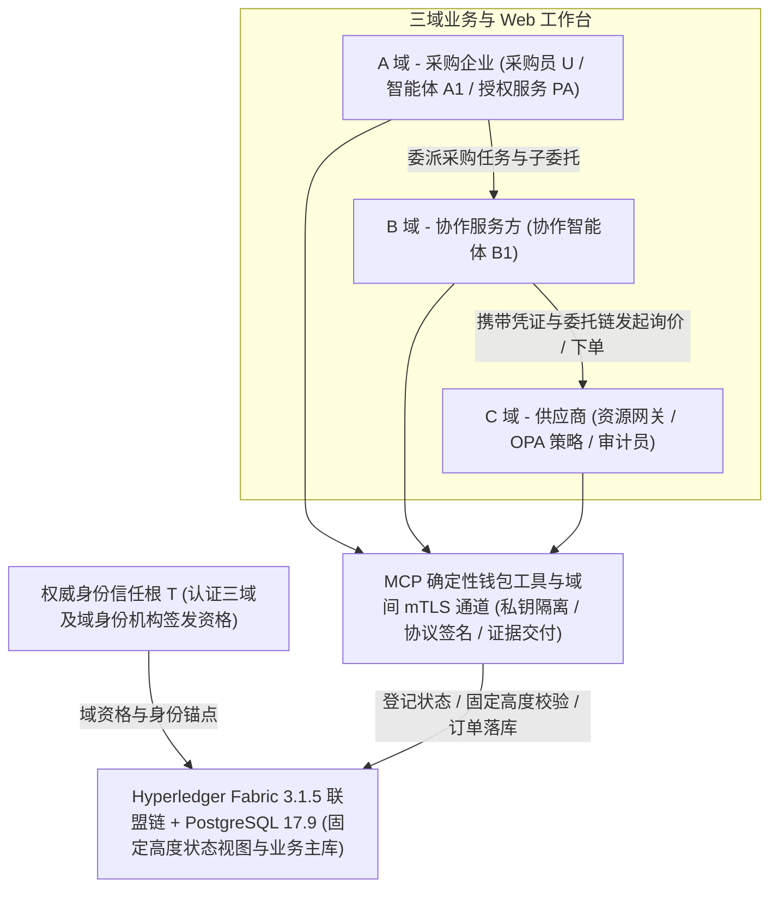

# 基于区块链的智能体跨域认证与委托授权方法研究

当企业把采购等业务交给跨组织的 AI 智能体代为执行时, 接收请求的供应商如何确认"智能体属于哪家企业, 由谁授权, 授权链上的任何环节是否已被撤销, 本次请求是否超额或重放"?

本项目针对上述问题, 实现了一套面向跨企业 AI 智能体协作的认证与委托授权原型系统及论文实验平台 (以"采购企业 A 委托协作服务方 B 的智能体向供应商 C 询价与下单"为业务场景):

- **链上登记与状态锚定**: 使用 Hyperledger Fabric 3.1.5 联盟链 (SmartBFT 排序 + Go 链码 `authregistry`) 登记权威信任根, 企业域签发资格, 身份密钥锚点与委托状态.
- **链下轻量化认证与原子鉴权**: 使用 `did:web`, W3C VC v2, SD-JWT 与请求绑定证明在链下传递证据; 供应商 C 网关结合 PostgreSQL 17.9 固定区块高度读视图与内嵌 OPA 策略完成防重放, 额度核对与订单落库.
- **智能体推理与密钥操作隔离**: 大语言模型 (LLM) 只负责任务理解与决策规划, 通过标准 MCP 协议调用确定性本地钱包工具; 私钥保管, 摘要签名与幂等意图锁完全封闭在工具层内.



阅读后续手册前, 可先记住四个核心代号:

| 代号 | 含义 | 职责 |
| --- | --- | --- |
| `T` | 权威身份信任根 | 三域共同认可的外部权威机构, 只认证 A/B/C 域及各域身份机构的签发资格, 不直接参与采购审批 |
| `A 域` | 采购企业 | 人类采购员 `U`, 采购智能体 `A1` 与本域采购授权服务 `PA` 所在域 |
| `B 域` | 协作服务方 | 跨企业协作智能体 `B1` 所在域, 接受 `A1` 转委托后代为向供应商询价与下单 |
| `C 域` | 供应商 | 提供商品目录, 报价与模拟订单服务, 独立做出最终准入决策并支持审计回溯 |

## 环境准备

按你的使用目标准备对应环境即可, 不必一开始就安装全部依赖:

| 使用目标 | 必需环境 | 说明 |
| --- | --- | --- |
| 运行 Go 离线单元测试与实验测试 | `mise` (自动安装 Go 1.27 与 Python 3.15) | 跨平台可用, 无需 Docker 或模型 API |
| 构建或测试 Web 前端 | mise 管理的 Node.js 22 和 npm | 从根目录运行 `web:*` 任务 |
| 运行 PostgreSQL 数据库集成测试 | Docker Engine | 自动通过 `testcontainers-go` 启动 `postgres:17-alpine`, 也可用 `TEST_POSTGRES_DSN` 连接已有库 |
| 启动 Fabric 联盟链与实机集成验收 | `arm64` macOS 或 Linux, Docker Engine 与 Compose, `curl`, `shasum`, `openssl` | Fabric 3.1.5 镜像按 OCI digest 锁定为 `linux/arm64` |
| 启动三域 Web 工作台或运行真实 LLM 实验 | 以上全部 + OpenAI 或 Anthropic 兼容模型 API | 仅 A/B 域智能体推理需要; C 域与确定性基线不需要 |

克隆仓库进入根目录后, 先安装项目锁定的基础工具链:

```bash
mise install
```

## 快速开始

从仓库根目录运行 `mise tasks` 查看所有带用途说明的任务. 日常开发, 三域演示和论文实验分别使用以下入口.

### 1. 本地构建与测试

```sh
mise run build
mise run test
```

构建产物为 `build/authregistry`, `build/ledgerctl`, `build/workbench`, `build/exp` 和 `web/dist/`. 离线测试覆盖 Go 项目三模块, 实验模块, 前端单测和演示编排. 安装前端依赖使用 `web:install`, 构建和测试会自动执行需要的安装步骤.

按需运行 `mise run web:check`, `mise run test:arch`, `mise run test:vet` 或 `mise run test:race -- grad/protocol/registry`. 浏览器回归 `web:test:browser` 需要 Chrome 或 Chromium, 可以用 `CHROME_BIN` 指定位置. 数据库集成使用 `test:db`, 需要 Docker 或测试数据库连接. 维护规范可运行 `mise run spec -- list --specs` 和 `mise run spec -- validate <变更名>`.

用 `mise run web:dev -- --port 5173` 调试前端. Vite 将 `/api/v1` 代理至 `VITE_API_PROXY_TARGET`, 默认值为 `http://127.0.0.1:8080`. 用 `mise run web:preview` 预览当前源码的生产构建.

### 2. 启动三域 Web 工作台 (完整交互体验)

首次把 A/B 模型配置和密钥分别放入 `.local/demo-config/{a,b}/` 的 `llm.env` 和 `model-api-key`. 在 arm64 主机启动 Docker 后运行以下命令. 文件格式见[工作台手册](infra/workbench/README.md#1-首次配置和启动).

```sh
mise run demo:up
mise run demo:status
mise run demo:logs -- b backend
```

在演示浏览器中信任输出指向的三张公共根证书. `mise run demo:down` 停机并保留现场. `mise run demo:clean` 关闭并删除演示数据. 夹具到期后, 完成旧记录复核即可清理并重新部署.

启动就绪后, 三个域的默认浏览器入口与预置账号如下 (各域口令文件由 `prepare` 生成在对应挂载目录下):

| 域 | 浏览器入口 | 预置账号 | 典型操作 |
| --- | --- | --- | --- |
| A 域 (采购企业) | `https://a.localhost:18441` | `admin`, `u` | `admin` 执行本域管理操作; `u` 与智能体 A1 对话发起采购, 确认委托并查看运行与委托树 |
| B 域 (协作服务方) | `https://b.localhost:18442` | `admin` | 执行本域管理操作, 查看协作任务派发与智能体 B1 的 MCP 工具调用轨迹 |
| C 域 (供应商) | `https://c.localhost:18443` | `admin`, `auditor` | `admin` 执行本域管理操作; `auditor` 按决定 ID 查询获准查看的授权决定与订单记录 |

推荐体验路线:

- 用 A 域的 `u` 登录并与智能体 A1 对话, 分别发起单笔上限 1000 元的采购任务: 商品 `P1` (800 元) 验证通过并唯一成单, 商品 `P2` (1200 元) 验证超额拒绝.
- 在运行页对照查看五类可视化证据视图: 身份与信任, 凭证披露, 委托树, 采购任务与决策时间线, 再用 C 域 `auditor` 按决定 ID 核查原决定.
- 在运行页暂停委托 `G1`, 观察后续请求被拒绝及恢复后的状态一致性.

完整可复制的准备, 构建, 启动, 就绪检查与停机恢复命令见 [三域 Web 工作台运行手册](infra/workbench/README.md).

### 3. 运行论文实验 (exp CLI)

`experiments/` 作为独立 Go 模块提供统一命令行 `exp`, 覆盖三组采购基线对照 (`C0`/`B0`/`B1`), E1/E6 正式运行与离线复算:

```bash
# 查看基线, 正式运行与离线复算参数
mise run experiment:baseline -- --help
mise run experiment:run -- --help
mise run experiment:analyze -- --help
```

运行需要真实大语言模型的实验前, 先按需编辑 [experiments/llm.env](experiments/llm.env) 中的 `LLM_PROVIDER`, `LLM_BASE_URL` 与 `LLM_MODEL`, 再在仓库根目录加载配置并导出密钥:

```bash
source experiments/llm.env
export LLM_API_KEY="<your-api-key>"
```

三组基线的完整运行命令见 [三组采购基线](experiments/baseline/README.md), E1-E8 全部研究问题, 方法与结果入口见 [论文实验索引](experiments/README.md).

### 单独操作 Fabric 联盟链与 ledgerctl

如果你只需要运行底层 Fabric 通道, 部署 `authregistry` 链码, 查验区块历史或跑全栈实机集成测试, 在 `arm64` 主机启动 Docker 后于根目录执行:

```bash
mise run fabric:config
mise run fabric:up
mise run ledger:deploy
mise run ledger:seed
mise run ledger:check
```

`ledger:check` 会输出当前已应用的区块高度与状态探针期限. 常用后续操作:

```bash
# 按十进制区块高度复查该块登记的授权与身份事实
mise run ledger:inspect -- --block <高度>

# 在隔离实例上运行完整 Fabric 实机集成验收 (会写入登记并启停节点)
FABRIC_INSTANCE="$PWD/.local/fabric-d0" mise run ledger:verify

# 停止容器并保留实例目录与数据卷 (后续可直接 mise run fabric:up 恢复)
mise run fabric:down
```

用 `mise tasks` 查看所有入口. `ledger:invoke` 提交登记操作, `ledger:operation` 按原键查询, `ledger:mcp` 通过标准输入输出提供钱包工具. 可用 `mise run ledger:mcp -- --help` 查看参数. 独立重建新实例, 部署断点续跑与管理服务装配说明见 [Fabric 网络与集成验收手册](infra/fabric/README.md).

## 仓库结构

本仓库使用 Go 1.27 四模块工作区 (`go.work`) 强制约束协议, 链码, 平台与实验之间的单向依赖, 并配套前端工作台, 基础设施脚本与论文目录:

| 路径 | 说明 |
| --- | --- |
| `protocol/` | Go 模块 `grad/protocol`: 协议编解码, P-256 密码学原语, DID/VC/SD-JWT, 委托链与证据包校验 |
| `chaincode/` | Go 模块 `grad/chaincode`: Hyperledger Fabric Go 链码 `authregistry` |
| `platform/` | Go 模块 `grad/platform`: 五层架构后端平台 (账本与数据库访问, 策略网关, 隔离钱包, REST/mTLS API, MCP 服务, LLM 智能体编排, 以及 `ledgerctl` / `workbench` 命令行入口) |
| `web/` | React 19 + TypeScript + Vite 浏览器工作台前端与同源 Caddy HTTPS 代理镜像 |
| `infra/` | Fabric 3.1.5 联盟链与三域工作台的 Docker Compose 配置, 镜像构建脚本与历史验收证据 |
| `experiments/` | Go 模块 `grad/experiments`: E1-E8 论文实验方法, 基线对照, 统一 `exp` CLI 与离线复算 |
| `docs/` | 系统设计文档 (`DESIGN.md`) 与实现契约 (`IMPLEMENTATION.md`) |
| `paper/` | 毕业论文 Markdown 单文件正文草稿与参考文献目录 |
| `openspec/` | 项目能力规范 (`specs/`) 与历史变更归档 (`changes/`) |

## 文档导航

**设计与契约**

- [系统设计文档](docs/DESIGN.md): 采购场景, 跨域身份与信任, 委托授权与策略, 请求认证与状态一致性, 威胁模型及 [R1-R5 需求追踪总表](docs/DESIGN.md#r1-r5-需求追踪总表).
- [系统实现契约](docs/IMPLEMENTATION.md): 五层架构与组件选型, 链上登记契约, 协议编码与测试向量, REST 接口与订单核账规格.
- [毕设要求](毕设要求.md): 任务书需求编号与项目边界.

**部署与运行手册**

- [三域 Web 工作台运行手册](infra/workbench/README.md): 准备 Fabric 实例, 构建前后端镜像, 启动 A/B/C 工作台, 浏览器演示与停机恢复.
- [Fabric 网络与集成验收手册](infra/fabric/README.md): 实例启停, 独立重建, `ledgerctl` 子命令, 实机故障回归与服务装配; 历史验收记录见 [Fabric 证据索引](infra/fabric/evidence/README.md).
- [论文实验索引](experiments/README.md): E1-E8 研究问题, 编号验证用例, 运行入口与离线复算.

**进度与论文**

- [项目实施与验收清单](TODO.md) 与 [实验进度](experiments/TODO.md): 各阶段完成状态与退出条件.
- [论文写作工作区](paper/README.md): [论文正文草稿](paper/thesis.md) 与 [参考文献表](paper/references.md).
