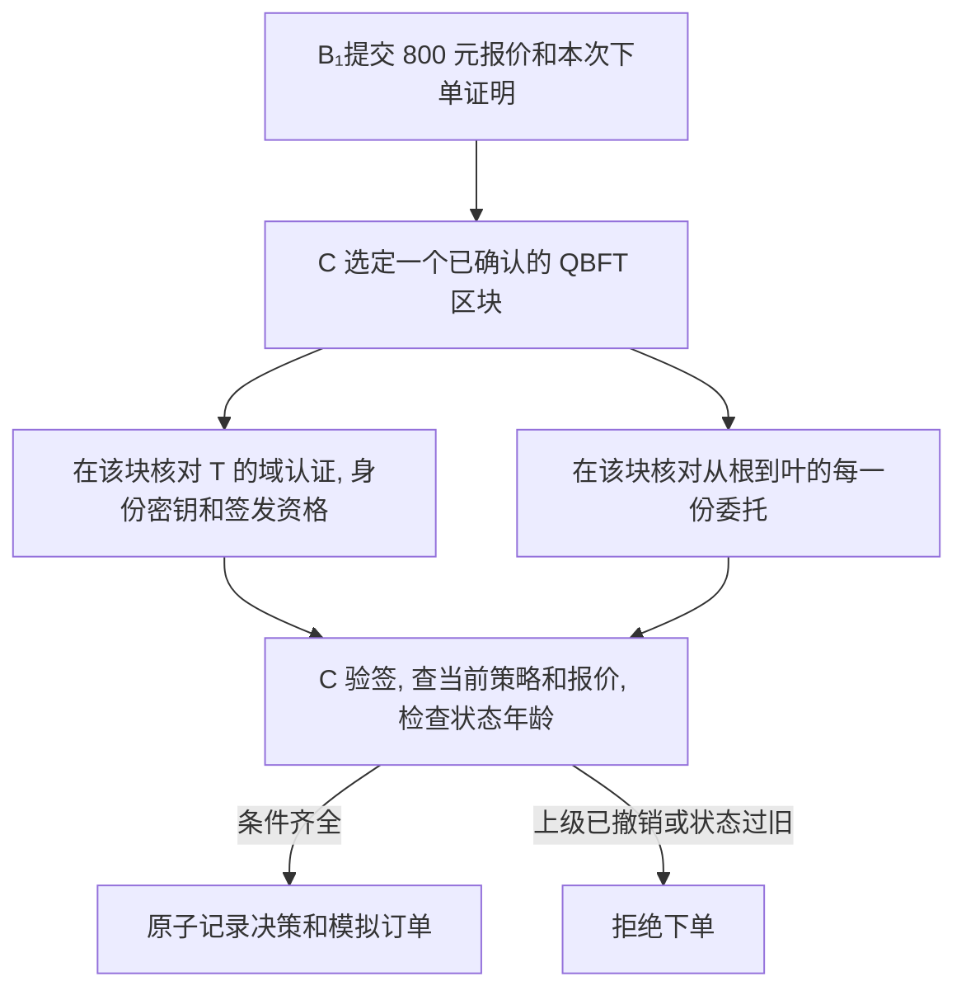

# 基于区块链的智能体跨域认证与委托授权方法研究

采购企业 A 把询价和下单委托给服务企业 B. 供应商 C 收到 B₁的订单时, 怎样确认它代表 A, 而且此刻仍有权下单?

身份采用三域共同认可的权威机构 T 作为唯一信任根. T 认证 A/B/C 域及 IA/IB/IC 的签发资格, 各域机构证明本域用户, 智能体和服务的身份. 采购委托由业务方签发, C 独立决定销售准入. 见[跨域身份与信任](docs/design/跨域身份与信任.md).

**当前处于设计阶段.** 账本采用 Besu 许可网络, QBFT 和 Solidity 登记合约. 认证与委托验证由 C 在链下执行. 第一项工程验证是让 C 在撤销前后的两个指定高度分别读到同一上级委托的两种状态.

| 想做什么 | 从这里开始 |
| --- | --- |
| 看懂一次采购为何获准或被拒 | [采购场景与总体设计](docs/design/采购场景与总体设计.md) |
| 查任务书要求与对应证据 | [毕设要求](毕设要求.md), [设计导航与需求追踪](docs/design/AGENTS.md) |
| 搭建网络, 编写验证器 | [技术栈](docs/implementation/技术栈.md), [实现导航](docs/implementation/AGENTS.md) |
| 测量撤销后还能下单多久 | [E6 撤销窗口](docs/experiments/实验计划.md#2-e6-撤销窗口), [实验导航](docs/experiments/AGENTS.md) |
| 按验收条件推进 | [任务安排](TODO.md) |
| 阅读论文或准备写作 | [文献清单](paper/论文.md), [全文与笔记索引](paper/README.md) |
