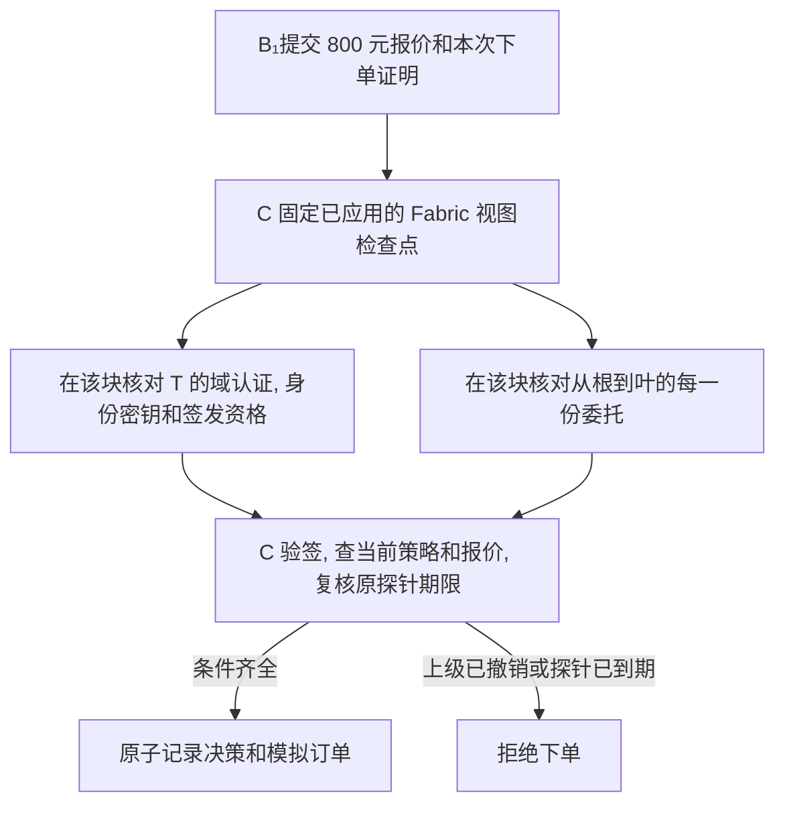

# 基于区块链的智能体跨域认证与委托授权方法研究

采购企业 A 把询价和下单委托给服务企业 B. 供应商 C 收到 B₁的订单时, 怎样确认它代表 A, 而且此刻仍有权下单?



身份采用三域共同认可的权威机构 T 作为唯一信任根. T 认证 A/B/C 域及 IA/IB/IC 的签发资格, 各域机构证明本域用户, 智能体和服务的身份. 采购委托由业务方签发, C 独立决定销售准入. 见[跨域身份与信任](docs/DESIGN.md#2-跨域身份与信任).

本仓库采用 Go 1.27 四模块工作区 (`go.work`), 提供两个入口. [毕设项目](#毕设项目)涵盖设计, 实现 (`protocol/`, `chaincode/`, `platform/`), 部署和回归. [论文实验](experiments/README.md) (`experiments/`) 按 E1-E8 组织研究问题, 方法, 运行和结果, 通过项目公开接口测量已固定的项目构建.

## 毕设项目

| 想做什么 | 从这里开始 |
| --- | --- |
| 看懂一次采购为何获准或被拒 | [采购场景与总体设计](docs/DESIGN.md#1-采购场景与总体设计) |
| 查任务书要求对应的设计与实现 | [毕设要求](毕设要求.md), [系统设计与需求追踪](docs/DESIGN.md#r1-r5-需求追踪总表) |
| 搭建网络, 编写验证器 | [技术栈与五层架构基线](docs/IMPLEMENTATION.md#1-技术栈与五层架构基线), [系统实现契约](docs/IMPLEMENTATION.md) |
| 了解四模块边界与源码布局 | [协议模块](protocol/AGENTS.md), [链码模块](chaincode/AGENTS.md), [平台模块](platform/AGENTS.md), [实验模块](experiments/AGENTS.md) |
| 复跑 Fabric 集成验收 | [网络与 ledgerctl](infra/fabric/README.md), [Fabric 证据](infra/fabric/evidence/README.md) |
| 启动 A/B/C 浏览器工作台 | [三域部署与演示](infra/workbench/README.md) |
| 查阶段状态, 任务和验证证据 | [任务安排与退出条件](TODO.md) |
| 撰写毕设论文或核对文献引用 | [论文写作工作区](paper/README.md), [论文正文草稿](paper/thesis.md), [参考文献表](paper/references.md) |

### 构建与测试

```bash
mise run ledger:build
mise run test:unit
mise run test:db
mise -C experiments run experiment:test
```

`test:unit` 运行 `protocol/`, `chaincode/`, `platform/` 全部离线单元测试. `test:db` 通过 `testcontainers-go` (或 `TEST_POSTGRES_DSN`) 运行 `platform/` 的 PostgreSQL 集成测试 (`//go:build db`). `experiment:test` 运行实验底座, 驱动与离线复算测试.

### 复跑 Fabric 集成回归

在 arm64 主机启动 Docker, 然后在项目根目录执行.

```bash
mise run fabric:config
mise run fabric:up
mise run ledger:deploy
mise run ledger:seed
mise run ledger:check
FABRIC_INSTANCE="$PWD/.local/fabric-d0" mise run ledger:verify
```

`ledger:check` 输出已应用的高度与原探针期限. 用 `mise run ledger:inspect -- --block <高度>` 复查该高度的登记事实. 停机保留卷, 独立重建使用新目录与新端口. [网络与复跑说明](infra/fabric/README.md).
