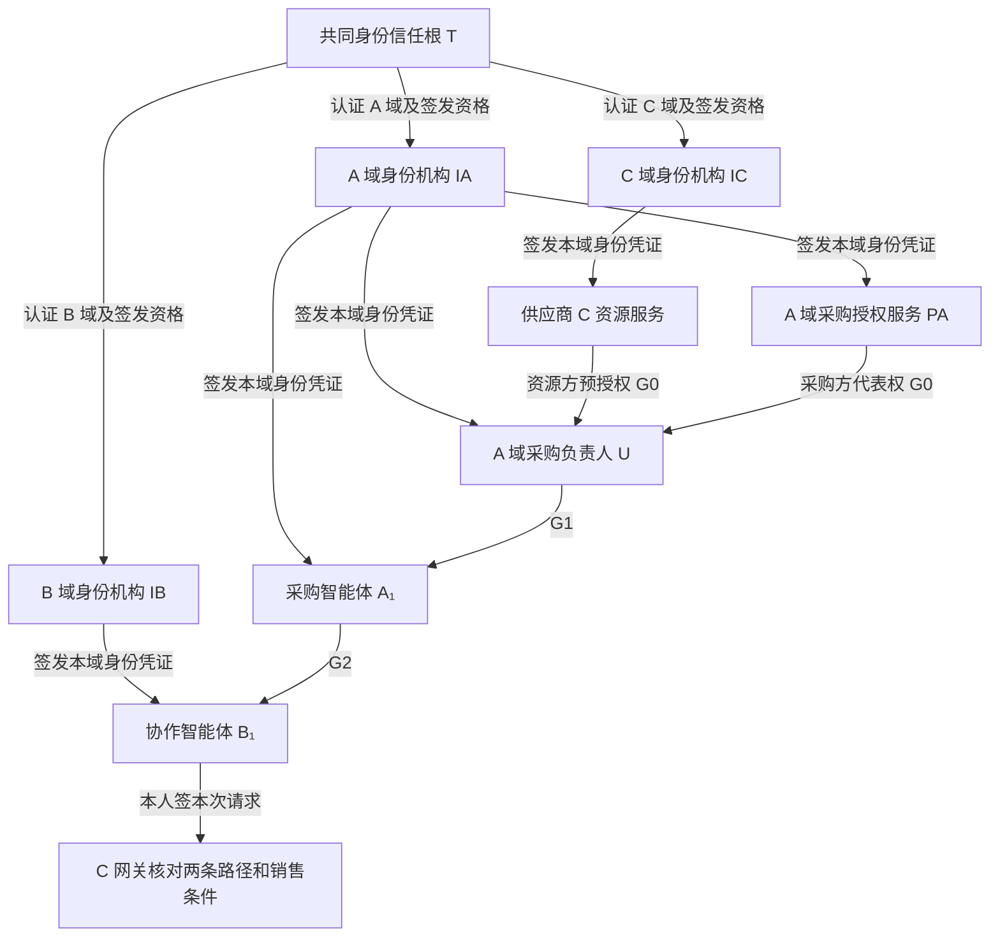
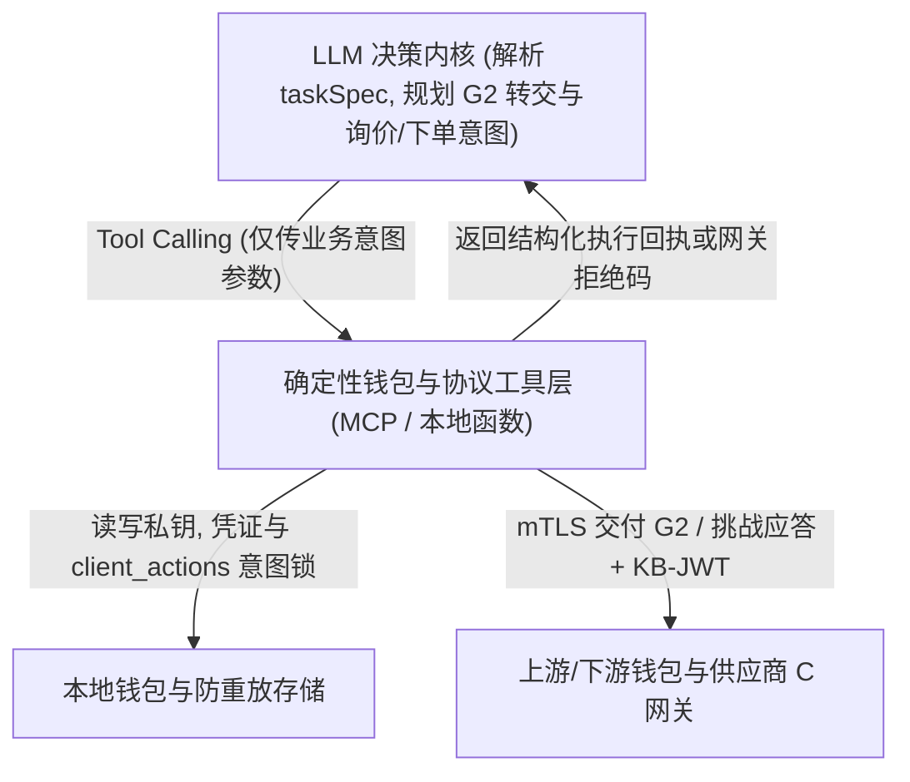
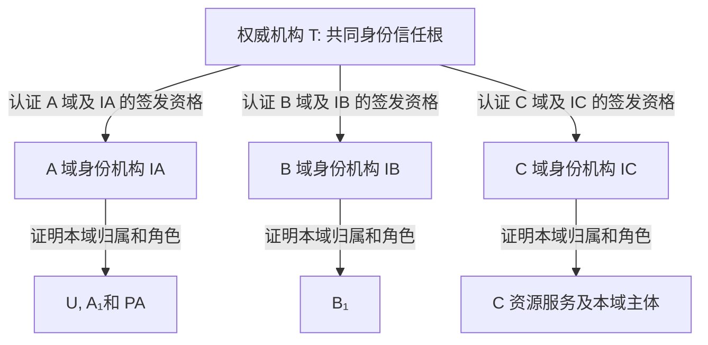
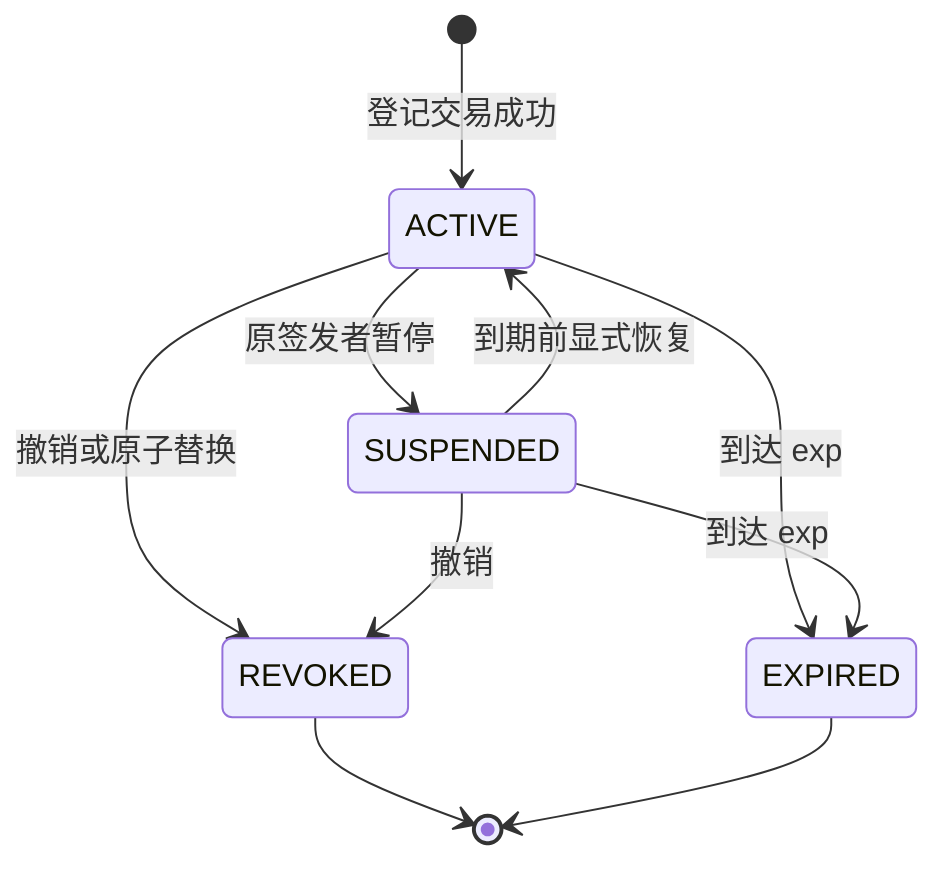
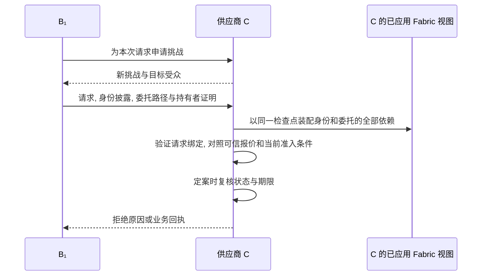
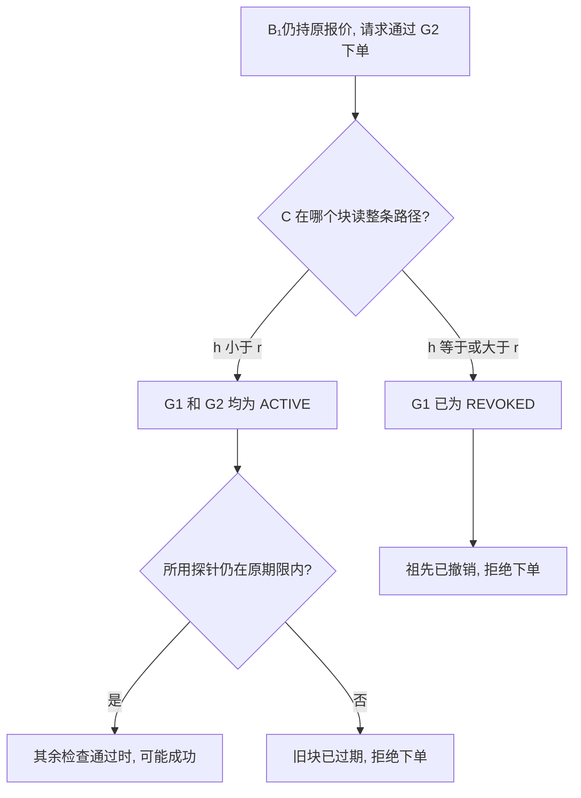

# 系统设计文档

本文整合采购场景与总体设计, 跨域身份与信任, 委托授权与策略, 请求认证与状态一致性以及威胁模型与安全目标. 实现契约, 编码向量与接口规格见 [IMPLEMENTATION.md](IMPLEMENTATION.md).

## R1-R5 需求追踪总表

| 需求 | 设计依据 | 实现规格 |
| --- | --- | --- |
| R1 跨域交互 | [1 采购场景与总体设计](#1-采购场景与总体设计) | [4 证据交付与网关执行](IMPLEMENTATION.md#4-证据交付与网关执行) |
| R2 / 任务 1 身份信任 | [2 跨域身份与信任](#2-跨域身份与信任) | [2.2 登记权限与交易结果](IMPLEMENTATION.md#22-登记权限与交易结果), [3.1 身份与委托字段](IMPLEMENTATION.md#31-身份与委托字段), [2.3 身份状态与管理账户恢复](IMPLEMENTATION.md#23-身份状态与管理账户恢复) |
| R3 / 任务 2 轻量认证 | [4 请求认证与状态一致性](#4-请求认证与状态一致性) | [3.2 证据包与摘要](IMPLEMENTATION.md#32-证据包与摘要), [4.2 固定高度的读取器](IMPLEMENTATION.md#42-固定高度的读取器) |
| R4 / 任务 3 动态委托 | [3 委托授权与策略](#3-委托授权与策略), [4.2 固定区块与新鲜度](#42-固定区块与新鲜度) | [4 证据交付与网关执行](IMPLEMENTATION.md#4-证据交付与网关执行), [5 策略输入与数据约束](IMPLEMENTATION.md#5-策略输入与数据约束) |
| R5 / 任务 4 原型 | [1 采购场景与总体设计](#1-采购场景与总体设计) | [2 部署与链上登记](IMPLEMENTATION.md#2-部署与链上登记), [4.3 C 如何提交订单](IMPLEMENTATION.md#43-c-如何提交订单) |
| R5 / 任务 5 验证 | [5 威胁模型与安全目标](#5-威胁模型与安全目标) | [5.2 数据库唯一性与审计字段](IMPLEMENTATION.md#52-数据库唯一性与审计字段) |

R1-R5 是本项目对[任务书要求](../毕设要求.md)的追踪编号. A1/B1/C1 等是[参考文献编号](../paper/references.md), SG1-SG6 是安全目标. 身份根唯一为 T, 两种根授权指采购 G0 权源, 各处须明确区分. T 只认证域及身份签发资格, 各域机构只证明本域主体身份.

## 1 采购场景与总体设计

**设计示例.** B₁已向供应商 C 询得一件 P1 的报价, 总价 800 元. 下单时, C 分别检查 B₁的企业身份, 采购权限和这一次下单的证明. 报价属于 B₁和当前任务, 在有效期内锁定价格. 已取得报价的主体仍须重新证明有权下单.

T 是三域之外的身份基础服务, 不增加第四个采购业务域. 身份信任根固定为 T; 下文两种根均指采购根授权 G0 的权源, 与身份信任根分开. 域内主体自己管理应用私钥, 各域发布 did:web 文档, T 认证域及机构资格.

示例中的两条 G0 箭头表示两种可选的任务起点. 每个任务只取其中一条. 签发条件见[3 委托授权与策略](#3-委托授权与策略).

| 授权 | 签发者与受托者 | 单笔上限 | 有效窗口 | 剩余转交次数 |
| --- | --- | --- | --- | --- |
| G0 | C 或 PA -> U | 5000 元 | 起点后 60 分钟 | 2 |
| G1 | U -> A₁ | 5000 元 | 起点后 45 分钟 | 1 |
| G2 | A₁ -> B₁ | 1000 元 | 起点后 30 分钟 | 0 |

任务只含询价和模拟下单. C 根据自己的商品目录生成报价. 当其他条件均有效时, 800 元订单通过, 1200 元订单超过 G2 上限. 本方案只研究单笔约束, 范围不含累计预算和真实支付.

链上合约登记身份与委托的摘要, 版本和状态. 原始凭证及签名授权由各域保管. C 网关在同一已确认区块核对两条路径, 再依据本次请求和业务主库中的报价定案. 身份证据见[2 跨域身份与信任](#2-跨域身份与信任), 选块和定案时点见[4 请求认证与状态一致性](#4-请求认证与状态一致性).

### 1.1 智能体决策层与确定性工具层分离

方案中的智能体主体 (`A₁`, `B₁`/`B₂`) 为接入真实大语言模型 (LLM) 的 AI Agent, 通过标准化接口 (OpenAI 兼容 Chat Completions / Tool Calling API) 与模型推理服务解耦通信; `T`, `IA/IB/IC`, `PA` 与供应商 `C` 网关保持为确定性服务, `U` 为下达采购任务并签发 `G1` 的人类采购负责人.

LLM 负责任务理解, 额度分派, 询价结果判断及异常改派/恢复决策, 不接触应用私钥, 不生成哈希或签名字节, 也不能绕过工具层直接修改凭证或幂等键. 私钥隔离, RFC 8785 JCS 摘要, 挑战绑定 (`KB-JWT`) 与发送前意图持久化均由底层确定性工具强制执行, 最终权限边界由委托链与 `C` 网关的确定性验证兜底.

## 2 跨域身份与信任

T 是 A/B/C 共同认可的外部权威机构和唯一身份信任根. T 核实企业域及其身份签发资格, 各域身份机构 IA/IB/IC 核实本域用户, 智能体和服务的身份. 三个业务域地位平等, 身份信任路径固定为 T 到域身份机构, 再到域内主体.

### 2.1 信任根与域资格

T 的 DID, 应用公钥及文档摘要, 管理账户在部署时通过受信渠道分发, 同时固定在部署清单和合约 RootRecord 中. T 的完整根 DID 文档随清单预置在各域本地, 以固定摘要和密钥用途核验, 访问时无需在线访问 T 的 DID 主机. 各域启动时逐项核对, 根的可信性不依赖 T 自签的声明或链上出现了某条记录. 同一部署内固定 T 的根密钥, 换根或根密钥恢复须重新部署并重发域认证材料.

T 为每个域签发一份 DomainAuthorityCredential, 将 domainId, 域 DID, 管理员, 注册机构及身份签发者 DID/密钥版本绑定到核实结果, 限定可签凭证类型, 属性名和有效期. 签发时凭证有效区间须包含于当前域认证的有效区间, 允许端点相等. IA/IB/IC 分别只可签本域 EnterpriseIdentityCredential 的 domain 和 role, 以及部署中明确配置的合成属性. 不允许跨域签发, 转授签发资格或域间相互背书. 域管理员不能自行增加 T 未认证的签发者或范围.

域 DID 表示企业域本身, 与 IA/IB/IC 的机构 DID 以及 C 资源服务 DID 分开. T 认证域和机构的控制权及资格, 不直接签发 U/A₁/B₁/PA 等普通主体的身份凭证. C 的资源服务也由 IC 签发本域身份凭证, 不能仅凭部署配置跳过域资格验证.

T 提供身份认证的权威来源, 区块链保存多方可核验的密钥锚, 域认证及凭证状态. T 不决定采购代表权或供应商准入, 也不需要参与每一次访问. 在域认证正文已交付, 资格尚有效且链上状态新鲜完整时, T 服务离线不影响验证; 无法续发或撤销属于管理可用性限制, 不能把失联解释为撤销.

### 2.2 域内身份与跨域验证

| 证据 | 谁提供 | 验证方可以据此相信什么 |
| --- | --- | --- |
| 域认证 | T 签发 DomainAuthorityCredential, 并登记认证摘要和状态 | 域已经核实, 指定的 IA/IB/IC 在有效期内有权证明本域指定属性 |
| 域内注册 | 主体向本域注册机构证明账号归属, 并以应用密钥和管理账户签署同一挑战 | 本域已核实账号, DID 和两把密钥的归属. 跨域只公开带盐的账号承诺, 原账号与盐留在域内 |
| 企业身份凭证 | IA 为 U/A₁/PA, IB 为 B₁, IC 为 C 资源服务及本域主体签发凭证 | 本域机构为主体的归属和角色作证, 声明范围受 T 认证约束 |
| 请求持有者证明 | 叶子主体用凭证绑定的当前认证密钥签署本次挑战与请求 | 本次请求由控制该密钥的主体发起, 凭证本身不能代替请求证明 |
| 跨域关联 | 两端各自证明本域账号和当前密钥, 两域注册机构在期限内批准同一提案 | 两个域共同认可账号对应关系. 关联不转移角色或采购权, 任一端换钥后须重新关联 |

C 验证 B₁时, 先以预置 T 根验 B 域认证, 核对其与当前 DomainRecord 的绑定, 再以获认证的 IB 密钥验 B₁凭证, 最后验 B₁的请求签名. 同样验证每个委托祖先的身份. A/B 接收 C 的根授权时验证 T 对 C 域及 IC 的认证, IC 对 C 服务的凭证, C 对 G0 的签名, 并核对 C 服务与任务资源所有者一致. 机构 DID 有效或登记成功, 均不能单独代替签发资格.

### 2.3 资格失效与密钥恢复

T 可停用企业域或撤销域认证. 在采用包含变更的已确认块后, 所有依赖该域或认证的身份路径均失效, 无需逐一撤销域内凭证和委托. 其他域身份仍有效, 但包含失效域主体的委托链必须拒绝. 域认证到期, 被替换或签发者密钥版本不匹配也使路径失效. 动态状态统一遵循[4.2 固定区块与新鲜度](#42-固定区块与新鲜度), 不承诺撤销提交瞬间全网生效.

域资格变更由 T 核实后以新认证 ID 原子替换当前认证. 新认证不自动改变原凭证和授权正文. 同一签发者和密钥下, 若本次出示的业务类型, 所有可见及实际披露声明仍在当前资格内, 且原凭证/委托仍有效, 更新认证材料即可重新验证. 签发时检查全部业务声明, 访问时不推断未披露摘要对应的属性名. 例如当前资格移除 department 后, 原凭证隐藏该属性的出示仍可验证 domain/role, 再披露 department 则拒绝整次出示. 必需属性不得隐藏来绕过检查. 若签发者换钥, 须重签相关凭证和引用它们的委托; 若本次必需声明或业务类型不再获准, 路径拒绝, 仅重签不能恢复已被移除的资格. 撤销的认证 ID 不可恢复, 到期不得靠改时间续用.

普通身份登记后的状态为 ACTIVE, 可暂停为 SUSPENDED, 撤销为不可恢复的 REVOKED. 本人当前管理账户或本域当前注册机构可暂停/撤销, 只有注册机构复核后可恢复暂停的身份, 本人不能绕过注册机构的暂停. 域 DID 和身份机构引导身份的状态管理及管理账户恢复仅由 T 执行. 域状态和身份状态独立, 恢复其中一项不自动恢复另一项.

普通主体换钥时须证明仍控制登记的管理账户并持有新应用密钥. 管理账户丢失由本域注册机构重新核实原域内账号, 验证新管理账户及新应用密钥的双证明后原子更换. 恢复保留主体 ID, 账号承诺及原身份状态, 增加应用密钥版本, 旧管理证书绑定及旧应用密钥不再有权发起新的身份管理操作或访问. 旧凭证, 关联和引用旧版本的委托须按各自规则重新办理, 不自动恢复. IA/IB/IC 换钥还须由 T 重新认证, 域管理员或注册机构变更也须经 T 更新域认证. C 按选定区块的登记摘要核对链下 DID 文档和密钥用途. 字段, 登记权限及恢复流程见[2 部署与链上登记](IMPLEMENTATION.md#2-部署与链上登记)和[3.1 身份与委托字段](IMPLEMENTATION.md#31-身份与委托字段).

Fabric MSP 认证管理客户端所属组织, 链码再以 MSPID 和该客户端证书 DER 指纹核对具体登记角色. 同 MSP 的其它证书没有该角色. T 的 TMsp 只提供客户端准入, 身份权威来自三域共同批准的根, 其证书既不能充当业务 Peer 背书, 也没有采购撤销权限. A/B/C 的背书验证本次链码执行及写集, 域内注册机构和身份签发者分别负责主体核实与属性签发. 两个域各自批准同一关联摘要才构成双域关联. 见[2 部署与链上登记](IMPLEMENTATION.md#2-部署与链上登记).

## 3 委托授权与策略

### 3.1 根授权的两种权源

每个任务只选一种 G0. **资源方预授权 (RP)** 由 C 签发, 表达使用指定采购接口的许可. **采购方委托 (BM)** 由 A 在登记表中指定的 PA 签发, 表达代表 A 采购的资格. 两种模式均先检查从 T 到域身份机构再到根签发服务的身份路径. C 的服务凭证由 IC 签发, PA 的服务凭证由 IA 签发; T 或身份机构取得认证资格并不自动获得 G0 签发权. C 检查 PA 的有效身份凭证和采购授权角色, 再决定是否接受 A, 商品与数量. A 域/U 的任务创建资格固定于受信部署清单和合约构造, 普通有效身份不自动取得该资格, 不开放运行期增授权入口. 两种模式都要求 G0 交给任务创建者 U, 并绑定相同任务, 模式, 采购主体和受众直至叶子. 模式不可降级或中途切换.

### 3.2 子授权与状态变化

只有父授权的受托者可以签发下一层, 父子两侧引用的身份凭证和密钥版本必须一致. 子签名绑定父授权的标识与摘要以及根授权的标识, 使另一条路径上的合法签名无法拼接进来. 路径无环, 根后最多 8 跳. C 要核对每一层的登记摘要和当前状态.

| 维度 | 子授权规则 |
| --- | --- |
| 资源, 动作, 供应商 | 有限非空子集, 禁止通配符 |
| 任务, 模式, 采购主体, 受众, 货币 | 逐跳相等 |
| 单笔上限 | 不大于父上限 |
| 时间, 深度 | 子区间落在父的 [nbf, exp) 内, 剩余次数非负且至少减 1 |

祖先一旦失效, 经过它的整条路径就失效, 无需枚举或改写后代. 暂停可在原到期时间前恢复, 签名内容和期限均不变. 撤销是终态. 改派时要原子地撤销旧授权并登记新授权, 引用被替换父对象的后代必须重签. 例如将 G2 改给 B₂后, B₂须凭自己的身份和新路径重新询价, 原报价仍属于 B₁. 撤销对哪一笔在途订单生效, 见[4.3 撤销后的决策窗口](#43-撤销后的决策窗口).

### 3.3 供应商的最终准入

委托路径给出权限上限. C 在该上限内, 根据任务状态, 已验证的身份属性和新鲜的环境观测决定是否接受本次采购. 两种根都受 C 的销售准入约束. 任务取消后须新建任务, 收紧的销售准入须通过更高策略版本才能放宽.

风险升为 ELEVATED 时只允许询价, BLOCKED 时拒绝所有访问. 可信观测器发布新鲜的 NORMAL 后, 仍按原授权和报价的剩余期限判断. 有效授权截止取任务, 域认证, 凭证, 各级授权以及适用的策略和环境绝对截止中的最早值. 身份证据失效及恢复的条件见[2 跨域身份与信任](#2-跨域身份与信任), 策略输入和截止字段见[5.1 OPA 输入与策略包](IMPLEMENTATION.md#51-opa-输入与策略包).

## 4 请求认证与状态一致性

询价和下单是两个独立决定. 即使沿用同一份凭证和同一条委托链, C 也要确认是谁发起了眼前的请求, 以及作出决定时哪些证据仍然有效.

### 4.1 链下凭证和请求绑定

B₁提供 T 签发的 B 域认证及 IB 签发的身份凭证. 域认证完整公开资格范围, 身份属性按需披露. B₁从签发者签名的凭证中只披露 C 所需的域和角色. C 可验证披露值属于这份凭证. 静态 DID 和委托路径仍可能把多次出示关联起来.

C 为每次动作发出一次性随机挑战. 叶子主体用当前认证密钥签名, 将挑战, 受众, 签发时间和本次业务请求绑定到同一份身份出示及有序委托证据. 因此, 拿到 B₁的凭证不能冒充 B₁, 询价时的签名也不能移用于下单. 证明持有者后, C 仅在形成终态决定时消费挑战. 询价和下单各自需要一次挑战与一次执行. 字段和签名字节见[3.2 证据包与摘要](IMPLEMENTATION.md#32-证据包与摘要).

挑战 nonce 由服务生成 32 字节随机数, 按[3.2.1 挑战 nonce 编码](IMPLEMENTATION.md#321-挑战-nonce-编码)作为规范无填充 base64url 字符串交付. 客户端原样写入 KB, C 按 challengeId 查到的原字符串核对, 不把不同文本表示归一化后视作同一挑战值. 格式错误或值不匹配均不消费挑战.

### 4.2 固定区块与新鲜度

C 自管的可信 Peer 完成区块提交校验并交付完整块. C 连续核对块号, 数据/父块哈希和交易校验码. 一个 PostgreSQL 事务应用该块内 VALID 的登记写集及历史, 再推进检查点. 一次在线读取在只读 REPEATABLE READ 中固定 h/hash, 从该快照装配根锚, 域资格, 身份和凭证锚, 任务, 委托祖先及策略. 必要依赖缺失, 检查点冲突或部署失配时停止装配. 历史复查按目标块末尾的事实独立返回.

每个在线实例在首次广播专用探针前记录本地单调发送时刻. 探针 VALID 且其完整块已在该视图应用后, 原期限 `sentMono + deltaState` 才可采用. 默认每 1 秒提交, 期限为 5 秒. 到期当刻或没有可用探针时拒绝. 重读, 重播和晚到的提交不会延长期限. 停链或断流期间, 已核对的完整视图最多用到原期限. 恢复时核对原检查点并按序补块, 进程重启后须采用本进程新发探针. 链下风险另按实际观测时间检查, 静态验签缓存仍依赖当次视图中的密钥, 域资格和动态状态.

C 先取得挑战, 业务键与当前环境的行锁, 再短时共享锁定视图检查点. 与初验的 h/hash 不同则释放锁并从新视图整次重验. 获得全部锁后取实际当前时间, 使用该环境副本及报价重新求值 OPA. 初验为 NORMAL, 获锁时已为 ELEVATED/BLOCKED 的订单须拒绝. 定案前重新核对探针原期限和业务期限, 记 decision_at. 检查点及环境副本保持到业务事务结束.

### 4.3 撤销后的决策窗口

设撤销 G1 的交易在 r 被可信 Peer 校验为 VALID, G2 自身的登记始终为 ACTIVE.

采用 h >= r 的网关在整次装配中看到失效祖先. 采用 h < r 时, 探针位于 h 或更早, 首次发送先于撤销排序和 Peer 的首次 VALID 观测. 在同一计时基准下, VALID 观测后的旧视图放行窗口至多为 deltaState. 跨机比较另记录可测时钟误差. 撤销提交到 VALID 观测是独立阶段. 已定案的业务事务可能在撤销观测后才回响应, 按 decision_at 和所用高度及探针期限判断定案时的状态. 详见[4.2 固定高度的读取器](IMPLEMENTATION.md#42-固定高度的读取器).

## 5 威胁模型与安全目标

攻击者可以控制普通智能体及其合法密钥, 拼接路径, 重放, 延迟请求或造成节点失联. 对于接入真实 LLM 的智能体 (`A₁`, `B₁`/`B₂`), 模型幻觉, 目标漂移或提示词注入诱导的越权参数, 重复下单或异常调用, 在威胁模型中等同于受控或失常智能体发起越界/重放请求. T 错误认证或根密钥泄露, 获准域身份机构谎报本域属性, 私钥主动共享, 恶意 C 绕过网关和超阈值串谋超出本方案的保证范围.

| 依赖的前提 | 在此前提下检验的性质 |
| --- | --- |
| T 正确核实 A/B/C 及其签发资格, 各方安全预置同一 T 根, 域注册机构及 IA/IB/IC 核实本域身份, 签发时检查全部声明, 验证方检查当前业务类型及全部可见/披露声明的资格 | SG1 拒绝伪造身份及越界使用的身份声明, 不声称识别未披露摘要对应的属性名 |
| 签名不可伪造, 哈希抗碰撞, 私钥与挑战随机源受保护, C 验证请求绑定及完整委托路径的逐跳约束 | SG2 凭证持有者绑定本次请求. SG3 子权限不超过祖先 |
| C 管理可信 Fabric Peer, SmartBFT 满足排序阈值, Peer 正确提交校验, 链码约束写权限 | SG4 在包含有效撤销的块上, 下游不能凭旧路径继续执行 |
| 出块和验证端时钟有界, C 执行端不能绕过网关 | SG5 状态或环境过旧时停止新放行 |
| C 的事务主库和受控观测器可信, 锁后按当前环境副本重新求值 | SG6 从订单还原实际采用的区块, 证据链, 策略和环境版本 |

T 的身份权威与 Fabric 的账本一致性是独立前提. T 的域核实由三域信任, 账本记录经提交校验的状态. C 核对块连续性及数据哈希, 交易校验码仍来自可信 Peer. 进程的单调探针期限约束可用视图, 业务期限用可信实际时钟, 跨机时序须计入校时误差. 一域资格撤销使依赖它的路径失败, 其他域独立路径仍可用; T 根泄露后的应急恢复须通过新部署完成. LLM 推理层不直接接触私钥与原始签名过程, 本地确定性工具层的意图锁防止并发/超时重复下单, 任何越界金额, 错误主体或过期路径均由 `C` 网关按 `SG1`-`SG6` 确定性拦截.

文献 A1 支撑身份信任边界, B2 支撑持有者与会话绑定的比较, B3 支撑撤销成本的评价维度, C1/C2 分别用于策略与受限委托的比较. 文献来源见[参考文献表](../paper/references.md). 验证节点的控制权假设见[1.1 网络与治理](IMPLEMENTATION.md#11-网络与治理).
