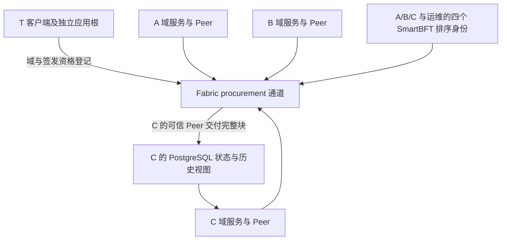
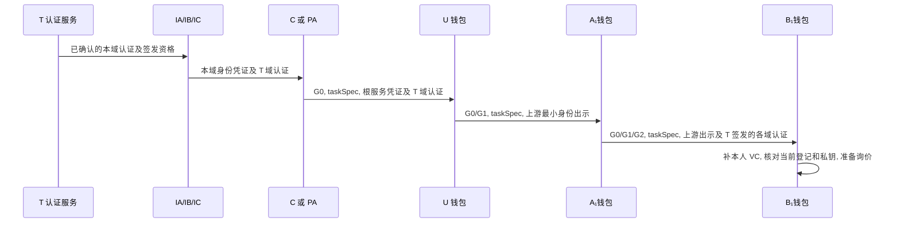
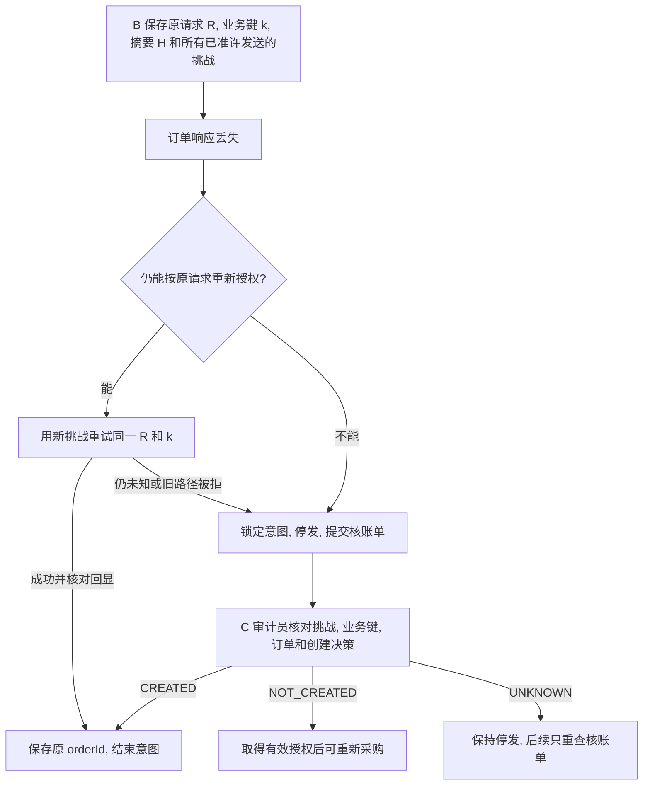

# 系统实现契约

本文整合技术栈与五层架构基线, 部署与链上登记, 协议编码与测试向量, 证据交付与网关执行, 策略输入与数据约束, REST 接口与响应码以及订单核账. 总体设计, 信任前提与安全目标见 [DESIGN.md](DESIGN.md).

## 1 技术栈与五层架构基线

C 在同一份授权视图中核对主体密钥, 祖先授权和任务. Fabric 的提交校验码决定登记写集是否有效, C 从自己的可信 Peer 接收完整块并原子生成视图, 将一次访问所需的所有依赖固定到同一高度. [Fabric 区块交付](https://hyperledger-fabric.readthedocs.io/en/latest/peer_event_services.html).

### 1.1 网络与治理

| 决定 | 配置和职责 |
| --- | --- |
| 业务域 | 采购 A, 协作 B, 供应 C 各有一个 Peer 和独立业务 MSP. PA 属于 A, C 独立决定接受订单 |
| 身份权威 | 三域共同预置 T 根. T 认证域及 IA/IB/IC 的签发资格, 用 TMsp 客户端提交提案和读结果 |
| 排序 | procurement 通道有四个 SmartBFT 排序身份, 由 A/B/C 及独立运维方分别控制. 区块签名策略要求其中三个 |
| 登记 | 日常登记使用任意两个业务组织的 Peer 背书. 三域共同批准链码定义和初始根, 关键应用通道配置由三域管理员共同治理 |
| 准入 | 节点和客户端各有 MSP 证书, 节点 TLS 材料分离. 链码以 MSPID 和客户端证书 DER 的 SHA-256 核对对象写权限 |
| 时间 | 各 Peer 开启 TimeWindowCheck, 最大提案偏差 w=2 秒. 校时误差假设为 epsilon<=1 秒, 受理资格按 3 秒裕度检验 |
| 读取 | C 使用自行管理的可信 Peer, 保留可重放的完整区块. C 的 PostgreSQL 同事务保存版本和检查点 |
| 新鲜度 | 每在线实例用专用客户端发送探针. 默认间隔 1 秒, 原发送后 5 秒到期, 仅可采用本进程发出且已应用的有效探针 |

四节点 SmartBFT 在协议假设成立时容忍一个拜占庭排序节点. 同机 Compose 部署中, 所有容器和密钥仍由同一宿主及运维控制, 容器停机与恢复只验证节点级故障. 机构级容错需要独立管理和故障域. 提案时间窗口与探针期限分别约束管理受理和在线视图. 记录时钟偏差和原始时间样本. [SmartBFT 配置](https://hyperledger-fabric.readthedocs.io/en/latest/bft_configuration.html).

### 1.2 四模块工作区, 五层架构与组件选型

仓库采用 Go 1.27 四模块工作区 (`go.work`), 在编译期强制协议, 链码, 平台与实验之间的单向依赖边界:

| Go 模块 | 目录 | 职责与边界 |
| --- | --- | --- |
| `grad/protocol` | `protocol/` | 规范化编解码 (`encoding/json/jsontext`), P-256/ES256 (`crypto/ecdsa`, `go-jose/v4`), DID/VC/SD-JWT/委托/证据包与固定高度校验; 子包 `grad/protocol/registry` 保持零第三方依赖 |
| `grad/chaincode` | `chaincode/` | Fabric Go 链码 `authregistry`, 仅依赖 `grad/protocol/registry` 与 `fabric-chaincode-go/v2` |
| `grad/platform` | `platform/` | 按五层架构组织: L2 数据访问与迁移 (`core/dao`, `core/dao/central`), 账本状态源 (`core/ledger`) 与无 HTTP 耦合领域逻辑 (`core/domain/{policy,registry,gateway,wallet,procurement,evidence}`), L3 入站服务 (`service/api/{gateway,registry,workbench,interdomain}`, `service/mcp`), L4 智能体 (`agent/{llm,orchestrator}`), 顶层装配 (`bootstrap`) 与 L5 进程入口 (`cmd/ledgerctl`, `cmd/workbench`), 并由 `arch_test.go` 强制校验分层边界 |
| `grad/experiments` | `experiments/` | 论文实验底座 (`harness`), 统一 `exp` CLI (`cmd/exp`), 基线与各编号实验驱动, 仅依赖 `grad/protocol` 与 `grad/platform` 公开 API |

平台运行时遵循五层单向依赖架构原则 (L5 -> L4 -> L3 -> L2 -> L1, 并行共享纯协议核 `grad/protocol`):

- **L1 基础设施层**: Hyperledger Fabric 通道网络 (Peer, SmartBFT Orderer, CCaaS `authregistry`) 与 PostgreSQL 17.9.
- **L2 逻辑封装层**: 账本与状态读取封装, PostgreSQL 持久化与事务访问, 以及无 HTTP 耦合的领域逻辑 (策略, 登记, 网关执行与核账, 隔离钱包, 采购编排状态与证据投影).
- **L3 服务接口层**: 入站 REST/mTLS HTTP API 服务与标准 MCP 工具服务, 只负责协议编解码, 认证鉴权并调用 L2 领域逻辑.
- **L4 Agent 推理层**: LLM 客户端与任务编排智能体, 严格通过标准 MCP 协议调用 L3 工具, 不直接访问私钥, 数据库或 Fabric 网关.
- **L5 应用层**: A/B/C 共用浏览器工作台前端 (`web/`) 与命令行/进程入口 (`workbench`, `ledgerctl`).

各层核心组件与选型如下:

| 组件 | 选择 | 用途 |
| --- | --- | --- |
| 账本和链码 | Fabric 3.1.5, SmartBFT, Go 链码 `authregistry`, Peer LevelDB | 登记结构字段, 摘要, 状态和版本, 原子替换 |
| 管理交易 | `fabric-gateway`, `fabric-protos-go-apiv2` | 持久化原签名提案与交易, 查可信 Peer 的提交校验码, 恢复原 txID |
| 读视图与存储 | 可信 Peer 的 Deliver, PostgreSQL 17.9, `pgx/v5`, `goose/v3` | 应用有效写集, 保留同块多次更新历史, 装配固定高度依赖; 嵌入式 SQL 迁移与事务锁重检 |
| 域服务与接口 | Go `net/http`, 域间 mTLS, `cobra` | T 与 A/B/C 独立服务及管理/核账通道, 按客户端证书绑定角色; `ledgerctl` 与 `exp` 统一命令行入口 |
| 应用身份与编码 | did:web, VC v2, SD-JWT, ES256/P-256 (`crypto/ecdsa`), `go-jose/v4`, `encoding/json/jsontext`, JCS | 验证原始签名字节, 严格 I-JSON 与 RFC 8785 规范 JSON 摘要, T 签域认证, IA/IB/IC 签本域 VC, 业务方签委托和请求挑战 |
| 策略与订单 | 内嵌 OPA/Rego v1 (`opa`) 和 PostgreSQL | C 在锁后用当前环境求值, 事务消费挑战并记录报价或订单 |
| 智能体运行时 | `modelcontextprotocol/go-sdk` + `openai-go` / `anthropic-sdk-go` | A₁/B₁/B₂ 通过 `ledgerctl mcp` 暴露的 MCP 工具 (`inspect_wallet`, `delegate_grant`, `replace_grant`, `request_quote`, `create_order`, `reconcile_order`) 接入可配置 LLM API (`LLM_PROVIDER`, `LLM_BASE_URL`, `LLM_API_KEY`, `LLM_MODEL`), 与模型部署, 私钥及协议签名解耦 |
| 浏览器工作台 | 原生 JavaScript 模块, Caddy HTTPS 代理, Go `net/http`, OpenAPI | A/B/C 使用共用前端镜像和独立后端镜像, 以 `/api/v1` 连接本域会话, 管理交易, 采购运行及证据视图. 各域持久化自己的账号和运行记录, A1/B1 的 MCP 工具按任务与执行阶段授权 |
| 测试与实验测量 | Docker Compose, `mise`, `testify`, `testcontainers-go/modules/postgres`, `renameio/v2`, `csvutil` | 三层测试 (`test:unit`, `test:db`, `ledger:verify`) 及实验原子落盘与表格导出 |

三域在部署时固定 T 的根 DID, 应用公钥, 文档摘要和管理证书绑定. T 的 DID 文档预置在本地, 访问端用固定摘要验证. 根变更需要新部署. 域身份机构换钥须 T 重新认证. 节点签名, TLS, 管理客户端及 DID 应用密钥分别生成和保管. DID 主机限已登记域名及受信 CA, 文档摘要和公钥转换见[3.1.4 DID文档, 公钥与凭证上下文编码](#314-did文档-公钥与凭证上下文编码). LLM 通过兼容 API 提供智能体推理. `T`, `IA/IB/IC`, `PA` 与 `C` 网关保持为确定性服务. 人类采购负责人可在浏览器工作台以 `U` 确认任务草稿并派发运行. 见[6.4 浏览器工作台接口](#64-浏览器工作台接口).

### 1.3 部署冻结条件

记录创世块和公开 MSP, 四排序身份及控制方, 通道和链码策略, 已提交定义及 sequence, 各组织安装 package ID, 构建和清单摘要, 实例标识, 容器资源及历史保留范围. 一次接受需要原交易的 VALID 校验码和块内位置. 在新实例使用新部署标识, 重新绑定签名向量和夹具. 记录本次部署使用的时钟误差界, 网络控制方和读取期限. 详见[2 部署与链上登记](#2-部署与链上登记).

### 1.4 账本配置与构建约束

| 项目 | arm64 配置 |
| --- | --- |
| Peer 3.1.5 | OCI 索引 digest `sha256:e07c735b6f2d131315f3ae6e582c5aa602143d9d14805bb98be8ebc9d6baa82c` |
| Orderer 3.1.5 | OCI 索引 digest `sha256:dcb4c042237993a6f537b2f54e701e749f8e108f25c0cbe0c6742c205fccc3d5` |
| 链码 baseos 3.1.5 | OCI 索引 digest `sha256:48f66ba5da1dac8276138c80bf09d17fa68c6b729ea3bd2fc182b1898cc3f0c5`, 每 Peer 一份 TLS 链码服务 |
| PostgreSQL 17.9 Alpine | OCI 索引 digest `sha256:c7526c0f6c3f30260a563d7bcf8ad778effac59a44f8ffa86678c35418338609` |
| 资源上限 | 每个 Peer, Orderer 和数据库 1 CPU/512 MiB, 每个链码服务 0.5 CPU/192 MiB |
| Go 与依赖 | Go 1.27 (`mise.toml` 锁定), `CGO_ENABLED=0`, `linux/arm64` 链码构建使用 `-trimpath`. 核心依赖: `go-jose/v4 v4.1.9`, `fabric-chaincode-go/v2 v2.3.0`, `fabric-gateway v1.13.0`, `fabric-protos-go-apiv2 v0.3.7`, `pgx/v5 v5.12.0`, `goose/v3 v3.30.1`, `opa v1.4.0`, `cobra v1.10.2`, `modelcontextprotocol/go-sdk v1.8.0`, `openai-go v1.12.0`, `anthropic-sdk-go v1.84.0`, `testify v1.12.1`, `testcontainers-go/modules/postgres v0.45.0`, `testcontainers-go v0.45.1-0.20261109125418-f31e98d4ee9b`, `renameio/v2 v2.0.2`, `csvutil v1.10.1`, 传递依赖由各模块 `go.mod`/`go.sum` 与根 `go.work.sum` 固定 |
| 链码定义 | `authregistry` 版本 1.0, sequence 1, 固定批准清单摘要和初始化证书. 锁定两组织背书及三域生命周期治理 |
| 排序与视图 | SmartBFT 请求批等待 200 ms. 提交延迟和探针确认间隔以实测为准, Peer 和 C 的视图保留通道完整历史 |

## 2 部署与链上登记

### 2.1 部署与引导



1. A/B/C 分别运行一个 Peer 并加入同一业务通道. MSP 限制通道准入, TLS 保护连接. A/B/C 及独立运维方分别控制四个排序身份, 区块签名取三者. 日常链码背书取 A/B/C 任意两个 Peer, 链码生命周期及关键应用通道政策由三域共同批准. T 以独立 TMsp 客户端提交及查询, 业务域仍是 A/B/C 三个. 后续业务服务端口为 8101/8102/8103, 第二个 C 网关为 8104, T 为 8100. 见[1 技术栈与五层架构基线](#1-技术栈与五层架构基线).
2. 三域核对同一公开引导清单. 清单固定通道, T 的 RootRecord, 初始化客户端, A 域/U 的任务创建资格, C 的资源绑定和 instanceId. 仓库采用四模块 Go 工作区 (`protocol/`, `chaincode/`, `platform/`, `experiments/`), 链码从独立模块 `chaincode/` 编译并通过 CCaaS 打包, 源码摘要仅覆盖 `chaincode/go.mod`, `chaincode/go.sum`, `chaincode/registry/*.go` 与 `protocol/registry/*.go` (不含测试文件). 各组织安装的链码包由 `platform/core/ledger` 与 `platform/cmd/ledgerctl` 绑定清单摘要, 初始化证书和链码构建摘要. 初始化入口核对调用者和完整摘要, 读取未占用的根键, 原子写入根, 实例参数和任务创建资格. 根 DID 文档随信任材料分发并核对摘要, 固定根变更需要新部署.
3. 实例标识为随机 32 字节的无前缀小写 hex. deploymentId 绑定 channelId, 创世块头哈希, 链码名, instanceId 和 schemaVersion. 通道已提交定义提供版本, sequence 和策略. 各组织安装 package ID 另随构建和清单摘要锁定. 启动核对信任材料, 实际通道与配置, 链码定义, 根和任务资格, 再续读原检查点. 通道配置或链码定义出现未批准的变更时停止在线检查. 见[3.4 部署绑定与管理证明](#34-部署绑定与管理证明).
4. T 核实企业域身份及域 DID, 管理员, 注册机构和 IA/IB/IC 的控制权. 挑战绑定部署, 域, DID, 管理证书绑定, 申请范围和期限, 应用密钥版本与文档摘要, 一次性 nonce 和会话. 域及身份机构各证明应用密钥和管理证书私钥控制权, 管理员和注册机构各证明自己的管理证书私钥. T 消费挑战, 以 T 管理证书提交引导交易, 域初态 PENDING, 只登记域与其身份机构.
5. 首份认证引用已经 CONFIRMED 的引导操作, 并匹配批准的域, 机构, 范围及期限. T 用根应用密钥签 DomainAuthorityCredential, 用根管理证书登记结构字段和摘要. 首份认证将域置为 ACTIVE 并设置当前认证指针. 后续业务认证续发或变更须重新核实双证明, 原子替换认证和指针, 保留 ACTIVE/SUSPENDED, REVOKED 为终态. 原正文先持久化, 原交易 VALID 后复核当前资格和实际期限, 然后投递. 收件人核对签名, 摘要和当前指针并按原 ID 保存.
6. 本域注册机构核对普通主体会话及域内账号承诺. 注册挑战绑定 deploymentId, 域, DID, 管理证书绑定, 应用公钥/版本, 文档摘要和截止时间. 应用密钥作 ES256 JWS, 管理证书私钥签同一挑战的规范字节. 机构核对两份证明后原子消费挑战并受理登记. 签发机构凭当前 T 认证登记本域凭证锚, 链码核对主体归属, 密钥版本和批准范围.
7. C 的服务 DID 持 IC 签发的 supplier-service 凭证. 后续由本域管理员登记 PA 的 purchasingAuthority, C 发布引用固定 T 根的策略包. 服务 DID 及当前域认证通过受控渠道交付 A/B, 按已核验身份和配置核对 HTTPS 端点. 风险环境由 C 的独立观测源写入主库.

### 2.2 登记权限与交易结果

Fabric 为每次调用验证客户端签名. 链码从该 X.509 客户端证书计算 (MSPID, SHA-256(DER)), 用当前登记绑定确定角色. 业务键按类型及 SHA-256(UTF-8(ID)) 定位, 写入绑定 deploymentId. 逐键读取调用者绑定, 域与当前认证指针, 凭证锚, 任务, 目标授权和祖先. 唯一 ID 或证书绑定在写入前读取, 使并发创建进入 MVCC 校验. expectedRevision 和预期摘要约束业务版本, 保留终态及原摘要.

| 写入 | 调用者与条件 |
| --- | --- |
| 初始化根及资格 | 仅清单指定的客户端, 清单摘要匹配且根键不存在 |
| 域/机构引导与首份认证 | 仅 T, 域从 PENDING 到 ACTIVE, 机构版本及有限范围与域匹配. T 可以按预期 revision 暂停域或恢复仍具资格的域 |
| 普通身份 | 本域当前注册机构, subjectId 和管理证书绑定唯一, 初始版本为 1 |
| 凭证锚 | 本域当前具资格的签发者, 核对凭证类型, 声明名, 主体归属和双方密钥版本. 签发区间满足 `cert.nbf <= credential.nbf` 及 `credential.exp <= cert.exp` |
| U 任务与 RP G0 | 受信清单固定 A 域/U 的任务创建资格. U 须具当前身份和凭证, C 以该资源所有者身份签发给任务创建者 |
| RP 子授权 | 父 grantee 调用, 核对父 ID/摘要, 根, 任务, 模式, 双方凭证/密钥, 期限和剩余深度 |
| 撤销或替换 | issuer, grantee, 根 issuer 或资源方可撤销, REVOKED 为终态, T 没有采购撤销权. 仅原 issuer 可撤旧并建新 ID, 保持父, 根权源, 任务与模式 |
| 探针 | 每实例专用证书, 写入该证书的专用键, 写集与登记键分开 |

完整业务生命周期延续相同角色边界. 域认证的续发, 替换及撤销由 T 控制, 域管理员不能独立改变被认证的角色和范围. 普通身份状态和恢复按第 2.3 节办理, 双域关联由两端注册机构审批同一摘要. BM 根限 A 域当前获准的 PA, grantee 为任务创建者. 策略发布由 C 策略管理员签名, 采用递增版本和摘要, 内容寻址签名包先保存并预编译. 采购方和资源方的授权各遵循自己的权源.

有资格要求的管理操作按提案时间 t 检查 `t - (w + epsilon) >= nbf` 且 `t + (w + epsilon) < exp`. 三个 Peer 启用同一时间窗口 w, 校时误差界为 epsilon. 子区间还须结构上包含于上级批准区间内. 已背书交易可以晚于业务期限通过提交校验, 交付和业务定案仍以可信实际时钟重验全部期限与当前资格. 有权调用者可撤销已经到期的记录.

账本登记可共享的结构字段, 原文摘要, 状态和版本. 提案参数, 公开写集及事件同样遵守该披露边界, 链码错误码统一输出规范码字符串 (不带 `D0:` 历史前缀). 凭证正文, 披露盐, 签名委托, 策略正文和报价留在受控链下存储. 服务端核对原签名和正文, C 核验逐维包含及金额约束. `platform/bootstrap` 负责生成可验证的协议夹具并执行种子登记与受控交付同步 (`fixtures.json` 统一使用 `procurementTaskSpec`, 移除历史 `synthetic` 与 `m2TaskSpec` 字段, C 服务凭证键统一为 `"C"`, 资源 URI 严格使用规范前缀), 私钥隔离存储在 `<instance>/private/`, 公开目录仅包含证书, DID 文档与可验证签名材料.

#### 2.2.1 提交确认与恢复

新操作按操作键协调并发. 持久化部署, 调用者, 输入摘要, 原签名提案和 txID 后背书, 首次广播前持久化完整已签交易. T 的挑战消费, 核实记录, 原签名材料和待办操作须在同一本地事务提交. 同键同输入查询原操作, 同键异输入为冲突. 原广播后按原 txID 查询可信 Peer, 需要时重投原已签字节.

初始化已有效提交而部署清单缺失时, 续跑以原批准包及原签名交易为依据. 核对可信 C Peer 的原区块, 校验码及已登记的根后写出清单. 重复初始化的拒绝在验收中检查.

| 原始证据 | 结果 |
| --- | --- |
| 原提案确定性拒绝 | FAILED, 阶段 ENDORSE. 有可核对的原响应时映射具体原因, 其余确定性拒绝为 ENDORSEMENT_REJECTED |
| 广播接收, 超时或 Peer 尚未看到原结果 | PENDING. 保存实际阶段和故障信息 |
| 原交易为 VALID | 核对原签名交易, txID, 通道, 调用者, 链码, 块号/哈希和交易位置后 CONFIRMED |
| 原交易入块无效 | FAILED, 阶段 COMMIT. MVCC_READ_CONFLICT 为 STATE_CHANGED, 其它无法细分的结果为 COMMIT_INVALID |
| 原交易重播 | 记录排序入口拦截或 Peer 的 DUPLICATE_TXID. 只归并与原已签字节相符的最初结果, 无法核对时保持待查 |

新请求在受理前发现版本冲突返回 409 STATE_CHANGED. 已受理请求返回 202 和原 operationId. 查询为 200, 并返回原操作的 PENDING, CONFIRMED 或 FAILED. 原因以原提案响应或原区块校验码为准, 事后模拟没有取证效力. 只有确认 VALID 且交付时资格及期限仍有效才开放材料. 见[6.2 REST 接口](#62-rest-接口)与[4 证据交付与网关执行](#4-证据交付与网关执行).

管理 HTTP 服务 (`platform/service/api/registry`) 与管理领域服务 (`platform/core/domain/registry`) 使用与 `platform/cmd/ledgerctl` (`ledgerctl invoke` / `operation`) 及 `platform/bootstrap` 共用的原交易日志 (`platform/core/ledger` 的 `ledger.Journal`). 宿主通过 `core/domain/registry` 的 `NewFabricService` 或 `NewFabricServiceWithDB` (以及 `bootstrap.StartFabricGatewayStack`) 装配真实 Fabric 后端, 经 `service/api/registry` 挂载经过客户端证书验证的 Handler, 并运行 `RunRecovery` 消费持久化待定请求. 请求的规范输入与调用者随受理事务保存; HTTP 202 后推进原提案, 背书和提交, 进程恢复仍以同一操作键读取原签名字节与 txID. 原提交结果及交付状态持久化, 已确认结果不被迟到的 PENDING 或重复提交覆盖. 管理证书指纹映射到宿主持有的签名身份, 不使用调用者自报头选择管理账户.

### 2.3 身份状态与管理账户恢复

普通身份包含 U, A₁/B₁, PA 和 C 资源服务; 域 DID 和 IA/IB/IC 的引导身份按 T 管理分支处理. 每个 IdentityRecord 登记后存储状态为 ACTIVE, 其所属域仍为 PENDING 时也不能有效使用. 有效身份要求身份为 ACTIVE 且所属域/当前域认证有效, 身份机构还须符合当前资格与密钥版本.

| 转换 | 普通身份的调用者 | 域 DID/身份机构引导身份的调用者 | 前提 |
| --- | --- | --- | --- |
| ACTIVE -> SUSPENDED | 本人当前管理账户或本域当前注册机构 | T | 版本匹配, 原因非空 |
| ACTIVE/SUSPENDED -> REVOKED | 本人当前管理账户或本域当前注册机构 | T | 版本匹配, 终态不可恢复 |
| SUSPENDED -> ACTIVE | 本域当前注册机构复核后提交 | T 复核后提交 | 所属域和当前认证有效; 机构须同时匹配当前认证 |

同状态的新操作或从 REVOKED 发起任何变更返回 IDENTITY_STATE_CONFLICT. 原操作键的精确重试仍返回原 operationId. 域资格失效期间允许上述有权者暂停/撤销既有身份, 不允许恢复, 普通换钥或普通管理账户恢复. 域 DID/机构的非终态密钥及管理账户恢复由 T 引导接口处理, 不受普通域有效前提阻塞, 但不自动恢复身份或域状态; 新钥仍须重新认证. T 可为已登记且暂停的非终态机构绑定新认证, 该认证不改变其暂停状态, 待资格/密钥匹配后另行恢复身份. T 根不走此入口.

普通管理账户恢复先由当前注册机构重新认证原域内账号, 确认原 accountCommitment 和恢复理由, 不依赖已丢失管理密钥的签名. 恢复挑战是 JCS UTF-8 对象, 必填 purpose="grad-identity-recovery-v1", deploymentId, domainId, subjectId, accountCommitment, oldManagementIdentity, newManagementIdentity, expectedRevision, expectedKeyVersion, newAppKeyId, newAppKeyVersion, newAppPublicKey, newDidDocumentDigest, challengeId, nonce, issuedAt, expiresAt. 管理证书绑定/公钥/文档摘要按[3.1.4 DID文档, 公钥与凭证上下文编码](#314-did文档-公钥与凭证上下文编码)表示; nonce 统一遵守[3.2.1 挑战 nonce 编码](#321-挑战-nonce-编码), 有效期最多 300 秒. 新管理证书绑定须未绑定其它身份, 且与旧地址不同; 新应用密钥不得与旧钥相同, newAppKeyVersion=expectedKeyVersion+1.

新应用密钥以 ES256 JWS 签挑战, 新管理证书私钥以 P-256 ECDSA 签同一 JCS 字节的 SHA-256. 注册机构核对当前 revision/密钥版本, 两份证明, 会话与期限, 并按[第 3.1.4 节](#314-did文档-公钥与凭证上下文编码)核对已保存候选文档的 id, 新 keyId/公钥/用途及摘要. 在同一本地事务中消费挑战, 保存恢复核实记录及待提交管理交易. 链码仅接受本域当前注册机构, 原子更换管理证书绑定, 文档及应用密钥, 增加 revision 和 appKeyVersion, 保留 subjectId/domainId/accountCommitment/原 status; 并发变更使读集校验失败. 结果未知按原 operationId/txID处理, 不再次消费挑战生成另一操作.

成功确认后旧管理证书绑定不再代表该身份, 旧密钥版本的凭证, 关联及委托按访问/关联规则失效, 不改写它们的原始存储状态. SUSPENDED 身份恢复账户后仍是 SUSPENDED, 须另走注册机构恢复状态操作. REVOKED 身份不得通过恢复或再次注册同一 DID 重新启用.

## 3 协议编码与测试向量

标记为示例的签名和部署值须由实际夹具生成.

### 3.1 身份与委托字段

业务协议使用 grad-auth-v1, UTF-8 JSON 与 Unix 秒, 区间左闭右开. ES256/P-256 用于应用签名. 业务摘要为 SHA-256 小写 hex, Fabric 登记值保存无前缀的 64 位小写 hex. SD-JWT 内部摘要用无填充 base64url. 输入拒绝重复键, 未知业务字段, 非法整数和重复集合项. 整数不得超过 2^53-1, 请求体上限 256 KiB.

RootRecord 固定 rootDid, managementIdentity, didDocumentDigest, appKeyId, appKeyVersion, appPublicKey, 均与本地受信部署清单一致. T 不属于 A/B/C 任一业务域, 不走普通身份的域内注册入口.

IdentityRecord 绑定 subjectId, domainId, kind, managementIdentity (MSPID 与 X.509 证书 DER 指纹), didDocumentDigest, appKeyId, appKeyVersion, appPublicKey, accountCommitment, registrar, status, revision. DomainRecord 绑定 domainId, domainDid, administrator, registrar, identityIssuers, currentCertificationId, status, revision 及 purchasingAuthority. identityIssuers 每项为 {id,appKeyVersion,credentialTypes,claimNames}, id 是本域已登记身份机构 DID; 本域域标识就是唯一允许的主体域, 不另开放跨域列表. 管理员/注册机构/身份机构及其范围来自 T 认证, PA 由本域管理员另行指定. 恢复和轮换保留变更历史.

IdentityRecord.status 为 ACTIVE/SUSPENDED/REVOKED, 初始 ACTIVE, REVOKED 终态. 普通主体包括业务服务, 与域 DID/身份机构引导身份分开管理. [2.3 身份状态与管理账户恢复](#23-身份状态与管理账户恢复)固定调用者权限; 恢复管理账户保留原 status 并增加 appKeyVersion, 不续用旧密钥的凭证和关联. DID 文档及公钥按第 3.1.4 节编码, 不能自行选择另一种序列化后求摘要.

域状态初始 PENDING, T 登记首份认证后转 ACTIVE. ACTIVE/SUSPENDED 的转换和 REVOKED 终态见[2.2 登记权限与交易结果](#22-登记权限与交易结果). 域有效要求 status=ACTIVE, 当前认证有效且 T 签名和正文绑定均通过, 不能只看域记录的 status.

账号承诺为 `SHA256(JCS({purpose,domainId,localAccountId,salt}))`, purpose 固定为 grad-account-v1, 盐至少 128 位. 原账号和盐只在域内保存.

#### 3.1.1 双域关联

用于记录两个域认可的账户对应关系, 不合并主体. 两端必须是不同域的已登记主体. 提案字段如下:

| 字段 | 约束 |
| --- | --- |
| id, deploymentId | 新关联 ID 与当前部署, ID 不复用 |
| leftSubjectId, rightSubjectId | 按主体 ID 字典序固定端点顺序, 与登记域对应 |
| leftKeyVersion, rightKeyVersion | 生成证明及批准时均为当前有效版本 |
| leftAccountCommitment, rightAccountCommitment | 与两端 IdentityRecord 的账号承诺一致 |
| nbf, exp, approvalExpiresAt | 有效区间及双域审批的绝对截止时间; nbf < exp, 批准时 now < approvalExpiresAt <= exp |
| proofDigest | 两端认证与持有证明材料的摘要, 原材料分域受控保存 |

每端挑战绑定上述字段中的 ID, 部署, 两端主体, 密钥版本, 账号承诺及期限, 另含该端一次性 nonce. proofDigest 在收集证明后生成, 不回填到原挑战造成循环摘要. 提案 digest 对全部提案字段按 JCS 求 SHA-256; 两域管理交易必须认可同一 digest. 同一主体对不得同时有两条有效关联, 倒置端点不能绕过唯一性.

一方域注册机构提交后为 `PENDING_APPROVAL`, 另一方所属域注册机构在审批截止前批准, 合约核对两端当前状态和版本后转为 `ACTIVE`. 只有单笔交易 CONFIRMED 不代表已完成双域审批. 记录另含两域审批者, 审批区块及 `status`; 任一端 managementIdentity 或任一所属域注册机构可将其置为不可恢复的 `REVOKED`. 到期, 端点停用或密钥版本变化均使关联校验失败; 轮换后需新 ID 和新证明.

API 查询返回关联及所用快照版本. `effectiveActive` 要求状态 ACTIVE, 两端所属域和身份当前有效, 密钥版本及账号承诺匹配, 且 nbf <= now < exp; 快照过期时返回 STATE_STALE, 不产生有效性结论. 网关不使用关联替换 issuer/grantee, 关联失效也不自动撤销两端独立凭证或授权. 快照按需包含关联, 普通访问不要求额外携带 IdentityLink.

#### 3.1.2 域认证与身份凭证

DomainAuthorityCredential 是 T 签发的完整可见 VC, 用 ES256 compact JWS 封装, 不使用 SD-JWT 披露或 KB. 必填字段及其约束如下:

| 字段 | 约束 |
| --- | --- |
| @context, type | VC v2 上下文及固定企业扩展上下文, 含 VerifiableCredential 和 DomainAuthorityCredential |
| id, deploymentId | 新认证 URI 和当前部署, ID 永不复用 |
| issuer, issuerKeyVersion | 必须等于 RootRecord.rootDid 及其固定 appKeyVersion |
| credentialSubject.id, credentialSubject.domainId | 企业域 DID 及域标识, 对应 DomainRecord.domainDid/domainId |
| credentialSubject.administrator, credentialSubject.registrar | 已核实的域管理员和注册机构的管理证书绑定 |
| credentialSubject.identityIssuers | 与 DomainRecord.identityIssuers 逐项一致, 非空, 按 id 升序, 每项 id 必须属本域, 密钥版本须匹配 IdentityRecord |
| validFrom, validUntil / nbf, exp | UTC 秒精度日期与 NumericDate 对齐, nbf < exp |
| credentialStatus | {id,type:"RegistryDomainCertificationStatus"}, id 等于认证 id, 结合 deploymentId 定位状态 |

顶层 iss/sub 分别等于 issuer/credentialSubject.id. identityIssuers 中 credentialTypes 和 claimNames 为非空, 去重的字典序有限集合, 禁止通配符, 每集合至多 64 项, 每域至多 8 个身份机构. 各域各一个 IA/IB/IC, 业务类型仅 EnterpriseIdentityCredential (通用 VerifiableCredential 基础类型不计入业务范围), claimNames 为 domain/role 及夹具预先配置的合成属性. 资格不允许转授, 不存在 parentEndorsementId 或 remainingHops. T 不作为 EnterpriseIdentityCredential 签发者.

DomainCertificationRecord 保存 certificationId, domainId, issuerKeyVersion, digest, nbf, exp, status, revision 及与正文一致的 domainDid/administrator/registrar/identityIssuers. digest=SHA256(ASCII(compactJws)), 只锚定 T 签名的原始 compact 字节. 初始状态 ACTIVE, 撤销或替换转为不可恢复的 REVOKED, 到期按 nbf <= now < exp 判断. 域的 currentCertificationId 必须指向本认证; 正文的每个结构化字段须与该记录和 DomainRecord 一致, 不得只验证签名而忽略当前资格. 新认证通过 expectedDomainRevision 和 expectedCurrentCertificationId 原子替换, 首份认证的预期指针为 null.

下表定义各域身份机构签发的 EnterpriseIdentityCredential:

| 字段 | 约束 |
| --- | --- |
| @context, type | VC v2 上下文及固定企业扩展上下文; 含 VerifiableCredential 和 EnterpriseIdentityCredential |
| id, issuer, credentialSubject.id | 凭证 URI, 可信签发者, 登记主体; 始终可见 |
| credentialSubject.domain, role | 本场景必需披露; domain 与登记主体一致 |
| appKeyVersion, deploymentId | 扩展字段, 必须与注册状态和当前部署一致 |
| validFrom, validUntil / nbf, exp | 日期与 NumericDate 一致 |
| credentialStatus | 项目 RegistryCredentialStatus 类型, 凭证 ID 及部署索引 |
| cnf.jwk | 持有者应用公钥, 指纹与登记版本一致 |
| _sd_alg, _sd, Disclosures | SHA-256; 不可重复或出现未被签名摘要引用的披露 |

域认证实例: T 分别签发 urn:grad:domain-certification:A-v1, urn:grad:domain-certification:B-v1, urn:grad:domain-certification:C-v1, 绑定各域和 IA/IB/IC 的版本 1 资格. T 对 IB 的认证只证明 IB 有资格为 B 域作证, B₁的归属由 IB 的下一份身份凭证证明.

业务实例: IB 为 B₁签发 `urn:grad:credential:B1-v1`, 域 B, 角色 `broker-agent`, 公钥版本 1, 期限覆盖 G2; 其余测试属性按需要隐藏. U 的角色为 `procurement-owner`, A₁为 `procurement-agent`. PA 使用 IA 签发的 `urn:grad:credential:PA-v1`, 域 A, 角色 `procurement-authority`, 类型 SERVICE; 角色与 DomainRecord.purchasingAuthority 当前登记必须同时匹配. C 资源服务使用 IC 签发的 urn:grad:credential:C-service-v1, 域 C, 角色 supplier-service, 类型 SERVICE. 祖先凭证引用进入授权签名, 属性更新需重签相关路径. T 的域认证不替代 PA 采购业务资格或 C 的资源所有权.

凭证载荷直接以 VC 为顶层 JSON, issuer 为 DID 字符串, credentialSubject 是单对象. 顶层 iss/sub 分别等于 issuer/credentialSubject.id, nbf/exp 与 UTC 秒精度 validFrom/validUntil 对齐. 顶层另含 appKeyVersion, deploymentId, cnf.jwk, _sd_alg="sha-256". credentialStatus 固定为 {id,type:"RegistryCredentialStatus"}, id 与凭证 id 相同, 结合 deploymentId 定位登记. domain 和 role 是 credentialSubject 内两个独立的带盐披露, _sd 在该对象内, 签发前按摘要字典序排序. 其它合成属性按同层单独披露. 夹具按属性名排序选取披露, 以原始 ASCII 字节参与 sd_hash. 域名和角色均取自核验后的出示. C 端策略包只能引用与本地预置清单及 RootRecord 一致的 T 根, 见[5.1 OPA 输入与策略包](#51-opa-输入与策略包).

凭证锚定摘要只覆盖 issuer-signed compact JWT, **不包括**可变披露集合及每次变化的 KB-JWT, 否则一次新出示会错误地要求重新登记凭证.

#### 3.1.3 委托与任务

| 字段组 | 具体字段与校验 |
| --- | --- |
| 标识与版本 | id, schemaVersion, deploymentId; ID 不复用 |
| 链关系 | parentId, parentDigest; 仅 G0 为 null; rootId 固定为当前根 ID |
| 授权来源 | authorizationMode 为 RESOURCE_PREAUTHORIZED/BUYER_MANDATE, principalDomain 固定 A; 与任务和祖先一致 |
| 主体 | issuer, grantee, issuerKeyVersion, granteeKeyVersion |
| 身份依据 | issuerCredentialId, granteeCredentialId; 两者均不得为 null; C 预授权根引用 IC 签发的当前资源服务凭证, PA 采购方根引用 IA 签发的当前身份/采购授权资格凭证 |
| 资源约束 | resources, actions, suppliers; 有限非空集合, 禁止通配符, resources 和 suppliers 各最多 32 项; taskId, aud, currency |
| 数值及时间 | maxAmountMinor, nbf, exp, remainingDepth |
| 状态 | 不在可变签名载荷里; 从链上读取, 不能相信客户端 status |

两种模式分别以 urn:grad:grant:RP-G 和 urn:grad:grant:BM-G 为前缀追加 0/1/2 生成独立夹具 ID, 正文的 G0/G1/G2 为路径位置简称. BUYER_MANDATE 根的 issuer 为 PA, grantee 为 U, issuerCredentialId 为 PA 的有效凭证; 下游约束与预授权夹具相同. mode/principalDomain 不允许通过 Replace 改变, 换模式需新任务和新根.

taskSpec 固定为下列七字段, 全部必填, 两个集合按升序签入. 同一份规格可供两个不同模式的任务分别锚定.

```json
{
  "supplierId": "urn:grad:supplier:C",
  "productId": "urn:grad:product:P1",
  "maxQuantity": 1,
  "currency": "CNY",
  "resources": ["urn:grad:resource:C:orders", "urn:grad:resource:C:quotes"],
  "actions": ["order.create", "quote.read"],
  "description": "P1 x 1"
}
```

服务端核对其 JCS 摘要与链上 taskSpecDigest; 商品/数量不只存在于请求签名, 也受采购任务约束. taskSpecDigest 在真实夹具中必填, 上例未给出计算值. 改任务商品/数量或授权模式需新任务和根, 不原地改已批准任务.

观测器以心跳产生新的实际观测; 离线时不能由网关把旧值更新时间戳来伪造新鲜状态.

#### 3.1.4 DID文档, 公钥与凭证上下文编码

| 字段或材料 | 固定编码 |
| --- | --- |
| didDocumentDigest | 对完整 DID JSON 文档严格解析, 拒绝重复键和非 I-JSON 值, 取 SHA256(JCS(document) 的 UTF-8 字节), 输出无前缀 64 位小写 hex; 链码登记同一 hex. HTTP 空白, 属性顺序及传输头不参与摘要, 数组顺序保留, 不做 JSON-LD 展开或 Unicode 归一化 |
| appPublicKey | P-256 非压缩点, 按单字节 0x04, X, Y 顺序连接为 65 字节, X/Y 各 32 字节大端并保留前导零. JSON 及链码值使用无前缀的 130 位小写 hex. 拒绝压缩点, 错误长度, 无穷点和非曲线上点 |
| managementIdentity | JSON 对象包含 mspId 与 certificateSha256. 指纹对 X.509 证书原始 DER 字节求 SHA-256, 输出无前缀的 64 位小写 hex. 恢复挑战的 oldManagementIdentity/newManagementIdentity 使用同一编码 |
| publicKeyJwk, cnf.jwk | 协议公钥对象恰含 kty="EC", crv="P-256", x, y; 坐标各取上述 32 字节的无填充 base64url, 不含私钥 d. 解码坐标须与 appPublicKey 相同 |
| 公钥指纹 | 按 RFC 7638 对 crv/kty/x/y 四字段的规范 JSON UTF-8 求 SHA-256, 用无填充 base64url 表示, 不对整个 DID 文档求指纹 |
| appKeyId 与版本 | appKeyId 为以 subjectId 加片段组成的绝对 DID URL, 对应 verificationMethod.id, controller 等于 subjectId. 每次换钥/恢复使用新 appKeyId, appKeyVersion 从 1 递增, 旧 keyId 不复用; 方法必须具有所需 authentication/assertionMethod 用途 |

DID 主机提供 application/did+json. T 预置副本与在线解析文档采用同一摘要规则, 每个副本按摘要保存. 验证只取登记 keyId 对应的 JsonWebKey/publicKeyJwk, 不跟随任意外部密钥引用. 验签始终使用收到的原始 JWS 字节; DID 文档使用 JCS 不改变域认证, 凭证和委托以原始 compact 字节锚定的规则. [JCS](https://www.rfc-editor.org/rfc/rfc8785.html), [JWK 指纹](https://www.rfc-editor.org/rfc/rfc7638.html).

两种凭证的 @context 精确取下列数组, 次序固定. 第二项是项目的内联扩展上下文, @vocab 为自定义类型和属性提供固定命名空间, 包括部署预配置的合成属性; 该命名空间是标识符, 不作为请求时下载入口. 封装字段与业务声明的区分仍由本协议 schema 决定, 不由 @vocab 推导签发权限. type 中的业务类型与 credentialTypes 逐字比较, 不接受语义别名替换.

```json
[
  "https://www.w3.org/ns/credentials/v2",
  {"@vocab": "https://grad-auth.example.test/vocab#"}
]
```

签发者和验证端内置上述数组, 对不相等的上下文返回 INVALID_SCHEMA. 基础 VC v2 上下文的本地副本随部署依赖清单固定摘要; 若工具需要 JSON-LD 处理, 仅从该副本解析, 不在线下载上下文. 签名和业务摘要仍按原始 JWS/JCS 规则处理. [VC v2 上下文](https://www.w3.org/TR/vc-data-model-2.0/#contexts).

以下仅为公钥转换和 DID 文档摘要的编码向量, 不用作部署身份或私钥. 对完整 JSON 文档计算上述 didDocumentDigest, 应为 `e08e529fe445c3506b707a790adc556b93148015621303fb48a7ccd7f1b3e8e8`. 公钥指纹应为 `xx0BcA-wMohw8atYDJOe6peGModklG2wRHBlXHMvl0M`, appPublicKey 应为 `046b17d1f2e12c4247f8bce6e563a440f277037d812deb33a0f4a13945d898c2964fe342e2fe1a7f9b8ee7eb4a7c0f9e162bce33576b315ececbb6406837bf51f5`.

```json
{
  "id": "did:web:example.test:subjects:vector",
  "verificationMethod": [{
    "id": "did:web:example.test:subjects:vector#key-1",
    "type": "JsonWebKey",
    "controller": "did:web:example.test:subjects:vector",
    "publicKeyJwk": {
      "kty": "EC",
      "crv": "P-256",
      "x": "axfR8uEsQkf4vOblY6RA8ncDfYEt6zOg9KE5RdiYwpY",
      "y": "T-NC4v4af5uO5-tKfA-eFivOM1drMV7Oy7ZAaDe_UfU"
    }
  }],
  "authentication": ["did:web:example.test:subjects:vector#key-1"],
  "assertionMethod": ["did:web:example.test:subjects:vector#key-1"]
}
```

### 3.2 证据包与摘要

访问证据包结构确定为 `request`, `taskSpec`, `challengeId`, `leafPresentation`, `ancestorCredentials`, `grants`, `trustPaths`. `leafPresentation` 为含 KB-JWT 的完整 SD-JWT 出示; `ancestorCredentials` 为不含当前 KB 的签名身份凭证及必要披露; `grants` 按根至叶子排序; `trustPaths` 按 `issuer` ID 排序, 每项包含一份域认证原始 JWS.

U 使用 RP 根直接访问时, 委托材料仅携带 G0, 仍须包含 IA 签发的 U 凭证及 IC 签发的 C 服务凭证, 身份资格分别追溯到 T 的 A/C 域认证. 原始 compact 的登记摘要是 H(A(compact)), 交付包摘要是 H(J(package)), 编码函数见下文.

**序列化契约.** 字段均为必填. leafPresentation 是字符串. ancestorCredentials 为按 credentialId 升序的 `{credentialId,presentation}` 数组, presentation 是保留末尾波浪号的 SD-JWT 字符串. grants 为原始 compact JWS 字符串数组. trustPaths 的每项为 `{issuer,domainCertification}`, domainCertification 是 T 签发的当前域认证原始 compact JWS 字符串. issuer 为 IA/IB/IC 的 DID, 必须出现在该认证的 identityIssuers 中且属于凭证主体域. 每项固定一个 T 到域机构的资格证明, 不能用空路径, 域间背书或 T 直接签普通身份替代. 每个被引用凭证须恰有一份, 每个身份签发者须恰有一项, 拒绝额外或重复项. 同一域多个签发者可各带相同认证字节, 解析及状态查询按 certificationId 去重. 两处引用同一凭证只传一份. 核对数组标签与已验签正文, 区分证据缺失与链上对象不存在.

定义 H(b) 为输入字节的 SHA-256 小写 hex, J(x) 为 JCS 的 UTF-8 字节, A(s) 为 ASCII 字节. 下列对象键名和数组顺序用于两端复算. leafPrefix 包含紧邻 KB 的最后一个 `~`, 不包含 KB. 保留收到的披露顺序.

```text
requestHash = H(J(request))
chainHash = H(J([H(A(g)) for g in grants]))
anc = [{credentialId: a.credentialId, digest: H(A(a.presentation))} for a in ancestorCredentials]
paths = [{issuer: p.issuer, domainCertification: H(A(p.domainCertification))} for p in trustPaths]
evidenceHash = H(J({leaf: H(A(leafPrefix)), ancestors: anc, taskSpec: H(J(taskSpec)), trustPaths: paths}))
```

挑战和 KB 的时间均取 Unix 秒. 要求 `issuedAt - epsilon <= iat <= now + epsilon`, `iat < expiresAt` 且最终定案时 `now < expiresAt`. 盐与账号承诺使用独立的随机源输出. 每个属性的披露摘要为 base64url(SHA256(ASCII(D))), D 为原始无填充 base64url 披露串.

KB 的受保护头为 `{alg:"ES256",typ:"kb+jwt",kid:叶子当前认证密钥ID}`. 载荷必含 aud, nonce, iat, sd_hash, 另用唯一扩展键 `urn:grad:binding` 存放 `{challengeId,requestHash,chainHash,evidenceHash}`. aud 是单个受众字符串. sd_hash 以 leafPrefix 计算并用无填充 base64url 表示. 域认证 JWS 的 typ 固定为 vc+jwt, 授权为 grad-delegation+jwt, 域内身份凭证为 vc+sd-jwt, 三者受保护头均含 alg="ES256" 和 kid. 域认证以预置 T 根的 assertionMethod 验证, 委托和域内身份凭证按各自签发者 assertionMethod 验证, KB 按叶子 authentication 验证. [RFC 9901](https://www.rfc-editor.org/rfc/rfc9901.html), [VC JOSE/COSE](https://www.w3.org/TR/vc-jose-cose/).

#### 3.2.1 挑战 nonce 编码

访问挑战, 注册, 域认证, 双域关联及管理账户恢复的挑战 nonce 统一由对应服务生成 32 字节密码学安全随机数, 使用 RFC 4648 base64url 无填充编码, JSON 类型为字符串. 规范形式恰为 43 个 ASCII 字符, 字符集为 A-Z, a-z, 0-9, 下划线和连字符. 严格解码必须得到 32 字节, 按同一规则重编码后须与原字符串逐字相等. 拒绝 `=` 填充, `+`/`/`, 空白, hex 表示, 错误类型/长度以及非零尾部填充位, 不自动修正后接受. Fabric 提案 nonce 由客户端 SDK 生成并与序列化调用者身份一起绑定 txID. 它与挑战 nonce 分开.

客户端校验挑战响应中的规范编码后, 将 nonce 字符串原样写入 KB 的 nonce claim 或相应管理证明, 不把解码结果再次编码后替换原值. 服务端保存生成的规范字符串, 校验 KB 的字段类型及编码后按 ASCII 字符串逐字比较当前 challengeId 绑定的 nonce. 格式不合法返回 400 INVALID_SCHEMA; 格式合法但值不符返回 401 CHALLENGE_MISMATCH. 两者均不消费挑战, 不形成终态决策或业务效果. 管理证明的编码错误按 schema 拒绝, 编码正确但绑定不符沿用相应注册/关联/恢复证明错误码. [base64url](https://www.rfc-editor.org/rfc/rfc4648.html#section-5), [KB nonce 字符串](https://www.rfc-editor.org/rfc/rfc9901.html#section-4.3).

下列为编码测试向量, nonceRawHex 仅描述测试输入, 不进入挑战响应或访问证据包. 生产挑战不得使用这组固定字节. 对 00 至 1f 的连续 32 字节无填充 base64url 编码, 结果如下:

```json
{
  "nonceRawHex": "000102030405060708090a0b0c0d0e0f101112131415161718191a1b1c1d1e1f",
  "nonce": "AAECAwQFBgcICQoLDA0ODxAREhMUFRYXGBkaGxwdHh8"
}
```

该 nonce 长度为 43. 追加 `=` 必须拒绝; 将末字符 `8` 改成 `9` 虽可能被宽松解码器还原成相同 32 字节, 也必须因重编码不相等而拒绝. 当前 requestHash/taskSpecDigest 向量不含 nonce, 保持原值.

### 3.3 请求与可复算向量

下面是 `requestHash` 所覆盖的业务字段实例. 本例用 64 个 0 表示编码测试专用的 deploymentId. 实际访问代入本次部署值并重新计算摘要.

```json
{
  "schemaVersion": "grad-auth-v1",
  "deploymentId": "0000000000000000000000000000000000000000000000000000000000000000",
  "actor": "did:web:broker-b.example.test:agents:B1",
  "principalDomain": "urn:grad:domain:A",
  "authorizationMode": "RESOURCE_PREAUTHORIZED",
  "taskId": "urn:grad:task:purchase-001",
  "audience": "https://supplier-c.example.test",
  "resource": "urn:grad:resource:C:orders",
  "action": "order.create",
  "supplierId": "urn:grad:supplier:C",
  "quoteId": "urn:grad:quote:Q800",
  "productId": "urn:grad:product:P1",
  "quantity": 1,
  "currency": "CNY",
  "amountMinor": 80000,
  "idempotencyKey": "purchase-001-order-001"
}
```

业务幂等摘要定义为 `businessHash=requestHash`. challengeId, nonce, KB-JWT 和证据包在摘要之外. 重试保留原业务字段, 用新挑战和当前有效证据. 在同一 actor/taskId/action 内, 已成功占用的键只有在新请求通过当前业务与授权检查后才比较摘要, 不同即冲突. 终态拒绝不占用空闲业务键.

两种模式都要求 request.authorizationMode/principalDomain 与 task/G 链相同, 并核对 taskSpecDigest 和商品/数量. `quote.read` 只允许报价资源, `quoteId` 为 `null`, `amountMinor` 为 0; 仍校验 `supplierId`, `productId`, `quantity`. 订单必须匹配 C 的未过期报价及数量, 按可信单价计算总额; 提交 80000 分却引用 120000 分报价返回 `AMOUNT_MISMATCH`. 夹具准备 Q800/Q900/Q1200, 分别支持 800/900/1200 元订单, 使权限上限, 报价不符和幂等冲突可以独立测试. 业务动作与资源映射在服务端固定, 不能用 `quote.read` 调用订单写接口.

**可复算的编码向量.** 对上例完整 JSON 取 JCS 的 UTF-8 字节, requestHash 应为 `ebaa3f7977a96dc46851272c964b135256580b5f8dd0a6b4ca366e472ef668c5`. 只把 amountMinor 改为 120000, 应变为 `9ed920b6a8055eb83ad5b3ff7ed91b852211f0975738b8b51f0def3693fe4444`. 对第 3.1.3 节 taskSpec 的同一算法输出为 `430541fe288ebcb3eaadbc6ba54765d45e4e56a1131148ff57a5e42c26e7c6ba`. 这些向量只检验字节编码. 签名验证另用 RFC 9901 向量和本部署实际密钥. 域认证及新的 trustPaths/evidenceHash 由真实 T/IA/IB/IC 夹具生成, 记录原始 compact JWS, JCS 中间字节和期望摘要; 改 domainCertification 的任一字节须导致摘要绑定或验签失败. 本节 requestHash/taskSpecDigest 的输入未变, 不因身份路径调整重写其固定值.

用于两端联调的询价向量沿用上面的订单示例的全零 deploymentId 和其余字段, 只替换下列五项. 对合并后的完整 request 计算 requestHash, 应得 `bb00c19deddca75a715791d25b3670d4679608ff5ad17c3d09c8fc9765d73863`.

```json
{
  "resource": "urn:grad:resource:C:quotes",
  "action": "quote.read",
  "quoteId": null,
  "amountMinor": 0,
  "idempotencyKey": "purchase-001-quote-001"
}
```

询价和下单的调用顺序见[6 REST 接口与响应码](#6-rest-接口与响应码).

### 3.4 部署绑定与管理证明

`deploymentId = SHA256(JCS({channelId,genesisHash,instanceId,purpose,registryName,schemaVersion}))`, purpose 固定为 grad-fabric-deployment-v1. genesisHash 是 Fabric 创世块头的哈希, instanceId 是随机 32 字节, 两者均用无前缀小写 hex. 区块头哈希按 Fabric 对 (number, previousHash, dataHash) 的 ASN.1 DER 序列编码后求 SHA-256, number 为整数, 其余字段为 OCTET STRING. 正常重启沿用 instanceId, 干净重建生成新值. 已提交的链码定义及各组织安装标识在独立信任清单核对.

注册挑战 purpose 固定为 grad-identity-registration-v1, 绑定本部署, 所属域, DID, 本域账号承诺, 管理证书绑定, 应用密钥 ID/公钥/版本, 文档摘要, challengeId, nonce, issuedAt, expiresAt 及服务端会话. 引导, 双域关联与恢复使用各自的 purpose 和字段. 注册, 恢复及需要双证明的引导主体提交如下两份证明.

1. 管理证明使用该绑定对应的 Fabric 客户端证书私钥 P-256 ECDSA, 签署 SHA-256(JCS(challenge)). 签名编码为 ASN.1 DER ECDSA-Sig-Value 的无填充 base64url. 核对证书 DER 指纹, 所属 MSP, 客户端角色, 证书有效性及撤销状态.
2. DID 应用证明使用 ES256 compact JWS, 受保护头含 alg, kid 和 typ=grad-management-proof+jwt, 载荷为同一份 JCS(challenge) UTF-8 字节. 服务端检查 kid, 用途和文档公钥, 核对与管理证明绑定完全相同的会话, challengeId 和部署. 任一证明或期限失败均不消费挑战. 见[2 部署与链上登记](#2-部署与链上登记).

下列固定向量的证书是独立生成的测试公钥材料. 用 deployment 对象复算 deploymentId, 用 challenge 对象复算 challengeSha256. 管理签名直接验证 challengeSha256, 应用签名验证 `appJwsProtected + "." + BASE64URL(JCS(challenge))`, 签名为 64 字节 r||s. 两份证明均应验证成功, 修改 nonce 或 deploymentId 后均失败. 向量覆盖编码和密钥控制权验证, 本地集成夹具另验证真实 MSP 管理交易与登记约束. 真实 DID 解析, 域认证 JWS 和 SD-JWT 出示由业务场景验证.

```json
{
  "appJwsProtected": "eyJhbGciOiJFUzI1NiIsImtpZCI6ImRpZDp3ZWI6ZXhhbXBsZS50ZXN0OnZlY3RvciNrZXktMSIsInR5cCI6ImdyYWQtbWFuYWdlbWVudC1wcm9vZitqd3QifQ",
  "appJwsSignature": "OTzI9unDzkeM2WwD4ItwlE3Pp1OVsrUClg1pgc6XZpaedyaCQbefspRZK_gZU82Y9rVYEVivhrXZ-k2m4dflsA",
  "challenge": {
    "accountCommitment": "4444444444444444444444444444444444444444444444444444444444444444",
    "appKeyId": "did:web:example.test:vector#key-1",
    "appKeyVersion": 1,
    "appPublicKey": "0431a61fada7406d291c75e0efe1469a2c2fe3e17d699bf9cb94c73546ffcf65af780ceae5c0cd184f810c097d306b6e0bced6b11757be7474111c1e7a3198ba17",
    "challengeId": "registration-vector",
    "deploymentId": "5fe902e96041547d334a9d7df5744e4587416513d7726a0ae71c98bd35423efa",
    "didDocumentDigest": "3333333333333333333333333333333333333333333333333333333333333333",
    "domainId": "A",
    "expiresAt": 1794270060,
    "issuedAt": 1794270000,
    "managementIdentity": {
      "certificateSha256": "89388e455530a554a374ef021ad195adc74dfbe6f2b69b7b5300720f3d58c719",
      "mspId": "AMsp"
    },
    "nonce": "AAECAwQFBgcICQoLDA0ODxAREhMUFRYXGBkaGxwdHh8",
    "purpose": "grad-identity-registration-v1",
    "subjectId": "did:web:example.test:vector"
  },
  "challengeSha256": "29d51c5814bc4fd04ca389616d2be1d14560ded592a88c7c644101f0ec6939bc",
  "deployment": {
    "channelId": "procurement",
    "genesisHash": "1111111111111111111111111111111111111111111111111111111111111111",
    "instanceId": "2222222222222222222222222222222222222222222222222222222222222222",
    "purpose": "grad-fabric-deployment-v1",
    "registryName": "authregistry",
    "schemaVersion": "grad-auth-v1"
  },
  "deploymentId": "5fe902e96041547d334a9d7df5744e4587416513d7726a0ae71c98bd35423efa",
  "managementCertificateDer": "MIIBSjCB8aADAgECAgEBMAoGCCqGSM49BAMCMCUxDzANBgNVBAsTBmNsaWVudDESMBAGA1UEAxMJRDAgdmVjdG9yMB4XDTI2MTEwOTIzMjAwMFoXDTI2MTExMDAxMjAwMFowJTEPMA0GA1UECxMGY2xpZW50MRIwEAYDVQQDEwlEMCB2ZWN0b3IwWTATBgcqhkjOPQIBBggqhkjOPQMBBwNCAAQjhz6-jSlHcN8B92sGs-kYO9dDGvSzHrYUvHWCpX8T_DhRkmUNukfdVma25kz7RHDu5VK8iQ61MtZW7WLOegI1oxIwEDAOBgNVHQ8BAf8EBAMCB4AwCgYIKoZIzj0EAwIDSAAwRQIhAPz6mpIUqsIvPC7S2gJbxUx2JUUbjVxUYZ12eM5vhBWLAiAl3WlhDLEk-A27ZyUHp7Ew4J3e2OktfkkUeNVjYJo_Mw",
  "managementSignatureDer": "MEYCIQCMmhtMKHOZMzsesHjIK5fV4l2sG1Q8XjHeSL6-IKI73wIhANWR3n35NV94RujhEGZhZyTAuhihWpazSvTODJSKNbPx"
}
```

## 4 证据交付与网关执行

### 4.1 签名材料的逐跳交付



每跳先从受托者钱包经授权 mTLS 接口取得最小身份出示, 验证资格和父链, 用 issuer 的应用密钥签 JWS, 再由其 Fabric 管理证书提交登记. 签名前固定任务和批准范围. 发送方持久化原始签名字节与发件箱, 原交易 VALID 且实际交付时资格和期限仍有效才开放投递. 接收方在新鲜一致视图核对登记/摘要和实际收件人, 域内事务原子写材料与回执. 按 (部署,recipient,grantId) 去重, 相同包重复确认, 同键异包拒绝. 缺材料时按原摘要恢复. RP 带 IC 签发的 C 服务最小出示, BM 带 IA 签发的 PA 最小出示, 两者均带对应 T 域认证. 各受托者先从本域机构取得本人 VC 和域认证, 交付链按身份签发者去重装配 trustPaths. 两种模式均由 B₁自己保管私钥. T 的认证服务不在逐次请求路径上.

对于接入 LLM 的智能体 (`A₁`, `B₁`/`B₂`), 上述登记, 验签, 摘要计算, 凭证封装与 `client_actions` 意图锁均封装为受控的确定性本地协议工具 (`inspect_wallet`, `delegate_grant`, `request_quote`, `create_order`, `reconcile_order` 等). LLM 仅根据 `taskSpec`, 收到的委托上限, 报价与网关错误码决定业务意图参数并触发工具调用; 工具层负责强制校验参数结构, 执行密码学签名和发件/意图锁, 防止模型越过密钥隔离或篡改协议字节.

### 4.2 固定高度的读取器

在线读取返回部署, 区块号/哈希, 登记依赖和探针原期限. 可用结果表示登记事实在该进程的期限内可用. 应用签名, DID 文档, 策略及采购准入仍按后续校验. 历史模式按显式高度返回块末尾事实, 与在线就绪和探针期限分离. 业务网关 (`platform/core/domain/gateway` 与 `platform/service/api/gateway`) 仅依赖 `core/ledger` 的 `ledger.StateSource` / `ledger.HistoricalStateSource` 契约与 `CertificationChecker` 接口, 不直接耦合 `core/domain/wallet`, `core/domain/registry`, `agent/` 或 `bootstrap`.

| 步骤 | StateProvider 的行为 |
| --- | --- |
| 建立信任 | 核对 C 的可信 Peer, 创世块, 当前通道和链码定义, 固定根与实例及任务资格. 重连先核对原检查点及校验元数据 |
| 应用区块 | 核对通道, 块号, 数据哈希, 父哈希和校验码. 依交易位置应用 VALID 的登记写集, 在同一事务更新当前值, 历史和检查点. 记录删除标记和同块多版本 |
| 装配 | 只读 REPEATABLE READ 内读取检查点和全部必要依赖. 包括根, 域状态及当前认证指针, 域机构和各主体身份/凭证, 任务, 根到叶子各授权, 以及业务网关需要的 C 资格和策略锚. 新发现的引用继续使用同一事务 |
| 新鲜度 | 每个进程记录自己的探针 txID 和首次广播前的单调时间. 只采用本进程发出, Peer 为 VALID 且完整应用的原探针. nowMono 必须严格早于该探针原期限. 默认 1 秒发送, 5 秒期限 |
| 异常 | 缺依赖或历史缺口时整次失败. 同高冲突, 回退, 缺块或信任材料变化使在线未就绪. 单纯断流可用完整旧视图至原期限. 连续续读并取得新鲜已应用探针后恢复. 重启重新发探针 |
| 最终复核 | 取得业务锁后短时共享锁定检查点, 比对初验的 h/hash. 变化则回滚并整次重验. 再遇竞争返回 409 STATE_CHANGED |

`check` 输出 mode=online 和已采用的探针, `inspect --block` 输出 mode=historical 和明确的历史高度. C 的可信 Peer 保留完整区块供重放. 逐项 Evaluate 用于部署检查或对照测试, 在线装配走上述视图事务.

静态验签缓存键包含原始字节摘要, 算法, 应用 keyId 和密钥版本. 采用新高度时必须核对当前根, 域资格, 版本和状态. 当前认证有效但正文缺失返回 MATERIAL_NOT_SYNCED, 域状态无效报 DOMAIN_INACTIVE, 当前域认证无效报 DOMAIN_CERTIFICATION_INVALID, 越界声明报 ISSUER_SCOPE_INVALID. T 根文档从核对过摘要的本地副本读取, 访问期间无需调用 T. 见[4.3 撤销后的决策窗口](DESIGN.md#43-撤销后的决策窗口).

### 4.3 C 如何提交订单

| 时点 | 业务主库事务与响应 |
| --- | --- |
| 模式校验 | 入口在读取挑战与数据库前严格校验规范资源 URI (`urn:grad:resource:C:quotes` 对应 `quote.read`, `urn:grad:resource:C:orders` 对应 `order.create`), 拒绝任何短别名, 失败返回 `400 INVALID_SCHEMA` (`decisionId: null`) 且不消费挑战 |
| 挑战 | 在主库生成唯一 ID/nonce, 绑定 actor/taskId/requestHash 和受众. 锁行后先查已消费, 再查到期与绑定 |
| 初验 | 用选定高度验证持有者, 身份, 各级委托和任务. 可预检策略, 初验结果不作为事务最终允许结果 |
| 加锁 | READ COMMITTED 事务锁挑战行, 共享锁读取可信环境行并保留该副本, 行锁持有到事务结束. 以 (actor,taskId,action,idempotencyKey) 唯一占位. 并发冲突者等锁后读胜者. 拒绝时撤销暂存业务键 |
| 最终求值 | 在所有可能等锁的操作后, 锁定并比对当前视图检查点, 检查挑战, 报价归属和总价. 使用所选块的已核验事实, 锁住的当前环境副本及实际核验时间重新构造完整 OPA 输入, 重算新鲜度及有效截止并求值. 只有此次返回 true 才可放行, 不复用初验 allow |
| 定案 | 锁后取 `clock_timestamp()` 作为秒级 `decision_at` 并同步记录亚秒级 `decision_at_ns`, 检查原探针单调期限, 当前环境时效, 挑战及全部业务期限. 已消费挑战直接报 CHALLENGE_REPLAY. 若检查点变化则回滚并整次重验 |
| 提交 | 新允许决定将挑战消费, 决策, 原始证据 (`decision_evidence`), 唯一业务键及报价/订单一并提交; 提交成功后触发可选的 `OnDecisionCommitted` 亚秒时序回调. 同键同摘要且重新授权成功返回原业务 ID 和新决策. 同键异摘要冲突. 已证明持有者的业务拒绝只记决策和消费. 临时故障回滚 |
| 回应 | 收到数据库提交确认才返回终态结果. 所有错误统一通过 `httpx` 返回 `{requestId,code,decisionId,message}`. 丢失提交响应记 COMMIT_UNKNOWN. B 保持原键并按订单核账规程处理 |

订单请求的字段和摘要见[3.3 请求与可复算向量](#33-请求与可复算向量). 提交结果未知时按[7 订单核账](#7-订单核账)恢复.

最终求值至业务提交共享锁定视图检查点, 在获取所有可能等待的业务行锁之后才取得此锁. 检查点变化则回滚并整次重验. 环境由共享行锁固定, 初验后已提交的 ELEVATED/BLOCKED 必须进入最终求值, 行锁取得之后的观测更新等本事务结束再生效. 决策保存实际用于最终求值的环境版本/副本, 核验时间和有效截止, 不把后来取得的版本号附到旧策略结果上.

锁后的数据库时间使用 `clock_timestamp()`, 禁止用 `now()`/`CURRENT_TIMESTAMP` 代替实际当前时间; 后两者在 PostgreSQL 中固定为事务开始时间. 探针使用进程内单调钟. 业务有效期使用可信当前时钟, 校时异常时停止定案. [PostgreSQL 当前时间语义](https://www.postgresql.org/docs/current/functions-datetime.html#FUNCTIONS-DATETIME-CURRENT).

询价取 C 目录单价, 检查数量和乘法溢出. 报价绑定部署, 主体, 任务, 商品, 数量和币种, validUntil=min(签发时刻+300 秒, 任务截止). 下单时以报价行核对真实总额, 再比较全部祖先上限. 调价不改已有报价. 到期当秒拒绝. 报价可供同一主体在同一任务内凭不同键分别下单, 每一单都要重新授权. 正常客户端每个采购意图只下一单.

### 4.4 演示与交付

工作台用运行 ID 关联已确认的采购任务, 原管理操作, A1/B1 工具调用以及 C 决定. U 通过 `GET /api/v1/runs/{runId}/evidence` 读取自己任务的可分享证据. 完整决定通过 `GET /api/v1/decisions/{decisionId}` 按实际请求主体或经授权的 C 审计者查询. 完整决定的授权在后端逐条检查. 受控服务的原始出示材料和历史复核证据保存在原服务边界内. 浏览器投影排除私钥, 令牌, 盐值和未披露属性. 见[6.4 浏览器工作台接口](#64-浏览器工作台接口).

| 视图 | 可核对的事实 |
| --- | --- |
| 身份与信任 | T 根, 域认证及当前签发资格, 实际参与域和主体的 DID, 状态和密钥版本 |
| 凭证披露 | 实际出示中的声明及已用资格, 对照相应签发者与认证 |
| 委托树 | G0/G1/G2 的签发者和受托者, 父委托, 金额, 截止时间, 深度和失效祖先 |
| 采购任务 | 被确认的草稿版本和任务参数, 原链上交易, 报价和业务主库中已提交的订单 |
| 决策时间线 | 关联工具调用和决定 ID, 实际准入结果或失败对象, 策略及环境版本, 采用块高/哈希, 原探针期限 |

委托树按链上锚点核对实际签发材料或已验证的收件回执. 在 C 产生第一条决定前, 已锚定各跳的授权额度即可随当前链上状态显示. RP 的 G0 尚未送达时, A 可向 C 查询与本任务锚点绑定的额度摘要.

任务运行区分处理中, 模型停止, 网关拒绝, 业务结果未知和已定案. C 预检发现失效祖先的拒绝以请求 ID 关联固定块和原探针, 已定案交易以决定 ID 读取原决定. 用 C 主库订单核对定案结果. 800 元和 1200 元流程以 C 实际报价及订单请求为依据. 暂停 G1 后从 C 选用的区块及失败祖先核对下游失效, 恢复时对照 G1 的原截止. 需要补充模型没有触发的负例时, 使用与模型工具相同的确定性业务操作. U 持 C 签的 G0 完成询价是直接访问示例.

确认后, 任务与运行使用各自的标识. 工作台先等原登记交易确认, 再核验授权送达, 然后执行下一步. 原管理操作到达终态前, 重启按持久记录查询并推进原交易. 已送达的授权复用相同回执. B 域按原运行 ID 接单, 询价和下单各使用该运行固定的业务键. 订单结果未知时, 采购侧保留原请求和意图锁, 通过 C 核账取得回执前保持未知状态. 网关和钱包之间的核账约束见[7 订单核账](#7-订单核账).

两域的后台轮询按持久化的下次处理时间和运行 ID 选取待处理记录. 每次取得运行锁后更新时间, 仍待处理的运行排到已等待的记录之后. 重启从同一持久化顺序继续.

任务到期后, A 域按原运行 ID 只读查询 B 域的派发结果, 已接收的运行继续等待原结果. 运行详情读取 B 域最新持久化的脱敏工具轨迹, 包括终态后的补充探针. B 域暂不可达时, 页面仍可读取 A 域已保存的轨迹.

## 5 策略输入与数据约束

### 5.1 OPA 输入与策略包

网关先完成 schema, 密码学及双链验证, 再构造 OPA 输入. 客户端不能上传 `verified=true` 来替代验证. 所有祖先角色, 公钥, 凭证状态, 任务状态和有效上界由服务端计算.

```json
{
  "verified": true,
  "supplierAcceptance": true,
  "task": {"active": true},
  "path": {"active": true, "maxAmountMinor": 100000},
  "request": {"action": "order.create", "amountMinor": 80000},
  "context": {"fresh": true, "riskLevel": "NORMAL"},
  "constraints": {"withinBounds": true, "beforeDeadline": true}
}
```

下面 Rego v1 示例表达 NORMAL 下按授权下单, ELEVATED 下只询价, BLOCKED 下全拒绝. 它不替代前置密码学和权限包含检查.

```rego
package procurement

import rego.v1

default allow := false

base_ok if {
    input.verified == true
    input.task.active == true
    input.path.active == true
    input.context.fresh == true
    input.constraints.withinBounds == true
    input.constraints.beforeDeadline == true
    input.supplierAcceptance == true
}

deny if {
    input.context.riskLevel == "BLOCKED"
}

permit if {
    input.request.action == "quote.read"
    input.context.riskLevel in {"NORMAL", "ELEVATED"}
}

permit if {
    input.request.action == "order.create"
    input.context.riskLevel == "NORMAL"
    input.request.amountMinor >= 0
    input.request.amountMinor <= input.path.maxAmountMinor
}

allow if {
    base_ok
    permit
    not deny
}
```

在进入 Rego 之前做完整输入类型及必填字段校验, 不能用 undefined 冒充"没有禁止条件". Go 侧启用严格 built-in 错误处理, 只有预期路径返回唯一布尔 true 才允许, 错误, 冲突, undefined 均拒绝. Rego 不调用网络和 `time.now_ns()`, 统一使用网关提供的核验时间与上下文, 以便重现. [OPA 语言与错误语义](https://www.openpolicyagent.org/docs/policy-language).

发布包含 manifest, Rego, 输入 schema, 角色/资源配置和策略测试. manifest 固定部署, 资源服务 DID 和 policyVersion, 按文件名排序记录各内容文件的 SHA-256 (不含 manifest 自身和独立签名), 再对 JCS(manifest) 计算 policyDigest; 不直接对会因打包时间变化的 tar 文件作为逻辑版本标识. 策略管理员签署 manifest, 链上策略锚固定版本及 digest. 禁止仅替换某个 Rego 文件却不变更版本.

策略包的 trustRoots 只能列出与部署清单和 RootRecord 一致的 T 根 DID, 应用密钥 ID/版本/公钥及文档摘要. 固定身份资格模式为 T 直接签 DomainAuthorityCredential, 域内 IA/IB/IC 再签 EnterpriseIdentityCredential, 不接受空资格路径, 跨域背书或继续转授. 策略发布预检和网关装配均拒绝更换根或根密钥的包, 更高策略版本也不能绕过此限制; 换根须新部署.

每次决定在同一块核对域 status, currentCertificationId, 域认证状态/期限/T 根版本及正文摘要, 并核对认证中的域 DID/管理员/注册机构/identityIssuers 与登记一致. 凭证的 issuer 必须在其主体所属域的认证和 DomainRecord.identityIssuers 中, 机构身份及密钥版本有效. 签发服务在当时资格下检查全部业务声明, 包括将隐藏的属性. 访问端检查当前业务类型以及本次出示的全部可见/实际披露业务声明名, 超范围时拒绝整次出示; 通用 VerifiableCredential 基础类型和封装字段不计入业务范围. 未披露摘要不能揭示属性名, 不进入策略输入, 不承诺对它们执行当前范围检查. 同钥续发后只移除隐藏的非必需属性, 不强制重签仍可合法使用的原凭证/委托; 再披露被移除属性即 ISSUER_SCOPE_INVALID. domain/role 必须披露, 策略所需其它属性缺失也拒绝, 不用缺省值代替. [SD-JWT 隐藏声明名](https://www.rfc-editor.org/rfc/rfc9901.html#section-9.6).

IA 证明 A 域 U/A₁/PA 身份, IB 证明 B 域 B₁身份, IC 证明 C 资源服务身份. C 服务须有 supplier-service 角色, 且其 DID 与任务资源所有者和部署配置一致; 不走 PA 采购角色分支, 仍须完整身份路径. T 域认证及普通身份凭证均不直接赋予采购权.

| 已核验条件 (其余维度均合法) | quote.read | order.create, Q800 | 判定依据 |
| --- | --- | --- | --- |
| RP 根为 C, 或 BM 根为域内当前 PA, NORMAL 且身份路径有效 | ALLOW | ALLOW | 共用执行路径, 分支核对根资格 |
| RP 根为 PA, 或 BM 根为 IA/T | ROOT_AUTHORITY_INVALID | ROOT_AUTHORITY_INVALID | 验签成功仍缺少该模式的签发权 |
| 合法 BM 根, C 移除 BM 或买方 A | SUPPLIER_POLICY_DENIED | SUPPLIER_POLICY_DENIED | 取 C 当前版本的接受配置 |
| 两模式各用自己的合法根, ELEVATED | ALLOW | POLICY_DENIED | 当前环境只接受询价 |
| 两模式各用自己的合法根, BLOCKED | POLICY_DENIED | POLICY_DENIED | 两个动作均被禁用 |
| 已应用 B 域认证撤销, 或 B 域非 ACTIVE | DOMAIN_CERTIFICATION_INVALID / DOMAIN_INACTIVE | DOMAIN_CERTIFICATION_INVALID / DOMAIN_INACTIVE | 不因 B₁凭证或 G2 存储状态仍 ACTIVE 而放行 |
| IB 签 A 域主体, 或使用未认证声明 | ISSUER_SCOPE_INVALID | ISSUER_SCOPE_INVALID | T 的认证范围与主体域必须同时满足 |
| 已应用 G1 撤销 | ANCESTOR_INACTIVE | ANCESTOR_INACTIVE | 访问检查覆盖叶子之前的所有祖先 |

角色/资源配置明确 C 的 acceptedAuthorizationModes, acceptedBuyerDomains, acceptedAuthorityRoles, allowedProductIds, maxQuantity. 夹具为两种模式, A, procurement-authority, P1 和 1; 这些值与 policyDeadline 一同纳入策略 manifest, 不能在包外静默改准入. supplierAcceptance 由服务端匹配已核验事实与该版本配置生成, C 禁用某模式时不自动尝试另一模式. 角色/资源配置中明确 policyDeadline, 类型为绝对 Unix 秒或 null, 默认 null. 初验可提前求值, 最终结果须在取得业务锁后, 用共享锁读取的当前环境副本及最终核验时间重新构造完整输入并执行 OPA. 即使 contextVersion 未变, 也重算 fresh, 有效期限和 beforeDeadline. 不把初验的 allow 复制到锁后的新环境, 环境行不存在返回 CONTEXT_STALE. 共享行锁保持到事务结束, 更新方必须更新同一行, 不以删建或切换未加锁指针绕过锁. 四类动态输入分别来自任务记录, 当前有效凭证属性, 注册/域认证状态和 C 环境观测; 客户端不能直接指定它们. 求值按所用快照与当前可信上下文收紧访问, 变更已签名的范围, 期限或受托者则经授权管理接口重新签名并登记.

### 5.2 数据库唯一性与审计字段

各域使用独立账户和库. 同一部署的两个 C 网关共用以下业务约束, 保留期覆盖全部未结核账.

| 表或记录 | 必须保留的约束 |
| --- | --- |
| challenges | id 和 nonce 各自唯一, nonce 保存生成的规范无填充 base64url 字符串, 校验为 43 字符且严格解码/重编码一致. 保存 actor/taskId/H, audience, issuedAt/expiresAt/consumedAt |
| trusted_contexts | 每任务一条固定主键的当前记录, 受信观测器原地更新并递增 contextVersion, 记录 sourceId, observedAt, riskLevel 和绝对截止. 任务可执行期间不删建该行, 执行端持共享行锁至事务结束 |
| business_keys, orders | (actor,taskId,action,key) 唯一, 绑定 businessHash 和业务 ID. 订单对 (actor,taskId,key) 唯一, creationDecisionId 指向首次创建决定 |
| quotes, decisions | 报价行不可变. 每挑战至多一条终态决定, 记录实际块号/哈希, 原探针 txID, 探针块, 发送与原期限, 进程启动标识及 decision_at, T 根标识及密钥版本, 所用 domainId/certificationId/digest/域 revision, 身份签发者, 策略摘要, 最终求值使用的 contextVersion/环境副本/核验时间及有效截止, 路径与失败对象 ID |
| decision_evidence | 按 (deploymentId,decisionId) 唯一, 与 ALLOW 决策和业务写入原子保存原始出示, 当时 DID 文档及原探针单调核验时点, 用于固定高度审计重放. 不向智能体或公开取证导出披露材料 |
| order_outcome_outbox, order_outcome_receipts | 按 (deploymentId,caseId,sendRevision,checkNo) 唯一, 审计端原子保存不可变待送回执, 接收端对全部绑定及历史结果去重, 记录原审计时点. 重启投递保留原 checkNo, 迟到 UNKNOWN 不重开终态意图 |
| certification_outbox, certification_receipts | T 保存原认证 JWS 和原操作的提交证据, 按 (deploymentId,domainId,certificationId,recipient) 唯一投递; 各域保存已核验认证正文, 不能用缓存覆盖新块的认证状态 |
| operations, grant_outbox, wallet_receipts | 按部署与操作键协调并发, 保存调用者绑定和输入摘要, 原签名提案/txID, 首次广播前已签交易, 原阶段和校验码, 区块号/哈希及交易位置. PENDING/CONFIRMED 的 failureCode 为 null, 具体失败绑定原提案或原块, 通用码为 ENDORSEMENT_REJECTED 或 COMMIT_INVALID. 原交易 VALID 且交付时资格/期限有效才开放原包. 发件和收件按 (deploymentId,recipient,grantId) 唯一 |
| fabric_head, fabric_block, fabric_version, fabric_current | 按 deploymentId 隔离, VALID 写集及含删除的历史按 blockNumber/txIndex 保存, 当前值及检查点同事务提交. 读取按只读 REPEATABLE READ 固定同一高度 |
| client_actions, reconciliation_checks | B 按意图保存代次与全部挑战, C 按 (caseId,checkNo) 追加核账结果与待投回执 |

C0 将 Fabric 区块与探针字段留空, 记录中心化一致快照的 revision. 业务键与决策记录只在本地事务提交时生效. 私钥, 账号盐和完整披露不进访问日志.

最终事务先锁挑战, 业务键, 报价和当前环境等业务行, 再共享锁定视图检查点. 检查点变动后释放锁并用新视图完整重验, 保留原请求与业务键. 取得全部锁后按实际时间重算 OPA 输入和有效截止. 锁后风险变为 ELEVATED 或 BLOCKED 时拒绝下单. 挑战已消费返回 CHALLENGE_REPLAY, 当前时间等于任何业务截止或单调时钟到达原探针期限时拒绝. `decision_at` 是最终复核时点. 允许时在同一事务提交挑战消费, 决策和唯一业务行, 临时失败回滚. 见[4.3 C 如何提交订单](#43-c-如何提交订单).

## 6 REST 接口与响应码

### 6.1 客户端调用顺序

request 的全部字段必填, idempotencyKey 为 1-64 个 ASCII 字母, 数字, 下划线或连字符. 询价时必须使用规范资源 URI `urn:grad:resource:C:quotes` 和动作 `quote.read`, quoteId 为 null, amountMinor 为 0, 使用新的询价键. 下单时只使用询价响应中的 quoteId, 商品, 数量, 币种和总价, 切换为规范资源 URI `urn:grad:resource:C:orders`, 动作 `order.create` 和独立订单键. 任何历史短别名 (`quotes`, `urn:grad:resource:quotes`, `orders`, `urn:grad:resource:orders`) 均在挑战与数据库读取前直接返回 `400 INVALID_SCHEMA` (`decisionId: null`), 不消费挑战. 当 `B₁`/`B₂` 作为 LLM 智能体运行时, 下表定义其底层确定性协议工具 (`request_quote`, `create_order` 等) 的执行契约: LLM 只向工具提交业务意图参数 (如动作, 任务/报价引用, 数量等), 挑战申请, `nonce` 原样绑定, `KB-JWT` 签名, `intentId` 持久化锁及响应校验均由工具层严格执行. 每个动作依次调用以下接口.

| 调用 | 成功响应 JSON | 客户端如何使用 |
| --- | --- | --- |
| POST /v1/auth/challenges | 201, {challengeId,nonce,audience,issuedAt,expiresAt} | C 根据服务配置填 audience, 绑定提交的 actor, taskId 和 requestHash. actor 的自报值仅标识待证明者 |
| POST /v1/access/execute, 询价 | 200, {decisionId,code:"ALLOW",quote} | quote 含 quoteId, taskId, actor, supplierId, productId, quantity, currency, unitPriceMinor, totalAmountMinor, issuedAt, validUntil |
| POST /v1/access/execute, 下单 | 200, {decisionId,code:"ALLOW",order} | order 含 orderId, quoteId, taskId, actor, supplierId, productId, quantity, currency, totalAmountMinor, idempotencyKey, status, createdAt. CREATED 后订单记录不可改 |
| execute 拒绝 | 对应 HTTP 状态, {requestId,code,decisionId,message} | 所有网关错误统一返回 `{requestId,code,decisionId,message}` 信封. 未形成审计决策时 decisionId 为 null. 客户端用 requestId 查故障, 用 decisionId 查该次决策. 成功重试返回新的 decisionId 和原业务 ID |

C 数据库按部署隔离. `gateway.EnsureSchema` 执行嵌入式迁移并幂等初始化默认目录价格: `urn:grad:product:P1` 为 80000 分 (CNY), `urn:grad:product:P2` 为 120000 分 (CNY). 报价 ID 由 C 分配, validUntil=min(issuedAt+300, task.validUntil). 独立用例可调用 Go 接口 `gateway.SetCatalogPrice` 调整指定部署中已有商品的单价 (正整数, 单位为分), 部署或商品未匹配时返回错误, 再调用同一询价接口, 将返回的 ID 记作 Q800, Q900 或 Q1200. 更新目录不改变已签发报价. 订单按如下顺序比较: 找到同部署/任务/主体的报价, 校验商品/数量/币种/供应商, 检查 now < validUntil, 检查真实总额与请求相同, 再判总额不超过整条路径最小上限. 授权和报价期限在事务最终检查时仍须满足.

| 时点 | B₁读取什么 | 写入或核对什么 |
| --- | --- | --- |
| 收到委托 | 已核验的 C 服务凭证及 T 的 C 域认证, 本地钱包的叶子 DID 和私钥, 交付包的 G0-G2 与 taskSpec, 部署清单中的 schemaVersion, deploymentId 和 C 服务地址 | actor 取钱包 DID, 等于 G2.grantee. taskId, principalDomain, authorizationMode 和 audience 取已验证的 G2 的 taskId, principalDomain, authorizationMode, aud. audience 必须与配置的 C 受众逐字相同. 真实 HTTPS 地址由清单映射, 不从响应发现 |
| 准备询价 | taskSpec 的 supplierId, productId, currency, maxQuantity, resources 和 actions | 固定购买 1 件, 要求 1 <= maxQuantity. 填 quotes 资源, quote.read, quoteId=null, amountMinor=0. 生成询价业务键并保存完整 request 后再算 requestHash |
| 申请并使用挑战 | 向 C 提交且仅提交 {actor,taskId,requestHash}. 核对 201 的 audience, challengeId, 按[3.2.1 挑战 nonce 编码](#321-挑战-nonce-编码)表示的 32 字节随机数和 30 秒有效区间 | 将响应中的 nonce 字符串原样写入 KB, 不重新编码. 对本次请求和证据生成 KB, execute 只提交[3.2 证据包与摘要](#32-证据包与摘要)规定的七个字段. 挑战响应丢失可重新申请. 一次动作的响应与发起它的 HTTP 调用配对 |
| 接收报价 | 200 ALLOW 且仅有 quote 业务对象 | 校验 quoteId 非空, actor/taskId 和商品, 供应商, 数量, 币种与询价相同. 按整数分重算 unitPriceMinor * quantity = totalAmountMinor, 核对 issuedAt < validUntil 及报价仍可用. 核对失败不得据此组订单 |
| 构造订单 | 前一步持久化的可信 C 响应和当前有效路径 | 保留主体, 任务, 模式及商品各字段, 切换为 orders 资源和 order.create, 填收到的 quoteId 和 totalAmountMinor, 生成独立订单键. 新算摘要, 再走一次挑战和 execute. 测试别名 Q800 不可代替真实 ID |
| 接收订单 | 200 ALLOW 且仅有 order, decisionId 非空 | 核对 orderId 非空, status=CREATED, quoteId, actor, taskId, principalDomain, authorizationMode, currency, amountMinor 与原订单请求相同. 在本地保存 orderId 和本次 decisionId 后结束 |

两个业务 POST 均发送 application/json. B₁使用请求正文中的 idempotencyKey, 管理写接口的 Idempotency-Key 请求头不参与业务键比较. 服务生成的 challengeId, quoteId, orderId, decisionId 分别使用 urn:grad:challenge:, urn:grad:quote:, urn:grad:order:, urn:grad:decision: 加随机 UUID, 以数据库唯一约束保证部署内不复用. 接收端按完整字符串比较. 正常 201/200 以及错误响应均由 C 在响应头 X-Request-Id 返回本次 HTTP 调用标识, 错误体的 requestId 与其相同.

字段解析先于访问验证. 数量必须是正整数, 请求金额是非负安全整数, 类型错误或越界返回 400 INVALID_SCHEMA. quote.read 只接受显式 null 的 quoteId 及零金额, order.create 必须有非空字符串 quoteId. 未知动作或动作与资源搭配错误同样返回 INVALID_SCHEMA. 结构正确后才检查任务上限, 供应商归属和真实价格, 相应返回 TASK_SCOPE_MISMATCH, QUOTE_SCOPE_MISMATCH 或 AMOUNT_MISMATCH.

### 6.2 REST 接口

管理接口只供 T 认证服务, 域服务和已登录管理员使用, 采用 HTTPS, 域间 mTLS 及服务端角色校验; 浏览器写操作须防 CSRF. 服务端按已认证的登录主体选择已登记的 Fabric 管理证书. 测试密钥仅用于可重置的本地验收实例.

| 方法和路径 (均在 /v1 下) | 请求要点 | 结果及约束 |
| --- | --- | --- |
| POST /trust/domain-certifications/challenges | 企业域身份核实材料, 候选域/机构/密钥/范围和期限 | 201; 限 T 审核角色建立挑战, 返回 challengeId/nonce/expiresAt, 原始核实材料受控保存 |
| POST /domains | challengeId, 域管理员证明, 域 DID 与机构双证明, 候选 DomainRecord 和引导身份记录 | 202; 仅 T 服务完成核实和挑战消费后提交, 域初态 PENDING, 不含普通主体 |
| POST /domains/{id}/authority-identities | challengeId, 域及机构控制权证明, 新机构或恢复后的引导身份记录 | 202; 限 T, 仅处理域 DID/身份机构, 生效后仍须新域认证才取得签发资格 |
| POST /trust/domain-certifications | T 签名的完整 DomainAuthorityCredential, expectedDomainRevision, expectedCurrentCertificationId, 首份认证的引导 operationId 或续发/变更的新 challengeId 及控制权证明 | 202; 限 T 管理角色, 校验根签名/部署/机构控制权/范围和挑战批准内容, 首次引用已确认引导, 续发/变更原子消费新挑战, 激活域或原子替换当前认证 |
| POST /trust/domain-certifications/{id}/revoke | expectedDigest, expectedRevision, reason | 202; 限 T, REVOKED 为终态, 域状态虽可仍 ACTIVE 但有效资格已失效 |
| GET /trust/domain-certifications/{id} | 认证 ID | 经 mTLS 向获准域服务返回原始 compact JWS 及登记状态/读取块, 核对后可持久缓存正文 |
| POST /domains/{id}/status | status, expectedRevision, reason | 202; 限 T, 暂停/恢复/撤销域, 恢复仍须当前认证有效 |
| POST /domains/{id}/purchasing-authority | purchasingAuthority 为该域有效服务 DID 或 null, expectedRevision | 202; 限该域登记的管理员. 提交生效后网关重查 PA 根资格 |
| POST /identities/{id}/status | status, expectedRevision, reason | 202; 普通身份由本人当前管理账户/本域当前注册机构暂停或撤销, 仅注册机构恢复暂停; 域 DID/机构引导身份仅 T 管理. 按[2.3 身份状态与管理账户恢复](#23-身份状态与管理账户恢复)检查, REVOKED 终态 |
| POST /identities/challenges | 已认证域内账户, 候选 DID, 管理身份和文档/公钥字段 | 201; 返回绑定本次登记的注册挑战 |
| POST /identities | challengeId, applicationProof, managementProof | 202 operationId; 域当前有效, 本域注册机构核验并提交 |
| POST /identity-links | 完整关联提案, 双域认证及绑定 PoP | 202; 首方登记, 关联仍待另一域审批 |
| POST /identity-links/{id}/approve | 提案 digest, 预期状态 | 202; 限另一端所属域注册机构, 双方确认后可用 |
| POST /identity-links/{id}/revoke | 原因, 预期状态 | 202; 任一端 managementIdentity 或所属域注册机构, 不可恢复 |
| GET /identity-links/{id} | 关联 ID | 记录, effectiveActive 及 stateRevision; 仅端点与授权审计者可查 |
| POST /identities/{id}/rotate | 新 DID 文档及 newKeyProof, 绑定 expectedRevision 和 expectedKeyVersion, 绑定新公钥及文档摘要 | 202; 限该主体的登记管理身份. 接受前发现版本冲突返回 409 STATE_CHANGED, 接受后发生冲突按 operation 查询失败结果 |
| POST /identities/{id}/recovery-challenges | 原域内账号的重新认证材料, 候选新管理证书绑定/新应用密钥/文档及预期版本, reason | 201; 限本域当前注册机构审核普通非终态身份, 返回[2.3 身份状态与管理账户恢复](#23-身份状态与管理账户恢复)定义的完整挑战; 域 DID/机构使用 T 引导接口 |
| POST /identities/{id}/recover | challengeId, applicationProof, managementProof | 202 operationId; 仅当前注册机构核验新钥双证明后提交, 原子消费挑战并持久化操作. 保留原 status, 增加密钥版本, 不要求旧管理私钥 |
| POST /credentials | credentialId, subjectId, nbf, exp; IA/IB/IC 从本域账户取得核验声明 | 202 operationId; 核对 T 域认证及当前签发资格, 只能签本域身份, 确认后交付 |
| GET /credentials/{id}/wallet-copy | 本域主体登录, credentialId | 仅向该凭证主体返回 {credentialId,issuerJwt,disclosures}, disclosures 是完整的原始披露字符串数组 |
| POST /credentials/{id}/revoke | expectedDigest, expectedRevision, reason | 202; 限签发者 |
| POST /tasks | taskId, resourceOwner, authorizationMode, taskSpec, validUntil | 202; creator 取已登录且与受信部署任务创建资格一致的 U, 管理账户和当前资格仍由合约核对 |
| POST /tasks/{id}/cancel | expectedRevision, reason | 202; 创建者或该任务资源方 C 可取消, 不可恢复 |
| POST /grants/root | 模式, 采购主体, 任务, 约束 | 202; 按模式由 C 或 PA 核实资格签发 |
| POST /grants/delegate | 父对象, 子约束, grantee | 202; 服务执行完整校验 |
| GET /grants/{id}/state | 对象 ID, 登录的该对象管理者或审计者 | 返回 id, digest, status, revision, exp 和读取所用 stateRevision |
| POST /grants/{id}/revoke | expectedDigest, expectedRevision, reason | 202; 限该路径有撤销权限的管理身份 |
| POST /grants/{id}/replace | newGrantJws, expectedDigest, expectedRevision, reason | 202; 限原 issuer, 可收缩范围/期限或更换受托者, 原子撤销/替换 |
| POST /grants/{id}/suspend 或 /resume | expectedDigest, expectedRevision, reason | 202; 限 issuer |
| POST /policies | expectedPolicyVersion, bundle (含新版本及签名 manifest) | 202; 限 C 策略管理员, 编译测试成功才提交 |
| POST /contexts/{taskId} | expectedContextVersion, observedAt, riskLevel, accessDeadline | 200; 由 C 观测服务写主库, 返回已提交观测 |
| POST /auth/challenges | actor, taskId, requestHash | 201; nonce 为 32 字节随机数的规范无填充 base64url 字符串, 长度 43, 受众及 30 秒期限由 C 固定 |
| POST /access/execute | 规范请求, 证据包, 挑战及叶子 KB | 200/4xx/503; 直接执行, 不签发宽权限 token |
| GET /operations/{id} | operationId | 查询成功为 HTTP 200, 返回 PENDING/CONFIRMED/FAILED, txId, stage, validationCode, blockNumber, blockHash, transactionIndex, observedPeer, failureCode; FAILED 不把该 GET 改成 HTTP 409 |
| GET /grants/{id}/path | 叶子 ID | 授权路径和当前验证结果; 需审计权限 |
| POST /internal/order-outcome-cases | caseId, sendRevision, deploymentId, request, requestHash, challengeIds | C 网关接口 (`platform/service/api/gateway`): B 恢复服务经 mTLS 向 C 登记已停发 (`sendRevision >= 2`) 的核账单; 202 只确认登记 |
| POST /audit/order-outcomes | 原订单 request 及可能已发送的 challengeIds; 已登记核账单另带 caseId | C 网关接口 (`platform/service/api/gateway`): 仅 C 审计员按核账规程查主库, 读取历史结果并原子写 outbox |
| POST /internal/order-outcome-receipts | 绑定原意图的最小核账回执 | B 侧恢复服务接口 (`platform/service/api/interdomain`): 仅 C 核账服务向 B 恢复服务交付, 200 表示 B 已持久化 |
| GET /decisions/{id} | decisionId | 决策解释; 限请求主体及审计者 |
| GET /health/ready | 无 | 状态完整且新鲜才 ready; 不暴露密钥 |

**管理请求与交付边界.** 管理写请求须提供 Idempotency-Key, 其格式与业务键一致. 对 (登录管理身份, 方法, 路径, key) 建唯一索引, 保存请求正文 JCS 摘要和 operationId. 链上管理写同键同摘要仍以 202 返回原 operationId, 包括原操作已 FAILED 时; 环境写返回原已提交的 200 结果, 同键异摘要均返回 409 IDEMPOTENCY_CONFLICT. 已认证请求先查操作键, 精确重试不因原 expectedRevision 已过时而变成新冲突. 新链上管理操作及待提交材料在本域同一事务持久化后才算接受并返回 202. 链上对象的生命周期操作带 expectedRevision, 接受前预检发现旧 revision 返回 409 STATE_CHANGED, 不创建待提交操作或 Fabric 提案. 新域认证的激活/替换使用 expectedDomainRevision 和 expectedCurrentCertificationId 检查域配置竞争, 认证撤销使用认证自身的 expectedRevision/expectedDigest. 模式或角色由已认证主体与登记记录决定, 登录人无权指定另一个主体的管理证书.

202 表示新操作及待提交材料已持久化. 客户端用 operationId 查询原操作, 查询权限限发起身份或本域审计者. 尚未知的 txId, 区块及校验字段为 null. 原 POST 的 202 保留, 随后发现的失败在查询时返回.

| 阶段或结果 | HTTP 行为 | operation 状态及 failureCode |
| --- | --- | --- |
| 新请求接受前发现版本不符 | POST 409 STATE_CHANGED | 无待提交 operation 或提案 |
| 已接受, 广播超时或原提交结果暂不可见 | POST 202, GET 200 | PENDING, failureCode=null |
| 原提案确定性拒绝 | GET 200 | FAILED, ENDORSE 阶段. 原响应支持业务码时映射, 其余用 ENDORSEMENT_REJECTED |
| 原交易在可信 Peer 为 VALID 且已核对原位置 | GET 200 | CONFIRMED, COMMIT 阶段, failureCode=null |
| 原交易入块为 MVCC_READ_CONFLICT | GET 200 | FAILED, COMMIT 阶段, STATE_CHANGED |
| 其它原交易入块无效 | GET 200 | FAILED, COMMIT 阶段, COMMIT_INVALID |
| 重投触发 DUPLICATE_TXID | GET 200 | 保留原交易的结果. 原位置无法核对时保持 PENDING |

原操作的精确重试返回 202 和同一 operationId, 包括原操作已 FAILED 的情况. 需要再次申请时, 先读当前状态, 使用新操作键和新预期版本. 只有原交易 VALID 且材料交付时的当前资格和期限通过复核才开放交付. 见[2.2.1 提交确认与恢复](#221-提交确认与恢复), [HTTP 202](https://www.rfc-editor.org/rfc/rfc9110.html#section-15.3.3).

T 和各域采用相同操作键和提交规则. 域认证更新走 T 接口, 普通域管理员不能单独修改被认证的角色. 有权管理者可撤销其已到期的登记对象.

管理角色与交易提交规则见[2 部署与链上登记](#2-部署与链上登记), 核账单与回执字段见[7 订单核账](#7-订单核账). 域间 GET /internal/tasks/{id}/spec 仅供本任务获准根签发者取明细. POST /internal/grantee-presentations 按任务与该跳分工授权, 仅返回受托者批准的最小出示和域认证, 本地当前认证正文缺失时返回 MATERIAL_NOT_SYNCED. GET /internal/resource-identities/{did} 向获准域服务返回 C 服务最小出示及当前域认证, 核对配置端点, 资源所有者和新鲜登记后更新本地材料. POST /internal/grant-deliveries 投递 {deploymentId,recipient,grantId,taskSpec,grants,credentials,trustPaths}, 凭证数组只含祖先的最小出示. IA/IB/IC 经 GET /trust/domain-certifications/{id} 取本域当前认证正文并向获准验证方交付. 新的 trustPaths 固定为 issuer 和 domainCertification, C 的 RP 根交付包须含 IC 签发的 C 服务凭证及 T 的 C 域认证. 不再提供域间背书接口.

### 6.3 响应码

本表用于当前 HTTP 请求的同步结果. 管理 POST 已返回 202 后的链上失败使用 operation.failureCode, 不再次返回本表的 HTTP 错误. ENDORSEMENT_REJECTED 和 COMMIT_INVALID 用于异步操作的相应阶段.

| HTTP | code | 含义 |
| --- | --- | --- |
| 400 | INVALID_SCHEMA / INVALID_DISCLOSURE | 格式, 缺失字段, 非法披露或非规范数值 |
| 401 | SIGNATURE_INVALID / HOLDER_MISMATCH | 签名或持有者公钥绑定失败 |
| 401 | CHALLENGE_EXPIRED / REQUEST_BINDING_MISMATCH | 挑战过期或被替换 |
| 401 | CHALLENGE_UNKNOWN | 本部署无此 challengeId |
| 413 / 415 | PAYLOAD_TOO_LARGE / UNSUPPORTED_MEDIA_TYPE | 请求体超过上限或请求体类型错误, 在验签前返回 |
| 403 | IDENTITY_UNTRUSTED / CREDENTIAL_INACTIVE / KEY_VERSION_STALE | 身份来源, 凭证或密钥状态无效 |
| 403 | DOMAIN_INACTIVE / DOMAIN_CERTIFICATION_INVALID / ISSUER_SCOPE_INVALID | 域非 ACTIVE, 或域认证不受预置 T 认可/非当前/撤销/到期/字段不符, 或域机构越界签发 |
| 403 | TRUST_MANAGEMENT_FORBIDDEN | 非 T 角色试图准入域, 变更认证范围或管理域状态 |
| 403 | IDENTITY_MANAGEMENT_FORBIDDEN / IDENTITY_RECOVERY_PROOF_INVALID | 无权变更身份状态或恢复管理证书绑定 / 恢复挑战的账号核实, 绑定或新钥双证明无效 |
| 409 | IDENTITY_STATE_CONFLICT | 身份状态转换非法, 或试图轮换/恢复已撤销身份 |
| 403 | GRANT_INACTIVE / GRANT_MANAGEMENT_FORBIDDEN | 访问所用叶子已暂停或撤销 / 调用者无权变更该授权 |
| 409 | TASK_STATE_CONFLICT | 新的取消操作不满足 ACTIVE 到 CANCELLED 的转换前提 |
| 409 | GRANT_STATE_CONFLICT | 管理操作的目标状态转换非法或授权已到期 |
| 403 | DELEGATION_EXPANSION / PATH_INVALID / ANCESTOR_INACTIVE | 子权限扩张, 链拼接或祖先失效 |
| 403 | TASK_MISMATCH / TASK_INACTIVE / GRANT_EXPIRED | 任务或时间约束失败 |
| 403 | POLICY_DENIED / SUPPLIER_POLICY_DENIED | 动态策略或 C 准入/销售策略明确拒绝 |
| 403 | ROOT_AUTHORITY_INVALID / AUTHORIZATION_MODE_MISMATCH | 根来源/采购授权机构无效, 或请求/任务/路径模式不一致 |
| 403 | DID_DOCUMENT_MISMATCH / DID_KEY_PURPOSE_INVALID | 文档与当前锚不符, 或 kid 不具备要求用途 |
| 403 | TASK_SCOPE_MISMATCH | 商品/数量/供应商超出已锚定任务范围 |
| 403 | LINK_PROOF_INVALID / LINK_APPROVAL_FORBIDDEN | 关联认证/持有证明无效, 或审批者不是对应端所属域注册机构 |
| 409 | CHALLENGE_REPLAY / IDEMPOTENCY_CONFLICT / STATE_CHANGED | 并发重放, 同键不同请求或状态竞争 |
| 409 | LINK_PROPOSAL_MISMATCH / LINK_STATE_CONFLICT | 关联提案摘要不符, 重复关联/审批, 版本变化或超出可审批期限 |
| 403 | REGISTRATION_PROOF_INVALID / MATERIAL_FORBIDDEN | 注册双证明或域内归属无效 / 调用方或收件人不符合已批准的交付范围 |
| 409 | DELIVERY_CONFLICT / MATERIAL_INVALID | 同一收件键的包摘要冲突 / 登记已可见但正文, 路径或引用不能通过核验 |
| 503 | MATERIAL_NOT_SYNCED | 指定块的登记或锚定材料尚不可用, 含有效认证对应正文暂缺; 不写钱包收件回执 |
| 403 | AUDIT_FORBIDDEN | 已登录但不是 C 审计员, 不能按业务键核账 |
| 403 | AMOUNT_LIMIT_EXCEEDED | 可信总额与请求一致但超过任一祖先或叶子上限 |
| 403 | QUOTE_SCOPE_MISMATCH | 报价不存在, 不属于当前任务/主体或商品等字段不匹配 |
| 409 | AMOUNT_MISMATCH / QUOTE_EXPIRED | 可信报价与提交业务不一致 |
| 409 | PRICE_UNAVAILABLE | 已通过任务和准入校验, 新询价在 C 目录无对应价格行 |
| 503 | STATE_STALE | 当前视图缺少本实例已应用的有效探针, 或到达原探针期限 |
| 503 | STATE_UNAVAILABLE / CONTEXT_STALE / POLICY_UNAVAILABLE | 视图未就绪或缺失可信状态, 环境过期, 或所需策略不可用 |
| 503 | STORE_UNAVAILABLE / COMMIT_UNKNOWN | 数据库不可用或锁等待超时并已回滚 / 已发送 COMMIT 但未取得确定结果 |
| 500 | POLICY_EVALUATION_ERROR / INTERNAL_ERROR | 内部错误; 不得退化成允许 |

只有已确认提交的终态决策返回 decisionId. 未证明持有者, 挑战已用或过期, 暂时不可判定和提交结果不明均返回 decisionId=null. 不返回原挑战对应的订单或原决策 ID. 拒绝体没有 quote/order. 传输中断时客户端可能连 requestId 都收不到, 可按本地已持久化的 challengeId 对账.

### 6.4 浏览器工作台接口

浏览器以同源 `/api/v1` 调用本域工作台. `platform/service/api/workbench/openapi.json` 描述请求字段, 成功响应和错误信封, 可从 `GET /api/v1/openapi.json` 获取. 工作台从服务端会话和本域运行配置选定部署, 域, 角色, DID 及管理证书. 现有 `/v1` 管理和材料交付接口继续承接受控服务调用, C 网关继续核对实际凭证, 授权路径和业务键并定案.

| 入口 | 会话及业务边界 |
| --- | --- |
| `/session/login`, `/session`, `/session/logout` | 使用本域预置账号映射和随机会话. 服务端仅存储会话令牌摘要, 用 `Secure`, `HttpOnly`, `SameSite=Strict` 的主机专属 Cookie 传输令牌. 登录返回 CSRF 令牌, 后续写请求通过 `X-CSRF-Token` 发送. 当前账号角色和允许动作从同一会话取得. |
| `/management/purchasing-authority` | 本域管理员读取当前登记版本和合资格服务, 用唯一 `Idempotency-Key` 提交 `SetPurchasingAuthority`. `purchasingAuthority` 为本域有效服务 DID 或显式 `null`. 域与管理证书取自可信账号映射. |
| `/operations/{operationId}` | 按发起者或本域获准审计者读取原操作. `PENDING` 表示已受理, `CONFIRMED` 表示已核对原交易有效入块, `FAILED` 携带原失败码. 原交易或入块信息尚未取得时相应字段为 `null` 或缺省. |
| `/chat`, `/drafts/{draftId}`, `/drafts/{draftId}/confirm` | 采购员 U 查看草稿及版本, 通过显式确认获得可持久查询的任务和运行. 同一版本的重复确认复用原运行. |
| `/runs`, `/runs/{runId}`, `/runs/{runId}/suspend`, `/runs/{runId}/resume` | 采购员 U 查询自己的运行和脱敏轨迹, 用管理操作键暂停或恢复本任务的 G1. |
| `/runs/{runId}/evidence`, `/decisions/{decisionId}` | 按任务归属读取可分享证据. 完整决策限实际请求主体或授权审计者. |

对话 `message` 最多 4000 个 Unicode 码点, 草稿 `description` 最多 512 个 Unicode 码点. 草稿, 运行和委托证据的 `mode` 使用 `RESOURCE_PREAUTHORIZED` (RP) 或 `BUYER_MANDATE` (BM).

运行详情中的脱敏轨迹保留转委托的 `output.grantId`, 下单的 `output.actionId` 及核账所得原网关决定的 `output.decisionId`. `step` 从 1 开始记录模型轮次, 域间 HTTP, 演示探针和后台自动核账的 `step` 为 0.

浏览器错误使用同一 `{requestId,code,decisionId,message}` 信封. 会话缺失或撤销返回 401 `SESSION_REQUIRED`, 用户名或密码无效返回 401 `LOGIN_FAILED`, CSRF 验证失败返回 403 `CSRF_INVALID`. 无权读取的原交易与未知操作统一返回 404 `OPERATION_UNKNOWN`. PA 同键同输入由管理服务复用原 `operationId`. 同键不同输入返回 409 `IDEMPOTENCY_CONFLICT`, 新操作版本过期返回 409 `STATE_CHANGED`.

#### 6.4.1 域间工作台接口

B 域在 mTLS 服务监听器上接受已绑定的 A 域工作台服务调用. `POST /internal/workbench/dispatch/{runId}/quote` 和 `POST /internal/workbench/dispatch/{runId}/order` 分别使用与 B1 MCP 的 `request_quote` 和 `create_order` 相同的输入和结果. B 从原派单选定 B1, 复核任务和 G2, 复用运行固定的报价和订单业务键. 待执行或已定案的运行可调用相应操作, 网关定案和业务键约束仍然适用. 订单结果未知时由原运行的核账流程推进. 同一运行的 HTTP 操作和后台执行串行, 执行已占用时返回 409 `STATE_CHANGED`.

成功报价在返回前绑定原运行的询价键并持久化. B 重启后, 首次下单可直接提交该运行原报价的 `quoteId` 和金额. 错误的报价引用或金额返回 `BINDING_MISMATCH`, 首次下单仍由 C 核对报价有效期及当前授权.

`GET /internal/workbench/root-amount/{taskId}` 供 A 域工作台服务向 C 域读取 RP 根授权额度. C 核对本任务的已登记锚点及签发记录, 仅返回授权摘要和签发金额. A 对照自己的锚点核对该摘要.

## 7 订单核账

B₁提交订单后超时, 再用新挑战重试时 G1 已被撤销. 第二次的拒绝只说明这一次无权执行. 第一笔订单是否已提交, 要查 C 的业务主库.



### 7.1 B 如何排除重复下单

B 在发送 execute **之前**持久化 intentId, 原请求, H, k, challengeId 和发送代次, 将意图标记为 OUTCOME_UNKNOWN (`platform/core/domain/wallet` 与 `platform/core/dao`, 表 `client_actions` 和 `order_outcome_receipts`, 见 `platform/core/dao/005_agent.sql`). 停发和最终网络发送由同一意图行锁串行处理, 发送方持锁到该次网络调用结束. 停发时递增 sendRevision (>= 2), 固定完整尝试清单, 拒绝迟到的旧工作进程申请新发送. 已绑定 caseId 的意图也拒绝读取当前 sendRevision 的新工作进程, 内存钱包遵循同一规则. 未知订单不得改价格或换键补发. 询价响应也需核对主体, 任务, 商品和总价才可推进订单.

### 7.2 C 如何确认业务事实

C 业务网关 (`platform/core/domain/gateway` 与 `platform/service/api/gateway`, 表 `order_outcome_cases`, `order_outcome_audits`, `order_outcome_outbox` 和 `decision_evidence`, 见 `platform/core/dao/004_gateway.sql`) 与 B 侧意图存储严格解耦, 不读写 `client_actions` 或 `order_outcome_receipts`. B 恢复服务用绑定角色的 mTLS 向 C 提交 {caseId,sendRevision,deploymentId,request,requestHash,challengeIds} (`POST /v1/internal/order-outcome-cases`), 其中 `sendRevision >= 2` 表示 B 已完成停发. C 验证发送域与 actor, 同一 caseId 的内容不可改. 仅 C 审计员能执行对账 (`POST /v1/audit/order-outcomes`). 服务身份从已验证 mTLS 客户端证书的 DID URI 与角色 OU 取得, 或由宿主在可信进程内通道 (`platform/internal/mtls`) 安装; X-Caller-* 请求头不能授予或覆盖身份. B 恢复服务, C 审计员与 C 回执服务分别使用宿主配置的认证客户端, MCP 工具参数不能选择服务身份. 在主库按 actor/taskId/H 枚举所有相关挑战, 与 B 的清单取并集并按 ID 排序加锁. 在所有行取得锁之后重新读取业务键与订单.

| 证据 | 可给出的业务结论 |
| --- | --- |
| 同部署/主体/任务/键/摘要的业务行与订单双向匹配 | CREATED, 返回原 orderId. 即使旧策略包已不可取也应停止补单 |
| 查无订单, 已验证停发与清单完整, 所有挑战均已消费且有拒绝决策或未用且已过期, 无待提交事务 | NOT_CREATED. 到期用锁后的可信主库时钟检查 |
| 有仍可执行的挑战, 清单不完整, 业务键与订单矛盾或已放行但缺业务行 | UNKNOWN, 继续停发 |
| 读库或锁等待失败 | 返回 503, B 保留未知状态 |

### 7.3 用决策的高度解释结果

1. 从订单的 creationDecisionId 找到首次允许的决策 d1, 核对请求摘要和挑战. 后续重试的拒绝 d2 单列. 两个 C 实例使用同一主库, 各自记录 verifierId 和本次启动标识.
2. 从 d1 取 deploymentId, h/hash, 原探针 txID, 发送时间及原期限, 本进程标识, decision_at 和环境观测. 按 h 复查完整历史的 T 根, 域及认证指针, 身份和凭证, G0/G1/G2 及策略. 从可信 Peer 原撤销交易的 VALID 校验和位置定位 r/hash, 在 r 核对 G1 为 REVOKED. h < r 的允许仍须落在原探针期限和全部业务期限内. h >= r 时凭失效祖先放行, 或超过原期限才定案, 记录为 MISMATCH. 历史复查不为原视图续期.
3. 按决策保存的 certificationId/digest 恢复当时 T 签发的域认证并用固定 T 根验签, 不使用今天的域认证替代历史资格. 按签名包摘要恢复 C 当时的策略, 用决策中复制的 contextVersion/riskLevel/observedAt/accessDeadline 和原报价复核. 核账期间保留历史状态, 锚定内容及决策记录. 创建决策与原始已验证 AccessEvidencePackage, 当时的 DID 文档及原探针单调时钟检查时点在同一事务保存到 decision_evidence. 历史重放只使用这些文档, 在 h 重新校验 T 签名, 全部凭证状态/期限/密钥版本, 委托链和 KB-JWT 绑定, 根据实际披露属性与路径上界构造策略输入. 材料缺失为 INCOMPLETE, 状态或签名矛盾为 MISMATCH, 历史不可读时记录缺口.
4. 历史复核另记 MATCHED / INCOMPLETE / MISMATCH / NO_DECISION. 确有订单却缺创建决策是 INCOMPLETE. 核账与历史复核均不得更改原订单或原挑战.

C 将审计记录和 order_outcome_outbox 待送回执原子保存, outbox 按 (deploymentId,caseId,sendRevision,checkNo) 唯一. 宿主在启动后和投递重试时调用 DeliverPendingReceipts, 逐条读取原回执并发送, 记录尝试次数与确认时点. 响应丢失仍保留待送状态, 重启继续原 checkNo, 无须重新审计. 经授权 mTLS 发送 {caseId,checkNo,sendRevision,deploymentId,actor,taskId,requestHash,outcome,orderId}. B 验发件角色和全部绑定, 同代次同序号同内容只入库一次. 迟到的 UNKNOWN 不能重开已结意图.
