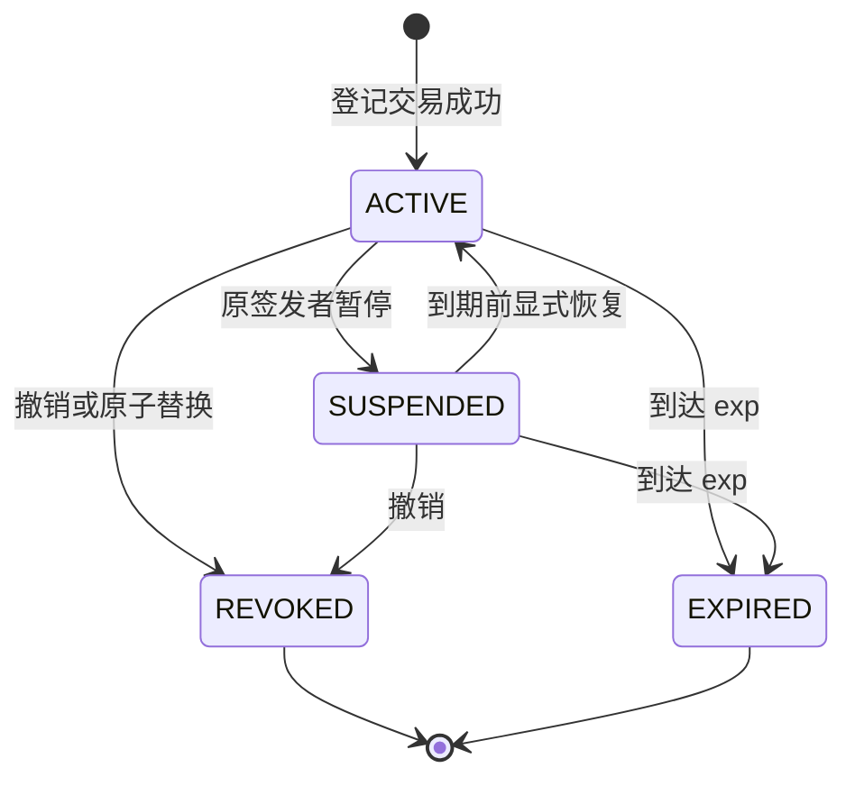

# 委托授权与策略

## 1 根授权的两种权源

每个任务只选一种 G0. **资源方预授权 (RP)** 由 C 签发, 表达使用指定采购接口的许可. **采购方委托 (BM)** 由 A 在登记表中指定的 PA 签发, 表达代表 A 采购的资格. 两种模式均先检查从 T 到域身份机构再到根签发服务的身份路径. C 的服务凭证由 IC 签发, PA 的服务凭证由 IA 签发; T 或身份机构取得认证资格并不自动获得 G0 签发权. C 检查 PA 的有效身份凭证和采购授权角色, 再决定是否接受 A, 商品与数量. A 域/U 的任务创建资格固定于受信部署清单和合约构造, 普通有效身份不自动取得该资格, 不开放运行期增授权入口. 两种模式都要求 G0 交给任务创建者 U, 并绑定相同任务, 模式, 采购主体和受众直至叶子. 模式不可降级或中途切换.

## 2 子授权与状态变化

只有父授权的受托者可以签发下一层, 父子两侧引用的身份凭证和密钥版本必须一致. 子签名绑定父授权的标识与摘要以及根授权的标识, 使另一条路径上的合法签名无法拼接进来. 路径无环, 根后最多 8 跳. C 要核对每一层的登记摘要和当前状态.

| 维度 | 子授权规则 |
| --- | --- |
| 资源, 动作, 供应商 | 有限非空子集, 禁止通配符 |
| 任务, 模式, 采购主体, 受众, 货币 | 逐跳相等 |
| 单笔上限 | 不大于父上限 |
| 时间, 深度 | 子区间落在父的 [nbf, exp) 内, 剩余次数非负且至少减 1 |

祖先一旦失效, 经过它的整条路径就失效, 无需枚举或改写后代. 暂停可在原到期时间前恢复, 签名内容和期限均不变. 撤销是终态. 改派时要原子地撤销旧授权并登记新授权, 引用被替换父对象的后代必须重签. 例如将 G2 改给 B₂后, B₂须凭自己的身份和新路径重新询价, 原报价仍属于 B₁. 撤销对哪一笔在途订单生效, 见[撤销后的决策窗口](请求认证与状态一致性.md#3-撤销后的决策窗口).

## 3 供应商的最终准入

委托路径给出权限上限. C 在该上限内, 根据任务状态, 已验证的身份属性和新鲜的环境观测决定是否接受本次采购. 两种根都受 C 的销售准入约束. 任务取消后须新建任务, 收紧的销售准入须通过更高策略版本才能放宽.

风险升为 ELEVATED 时只允许询价, BLOCKED 时拒绝所有访问. 可信观测器发布新鲜的 NORMAL 后, 仍按原授权和报价的剩余期限判断. 有效授权截止取任务, 域认证, 凭证, 各级授权以及适用的策略和环境绝对截止中的最早值. 身份证据失效及恢复的条件见[跨域身份与信任](跨域身份与信任.md), 策略输入和截止字段见[策略输入与数据约束](../implementation/策略输入与数据约束.md#1-opa-输入与策略包).
