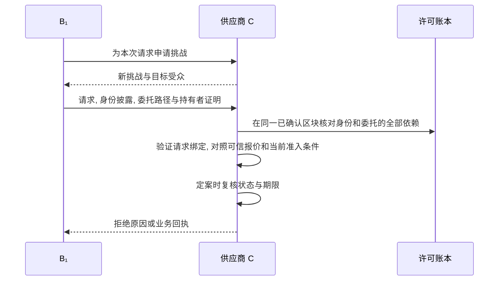
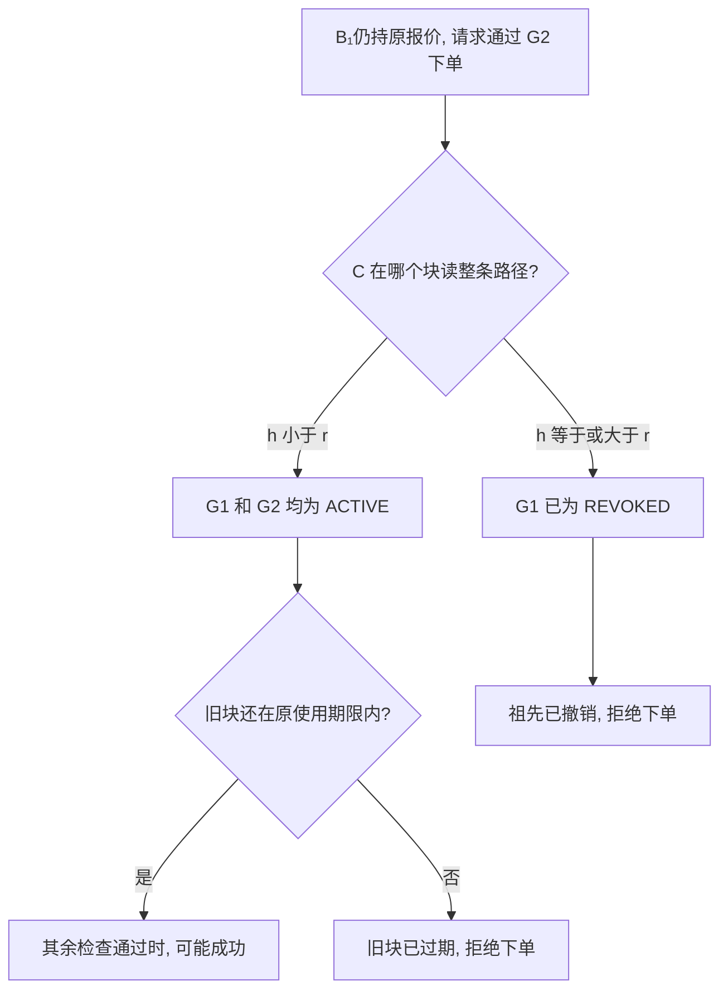

# 请求认证与状态一致性

询价和下单是两个独立决定. 即使沿用同一份凭证和同一条委托链, C 也要确认是谁发起了眼前的请求, 以及作出决定时哪些证据仍然有效.

## 1 链下凭证和请求绑定

B₁提供 T 签发的 B 域认证及 IB 签发的身份凭证. 域认证完整公开资格范围, 身份属性按需披露. B₁从签发者签名的凭证中只披露 C 所需的域和角色. C 可验证披露值属于这份凭证. 静态 DID 和委托路径仍可能把多次出示关联起来.

C 为每次动作发出一次性随机挑战. 叶子主体用当前认证密钥签名, 将挑战, 受众, 签发时间和本次业务请求绑定到同一份身份出示及有序委托证据. 因此, 拿到 B₁的凭证不能冒充 B₁, 询价时的签名也不能移用于下单. 证明持有者后, C 仅在形成终态决定时消费挑战. 询价和下单各自需要一次挑战与一次执行. 字段和签名字节见[证据包与摘要](../implementation/协议编码与测试向量.md#2-证据包与摘要).

挑战 nonce 由服务生成 32 字节随机数, 按[统一编码](../implementation/协议编码与测试向量.md#21-挑战-nonce-编码)作为规范无填充 base64url 字符串交付. 客户端原样写入 KB, C 按 challengeId 查到的原字符串核对, 不把不同文本表示归一化后视作同一挑战值. 格式错误或值不匹配均不消费挑战.

## 2 固定区块与新鲜度

**一致性.** C 为一次决定固定同一部署的一个已确认区块 h, 以块哈希标识该快照. T 根锚, 域状态及域认证, 身份密钥, 签发资格, 凭证, 任务, 委托祖先和策略锚都在 h 核对. 若读取 G1 和 G2 之间恰有撤销入块, 两者仍须来自同一快照. 必要记录缺失或快照不可信时不能放行. 切换高度须整次重验.

**新鲜度.** 即使证据来自同一块, 停链也会使它过时. 状态年龄从区块时间算起, 以 Δstate 为上限. 重读或重连不能延长同一块的期限. 链下风险另按可信来源, 版本和观测时间判断. 静态验签结果可以复用, 动态状态和期限必须在每次决定中核验, 最终放行结果不能复用.

**锁后求值.** 初验结果不能代替定案. C 在取得业务锁后读取并锁住当前环境行, 用该副本和最终核验时间重新构造策略输入并求值, 同时重新计算有效截止. 初验为 NORMAL, 获锁时已为 ELEVATED/BLOCKED 的订单必须拒绝, 即使新观测仍新鲜. 环境行锁保持到事务结束, 决策记录的 contextVersion 和环境副本必须与这次求值一致. 在所有可能等锁的操作之后再取实际当前时间, 不能用事务开始时间判断锁后是否到期.

## 3 撤销后的决策窗口

**同一条 G2, 为什么两笔下单结果可能不同?** 设撤销 G1 的交易在 r 成功, G2 自身的登记始终为 ACTIVE.

图中 h >= r 的分支假设新块仍然新鲜. 等待业务资源期间, 若本实例已采用新高度, C 须按新高度整次重验. 若在旧块期限内已经定案, 随后确认的撤销不能回滚这笔在途事务. 因此判断是否越过撤销窗口要看订单的定案时刻和所用区块.

设出块时间和验证端时钟相对真实时间的误差各不超过 ε. 旧块产生于撤销确认之前, 其时间戳最多偏快 ε, 验证端时钟最多偏慢 ε. 因此用旧块作出新放行决定的最迟时刻, 至多是撤销真实确认时刻加上 Δstate + 2ε. 这个上界依赖时钟假设, QBFT 终局性本身不能保证时钟准确.

新鲜度计时和锁后复核见[网关执行规格](../implementation/证据交付与网关执行.md#2-固定高度的读取器). 默认参数和撤销窗口的测量方法见[E6 撤销窗口](../experiments/实验计划.md#2-e6-撤销窗口).
