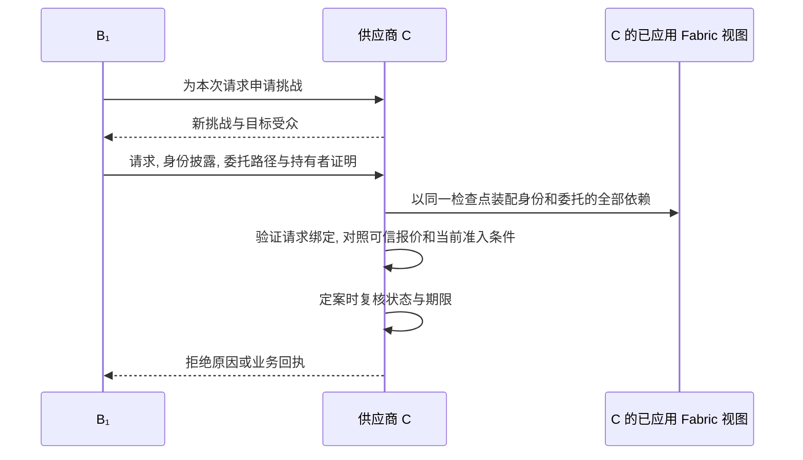

# 请求认证与状态一致性

询价和下单是两个独立决定. 即使沿用同一份凭证和同一条委托链, C 也要确认是谁发起了眼前的请求, 以及作出决定时哪些证据仍然有效.

## 1 链下凭证和请求绑定

B₁提供 T 签发的 B 域认证及 IB 签发的身份凭证. 域认证完整公开资格范围, 身份属性按需披露. B₁从签发者签名的凭证中只披露 C 所需的域和角色. C 可验证披露值属于这份凭证. 静态 DID 和委托路径仍可能把多次出示关联起来.

C 为每次动作发出一次性随机挑战. 叶子主体用当前认证密钥签名, 将挑战, 受众, 签发时间和本次业务请求绑定到同一份身份出示及有序委托证据. 因此, 拿到 B₁的凭证不能冒充 B₁, 询价时的签名也不能移用于下单. 证明持有者后, C 仅在形成终态决定时消费挑战. 询价和下单各自需要一次挑战与一次执行. 字段和签名字节见[证据包与摘要](../implementation/协议编码与测试向量.md#2-证据包与摘要).

挑战 nonce 由服务生成 32 字节随机数, 按[统一编码](../implementation/协议编码与测试向量.md#21-挑战-nonce-编码)作为规范无填充 base64url 字符串交付. 客户端原样写入 KB, C 按 challengeId 查到的原字符串核对, 不把不同文本表示归一化后视作同一挑战值. 格式错误或值不匹配均不消费挑战.

## 2 固定区块与新鲜度

C 自管的可信 Peer 完成区块提交校验并交付完整块. C 连续核对块号, 数据/父块哈希和交易校验码. 一个 PostgreSQL 事务应用该块内 VALID 的登记写集及历史, 再推进检查点. 一次在线读取在只读 REPEATABLE READ 中固定 h/hash, 从该快照装配根锚, 域资格, 身份和凭证锚, 任务, 委托祖先及策略. 必要依赖缺失, 检查点冲突或部署失配时停止装配. 历史复查按目标块末尾的事实独立返回.

每个在线实例在首次广播专用探针前记录本地单调发送时刻. 探针 VALID 且其完整块已在该视图应用后, 原期限 `sentMono + deltaState` 才可采用. 默认每 1 秒提交, 期限为 5 秒. 到期当刻或没有可用探针时拒绝. 重读, 重播和晚到的提交不会延长期限. 停链或断流期间, 已核对的完整视图最多用到原期限. 恢复时核对原检查点并按序补块, 进程重启后须采用本进程新发探针. 链下风险另按实际观测时间检查, 静态验签缓存仍依赖当次视图中的密钥, 域资格和动态状态.

C 先取得挑战, 业务键与当前环境的行锁, 再短时共享锁定视图检查点. 与初验的 h/hash 不同则释放锁并从新视图整次重验. 获得全部锁后取实际当前时间, 使用该环境副本及报价重新求值 OPA. 初验为 NORMAL, 获锁时已为 ELEVATED/BLOCKED 的订单须拒绝. 定案前重新核对探针原期限和业务期限, 记 decision_at. 检查点及环境副本保持到业务事务结束.

## 3 撤销后的决策窗口

设撤销 G1 的交易在 r 被可信 Peer 校验为 VALID, G2 自身的登记始终为 ACTIVE.

采用 h >= r 的网关在整次装配中看到失效祖先. 采用 h < r 时, 探针位于 h 或更早, 首次发送先于撤销排序和 Peer 的首次 VALID 观测. 在同一计时基准下, VALID 观测后的旧视图放行窗口至多为 deltaState. 跨机比较另记录可测时钟误差. 撤销提交到 VALID 观测的时延独立报告. 已定案的业务事务可能在撤销观测后才回响应, 实验以 decision_at 和所用高度/探针期限判断. [网关执行规格](../implementation/证据交付与网关执行.md#2-固定高度的读取器), [E6 撤销窗口](../experiments/实验计划.md#2-e6-撤销窗口).
