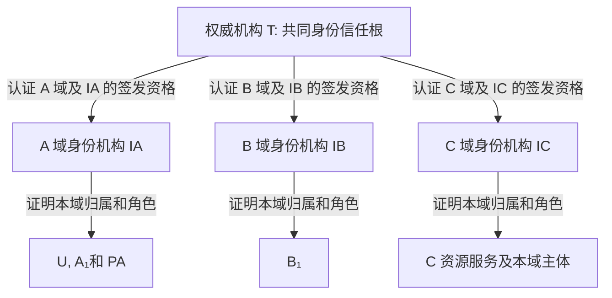

# 跨域身份与信任

T 是 A/B/C 共同认可的外部权威机构和唯一身份信任根. T 核实企业域及其身份签发资格, 各域身份机构 IA/IB/IC 核实本域用户, 智能体和服务的身份. 三个业务域地位平等, 身份信任路径固定为 T 到域身份机构, 再到域内主体.

## 1 信任根与域资格

T 的 DID, 应用公钥及文档摘要, 管理账户在部署时通过受信渠道分发, 同时固定在部署清单和合约 RootRecord 中. T 的完整根 DID 文档随清单预置在各域本地, 以固定摘要和密钥用途核验, 访问时无需在线访问 T 的 DID 主机. 各域启动时逐项核对, 根的可信性不依赖 T 自签的声明或链上出现了某条记录. 同一部署内固定 T 的根密钥, 换根或根密钥恢复须重新部署并重发域认证材料.

T 为每个域签发一份 DomainAuthorityCredential, 将 domainId, 域 DID, 管理员, 注册机构及身份签发者 DID/密钥版本绑定到核实结果, 限定可签凭证类型, 属性名和有效期. IA/IB/IC 分别只可签本域 EnterpriseIdentityCredential 的 domain 和 role, 以及实验中明确配置的合成属性. 不允许跨域签发, 转授签发资格或域间相互背书. 域管理员不能自行增加 T 未认证的签发者或范围.

域 DID 表示企业域本身, 与 IA/IB/IC 的机构 DID 以及 C 资源服务 DID 分开. T 认证域和机构的控制权及资格, 不直接签发 U/A₁/B₁/PA 等普通主体的身份凭证. C 的资源服务也由 IC 签发本域身份凭证, 不能仅凭部署配置跳过域资格验证.

T 提供身份认证的权威来源, 区块链保存多方可核验的密钥锚, 域认证及凭证状态. T 不决定采购代表权或供应商准入, 也不需要参与每一次访问. 在域认证正文已交付, 资格尚有效且链上状态新鲜完整时, T 服务离线不影响验证; 无法续发或撤销属于管理可用性限制, 不能把失联解释为撤销.

## 2 域内身份与跨域验证

| 证据 | 谁提供 | 验证方可以据此相信什么 |
| --- | --- | --- |
| 域认证 | T 签发 DomainAuthorityCredential, 并登记认证摘要和状态 | 域已经核实, 指定的 IA/IB/IC 在有效期内有权证明本域指定属性 |
| 域内注册 | 主体向本域注册机构证明账号归属, 并以应用密钥和管理账户签署同一挑战 | 本域已核实账号, DID 和两把密钥的归属. 跨域只公开带盐的账号承诺, 原账号与盐留在域内 |
| 企业身份凭证 | IA 为 U/A₁/PA, IB 为 B₁, IC 为 C 资源服务及本域主体签发凭证 | 本域机构为主体的归属和角色作证, 声明范围受 T 认证约束 |
| 请求持有者证明 | 叶子主体用凭证绑定的当前认证密钥签署本次挑战与请求 | 本次请求由控制该密钥的主体发起, 凭证本身不能代替请求证明 |
| 跨域关联 | 两端各自证明本域账号和当前密钥, 两域注册机构在期限内批准同一提案 | 两个域共同认可账号对应关系. 关联不转移角色或采购权, 任一端换钥后须重新关联 |

C 验证 B₁时, 先以预置 T 根验 B 域认证, 核对其与当前 DomainRecord 的绑定, 再以获认证的 IB 密钥验 B₁凭证, 最后验 B₁的请求签名. 同样验证每个委托祖先的身份. A/B 接收 C 的根授权时验证 T 对 C 域及 IC 的认证, IC 对 C 服务的凭证, C 对 G0 的签名, 并核对 C 服务与任务资源所有者一致. 机构 DID 有效或登记成功, 均不能单独代替签发资格.

## 3 资格失效与密钥恢复

T 可停用企业域或撤销域认证. 在采用包含变更的已确认块后, 所有依赖该域或认证的身份路径均失效, 无需逐一撤销域内凭证和委托. 其他域身份仍有效, 但包含失效域主体的委托链必须拒绝. 域认证到期, 被替换或签发者密钥版本不匹配也使路径失效. 动态状态统一遵循[固定区块与新鲜度](请求认证与状态一致性.md#2-固定区块与新鲜度), 不承诺撤销提交瞬间全网生效.

域资格变更由 T 核实后以新认证 ID 原子替换当前认证. 新认证不自动改变原凭证和授权正文. 同一签发者和密钥下, 若本次出示的业务类型, 所有可见及实际披露声明仍在当前资格内, 且原凭证/委托仍有效, 更新认证材料即可重新验证. 签发时检查全部业务声明, 访问时不推断未披露摘要对应的属性名. 例如当前资格移除 department 后, 原凭证隐藏该属性的出示仍可验证 domain/role, 再披露 department 则拒绝整次出示. 必需属性不得隐藏来绕过检查. 若签发者换钥, 须重签相关凭证和引用它们的委托; 若本次必需声明或业务类型不再获准, 路径拒绝, 仅重签不能恢复已被移除的资格. 撤销的认证 ID 不可恢复, 到期不得靠改时间续用.

普通身份登记后的状态为 ACTIVE, 可暂停为 SUSPENDED, 撤销为不可恢复的 REVOKED. 本人当前管理账户或本域当前注册机构可暂停/撤销, 只有注册机构复核后可恢复暂停的身份, 本人不能绕过注册机构的暂停. 域 DID 和身份机构引导身份的状态管理及管理账户恢复仅由 T 执行. 域状态和身份状态独立, 恢复其中一项不自动恢复另一项.

普通主体换钥时须证明仍控制登记的管理账户并持有新应用密钥. 管理账户丢失由本域注册机构重新核实原域内账号, 验证新管理账户及新应用密钥的双证明后原子更换. 恢复保留主体 ID, 账号承诺及原身份状态, 增加应用密钥版本, 旧管理地址及旧应用密钥不再有权发起新的身份管理操作或访问. 旧凭证, 关联和引用旧版本的委托须按各自规则重新办理, 不自动恢复. IA/IB/IC 换钥还须由 T 重新认证, 域管理员或注册机构变更也须经 T 更新域认证. C 按选定区块的登记摘要核对链下 DID 文档和密钥用途. 字段, 登记权限及恢复流程见[部署与链上登记](../implementation/部署与链上登记.md)和[身份字段](../implementation/协议编码与测试向量.md#1-身份与委托字段).
