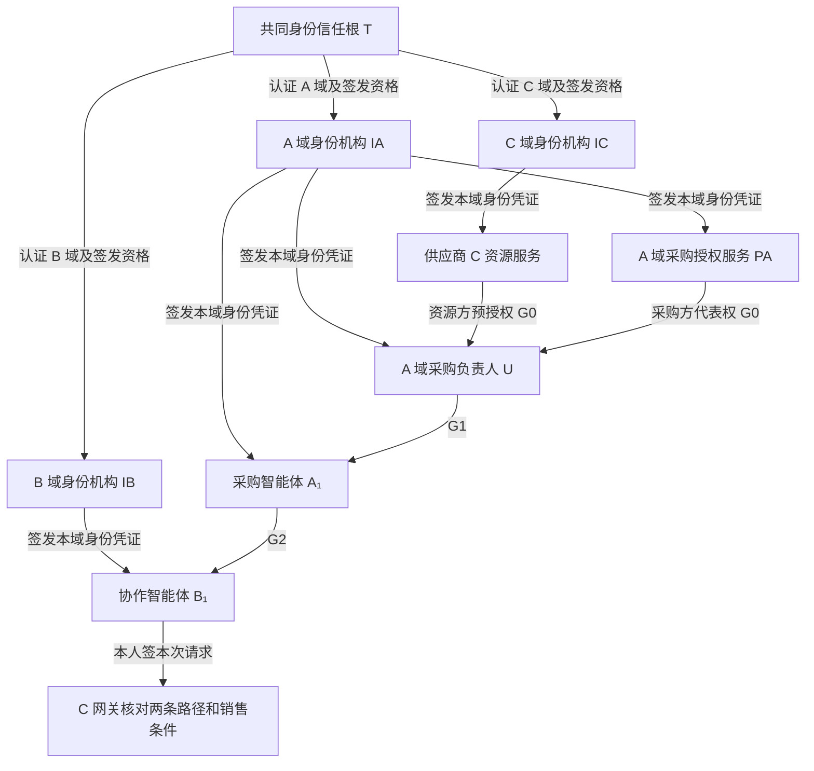
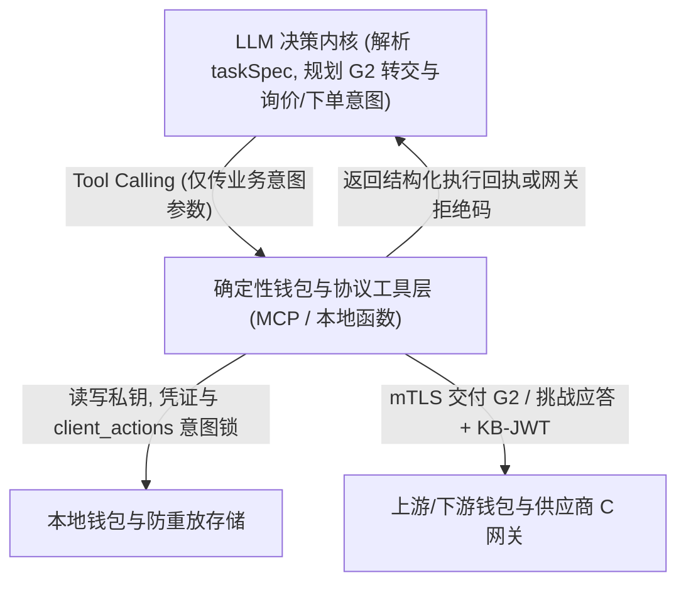

# 采购场景与总体设计

**设计示例.** B₁已向供应商 C 询得一件 P1 的报价, 总价 800 元. 下单时, C 分别检查 B₁的企业身份, 采购权限和这一次下单的证明. 报价属于 B₁和当前任务, 在有效期内锁定价格. 已取得报价的主体仍须重新证明有权下单.

T 是三域之外的身份基础服务, 不增加第四个采购业务域. 身份信任根固定为 T; 下文两种根均指采购根授权 G0 的权源, 与身份信任根分开. 域内主体自己管理应用私钥, 各域发布 did:web 文档, T 认证域及机构资格.

示例中的两条 G0 箭头表示两种可选的任务起点. 每个任务只取其中一条. 签发条件见[委托授权与策略](委托授权与策略.md).

| 授权 | 签发者与受托者 | 单笔上限 | 有效窗口 | 剩余转交次数 |
| --- | --- | --- | --- | --- |
| G0 | C 或 PA → U | 5000 元 | 起点后 60 分钟 | 2 |
| G1 | U → A₁ | 5000 元 | 起点后 45 分钟 | 1 |
| G2 | A₁ → B₁ | 1000 元 | 起点后 30 分钟 | 0 |

任务只含询价和模拟下单. C 根据自己的商品目录生成报价. 当其他条件均有效时, 800 元订单通过, 1200 元订单超过 G2 上限. 本方案只研究单笔约束, 范围不含累计预算和真实支付.

链上合约登记身份与委托的摘要, 版本和状态. 原始凭证及签名授权由各域保管. C 网关在同一已确认区块核对两条路径, 再依据本次请求和业务主库中的报价定案. 身份证据见[跨域身份与信任](跨域身份与信任.md), 选块和定案时点见[请求认证与状态一致性](请求认证与状态一致性.md).

## 1 智能体决策层与确定性工具层分离

方案中的智能体主体 (`A₁`, `B₁`/`B₂`) 为接入真实大语言模型 (LLM) 的 AI Agent, 通过标准化接口 (OpenAI 兼容 Chat Completions / Tool Calling API) 与模型推理服务解耦通信; `T`, `IA/IB/IC`, `PA` 与供应商 `C` 网关保持为确定性服务, `U` 为下达采购任务并签发 `G1` 的人类采购负责人.

LLM 负责任务理解, 额度分派, 询价结果判断及异常改派/恢复决策, 不接触应用私钥, 不生成哈希或签名字节, 也不能绕过工具层直接修改凭证或幂等键. 私钥隔离, RFC 8785 JCS 摘要, 挑战绑定 (`KB-JWT`) 与发送前意图持久化均由底层确定性工具强制执行, 最终权限边界由委托链与 `C` 网关的确定性验证兜底.
