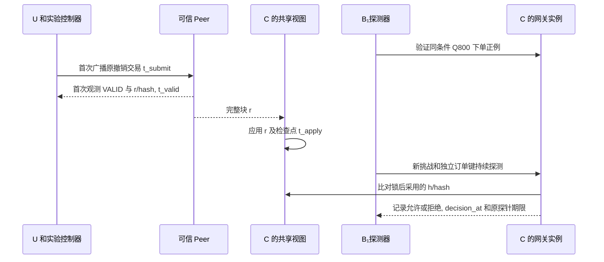

# 实验计划

B₁持有效 Q800, 风险及其它条件均允许下单. E6 中 U 撤销上级委托 G1, 探测器继续用原路径下单. 记录最后一次允许的 decision_at, 所用视图及原探针期限.

## 1 实验地图与同语义对照

| 实验 | 要回答的问题 | 交付证据 |
| --- | --- | --- |
| E1 功能 | 真实签发与逐跳交付之后, 两种根都能形成可用订单吗? | 从空钱包到订单的 F01-F16, 报价和订单行数 |
| E2 安全 | 越权, 混块, 伪造和重放在哪一步被截住? | S01-S103 配对正负例, 随机状态机反例 |
| E3 动态调整 | 同一笔未执行订单在换人, 换钥或风险升高后如何处理? | 每条轨迹的生效点, 有效范围/截止, 重签与交付次数 |
| E4 微基准 | 验签, 披露, 路径遍历, 一致视图装配各花多少? | 冷/热耗时, 分配量, 查询次数及字节 |
| E5 负载 | 深度, 主体数和到达率如何影响完成率与尾延迟? | 开放到达负载, 延迟分位数与队列对账 |
| E6 撤销 | 上级撤销后还能成功下单多久? | 各验证实例的确认, 采用新区块, 最后允许, 首次拒绝时间线 |
| E7 故障 | 停排序, Peer 断流, 等锁或响应丢失时是否重复下单? | 拒绝原因, 主库行数, 恢复与核账结果 |
| E8 开销 | 应用层减少的工作是否移到了后台或验证节点? | 背书/排序/提交/应用耗时与字节, 节点资源, 每次出示大小 |

| 配置 | 链上或登记状态从哪里来 | 可复用什么 |
| --- | --- | --- |
| C0 中心化快照 | 可信主库的一次一致事务快照, 保存 revision 和本次读取时点 | 关闭跨请求静态验签缓存 |
| B0 Fabric 逐次装配 | 从 C 的同一 Fabric 历史视图, 每次事务重新装配依赖和检查本实例探针 | 关闭跨请求静态验签缓存 |
| B1 Fabric 加静态验签缓存 | 使用与 B0 相同的视图, 探针, 依赖集合和动态检查 | 仅按原始材料, 算法, keyId 和密钥版本复用静态验签 |

三组使用同一 T 根, 相同真实签名凭证/委托, 挑战, 权限包含, 策略和业务事务. C0 用中心化一致快照及其 revision 复核读取一致性, 按相同业务有效期和当前风险规则判定, 单独记录状态读取时点和截止. B0/B1 同样检查实际业务期限, 并共同受本实例的原探针期限约束. 各组报告可用性拒绝和业务拒绝的分布. B0 与 B1 对照验签复用, C0 与 B0 对照状态提供及后台成本. A-FULL 披露全部合成属性, A-REUSE 改变材料复用率. 各组保持同一准入语义.

实验采用"同核双驱动"执行方式, 复用同一套底层确定性钱包与协议工具层: `E1` (功能闭环) 与 `E3` (动态改派与恢复轨迹) 由接入真实 LLM 的 `A₁`/`B₁`/`B₂` 智能体通过 Tool Calling 端到端驱动, 单独记录模型标识, 推理与工具调用耗时及工具轨迹; `E2` (万级正负例与随机状态机检查) 及 `E4`/`E5`/`E6`/`E8` (微基准, 100-500 ops/s 负载, 20 ms 撤销窗口探测, 账本开销) 由测试驱动直接调用同一底层确定性协议工具层发起请求, 防止数百毫秒至数秒的模型推理延迟掩盖微秒/毫秒级的验签, 视图装配与 `deltaState` 撤销窗口测量. `E7` 故障与并发测试默认使用确定性工具层按精确时序注入故障, 另配合 `E3` 中的智能体响应丢失恢复场景核对核账行为.

## 2 E6 撤销窗口

默认探针间隔 1 秒, deltaState 为 5 秒. 在同一时基下, Peer 首次观测撤销 VALID 后, 旧视图可用窗口至多为 deltaState. 跨机观测记录校时误差. 管理提案时间窗口属于背书期的资格检查. [撤销后的决策窗口](../design/请求认证与状态一致性.md#3-撤销后的决策窗口), [网关执行](../implementation/证据交付与网关执行.md#2-固定高度的读取器).

1. RP 与 BM 分别使用独立任务和授权 ID, 每轮从 G1/G2 ACTIVE 开始. 正式询价生成属于 B₁的 Q800. 保证整轮早于报价/任务/授权截止, 风险始终新鲜且为 NORMAL. 预热并完成至少一次实际下单.
2. 默认每实例每 20 ms 发起一次旧路径探测, 每次新挑战, 独立业务键并重签. 记录实际发送间隔, 排队和漏探测. 多实例用同一 C 共享视图, 各自用本进程的原探针判定新鲜度.
3. 记录撤销首次发送 t_submit, 可信 Peer 首次观测原 txID 为 VALID 的 t_valid, r/hash 及交易位置, 共享视图首次应用 r 的 t_apply, 各实例首次采用 h>=r 的 t_adopt,j. 每次决定记录 h/hash, G1 状态, 探针 txID/所在块/原发送与期限, decision_at, 理由和业务提交/响应时间.
4. 每轮持续至少 max(30 秒, 2 x deltaState + 10 秒), 主要场景独立重复至少 30 次. 默认深度 2, 扫描 deltaState 为 1/5/15 秒, 探针发送间隔一并记录. 扩展分别改变撤销对象, 深度 2/8 和后代数 1/10/100. 合法兄弟支作为对照.
5. 报告 t_valid-t_submit, t_apply-t_valid, t_adopt,j-t_apply, 最后允许 t_last_allow,j 和首次拒绝 t_first_deny,j. VALID 观测后的窗口为 max(0,t_last_allow,j-t_valid), 同时报告相对提交的窗口. 无确认后允许样本标记未观测到, 保留探测分辨率, 删失和跨机误差. 订单响应未知时按核账规程找原创建决定.

采用 h>=r 后仍允许旧路径, 或 decision_at 到达或越过所用探针原期限后仍允许, 均判失败. h<r 时已定案而随后才返回数据库提交响应的样本单列. D0 用合成 G0/G1 检查 h/r 的登记事实与探针期限. 订单级 E6 用真实材料, 实际报价和数据库决定验收.

## 3 E1-E3 功能, 安全与动态轨迹

E1 在两种根配置分别验收询价 800 元并下单成功, 询价 1200 元后按真实金额下单被拒. 篡改 Q1200 金额为 800 元应先触发 AMOUNT_MISMATCH. 同键冲突使用两笔限额内的 Q800/Q900. C 拒绝合法 PA 根的独立用例必须保留. [F01-F16 与 S01-S103](验证用例.md).

E2 将 S01-S04 和 S76-S90 作为共同根专项, 覆盖根替换, 域/机构控制权, 跨域越界, 域认证原子更新/撤销, IC 服务身份和 T 离线. 每个拒绝记录实际认证 ID/域 revision, 首个失败阶段与响应码, 配对正例保持其他条件相同.

E2 用 [S91-S99](验证用例.md#6-锁后求值-身份生命周期与固定编码)核对锁后风险变化, 实际时间, 隐藏属性的当前资格边界, 身份状态/账户恢复权限及 DID/JWK/上下文编码. S93 的结论限于可见/实际披露声明, 不把未披露摘要当作已检查的声明名. S94-S97 同时从 HTTP 及直接管理交易检验权限, 记录恢复前后管理证书绑定, 密钥版本和原 status.

E2 用 [S100-S103](验证用例.md#7-异步管理结果与-nonce-编码)检查接受前同步拒绝, 接受后异步失败, 精确操作重试及挑战编码/绑定. 用例记录原 POST 状态, operationId, 每次查询的 status/failureCode, 原 txID, 提案响应/提交校验码和交易位置和候选材料交付数. nonce 负例均使用合法持有者重新签 KB, 排除签名错误掩盖格式或绑定错误; 固定 nonce 向量只用于编码测试.

E2 另生成至少 10000 组父子约束, 每次只放宽一维. 以显式集合包含与祖先遍历作独立判据. 用 100 个种子各执行 100 步 create/delegate/suspend/resume/revoke/replace/rotate/cancel/advanceBlock/advanceTime. 每个反例保留最短可重现序列.

| E3 从同一 Q800 独立开始 | 应观测到的变化 | 配对恢复或负例 |
| --- | --- | --- |
| 暂停 G1 / 撤销 G1 | 两者在采用变更块后都拒绝 G2 | 暂停可恢复且 exp 不变, 撤销后须新的有效路径 |
| 替换 G2, 改派 B₂ | 原子撤旧建新, 只需重签叶子. B₂不能用 B₁的 Q800 | B₂用新路径重新询价. 同 ID 覆盖或中途回退不得产生交付 |
| B₁换钥 / 叶子 VC 被撤销 | 缓存命中仍拒绝旧材料 | 核验新凭证并重签所引用的 G2. 同主体同任务仍可用未过期原报价 |
| T 撤销 B 域认证 / 暂停 B 域 | 采用变更块后依赖 B 的路径失效, A/C 独立路径仍有效 | 撤销认证须 T 新 ID 续发; 暂停可在原认证有效时恢复, 不恢复单独撤销的凭证或授权 |
| T 同钥续发 / IB 换钥后重新认证 | 旧认证不能用, 更新认证材料后重新绑定请求 | 同钥同范围可复用原有效 VC/委托, 换钥须重签引用旧版本的 VC 和委托, 均不延长报价 |
| T 同钥收缩声明范围 / 普通主体管理账户恢复 | 隐藏非必需属性与披露该属性分别判断; 恢复后旧管理证书绑定和旧应用版本失效 | S93 使用同一 VC/路径作披露配对; S95/S97 核对恢复不改变原 status, 新凭证和新路径完整后才可访问 |
| 停 T 服务 / 收紧 C 的准入 | 已有有效认证且状态新鲜时仍能本地验证; 被禁业务条件仍拒绝 | T 离线不能伪装撤销或续期, 超龄/缺材料拒绝; 更高策略版本只能调整业务准入, 不能换身份根 |
| 取消任务 / 风险升降 / 缩短绝对期限 | 取消不可逆. ELEVATED 只许询价, BLOCKED 全拒. 到达截止秒拒绝 | 必须用真实新环境观测恢复 NORMAL. 改派或新任务分别验证角色和报价归属 |

## 4 E7 故障与并发

| 注入点 | 观察与判定 |
| --- | --- |
| 在同一读取事务的两次依赖读取之间应用 r | 整次装配仍取 h. 下次读取采用 r 或更高后看到撤销. 缺依赖, 缺块或历史失败时整次拒绝 |
| 分别停止一个和两个 SmartBFT 排序节点 | 保持 Peer 可用. 停一记录新探针 VALID 与采用时刻, 停两等待在途收敛后记录无新确认及最后高度. 原期限到期时 STATE_STALE, 恢复后补块并采用新探针 |
| 中断 C 的 Peer 或完整区块交付 | A/B 仍可背书并确认交易. 记录 C 最后应用高度, 原探针期限和首次拒绝. 恢复时核对检查点并补齐区块, 由本进程有效新探针重新就绪 |
| C甲采用 r, C乙暂用 h<r | 保持同一报价和有效条件, 分开记录两实例探针和最后允许/首次拒绝. 采用 r 后拒绝, h<r 的决定还须早于原期限. 同键最多一笔订单 |
| 等业务锁时应用撤销或越过截止 | 先推进共享检查点再释放业务锁, 检验锁后比对和整次重验. 到达挑战, 报价, 资格或探针期限均拒绝. 同挑战最多一个终态决定 |
| 初验后风险升级 | 屏障使观测器在环境行锁取得前提交 ELEVATED/BLOCKED, S91 验证锁后重跑 OPA. S92 用实际时间核对期限. 共享锁取得后的更新等本事务结束 |
| 管理交易结果未知或授权交付响应丢失 | 按原 txID 或原已签字节恢复. S100/S101 分别核对受理前 409, 受理后 202/查询结果, PENDING 和通用阶段码. 重播重复码不改变原结果. VALID 且交付资格仍有效后只重投原包 |
| 订单提交后丢响应, 随后撤销 G1 | B 停发, C 用 R/k/H 和挑战清单找创建决定, 对照历史 h/r 与原期限, 给出 CREATED/NOT_CREATED/UNKNOWN 和历史完整性 |
| 风险观测停更, 策略包缺失或墙钟异常 | 记录 CONTEXT_STALE, POLICY_UNAVAILABLE 或状态异常. 停止创建订单, 恢复后复核策略锚及实际时效 |

注入仅作用于测试环境. 单向延迟 0/20/100 ms, 丢包 0/1/5%, 分别施加于客户端到 C, Peer 区块交付和排序通信. 同机停容器检验节点故障, 不推论机构级故障隔离. D0 的故障证据为提交校验码, 块流和状态读结果. E7 的订单结果使用真实授权和业务主库核账. [订单核账](../implementation/订单核账.md).

## 5 E4/E5/E8 性能与复现

| 控制项 | 默认与扫描 |
| --- | --- |
| 数据集 | 主体 N=1000, 扫描 100/1000/10000. 每任务分配 U 和 d 个独立智能体, 生成 floor(N/(d+1)) 条互不共享主体的路径 |
| 路径与材料 | 根后深度 d=2, 扫描 1/2/4/8. 身份资格固定为 T 直接认证域机构, 不扫描背书深度. 独立扫描请求实际依赖域数 2/3, 按不同认证 ID 去重; RP/BM 分别报告证据包认证数和本地 C 服务资格依赖, 不以省略域认证制造性能收益. 属性默认 16 个, 扫描 4/16/64, 必需 domain/role 两个. 合成值默认 32 字节 |
| 策略与负载 | 默认 20 条规则, 专项取 10/100/1000. 开放到达率默认 100 操作/秒, 扫描 10/50/100/200/500. 询价/订单各半, 新订单键 |
| 运行 | 预热 30 秒, 测量 120 秒, 排空 35 秒, 请求超时 10 秒. 5 次独立重复, 配对种子 1109-1113. 正式轮默认不自动重试 |

三域采购主实验固定依赖 A/B/C 三域. 两域专项夹具只使用 A 域主体与 C 资源服务, 用于分离域认证数量成本, 不替代三域结果. RP/BM 配对保持相同主体/任务/授权条件, 分别计入各自必需的证据和本地服务身份校验, 报告材料数量差异.

E4 分开测材料生成, ES256 签名/验签, 披露, 路径收缩, OPA, 挑战及事务, 一致快照开启和依赖装配. E5 为每个 actor/taskId 预取覆盖测量期的有效报价, 准备成本单列. 每操作实际完成挑战和执行两个 HTTP 请求. 一次改变一个因素, 两种根在相同 d=2 和业务条件下配对. 报告 P50/P95/P99, 拒绝率, 丢弃和超时, 并区分验签缓存命中和端到端请求.

E8 单列 T 引导/域认证, 本域身份登记, 授权/轮换/撤销/替换及 C 服务准备成本. 各类至少测 30 个独立对象. 对每笔记录提案生成到背书, 首次广播到排序接收及可信 Peer 校验, 可信 Peer 到达至视图提交, 各段的字节和结果. 排序器接收成功与 Peer VALID 分列, 只有可直接观测的内部阶段才单独估计. 在空闲及负载时测探针发送/确认/采用率, 探针和区块流消息/字节, 视图事务开销, 检查点冲突重验率, Peer/Orderer/数据库的 CPU, RSS, 网络及磁盘. 分开报告客户端两次往返和后台阶段开销.

| 原始文件 | 复现实验至少需要的字段 |
| --- | --- |
| manifest.json | 实际控制方, 拓扑和宿主/校时, 镜像和依赖锁, 通道/创世哈希/配置, 链码版本/sequence/package ID, 固定根/实例/部署标识, 历史范围, 策略与夹具, 以及 E1/E3 所用 LLM 模型标识与接口端点配置 (不含 API Key) |
| requests.csv | 计划/开始/结束时间, 实例, 模式, 深度, 域认证 ID 及数量, T 在线调用数, challengeId, decisionId, h/hash, 探针 txID/块号/发送/原期限, contextVersion, decision_at, 业务提交与响应, 验签/缓存及状态查询计数, 以及智能体驱动轮次的 LLM 推理耗时与工具调用次数 |
| operations.csv, revocations.csv | 操作键, 原 txID, 提案和背书阶段, 排序接收, 首次观测 VALID, r/hash/index, 视图应用 r, 各实例采用/最后允许/首次拒绝, 校验码及删失原因 |
| dynamic_events.csv | 前后权限, 有效截止, 路径及重签/重发数, 对应决定 |
| communications.csv, resources.csv | 请求, 背书, 排序, 提交观测, 探针与区块交付的次数, 字节和耗时, 每秒 CPU/RSS/网络/磁盘/队列, 检查点和重验次数 |
| summary.json | 各配置样本数, 失败, 超时, 丢弃和重复间不确定性 |

所有计划到达样本按下式对账. planned = started + dropped, started = completed + timeout, completed = allowed + denied + error. 排空完成是 completed 子集. 分开报计划到完成, 挑战到响应的延迟和测量期内成功吞吐. 每次运行内计算 P50/P95, 相关样本不少于 10000 才列 P99. 汇总报告独立重复的中位数和范围, 不用请求数冒充独立轮数. 原始耗时标单位, 未观测填 null. 任何非法放行须定位原因, 性能收益只据实测报告.

主结果图用撤销确认与各实例决策时间线标出 h/r 和拒绝原因, 再画不同 deltaState 下窗口与可用率的变化. 性能图给出各配置随到达率变化的 P50/P95, 同列失败与丢弃比例. 未确认撤销或未完成的请求单列删失, 图上注明样本量, 单位及误差含义.
