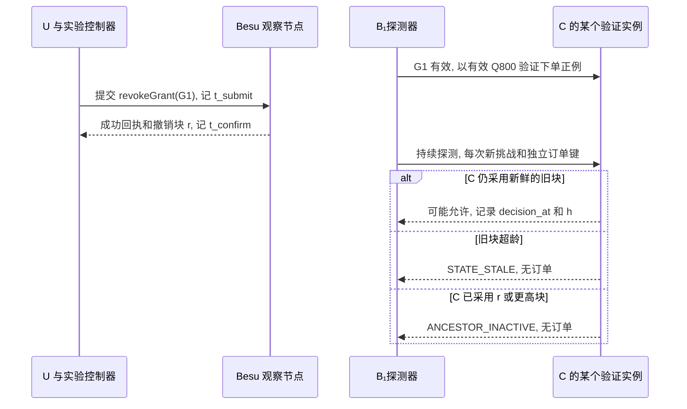

# 实验计划

**主实验 E6 只改变一件事.** B₁已经拿到有效报价, 其余条件始终允许下单. U 撤销上级委托 G1, 探测器继续用原路径向 C 下单. 记录最后一次成功决定用了哪个区块, 以及它距撤销交易提交和确认各有多久.

## 1 实验地图与同语义对照

| 实验 | 要回答的问题 | 交付证据 |
| --- | --- | --- |
| E1 功能 | 真实签发与逐跳交付之后, 两种根都能形成可用订单吗? | 从空钱包到订单的 F01-F16, 报价和订单行数 |
| E2 安全 | 越权, 混块, 伪造和重放在哪一步被截住? | S01-S103 配对正负例, 随机状态机反例 |
| E3 动态调整 | 同一笔未执行订单在换人, 换钥或风险升高后如何处理? | 每条轨迹的生效点, 有效范围/截止, 重签与交付次数 |
| E4 微基准 | 验签, 披露, 路径遍历, 固定高度读链各花多少? | 冷/热耗时, 分配量, RPC 数量及字节 |
| E5 负载 | 深度, 主体数和到达率如何影响完成率与尾延迟? | 开放到达负载, 延迟分位数与队列对账 |
| E6 撤销 | 上级撤销后还能成功下单多久? | 各验证实例的确认, 采用新区块, 最后允许, 首次拒绝时间线 |
| E7 故障 | 停链, 两实例看到不同高度或回执丢失时是否重复下单? | 拒绝原因, 主库行数, 恢复与核账结果 |
| E8 开销 | 应用层减少的工作是否移到了后台或验证节点? | gasUsed, 交易及 RPC 字节, 节点资源, 每次出示大小 |

| 配置 | 链上或登记状态从哪里来 | 可复用什么 |
| --- | --- | --- |
| C0 中心化 | 可信主库的一次一致事务快照, 记录实际读取时间 | 关闭静态验签和跨请求状态缓存 |
| B0 逐请求读链 | 每请求从可信节点取已确认头, 所有 eth_call 固定该高度 | 与 B1 用相同 ABI, 批量方式和依赖集合, 关闭跨请求缓存 |
| B1 固定高度缓存 | 后台每 500 ms 观察头, 每请求固定该头, 按需读取缺失记录 | 按块哈希复用状态, 按材料与密钥版本复用静态验签 |

三者共用同一 T 根, 域认证/本域身份凭证及委托验证, 挑战, 策略和业务事务. C0 的状态登记来自可信主库的一致快照, 身份签名和 T 资格链仍与 B0/B1 相同, 不把认证权威变化混入链上状态对照. B0/B1 都受同一年龄上限约束. 配置比较同时报告实际块龄和拒绝率. A-SIG 仅关闭静态验签缓存, A-STATE 仅切回逐请求选头并取全套所需状态, A-FULL 披露全部合成属性, A-REUSE 改变材料复用率. 各配置均重新验证动态条件.

## 2 E6 撤销窗口

默认轮取 Δstate = 5 秒, ε = 1 秒, 条件上界为 7 秒. 它用于受控时钟下的判定, 实际接受窗口按各实例的决定记录测量. 时钟假设与条件上界见[撤销后的决策窗口](../design/请求认证与状态一致性.md#3-撤销后的决策窗口), 选块及锁后复核步骤见[网关执行规格](../implementation/证据交付与网关执行.md#2-固定高度的读取器).

1. RP 与 BM 的任务 ID 分别为 urn:grad:task:purchase-001 与 urn:grad:task:purchase-002. 每轮使用独立状态及新授权 ID. 每轮从 G1/G2 ACTIVE 开始. 用正式询价接口生成属于 B₁的 Q800, 确保整轮早于报价/任务/授权截止, 风险始终新鲜且为 NORMAL. 先预热缓存并实际成功下一单.
2. 默认每个实例每 20 ms 发起一次旧路径探测, 每次新挑战, 独立业务键并重签, 避免重放拒绝或幂等复用旧订单掩盖结果. 同时向各实例发请求, 记录实际间隔, 排队与漏探测.
3. 记录向节点发送已签撤销交易的 t_submit. 独立观察者在可信节点首次取得相符成功回执并核对 r/hash 的时间为 t_confirm. t_apply,j 为实例 j 首次采用 r 或更高的已确认块作为读取基准的时间. B0 在请求选头时观测, B1 在换头时观测. 记录实际决定的 h/hash, G1 状态, 原因及 decision_at, 订单提交回执另记.
4. 每轮持续至少 max(30 秒, 2 × Δstate + 10 秒). 每个主要场景独立重复至少 30 次. 默认深度 2, 扫描 Δstate 为 1/5/15 秒. 扩展分别改变撤销对象 (根/中间/叶), 深度 (2/8), 后代数 (1/10/100). 兄弟分支保持可用作为对照.
5. 以同一台机器的单调钟计阶段耗时, 跨机观测标注校时误差. 分别报告 t_confirm - t_submit, t_apply,j - t_confirm 和最后一次允许的服务端 decision_at. 确认观测后的窗口为 max(0, t_last_allow,j - t_confirm), 同时报告相对提交的窗口. 无确认后允许样本记为未观测到, 附探测分辨率和时钟误差. 采用时差保留原始有符号值. 对超时探测核账, 区分已提交订单和客户端成功收到响应.

**失败条件.** 选定 h >= r 的新决定仍允许旧路径, 或超龄仍放行, 均为正确性失败. 若在 h < r 时已定案, 随后才收到主库提交回执, 单列为在途业务. 只有满足出块与验证时钟假设才用受控时钟检验条件上界. 停链后及时拒绝说明安全规则生效, 同时计入可用性损失.

## 3 E1-E3 功能, 安全与动态轨迹

E1 在两种根配置分别验收询价 800 元并下单成功, 询价 1200 元后按真实金额下单被拒. 篡改 Q1200 金额为 800 元应先触发 AMOUNT_MISMATCH. 同键冲突使用两笔限额内的 Q800/Q900. C 拒绝合法 PA 根的独立用例必须保留. [F01-F16 与 S01-S103](验证用例.md).

E2 将 S01-S04 和 S76-S90 作为共同根专项, 覆盖根替换, 域/机构控制权, 跨域越界, 域认证原子更新/撤销, IC 服务身份和 T 离线. 每个拒绝记录实际认证 ID/域 revision, 首个失败阶段与响应码, 配对正例保持其他条件相同.

E2 用 [S91-S99](验证用例.md#6-锁后求值-身份生命周期与固定编码)核对锁后风险变化, 实际时间, 隐藏属性的当前资格边界, 身份状态/账户恢复权限及 DID/JWK/上下文编码. S93 的结论限于可见/实际披露声明, 不把未披露摘要当作已检查的声明名. S94-S97 同时从 HTTP 及直接管理交易检验权限, 记录恢复前后管理地址, 密钥版本和原 status.

E2 用 [S100-S103](验证用例.md#7-异步管理结果与-nonce-编码)检查接受前同步拒绝, 接受后异步失败, 精确操作重试及挑战编码/绑定. 用例记录原 POST 状态, operationId, 每次查询的 status/failureCode, txHash/实际回退数据和候选材料交付数. nonce 负例均使用合法持有者重新签 KB, 排除签名错误掩盖格式或绑定错误; 固定 nonce 向量只用于编码测试.

E2 另生成至少 10000 组父子约束, 每次只放宽一维. 以显式集合包含与祖先遍历作独立判据. 用 100 个种子各执行 100 步 create/delegate/suspend/resume/revoke/replace/rotate/cancel/advanceBlock/advanceTime. 每个反例保留最短可重现序列.

| E3 从同一 Q800 独立开始 | 应观测到的变化 | 配对恢复或负例 |
| --- | --- | --- |
| 暂停 G1 / 撤销 G1 | 两者在采用变更块后都拒绝 G2 | 暂停可恢复且 exp 不变, 撤销后须新的有效路径 |
| 替换 G2, 改派 B₂ | 原子撤旧建新, 只需重签叶子. B₂不能用 B₁的 Q800 | B₂用新路径重新询价. 同 ID 覆盖或中途回退不得产生交付 |
| B₁换钥 / 叶子 VC 被撤销 | 缓存命中仍拒绝旧材料 | 核验新凭证并重签所引用的 G2. 同主体同任务仍可用未过期原报价 |
| T 撤销 B 域认证 / 暂停 B 域 | 采用变更块后依赖 B 的路径失效, A/C 独立路径仍有效 | 撤销认证须 T 新 ID 续发; 暂停可在原认证有效时恢复, 不恢复单独撤销的凭证或授权 |
| T 同钥续发 / IB 换钥后重新认证 | 旧认证不能用, 更新认证材料后重新绑定请求 | 同钥同范围可复用原有效 VC/委托, 换钥须重签引用旧版本的 VC 和委托, 均不延长报价 |
| T 同钥收缩声明范围 / 普通主体管理账户恢复 | 隐藏非必需属性与披露该属性分别判断; 恢复后旧管理地址和旧应用版本失效 | S93 使用同一 VC/路径作披露配对; S95/S97 核对恢复不改变原 status, 新凭证和新路径完整后才可访问 |
| 停 T 服务 / 收紧 C 的准入 | 已有有效认证且状态新鲜时仍能本地验证; 被禁业务条件仍拒绝 | T 离线不能伪装撤销或续期, 超龄/缺材料拒绝; 更高策略版本只能调整业务准入, 不能换身份根 |
| 取消任务 / 风险升降 / 缩短绝对期限 | 取消不可逆. ELEVATED 只许询价, BLOCKED 全拒. 到达截止秒拒绝 | 必须用真实新环境观测恢复 NORMAL. 改派或新任务分别验证角色和报价归属 |

## 4 E7 故障与并发

| 注入点 | 观察与判定 |
| --- | --- |
| 在两次 eth_call 之间确认 G1 或域认证撤销 | 捕获每项 RPC 的块参数. h < r 的读全为旧值, h >= r 全为新值. 失败/历史被裁剪时不能补用 latest |
| 停一台 / 两台 QBFT 验证节点 | 四台中停一台测剩余三台能否继续确认及停顿. 停两台时失去法定数, 记录最后高度及首次超龄拒绝, 恢复后待新鲜块再放行 |
| 中断 C 的 RPC 或丢失通知 | 记录缓存是否有同块完整材料及其原截止. 缺依赖立即不可判定. 能重新轮询时直接选新块, 不依赖通知补齐变化 |
| C甲采用 r, C乙暂留 r-1 | 保持同一 G1 和有效报价, 用不同挑战探测. 新块拒绝, 旧块仅在仍新鲜且其他条件有效时可能允许. 超龄则拒绝. 同键最多一笔订单 |
| 等锁时撤销入块, 或越过挑战/报价期限 | 先让实例采用新高度再释放锁, 检验整次重验. 已定案但尚未提交单列. 同挑战双实例并发最多一个终态决定 |
| 初验后风险升级, 或事务开始后等待至环境/业务截止 | 用屏障使观测器在环境行锁取得前提交 ELEVATED/BLOCKED, S91 检验按新副本重跑 OPA. S92 检查锁后实际时钟及期限, 不用事务开始时间. 取得共享锁后的更新须等待事务结束 |
| 管理交易结果未知 / 授权交付丢回执 | 按原哈希查回执. S100/S101 对照接受前 409 与接受后 202/查询 FAILED, 回执缺失保持 PENDING, 无具体回退证据时不猜失败码. 回退无半替换, 成功后只重投原包. 发送可多次, 收件唯一 |
| 订单提交后丢响应, 随后撤销 G1 | B 停发, C 审计员仅用 R/k/H 和挑战清单反查创建决定. 对照历史 h 与 r, 恢复 CREATED/NOT_CREATED/UNKNOWN, 独立标记历史证据完整性 |
| 风险观测停更, 策略包缺失, 时钟回拨 | 观察 CONTEXT_STALE, POLICY_UNAVAILABLE 或状态异常, 无新订单. 恢复后先核对策略锚和新鲜度 |

注入只作用于测试容器. 单向延迟 0/20/100 ms, 丢包 0/1/5%, 客户端到 C 与 C 到 RPC 分开注入. 同机停容器只检验节点可用性与应用反应. [订单核账规程](../implementation/订单核账.md).

## 5 E4/E5/E8 性能与复现

| 控制项 | 默认与扫描 |
| --- | --- |
| 数据集 | 主体 N=1000, 扫描 100/1000/10000. 每任务分配 U 和 d 个独立智能体, 生成 floor(N/(d+1)) 条互不共享主体的路径 |
| 路径与材料 | 根后深度 d=2, 扫描 1/2/4/8. 身份资格固定为 T 直接认证域机构, 不扫描背书深度. 独立扫描请求实际依赖域数 2/3, 按不同认证 ID 去重; RP/BM 分别报告证据包认证数和本地 C 服务资格依赖, 不以省略域认证制造性能收益. 属性默认 16 个, 扫描 4/16/64, 必需 domain/role 两个. 合成值默认 32 字节 |
| 策略与负载 | 默认 20 条规则, 专项取 10/100/1000. 开放到达率默认 100 操作/秒, 扫描 10/50/100/200/500. 询价/订单各半, 新订单键 |
| 运行 | 预热 30 秒, 测量 120 秒, 排空 35 秒, 请求超时 10 秒. 5 次独立重复, 配对种子 1109-1113. 正式轮默认不自动重试 |

三域采购主实验固定依赖 A/B/C 三域. 两域专项夹具只使用 A 域主体与 C 资源服务, 用于分离域认证数量成本, 不替代三域结果. RP/BM 配对保持相同主体/任务/授权条件, 分别计入各自必需的证据和本地服务身份校验, 报告材料数量差异.

E4 分开测材料生成, ES256 签名/验签, 披露, 路径收缩, OPA, 挑战及事务, 选头和固定块查询. E5 为每个 actor/taskId 预取覆盖测量期的有效报价, 准备成本单列. 每操作实际完成挑战和执行两个 HTTP 请求. 一次改变一个因素, 两种根在相同 d=2 和业务条件下配对.

E8 单列 T 域引导/认证签发/替换/撤销, IC 服务身份及各域主体凭证的准备成本, 区分 T 管理阶段与无需在线 T 的访问阶段. 对每类登记/轮换/撤销/替换至少测 30 个独立对象, 记录成功或回退, gasUsed, 签名交易字节, 确认耗时与状态增长. 另测前台 eth_call 与后台查头的 RPC 数量, 网络往返, 字节, CPU 与节点磁盘增量, 并计入空块. 分开报告客户端往返数和在线参与方数. 每次访问没有管理交易, 读链仍消耗节点资源.

| 原始文件 | 复现实验至少需要的字段 |
| --- | --- |
| manifest.json | 拓扑及实际控制方, T 根 DID/公钥/版本/文档摘要, 域认证 ID/摘要/范围/期限, chainId/genesisHash, 合约地址/代码哈希, instanceId, 镜像及依赖锁, 出块与历史保留配置, 主机/时钟, 策略摘要, 夹具和种子 |
| requests.csv | 计划/开始/结束时间, 实例, 模式, 深度, 实际依赖域/认证 ID 及数量, T 在线调用数, challengeId, decisionId, 块号/哈希/年龄, 环境版本, decision_at, 提交观测, 响应码, 缓存/RPC 计数 |
| operations.csv, revocations.csv | 操作/交易哈希, receiptStatus, 块号/哈希, gasUsed, 撤销对象, 各实例确认/采用/允许/拒绝时点, 探测间隔及删失原因 |
| dynamic_events.csv | 前后权限, 有效截止, 路径及重签/重发数, 对应决策 |
| communications.csv, resources.csv | 分准备/管理/访问/查头的消息数与字节, 每秒 CPU/RSS/网络/磁盘/队列, 选块与节点头高度 |
| summary.json | 分配置样本数及失败, 超时, 丢弃, 重复间不确定性, 统计程序版本 |

所有计划到达样本按下式对账. planned = started + dropped, started = completed + timeout, completed = allowed + denied + error. 排空完成是 completed 子集. 分开报计划到完成, 挑战到响应的延迟和测量期内成功吞吐. 每次运行内计算 P50/P95, 相关样本不少于 10000 才列 P99. 汇总报告独立重复的中位数和范围, 不用请求数冒充独立轮数. 原始耗时标单位, 未观测填 null. 任何非法放行须定位原因, 性能收益只据实测报告.

主结果图用撤销确认与各实例决策时间线标出 h/r 和拒绝原因, 再画不同 Δstate 下窗口与可用率的变化. 性能图给出各配置随到达率变化的 P50/P95, 同列失败与丢弃比例. 未确认撤销或未完成的请求单列删失, 图上注明样本量, 单位及误差含义.
