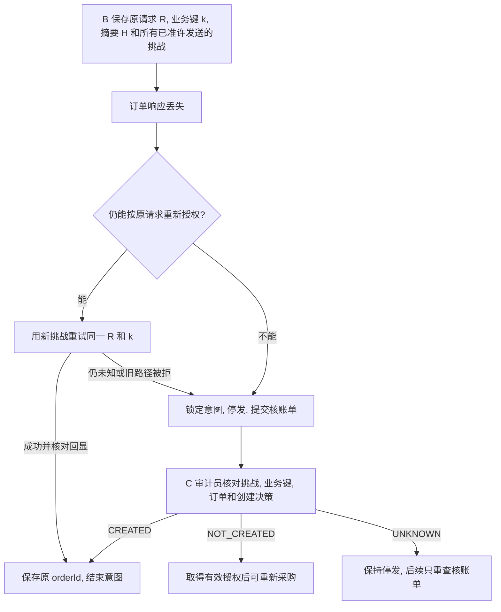

# 订单核账

B₁提交订单后超时, 再用新挑战重试时 G1 已被撤销. 第二次的拒绝只说明这一次无权执行. 第一笔订单是否已提交, 要查 C 的业务主库.

## 1 B 如何排除重复下单

B 在发送 execute **之前**持久化 intentId, 原请求, H, k, challengeId 和发送代次, 将意图标记为 OUTCOME_UNKNOWN. 停发和许可发送由同一意图锁串行处理. 停发时递增 sendRevision, 固定完整尝试清单, 拒绝迟到的旧工作进程申请新发送. 未知订单不得改价格或换键补发. 询价响应也需核对主体, 任务, 商品和总价才可推进订单.

## 2 C 如何确认业务事实

B 恢复服务用绑定角色的 mTLS 提交 {caseId,sendRevision,deploymentId,request,requestHash,challengeIds}. C 验证发送域与 actor, 同一 caseId 的内容不可改. 仅 C 审计员能执行对账. 在主库按 actor/taskId/H 枚举所有相关挑战, 与 B 的清单取并集并按 ID 排序加锁. 在所有行取得锁之后重新读取业务键与订单.

| 证据 | 可给出的业务结论 |
| --- | --- |
| 同部署/主体/任务/键/摘要的业务行与订单双向匹配 | CREATED, 返回原 orderId. 即使旧策略包已不可取也应停止补单 |
| 查无订单, 已验证停发与清单完整, 所有挑战均已消费且有拒绝决策或未用且已过期, 无待提交事务 | NOT_CREATED. 到期用锁后的可信主库时钟检查 |
| 有仍可执行的挑战, 清单不完整, 业务键与订单矛盾或已放行但缺业务行 | UNKNOWN, 继续停发 |
| 读库或锁等待失败 | 返回 503, B 保留未知状态 |

## 3 用决策的高度解释结果

1. 从订单的 creationDecisionId 找到首次允许的决策 d1, 核对请求摘要和挑战. 后续重试的拒绝 d2 单列. 两个 C 实例使用同一主库, 各自记录 verifierId 和本次启动标识.
2. 从 d1 取 deploymentId, h/hash, stateTime, decision_at, 状态及环境年龄. 用保留历史状态的可信 RPC 在 h 固定读取 RootRecord, 各域 DomainRecord 及当时 currentCertificationId 对应认证, IA/IB/IC 和主体身份/凭证, G0/G1/G2 及策略锚. 从撤销交易成功回执取得 r/hash, 按同一 G1 ID 在 r 验证 REVOKED. 若 h < r, d1 可能用旧状态获准, 仍需检查当时新鲜度. 若 h >= r 却凭该祖先放行, 记为矛盾.
3. 按决策保存的 certificationId/digest 恢复当时 T 签发的域认证并用固定 T 根验签, 不使用今天的域认证替代历史资格. 按签名包摘要恢复 C 当时的策略, 用决策中复制的 contextVersion/riskLevel/observedAt/accessDeadline 和原报价复核. 实验结束前保留历史状态, 锚定内容及决策记录. 历史不可读时记录缺口.
4. 历史复核另记 MATCHED / INCOMPLETE / MISMATCH / NO_DECISION. 确有订单却缺创建决策是 INCOMPLETE. 核账与历史复核均不得更改原订单或原挑战.

C 将审计记录和待送回执原子保存, 经授权 mTLS 发送 {caseId,checkNo,sendRevision,deploymentId,actor,taskId,requestHash,outcome,orderId}. B 验发件角色和全部绑定, 同代次同序号同内容只入库一次. 迟到的 UNKNOWN 不能重开已结意图. E7 应从只有 R/k/H 和挑战清单的状态完成这次恢复. [E7 故障与并发](../experiments/实验计划.md#4-e7-故障与并发).
