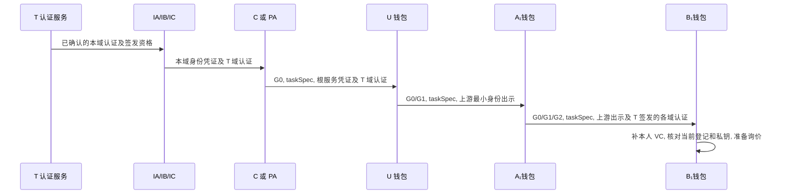

# 证据交付与网关执行

## 1 签名材料的逐跳交付

每跳先从受托者钱包经授权 mTLS 接口取得最小身份出示, 验证资格和父链, 用 issuer 的应用密钥签 JWS, 再由其管理账户登记. 签名前固定任务和批准范围. 发送方持久化原始签名字节与发件箱, 成功回执才开放投递. 接收方在新鲜块核对登记/摘要和实际收件人, 域内事务原子写材料与回执. 按 (部署,recipient,grantId) 去重, 相同包重复确认, 同键异包拒绝. 缺材料时按原摘要恢复. RP 带 IC 签发的 C 服务最小出示, BM 带 IA 签发的 PA 最小出示, 两者均带对应 T 域认证. 各受托者先从本域机构取得本人 VC 和域认证, 交付链按身份签发者去重装配 trustPaths. 两种模式均由 B₁自己保管私钥. T 的认证服务不在逐次请求路径上.

## 2 固定高度的读取器

D0 已实现的 [StateReader 和命令](../../internal/ledger/README.md)覆盖链上登记依赖的同高度装配, 历史复查, 部署绑定, 最高已见头及双时钟新鲜度. 它没有实现本节要求的凭证/域认证签名正文, DID 在线材料, 策略包, 订单锁后复核和业务准入; 在线 fresh 只说明快照年龄, 不输出采购 allow. 当前取 RP G0/G1, 每次查头且不使用跨请求记录缓存, 不宣称 B1 后台轮询优化已实现.

| 步骤 | StateProvider 的行为 |
| --- | --- |
| 选块 | 向绑定部署的 C 节点读已提交链头, 固定 number/hash/timestamp. 实例只接受单调前进的头. B0 每请求查头, B1 后台每 500 ms 轮询头. 事件只用来提前唤醒 |
| 查记录 | 从有界证据包提取依赖集合, ABI 编码 view 调用, 为每个 eth_call 的第二个参数传同一十六进制高度. 可批量或并发. 依赖必须含 RootRecord, 所有主体域以及本地 C 服务所属域的 DomainRecord/currentCertificationId/认证状态, IA/IB/IC 的机构身份和被引用的主体凭证. 额外发现的祖先与配置也用该高度 |
| 装配 | 按所读锚装配域认证, DID 文档与策略包, 核对 T 根, 域认证签名/正文与登记字段, 机构版本/范围及各签名密钥用途. T 根文档从与清单摘要一致的本地预置副本读取, C 服务身份材料在本地准备并持续校验. BM 不要求客户端重复携带未被委托引用的 C 服务凭证, 但 C 的 ready 和执行检查仍包含自身身份资格. 域认证正文来自证据包或已核验的本地存储, 不在请求期间调用 T. 记录缓存键包含 deploymentId, blockHash, 类型及 ID. 同一请求的每个必要值齐全才可判权 |
| 异常 | 查不到指定高度或缺必要正文时不放行, 不退回 latest 重查单项. 哈希冲突/回退或未来时间异常进入未就绪态. 重启后核对部署, 已见高度下限和当前新鲜度再服务 |
| 最终复核 | 实例以短锁协调头引用的切换和最终定案. 锁业务行之后若本实例已采用不同块, 释放锁并从新高度整次重验一次. 再发生竞争返回 409 STATE_CHANGED |

例如, 已确认头为 42 时, 合约查询参数为 `[{"to": registry, "data": abiCall}, "0x2a"]` (参数示意). getIdentity(B₁), getGrant(G1), getGrant(G2) 与其余查询使用完全相同的块参数. B1 可以复用已取得的同块条目, 观察到更新区块立即切换头引用. 缺少新块数据的请求拒绝, 不回退到旧块. 头观测中断时, 已选块仅可在原期限内且所需条目齐全时使用.

读取器取 `stateTime = header(h).timestamp`, 要求 `-ε <= now - stateTime <= Δstate`. 首见该块时, 以单调钟固定剩余预算 `max(0, Δstate - max(0, now - stateTime))`. 定案前同时检查墙钟年龄和单调期限. 未来时间超界或墙钟回拨时停止定案, 恢复校时后再检查新鲜度. 默认状态和环境年龄上限各 5 秒, 时钟误差假设为 1 秒. 风险观测按自己的 observedAt 检查.

静态验签缓存键包含原始字节摘要, 算法和密钥版本. 缓存命中仍须核对本次快照中的根锚, 域状态, 当前域认证及密钥资格和动态状态. 当前认证有效但缺正文返回 MATERIAL_NOT_SYNCED, 不能使用已替换的旧认证; 域状态无效报 DOMAIN_INACTIVE, 当前认证无效报 DOMAIN_CERTIFICATION_INVALID, 越界声明报 ISSUER_SCOPE_INVALID. 指定块号的调用方式见[Besu 合约读取接口](https://docs.besu-eth.org/public-networks/reference/api/eth/execute#eth_call).

选块与撤销时序的依据见[请求认证与状态一致性](../design/请求认证与状态一致性.md#3-撤销后的决策窗口).

## 3 C 如何提交订单

| 时点 | 业务主库事务与响应 |
| --- | --- |
| 挑战 | 在主库生成唯一 ID/nonce, 绑定 actor/taskId/requestHash 和受众. 锁行后先查已消费, 再查到期与绑定 |
| 初验 | 用选定高度验证持有者, 身份, 各级委托和任务. 可预检策略, 初验结果不作为事务最终允许结果 |
| 加锁 | READ COMMITTED 事务锁挑战行, 共享锁读取可信环境行并保留该副本, 行锁持有到事务结束. 以 (actor,taskId,action,idempotencyKey) 唯一占位. 并发冲突者等锁后读胜者. 拒绝时撤销暂存业务键 |
| 最终求值 | 在所有可能等锁的操作后, 检查当前块版本, 挑战, 报价归属和总价. 使用所选块的已核验事实, 锁住的当前环境副本及实际核验时间重新构造完整 OPA 输入, 重算新鲜度及有效截止并求值. 只有此次返回 true 才可放行, 不复用初验 allow |
| 定案 | 求值后再次取实际当前时间, 检查状态/环境年龄, 单调期限, 挑战及全部业务期限, 此刻记 decision_at. 已消费挑战直接报 CHALLENGE_REPLAY. 若定案前又发生等待, 重新执行最终求值和定案检查 |
| 提交 | 新允许决定将挑战消费, 决策, 唯一业务键及报价/订单一并提交. 同键同摘要且重新授权成功返回原业务 ID 和新决策. 同键异摘要冲突. 已证明持有者的业务拒绝只记决策和消费. 临时故障回滚 |
| 回应 | 收到数据库提交确认才返回终态结果. 丢失提交响应记 COMMIT_UNKNOWN. B 保持原键并按订单核账规程处理 |

订单请求的字段和摘要见[协议编码与测试向量](协议编码与测试向量.md#3-请求与可复算向量). 提交结果未知时按[订单核账](订单核账.md)恢复.

最终求值至定案期间以第 2 节的短锁协调块引用, 不在持有该短锁时等待业务行锁. 块已改变则按该节规则回滚并整次重验. 环境由共享行锁固定, 初验后已提交的 ELEVATED/BLOCKED 必须进入最终求值, 行锁取得之后的观测更新等本事务结束再生效. 决策保存实际用于最终求值的环境版本/副本, 核验时间和有效截止, 不把后来取得的版本号附到旧策略结果上.

锁后的数据库时间使用 `clock_timestamp()`, 禁止用 `now()`/`CURRENT_TIMESTAMP` 代替实际当前时间; 后两者在 PostgreSQL 中固定为事务开始时间. 状态年龄还须按第 2 节检查验证端墙钟与单调期限, 各时钟满足同一有界误差假设. [PostgreSQL 当前时间语义](https://www.postgresql.org/docs/current/functions-datetime.html#FUNCTIONS-DATETIME-CURRENT).

询价取 C 目录单价, 检查数量和乘法溢出. 报价绑定部署, 主体, 任务, 商品, 数量和币种, validUntil=min(签发时刻+300 秒, 任务截止). 下单时以报价行核对真实总额, 再比较全部祖先上限. 调价不改已有报价. 到期当秒拒绝. 报价可供同一主体在同一任务内凭不同键分别下单, 每一单都要重新授权. 正常客户端每个采购意图只下一单.

## 4 演示与交付

五个视图复用正式 API: 身份与信任 (T, A/B/C 域认证及 IA/IB/IC 到本域主体), 凭证披露, 委托树, 采购任务, 决策时间线. 决策要显示失效的域/认证或具体祖先, 实际块号/哈希和年龄, 策略及环境版本. 后端分别记录管理交易回执和订单事务, 前端只呈现结果. 首次可验收调用是 U 持 C 签的 G0 完成询价. 实施与测试顺序见[任务安排](../../TODO.md)及[实验索引](../experiments/AGENTS.md).

当前账本切片使用下列实际命令. 先按[网络说明](../../infra/besu/README.md#网络启停与重建)设置 BESU_INSTANCE/BESU_UID/BESU_GID, 实际状态和查询参数见[读取说明](../../internal/ledger/README.md).

| 步骤 | 命令与输出 |
| --- | --- |
| 环境与部署 | `docker version`, `docker compose version`; `CGO_ENABLED=0 go run ./cmd/ledgerctl init --dir .local/besu-qbft`; `docker compose -f infra/besu/compose.yaml up -d`; `CGO_ENABLED=0 go run ./cmd/ledgerctl compile`; `CGO_ENABLED=0 go run ./cmd/ledgerctl deploy --dir .local/besu-qbft --name registry` |
| 准备与读取 | `CGO_ENABLED=0 go run ./cmd/ledgerctl seed --dir .local/besu-qbft`; `CGO_ENABLED=0 go run ./cmd/ledgerctl check --dir .local/besu-qbft`; `inspect --block` 的实际调用见读取说明 |
| 测试与关闭 | `CGO_ENABLED=0 go test ./...` 默认运行单元测试, 真实链测试须显式设置实例/清单/证据目录; `docker compose -f infra/besu/compose.yaml down` 关闭并保留数据. 重建使用独立新实例目录 |
| D0 验收 | `CGO_ENABLED=0 go run ./cmd/ledgerctl verify --dir .local/besu-qbft --out .local/evidence` 编排真实网络/合约/交易/读取及故障恢复, 具体控制步骤见[网络说明](../../infra/besu/README.md#完整验收命令) |
| 未来业务 | 两种模式的完整签名夹具, 采购演示, 订单事务, 负载实验及报表命令均未实现 |
