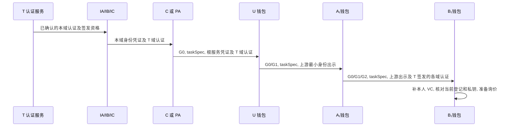

# 证据交付与网关执行

## 1 签名材料的逐跳交付

每跳先从受托者钱包经授权 mTLS 接口取得最小身份出示, 验证资格和父链, 用 issuer 的应用密钥签 JWS, 再由其 Fabric 管理证书提交登记. 签名前固定任务和批准范围. 发送方持久化原始签名字节与发件箱, 原交易 VALID 且实际交付时资格和期限仍有效才开放投递. 接收方在新鲜一致视图核对登记/摘要和实际收件人, 域内事务原子写材料与回执. 按 (部署,recipient,grantId) 去重, 相同包重复确认, 同键异包拒绝. 缺材料时按原摘要恢复. RP 带 IC 签发的 C 服务最小出示, BM 带 IA 签发的 PA 最小出示, 两者均带对应 T 域认证. 各受托者先从本域机构取得本人 VC 和域认证, 交付链按身份签发者去重装配 trustPaths. 两种模式均由 B₁自己保管私钥. T 的认证服务不在逐次请求路径上.

## 2 固定高度的读取器

在线读取返回部署, 区块号/哈希, 登记依赖和探针原期限. 可用结果表示登记事实在该进程的期限内可用. 应用签名, DID 文档, 策略及采购准入仍按后续校验. 历史模式按显式高度返回块末尾事实, 与在线就绪和探针期限分离. 合成夹具覆盖登记和装配行为.

| 步骤 | StateProvider 的行为 |
| --- | --- |
| 建立信任 | 核对 C 的可信 Peer, 创世块, 当前通道和链码定义, 固定根与实例及任务资格. 重连先核对原检查点及校验元数据 |
| 应用区块 | 核对通道, 块号, 数据哈希, 父哈希和校验码. 依交易位置应用 VALID 的登记写集, 在同一事务更新当前值, 历史和检查点. 记录删除标记和同块多版本 |
| 装配 | 只读 REPEATABLE READ 内读取检查点和全部必要依赖. 包括根, 域状态及当前认证指针, 域机构和各主体身份/凭证, 任务, 根到叶子各授权, 以及业务网关需要的 C 资格和策略锚. 新发现的引用继续使用同一事务 |
| 新鲜度 | 每个进程记录自己的探针 txID 和首次广播前的单调时间. 只采用本进程发出, Peer 为 VALID 且完整应用的原探针. nowMono 必须严格早于该探针原期限. 默认 1 秒发送, 5 秒期限 |
| 异常 | 缺依赖或历史缺口时整次失败. 同高冲突, 回退, 缺块或信任材料变化使在线未就绪. 单纯断流可用完整旧视图至原期限. 连续续读并取得新鲜已应用探针后恢复. 重启重新发探针 |
| 最终复核 | 取得业务锁后短时共享锁定检查点, 比对初验的 h/hash. 变化则回滚并整次重验. 再遇竞争返回 409 STATE_CHANGED |

`check` 输出 mode=online 和已采用的探针, `inspect --block` 输出 mode=historical 和明确的历史高度. C 的可信 Peer 保留完整区块供重放. 逐项 Evaluate 用于部署检查或对照测试, 在线装配走上述视图事务.

静态验签缓存键包含原始字节摘要, 算法, 应用 keyId 和密钥版本. 采用新高度时必须核对当前根, 域资格, 版本和状态. 当前认证有效但正文缺失返回 MATERIAL_NOT_SYNCED, 域状态无效报 DOMAIN_INACTIVE, 当前域认证无效报 DOMAIN_CERTIFICATION_INVALID, 越界声明报 ISSUER_SCOPE_INVALID. T 根文档从核对过摘要的本地副本读取, 访问期间无需调用 T. [撤销时序](../design/请求认证与状态一致性.md#3-撤销后的决策窗口).

## 3 C 如何提交订单

| 时点 | 业务主库事务与响应 |
| --- | --- |
| 挑战 | 在主库生成唯一 ID/nonce, 绑定 actor/taskId/requestHash 和受众. 锁行后先查已消费, 再查到期与绑定 |
| 初验 | 用选定高度验证持有者, 身份, 各级委托和任务. 可预检策略, 初验结果不作为事务最终允许结果 |
| 加锁 | READ COMMITTED 事务锁挑战行, 共享锁读取可信环境行并保留该副本, 行锁持有到事务结束. 以 (actor,taskId,action,idempotencyKey) 唯一占位. 并发冲突者等锁后读胜者. 拒绝时撤销暂存业务键 |
| 最终求值 | 在所有可能等锁的操作后, 锁定并比对当前视图检查点, 检查挑战, 报价归属和总价. 使用所选块的已核验事实, 锁住的当前环境副本及实际核验时间重新构造完整 OPA 输入, 重算新鲜度及有效截止并求值. 只有此次返回 true 才可放行, 不复用初验 allow |
| 定案 | 求值后再次取实际当前时间, 检查原探针单调期限, 当前环境时效, 挑战及全部业务期限, 此刻记 decision_at. 已消费挑战直接报 CHALLENGE_REPLAY. 若定案前又发生等待, 重新执行最终求值和定案检查 |
| 提交 | 新允许决定将挑战消费, 决策, 唯一业务键及报价/订单一并提交. 同键同摘要且重新授权成功返回原业务 ID 和新决策. 同键异摘要冲突. 已证明持有者的业务拒绝只记决策和消费. 临时故障回滚 |
| 回应 | 收到数据库提交确认才返回终态结果. 丢失提交响应记 COMMIT_UNKNOWN. B 保持原键并按订单核账规程处理 |

订单请求的字段和摘要见[协议编码与测试向量](协议编码与测试向量.md#3-请求与可复算向量). 提交结果未知时按[订单核账](订单核账.md)恢复.

最终求值至业务提交共享锁定视图检查点, 在获取所有可能等待的业务行锁之后才取得此锁. 检查点变化则回滚并整次重验. 环境由共享行锁固定, 初验后已提交的 ELEVATED/BLOCKED 必须进入最终求值, 行锁取得之后的观测更新等本事务结束再生效. 决策保存实际用于最终求值的环境版本/副本, 核验时间和有效截止, 不把后来取得的版本号附到旧策略结果上.

锁后的数据库时间使用 `clock_timestamp()`, 禁止用 `now()`/`CURRENT_TIMESTAMP` 代替实际当前时间; 后两者在 PostgreSQL 中固定为事务开始时间. 探针使用进程内单调钟. 业务有效期使用可信当前时钟, 校时异常时停止定案. [PostgreSQL 当前时间语义](https://www.postgresql.org/docs/current/functions-datetime.html#FUNCTIONS-DATETIME-CURRENT).

询价取 C 目录单价, 检查数量和乘法溢出. 报价绑定部署, 主体, 任务, 商品, 数量和币种, validUntil=min(签发时刻+300 秒, 任务截止). 下单时以报价行核对真实总额, 再比较全部祖先上限. 调价不改已有报价. 到期当秒拒绝. 报价可供同一主体在同一任务内凭不同键分别下单, 每一单都要重新授权. 正常客户端每个采购意图只下一单.

## 4 演示与交付

五个视图复用正式 API: 身份与信任 (T, A/B/C 域认证及 IA/IB/IC 到本域主体), 凭证披露, 委托树, 采购任务, 决策时间线. 决策要显示失效的域/认证或具体祖先, 实际块号/哈希和探针期限, 策略及环境版本. 后端分别记录原管理交易校验结果和订单事务, 前端只呈现结果. U 持 C 签的 G0 完成询价是直接访问示例. 实验方法与判据见[实验索引](../experiments/AGENTS.md).
