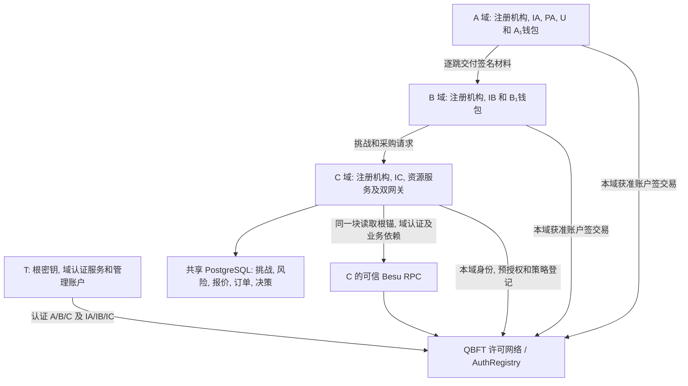

# 部署与链上登记

## 1 部署与引导

1. Compose 启动固定的四个验证节点, A/B/C 服务及各自独立数据库. 业务服务端口为 8101/8102/8103, 第二个 C 网关为 8104. T 的独立认证服务使用 8100 和独立数据库/密钥, 经受限 RPC 提交管理交易. 第四个验证节点仍由实验运维控制, T 不因担任身份根而获得验证节点角色, 业务仍只有三域.
2. 三域通过受信渠道共同确认 T 根和部署清单. 清单固定 RootRecord 的 rootDid, managementIdentity, didDocumentDigest, appKeyId, appKeyVersion, appPublicKey, T 的服务地址及 mTLS 角色. 根 DID 文档随清单预置在各域本地, 核对固定摘要和 assertionMethod, 访问期间无需连接 T 的 DID 主机. 受信部署账户按清单一次初始化合约, 之后没有绕过 T 的域准入入口. 根字段在同一部署内不可变, 服务启动时与本地预置信息逐项核对. 根可信性来自初始分发, 不计作链上多签或链自行认证.
3. 每次重建生成随机 32 字节 instanceId 并由合约只读暴露, 正常重启沿用. deploymentId 取 JCS({chainId,genesisHash,registryAddress,runtimeCodeHash,instanceId,schemaVersion}) 的 SHA-256 小写 hex. chainId 用十进制字符串, EVM 地址和哈希用 0x 前缀小写 hex, instanceId 为无前缀小写 hex. 代码哈希为已部署运行时代码的 Keccak-256. 启动逐项比对, 失败不提供业务服务.
4. T 核实企业域身份, 域 DID 控制权, 管理员及注册机构地址, IA/IB/IC 的 DID/应用密钥/管理账户控制权和申请范围. T 的注册挑战绑定 deploymentId, domainId, domainDid, 管理员, 注册机构, 各身份机构的 DID/地址/文档摘要/公钥及版本, 申请范围和期限, challengeId, nonce 及截止时间. 域管理员作管理账户证明, 域 DID 及每个身份机构分别作应用密钥与管理账户双证明. T 原子消费挑战, 以 T 管理账户引导登记 DomainRecord 和域 DID/身份机构的 IdentityRecord; 此时域为 PENDING, 不能注册普通主体或签发可采信身份. 引导接口只能登记域本身及身份机构, 不代办普通用户或智能体身份.
5. 首份域认证引用第 4 步已确认的引导 operationId, 且正文的域/机构/范围/期限须与挑战批准内容相同. 已有域续发或变更时重新建立挑战, 在域认证提交接口核验并消费新的控制权证明. T 用根应用密钥签 DomainAuthorityCredential, 用根管理账户登记其摘要及与正文一致的域/机构/范围字段, 首次认证将 PENDING 域转为 ACTIVE, 设置 currentCertificationId; 替换保留域的 ACTIVE/SUSPENDED 状态, 不恢复 REVOKED 域. 正文先保存在 T 的发件记录, 成功回执后投递给本域注册机构及身份机构, 收件人核对 T 签名, 摘要, 当前指针和字段后持久化. 通过受限 mTLS 可按 ID 重取同一正文, 访问验证不依赖实时调用 T.
6. 本域注册机构登记 PA, U/A₁/B₁, C 资源服务及其他本域主体. 注册挑战绑定 deploymentId, 域, DID, 域内账号承诺, 管理地址, 应用公钥/版本, 文档摘要, 会话对应的 challengeId, nonce 和截止时间. 应用密钥签 ES256 JWS, 管理账户用 ERC-191 personal_sign 签同一挑战的 JCS UTF-8 字节. 注册机构恢复地址并核对会话与两份签名, 原子消费挑战后以本域注册账户提交. [ERC-191 消息签名](https://eips.ethereum.org/EIPS/eip-191).
7. IA/IB/IC 签发本域身份凭证. PA 生效后由 A 管理员登记为 purchasingAuthority. C 发布唯一身份根为 T 的策略包及采购准入条件, 其服务 DID 另须持 IC 签发的 supplier-service 凭证. 风险服务定期实际采样并写主库. C 服务最小身份出示和 T 的 C 域认证随受控配置材料交付 A/B, 此后变化由域间材料接口更新. 各方以新鲜状态核验服务 DID 与配置 HTTPS 端点的映射, BM 客户端也须认证目标 C 服务. 引导管理接口与业务就绪检查分开.

## 2 谁能改合约中的哪一行

AuthRegistry 将根账户, 域管理员/注册机构/身份机构地址, 主体管理地址和 DID 显式关联. 管理角色由 msg.sender 和登记记录解析, 服务端不能靠传入 issuer 字符串冒充签发者. ID 以 SHA-256(UTF-8(ID)) 索引, 操作绑定部署. 合约保留终态和 revision, 拒绝复用 ID. 修改检查 expectedRevision, 已签对象另查预期摘要.

| 写入 | 合约允许的调用者与状态约束 |
| --- | --- |
| 根锚 | 仅部署构造时初始化 RootRecord, 后续无写入口. 换根或根密钥恢复需要新部署与新域认证 |
| 域准入及机构引导登记 | 仅 T 管理账户. 新域初态 PENDING, 域 DID 和身份机构仅按受核实清单引导登记, 不能借此登记普通主体. 已有域的机构增设或管理身份恢复须经 T 新挑战核实后更新对应引导身份记录 |
| 域认证登记 / 替换 / 撤销 | 仅 T 管理账户. 检查域和机构登记, 密钥版本, 非空有限范围及期限. 替换用新 ID 原子更新当前认证和受认证配置, 旧认证标为 REVOKED; 失败全部回退 |
| 域状态 | 仅 T 管理账户. ACTIVE 可暂停或撤销, SUSPENDED 可在当前认证仍有效时恢复或转 REVOKED. REVOKED 是终态, 不得靠新认证恢复已撤销域 |
| 域管理员 / 注册机构 / identityIssuers | 仅 T 通过新域认证原子更新. 域管理员不能自行增设签发者或扩大范围, 域 DID 的恢复也须 T 复核并重发认证 |
| PA 业务资格 | 本域管理员配置 purchasingAuthority, 必须是本域有效服务. PA 的业务资格与 T 认证的身份签发资格分开 |
| 普通身份注册 / 轮换 / 恢复 | 注册及管理地址恢复由本域当前注册机构审核, 应用换钥由主体登记地址提交并证明新钥持有. 域须有效, 管理地址与 DID 唯一绑定. 身份机构换钥后还须 T 更新域认证才恢复签发资格 |
| 身份状态 | 普通身份的当前管理账户或本域当前注册机构可暂停/撤销, 只有当前注册机构可恢复暂停身份. 域 DID/身份机构引导身份仅 T 可暂停/恢复/撤销. 检查 expectedRevision, REVOKED 无后续转换 |
| 双域关联 | 一侧注册机构提案, 另一侧在截止前批准同一摘要, 两域资格及端点版本仍有效. 任一端主体或所属注册机构可撤销 |
| 企业身份凭证 | 仅本域当前获 T 认证的身份签发者登记, 主体必须属于本域, 签发者密钥版本须与认证一致. 原签发者可撤销自己的凭证 |
| 任务与根授权 | 由受信部署清单在构造时固定 A 域/U 的任务创建资格, 仅该 U 当前管理账户在身份/域认证/凭证及版本有效时创建任务, 不提供运行期增授权入口. 创建者或资源方可取消. RP 根限该资源的 C, BM 根限该采购域当前 PA. G0.grantee 必须是任务创建者 |
| 子授权与暂停 | 父 grantee 才能登记子, 检查父/根引用, 任务, 深度和时间边界. 原 issuer 可暂停/恢复自己的非终态授权 |
| 撤销 / 替换委托 | issuer, grantee, 本路径采购根签发者或资源方可撤销相关对象. 仅原 issuer 可原子撤旧并登记新 ID, 保持父, 任务, 模式与根权源. T 无采购授权管理角色 |
| 策略 | 仅 C 策略管理员发布递增版本和策略摘要. 内容寻址签名包先保存并预编译. 网关核对根锚及策略锚后采用, 策略不能更换 T 根 |

资格无效后拒绝新增注册, 凭证, 关联批准及任务/委托等业务写入, 仍允许原管理者撤销其既有对象. 域暂停, 域认证到期或撤销不批量改写下属凭证/授权的存储状态, 访问端按依赖计算失效. T 可在非终态域上续发新认证以恢复资格, 新认证不能恢复被单独撤销的凭证或授权.

链上保存根锚, 域认证的摘要/结构化范围/状态, 身份密钥锚, 凭证和委托摘要/状态, 任务及策略摘要. 原始域认证 JWS, SD-JWT, 披露盐, 签名委托, 策略正文和订单留在受控链下存储. 合约按执行顺序核对写权限, 当前指针, 域/主体/密钥状态和结构化字段; 域认证正文的 T 签名及完整字段一致性, 凭证声明范围和逐维授权包含在服务和验证端核验. 登记成功不等于获得访问许可.

**确认与重试.** 服务先原子保存操作键, 正文, 分配的账户 nonce 和原始已签交易, 每账户串行分配 nonce. T 的挑战消费, 核实记录, 发件记录和待提交交易同样须在其本地事务中持久化, 不能消费挑战后丢失待办操作. 202 返回 operationId. 可信节点返回相符 txHash 的 receipt, 核对目标合约, 块号和哈希. status=0x1 才记 CONFIRMED, 0x0 记 FAILED, 状态全部回退但交易仍耗 gas. 回执缺失保持 PENDING, 按原哈希查询或重播相同交易. 相同操作键和输入复用原操作, 不同输入返回冲突. [Besu 交易回执](https://docs.besu-eth.org/public-networks/reference/api/eth/transaction#eth_gettransactionreceipt).

HTTP 409 STATE_CHANGED 仅用于新请求被接受前已发现的版本冲突. 接受后原 POST 已返回 202, 入块时才出现的冲突通过原 operationId 查询为 HTTP 200, status=FAILED, failureCode=STATE_CHANGED, 保留失败交易及回执, 不重新响应原 POST. PENDING/CONFIRMED 的 failureCode 均为 null. 精确操作键重试先命中原操作, 即使其已 FAILED 或预期版本已过时也不生成另一交易. [管理响应规则](REST接口与响应码.md#2-rest-接口).

合约使用固定 custom error 区分版本竞争, 权限及生命周期错误. 具体 failureCode 只能由可信节点提供的原交易实际执行回退数据映射, 保存其与 txHash/区块/交易位置的绑定; 部署验证须核对目标节点获取和解码该数据的能力. receipt 的 status=0x0 本身没有具体业务原因, 不能以事后最新状态或单独在父块重跑 eth_call 猜测原交易失败原因. 实际回退数据暂不可得或不能解码时使用 TRANSACTION_REVERTED, 后续取得确切证据可补充具体码, FAILED 状态及原回执不变. 客户端始终将其视为未成功登记, 不交付材料.

管理交易确认后才能交付已登记材料. 下一步见[证据交付与网关执行](证据交付与网关执行.md).

若单交易跟踪与原回执的执行状态不一致, 仅允许按原 receipt.blockHash 跟踪整块, 核对原块号/哈希, 完整交易顺序及原 transactionIndex/txHash, failed, gas 和完整性后, 从同一执行的 returnValue 或根深度 REVERT.reason 解码. 保留单交易跟踪和整块原文, 任一绑定不符或不能解码时保留 FAILED/TRANSACTION_REVERTED, 不使用父块独立模拟. 后续取得可信原因时只补充具体码, 不改变原失败终态和回执.

## 3 身份状态与管理账户恢复

普通身份包含 U, A₁/B₁, PA 和 C 资源服务; 域 DID 和 IA/IB/IC 的引导身份按 T 管理分支处理. 每个 IdentityRecord 登记后存储状态为 ACTIVE, 其所属域仍为 PENDING 时也不能有效使用. 有效身份要求身份为 ACTIVE 且所属域/当前域认证有效, 身份机构还须符合当前资格与密钥版本.

| 转换 | 普通身份的调用者 | 域 DID/身份机构引导身份的调用者 | 前提 |
| --- | --- | --- | --- |
| ACTIVE -> SUSPENDED | 本人当前管理账户或本域当前注册机构 | T | 版本匹配, 原因非空 |
| ACTIVE/SUSPENDED -> REVOKED | 本人当前管理账户或本域当前注册机构 | T | 版本匹配, 终态不可恢复 |
| SUSPENDED -> ACTIVE | 本域当前注册机构复核后提交 | T 复核后提交 | 所属域和当前认证有效; 机构须同时匹配当前认证 |

同状态的新操作或从 REVOKED 发起任何变更返回 IDENTITY_STATE_CONFLICT. 原操作键的精确重试仍返回原 operationId. 域资格失效期间允许上述有权者暂停/撤销既有身份, 不允许恢复, 普通换钥或普通管理账户恢复. 域 DID/机构的非终态密钥及管理账户恢复由 T 引导接口处理, 不受普通域有效前提阻塞, 但不自动恢复身份或域状态; 新钥仍须重新认证. T 可为已登记且暂停的非终态机构绑定新认证, 该认证不改变其暂停状态, 待资格/密钥匹配后另行恢复身份. T 根不走此入口.

普通管理账户恢复先由当前注册机构重新认证原域内账号, 确认原 accountCommitment 和恢复理由, 不依赖已丢失管理密钥的签名. 恢复挑战是 JCS UTF-8 对象, 必填 purpose="grad-identity-recovery-v1", deploymentId, domainId, subjectId, accountCommitment, oldManagementIdentity, newManagementIdentity, expectedRevision, expectedKeyVersion, newAppKeyId, newAppKeyVersion, newAppPublicKey, newDidDocumentDigest, challengeId, nonce, issuedAt, expiresAt. 地址/公钥/文档摘要按[固定编码](协议编码与测试向量.md#14-did文档-公钥与凭证上下文编码)表示; nonce 统一遵守[挑战 nonce 编码](协议编码与测试向量.md#21-挑战-nonce-编码), 有效期最多 300 秒. 新管理地址须未绑定其它身份, 且与旧地址不同; 新应用密钥不得与旧钥相同, newAppKeyVersion=expectedKeyVersion+1.

新应用密钥以 ES256 JWS 签挑战, 新管理账户以 ERC-191 personal_sign 签同一 JCS 字节. 注册机构核对当前 revision/密钥版本, 两份证明, 会话与期限, 并按[编码规格第 1.4 节](协议编码与测试向量.md#14-did文档-公钥与凭证上下文编码)核对已保存候选文档的 id, 新 keyId/公钥/用途及摘要. 在同一本地事务中消费挑战, 保存恢复核实记录及待提交管理交易. 合约仅接受本域当前注册机构, 原子更换管理地址, 文档及应用密钥, 增加 revision 和 appKeyVersion, 保留 subjectId/domainId/accountCommitment/原 status; 并发变更使交易回退. 结果未知按原 operationId/交易哈希处理, 不再次消费挑战生成另一操作.

成功确认后旧管理地址不再代表该身份, 旧密钥版本的凭证, 关联及委托按访问/关联规则失效, 不改写它们的原始存储状态. SUSPENDED 身份恢复账户后仍是 SUSPENDED, 须另走注册机构恢复状态操作. REVOKED 身份不得通过恢复或再次注册同一 DID 重新启用.
