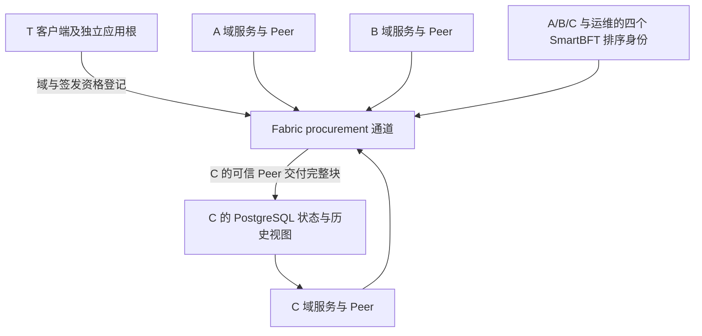

# 部署与链上登记

## 1 部署与引导

1. A/B/C 分别运行一个 Peer 并加入同一业务通道. MSP 限制通道准入, TLS 保护连接. A/B/C 及实验运维分别控制四个排序身份, 区块签名取三者. 日常链码背书取 A/B/C 任意两个 Peer, 链码生命周期及关键应用通道政策由三域共同批准. T 以独立 TMsp 客户端提交及查询, 业务域仍是 A/B/C 三个. 后续业务服务端口为 8101/8102/8103, 第二个 C 网关为 8104, T 为 8100. [技术栈](技术栈.md).
2. 三域核对同一公开引导清单. 清单固定通道, T 的 RootRecord, 初始化客户端, A 域/U 的任务创建资格, C 的资源绑定和 instanceId. 各组织安装的链码包绑定清单摘要, 初始化证书和该链码构建摘要. 初始化入口核对调用者和完整摘要, 读取未占用的根键, 原子写入根, 实例参数和任务创建资格. 根 DID 文档随信任材料分发并核对摘要, 固定根变更需要新部署.
3. 实例标识为随机 32 字节的无前缀小写 hex. deploymentId 绑定 channelId, 创世块头哈希, 链码名, instanceId 和 schemaVersion. 通道已提交定义提供版本, sequence 和策略. 各组织安装 package ID 另随构建和清单摘要锁定. 启动核对信任材料, 实际通道与配置, 链码定义, 根和任务资格, 再续读原检查点. 通道配置或链码定义出现未批准的变更时停止在线检查. [部署绑定与管理证明](协议编码与测试向量.md#4-部署绑定与管理证明).
4. T 核实企业域身份及域 DID, 管理员, 注册机构和 IA/IB/IC 的控制权. 挑战绑定部署, 域, DID, 管理证书绑定, 申请范围和期限, 应用密钥版本与文档摘要, 一次性 nonce 和会话. 域及身份机构各证明应用密钥和管理证书私钥控制权, 管理员和注册机构各证明自己的管理证书私钥. T 消费挑战, 以 T 管理证书提交引导交易, 域初态 PENDING, 只登记域与其身份机构.
5. 首份认证引用已经 CONFIRMED 的引导操作, 并匹配批准的域, 机构, 范围及期限. T 用根应用密钥签 DomainAuthorityCredential, 用根管理证书登记结构字段和摘要. 首份认证将域置为 ACTIVE 并设置当前认证指针. 后续业务认证续发或变更须重新核实双证明, 原子替换认证和指针, 保留 ACTIVE/SUSPENDED, REVOKED 为终态. 原正文先持久化, 原交易 VALID 后复核当前资格和实际期限, 然后投递. 收件人核对签名, 摘要和当前指针并按原 ID 保存.
6. 本域注册机构核对普通主体会话及域内账号承诺. 注册挑战绑定 deploymentId, 域, DID, 管理证书绑定, 应用公钥/版本, 文档摘要和截止时间. 应用密钥作 ES256 JWS, 管理证书私钥签同一挑战的规范字节. 机构核对两份证明后原子消费挑战并受理登记. 签发机构凭当前 T 认证登记本域凭证锚, 链码核对主体归属, 密钥版本和批准范围.
7. C 的服务 DID 持 IC 签发的 supplier-service 凭证. 后续由本域管理员登记 PA 的 purchasingAuthority, C 发布引用固定 T 根的策略包. 服务 DID 及当前域认证通过受控渠道交付 A/B, 按已核验身份和配置核对 HTTPS 端点. 风险环境由 C 的独立观测源写入主库.

## 2 登记权限与交易结果

Fabric 为每次调用验证客户端签名. 链码从该 X.509 客户端证书计算 (MSPID, SHA-256(DER)), 用当前登记绑定确定角色. 业务键按类型及 SHA-256(UTF-8(ID)) 定位, 写入绑定 deploymentId. 逐键读取调用者绑定, 域与当前认证指针, 凭证锚, 任务, 目标授权和祖先. 唯一 ID 或证书绑定在写入前读取, 使并发创建进入 MVCC 校验. expectedRevision 和预期摘要约束业务版本, 保留终态及原摘要.

| 写入 | 调用者与条件 |
| --- | --- |
| 初始化根及资格 | 仅清单指定的客户端, 清单摘要匹配且根键不存在 |
| 域/机构引导与首份认证 | 仅 T, 域从 PENDING 到 ACTIVE, 机构版本及有限范围与域匹配. T 可以按预期 revision 暂停域或恢复仍具资格的域 |
| 普通身份 | 本域当前注册机构, subjectId 和管理证书绑定唯一, 初始版本为 1 |
| 凭证锚 | 本域当前具资格的签发者, 核对凭证类型, 声明名, 主体归属和双方密钥版本. 签发区间满足 `cert.nbf <= credential.nbf` 及 `credential.exp <= cert.exp` |
| U 任务与 RP G0 | 受信清单固定 A 域/U 的任务创建资格. U 须具当前身份和凭证, C 以该资源所有者身份签发给任务创建者 |
| RP 子授权 | 父 grantee 调用, 核对父 ID/摘要, 根, 任务, 模式, 双方凭证/密钥, 期限和剩余深度 |
| 撤销或替换 | issuer, grantee, 根 issuer 或资源方可撤销, REVOKED 为终态, T 没有采购撤销权. 仅原 issuer 可撤旧并建新 ID, 保持父, 根权源, 任务与模式 |
| 探针 | 每实例专用证书, 写入该证书的专用键, 写集与登记键分开 |

完整业务生命周期延续相同角色边界. 域认证的续发, 替换及撤销由 T 控制, 域管理员不能独立改变被认证的角色和范围. 普通身份状态和恢复按第 3 节办理, 双域关联由两端注册机构审批同一摘要. BM 根限 A 域当前获准的 PA, grantee 为任务创建者. 策略发布由 C 策略管理员签名, 采用递增版本和摘要, 内容寻址签名包先保存并预编译. 采购方和资源方的授权各遵循自己的权源.

有资格要求的管理操作按提案时间 t 检查 `t - (w + epsilon) >= nbf` 且 `t + (w + epsilon) < exp`. 三个 Peer 启用同一时间窗口 w, 校时误差界为 epsilon. 子区间还须结构上包含于上级批准区间内. 已背书交易可以晚于业务期限通过提交校验, 交付和业务定案仍以可信实际时钟重验全部期限与当前资格. 有权调用者可撤销已经到期的记录.

账本登记可共享的结构字段, 原文摘要, 状态和版本. 提案参数, 公开写集及事件同样遵守该披露边界. 凭证正文, 披露盐, 签名委托, 策略正文和报价留在受控链下存储. 服务端核对原签名和正文, C 核验逐维包含及金额约束. D0 合成夹具使用真实管理证书和 Fabric 提交, 其应用密钥锚与摘要只用于验证登记及状态读视图.

### 2.1 提交确认与恢复

新操作按操作键协调并发. 持久化部署, 调用者, 输入摘要, 原签名提案和 txID 后背书, 首次广播前持久化完整已签交易. T 的挑战消费, 核实记录, 原签名材料和待办操作须在同一本地事务提交. 同键同输入查询原操作, 同键异输入为冲突. 原广播后按原 txID 查询可信 Peer, 需要时重投原已签字节.

初始化已有效提交而部署清单缺失时, 续跑以原批准包及原签名交易为依据. 核对可信 C Peer 的原区块, 校验码及已登记的根后写出清单. 重复初始化的拒绝在验收中检查.

| 原始证据 | 结果 |
| --- | --- |
| 原提案确定性拒绝 | FAILED, 阶段 ENDORSE. 有可核对的原响应时映射具体原因, 其余确定性拒绝为 ENDORSEMENT_REJECTED |
| 广播接收, 超时或 Peer 尚未看到原结果 | PENDING. 保存实际阶段和故障信息 |
| 原交易为 VALID | 核对原签名交易, txID, 通道, 调用者, 链码, 块号/哈希和交易位置后 CONFIRMED |
| 原交易入块无效 | FAILED, 阶段 COMMIT. MVCC_READ_CONFLICT 为 STATE_CHANGED, 其它无法细分的结果为 COMMIT_INVALID |
| 原交易重播 | 记录排序入口拦截或 Peer 的 DUPLICATE_TXID. 只归并与原已签字节相符的最初结果, 无法核对时保持待查 |

新请求在受理前发现版本冲突返回 409 STATE_CHANGED. 已受理请求返回 202 和原 operationId. 查询为 200, 并返回原操作的 PENDING, CONFIRMED 或 FAILED. 原因以原提案响应或原区块校验码为准, 事后模拟没有取证效力. 只有确认 VALID 且交付时资格及期限仍有效才开放材料. [管理响应](REST接口与响应码.md#2-rest-接口), [证据交付](证据交付与网关执行.md).

## 3 身份状态与管理账户恢复

普通身份包含 U, A₁/B₁, PA 和 C 资源服务; 域 DID 和 IA/IB/IC 的引导身份按 T 管理分支处理. 每个 IdentityRecord 登记后存储状态为 ACTIVE, 其所属域仍为 PENDING 时也不能有效使用. 有效身份要求身份为 ACTIVE 且所属域/当前域认证有效, 身份机构还须符合当前资格与密钥版本.

| 转换 | 普通身份的调用者 | 域 DID/身份机构引导身份的调用者 | 前提 |
| --- | --- | --- | --- |
| ACTIVE -> SUSPENDED | 本人当前管理账户或本域当前注册机构 | T | 版本匹配, 原因非空 |
| ACTIVE/SUSPENDED -> REVOKED | 本人当前管理账户或本域当前注册机构 | T | 版本匹配, 终态不可恢复 |
| SUSPENDED -> ACTIVE | 本域当前注册机构复核后提交 | T 复核后提交 | 所属域和当前认证有效; 机构须同时匹配当前认证 |

同状态的新操作或从 REVOKED 发起任何变更返回 IDENTITY_STATE_CONFLICT. 原操作键的精确重试仍返回原 operationId. 域资格失效期间允许上述有权者暂停/撤销既有身份, 不允许恢复, 普通换钥或普通管理账户恢复. 域 DID/机构的非终态密钥及管理账户恢复由 T 引导接口处理, 不受普通域有效前提阻塞, 但不自动恢复身份或域状态; 新钥仍须重新认证. T 可为已登记且暂停的非终态机构绑定新认证, 该认证不改变其暂停状态, 待资格/密钥匹配后另行恢复身份. T 根不走此入口.

普通管理账户恢复先由当前注册机构重新认证原域内账号, 确认原 accountCommitment 和恢复理由, 不依赖已丢失管理密钥的签名. 恢复挑战是 JCS UTF-8 对象, 必填 purpose="grad-identity-recovery-v1", deploymentId, domainId, subjectId, accountCommitment, oldManagementIdentity, newManagementIdentity, expectedRevision, expectedKeyVersion, newAppKeyId, newAppKeyVersion, newAppPublicKey, newDidDocumentDigest, challengeId, nonce, issuedAt, expiresAt. 管理证书绑定/公钥/文档摘要按[固定编码](协议编码与测试向量.md#14-did文档-公钥与凭证上下文编码)表示; nonce 统一遵守[挑战 nonce 编码](协议编码与测试向量.md#21-挑战-nonce-编码), 有效期最多 300 秒. 新管理证书绑定须未绑定其它身份, 且与旧地址不同; 新应用密钥不得与旧钥相同, newAppKeyVersion=expectedKeyVersion+1.

新应用密钥以 ES256 JWS 签挑战, 新管理证书私钥以 P-256 ECDSA 签同一 JCS 字节的 SHA-256. 注册机构核对当前 revision/密钥版本, 两份证明, 会话与期限, 并按[编码规格第 1.4 节](协议编码与测试向量.md#14-did文档-公钥与凭证上下文编码)核对已保存候选文档的 id, 新 keyId/公钥/用途及摘要. 在同一本地事务中消费挑战, 保存恢复核实记录及待提交管理交易. 链码仅接受本域当前注册机构, 原子更换管理证书绑定, 文档及应用密钥, 增加 revision 和 appKeyVersion, 保留 subjectId/domainId/accountCommitment/原 status; 并发变更使读集校验失败. 结果未知按原 operationId/txID处理, 不再次消费挑战生成另一操作.

成功确认后旧管理证书绑定不再代表该身份, 旧密钥版本的凭证, 关联及委托按访问/关联规则失效, 不改写它们的原始存储状态. SUSPENDED 身份恢复账户后仍是 SUSPENDED, 须另走注册机构恢复状态操作. REVOKED 身份不得通过恢复或再次注册同一 DID 重新启用.
