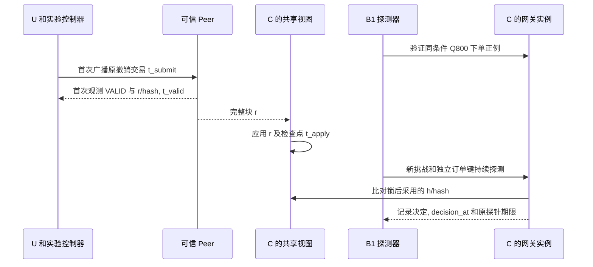

# E6 撤销窗口

## 1 研究问题与范围

B1 持有效 Q800 且风险及其它条件均允许下单时, U 撤销上级委托 G1 后, 各网关实例还能沿原路径下单多久? 在同一时基下, 可信 Peer 首次观测撤销交易为 `VALID` 后, 旧视图可用窗口上界为 `deltaState`. 管理提案时间窗口属于背书期的资格检查. [撤销后的决策窗口](../../docs/DESIGN.md#43-撤销后的决策窗口), [固定高度的读取器](../../docs/IMPLEMENTATION.md#42-固定高度的读取器).

## 2 对照与变量

RP 与 BM 分别用独立的任务和授权 ID. 合法兄弟支作为对照. 默认根后深度为 2, 状态探针发送间隔为 1 秒, `deltaState` 为 5 秒. 扫描 `deltaState` 为 1/5/15 秒, 记录实际生效值及发送间隔. 扩展分别改变撤销对象, 深度 2/8 和后代数 1/10/100.

## 3 输入与准备

每轮从 G1/G2 `ACTIVE` 开始, 用真实材料询价生成属于 B1 的 Q800. 整轮早于报价, 任务和授权截止, 保持风险新鲜且为 `NORMAL`. 预热并完成至少一次实际下单. 多实例使用同一 C 共享视图和各自进程的原探针. 采用确定性工具和[共用复现约定](../实验计划.md#共用复现约定).

## 4 执行与采样

1. 默认每实例每 20 ms 计划发起一次旧路径订单探测, 各用新挑战和独立业务键并重签. 记录实际发送间隔, 排队和漏探测.
2. 记录首次发送 `t_submit`, 可信 Peer 首次观测原 txID 为 `VALID` 的 `t_valid`, 撤销块 `r/hash` 及交易位置, 首次应用 `r` 的 `t_apply`, 以及各实例首次采用 `h >= r` 的 `t_adopt,j`.
3. 每次决定保存 `h/hash`, G1 状态, 所用原探针的 txID, 所在块, 原发送和期限, 网关定案 `decision_at`, 理由, 业务提交与客户端响应时点. 记录实际时基和分辨率, 跨机观测另记校时误差. 若订单响应未知, 按[核账规程](../../docs/IMPLEMENTATION.md#7-订单核账)定位原创建决定.
4. 每轮持续至少 `max(30 秒, 2 x deltaState + 10 秒)`, 主要场景独立重复至少 30 次.

## 5 判据与缺测

采用 `h >= r` 后仍允许旧路径, 或定案到达或越过所用原探针期限后仍允许, 均判失败. `h < r` 时已定案, 随后才返回业务提交响应的样本单列. 用定案时点确定各实例最后允许 `t_last_allow,j`. 记录首次拒绝 `t_first_deny,j` 的观测点, 对未产生业务决定的拒绝保留响应时点和缺测原因. 对可确定的允许样本计算确认后窗口 `max(0,t_last_allow,j-t_valid)`, 并报告相对首次提交的窗口.

确认后允许未观测到, 撤销未确认, 漏探测, 请求未完成及时间精度不足以确定先后的轮次, 分别记录原因, 实际分辨率及删失口径. D0 的合成 G0/G1 检查覆盖 h/r 登记与探针期限. 订单级 E6 则以真实材料, 实际报价与数据库决定验证业务结果.

## 6 结果表和图

按配置和实例报告 `t_valid-t_submit`, `t_apply-t_valid`, `t_adopt,j-t_apply`, 最后允许与首次拒绝, 确认后窗口和可用率. 时间线标出 `h/r`, 拒绝原因及原探针期限, 另画不同 `deltaState` 下窗口与可用率. 列出独立轮数, 未观测和违规放行数, 用运行 ID 链接 `requests.csv`, `revocations.csv` 和汇总.
