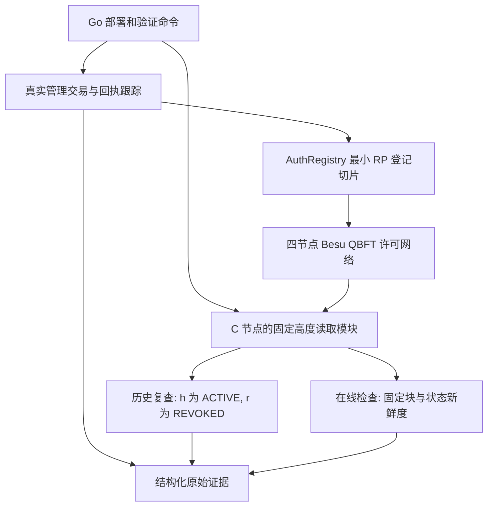

# 技术设计

## 背景

动机和交付边界见 [提案](proposal.md). 本变更从 Go 模块, Solidity 源码, Compose 配置和测试的最小工程骨架开始, 实际交付见[D0 证据索引](../../../../infra/besu/evidence/README.md). 本机为 arm64, 镜像与编译工具的兼容性以目标环境实测为准, 不能把架构推断当作支持证据.

实现遵循 [部署与链上登记](../../../../docs/implementation/部署与链上登记.md), [固定编码](../../../../docs/implementation/协议编码与测试向量.md) 和 [读取器契约](../../../../docs/implementation/证据交付与网关执行.md#2-固定高度的读取器). 行为要求分别在 [许可账本](specs/permissioned-ledger/spec.md), [授权登记](specs/authorization-registry/spec.md), [固定高度状态](specs/fixed-height-state/spec.md) 维护.

## 目标与非目标

**目标:**

- 将真实交易执行, 历史状态复查和在线快照检查拆成可组合模块, 后续 C 网关可以复用读取模块.
- 使用足以建立 G1 的正常登记依赖, 保证权限负例能在真实 EVM 上入块回退.
- 每项失败和超时均有证据, 不将缺少业务验证的 D0 结果包装成采购准入决定.

**非目标:**

- 不建立通用登记平台或预先实现全部生命周期接口. 未覆盖的入口保持不存在, 不使用总是成功的占位实现.
- 不在 D0 复刻完整的域认证服务和凭证钱包. 夹具明确区分真实管理交易签名与合成应用材料.
- 本轮不测撤销后的订单接受窗口. 这里只检查状态读取及可用性, E6/E7 的订单效果仍需 M1/M2 之后验证.

## 决策

### 1. 四节点 Compose 和本地验证命令

`infra/besu/` 保存 Compose, genesis 模板和每节点配置, 四把验证密钥对应 A/B/C/实验运维. C 节点兼作首个可信读取节点, 停机验证优先停止其它节点, 使 C 的 RPC 仍可返回停链后的旧头. 无需为这个里程碑再增加第五个观察节点.

节点使用同一许可名单, 业务账户在 genesis 预置足够测试余额. 应用不调用节点托管私钥的解锁接口. 对外映射的 RPC 绑定回环地址, Compose 内部使用隔离网络. 调试 API 仅在受控验证配置中启用. 默认持续空块, blockperiodseconds 预设 1, 超时参数显式记录; 不关闭空块来减少日志或磁盘使用.

候选镜像和工具先在目标架构完成启动, 部署及回退跟踪探针, 再锁定 digest 和编译器. 编译采用固定 Solidity 编译器的 standard JSON 输入, 保存 optimizer, evmVersion, ABI 和字节码; EVM 目标必须与 genesis 激活规则一致. Go 通过 ABI 调用及本地签交易, 不为这次验证引入前端或额外 JavaScript 工程.

备选单节点开发链无法验证选定的共识和故障行为. 完整三域服务一起启动会把凭证及数据库问题混入最初的读链验证. 因此先保留四节点和一个 Go 命令行入口.

### 2. 最小合约切片和正常引导夹具

`contracts/AuthRegistry.sol` 以现有字段契约为准, 仅实现本轮使用的构造, 引导, 登记, 撤销和只读查询. 固定 RootRecord, instanceId 和 schemaVersion, 支持 DomainRecord, DomainCertificationRecord, IdentityRecord, 凭证锚, 任务及 G0/G1 的必要记录. ID 索引使用 UTF-8 的 SHA-256, 不以事件索引代替历史状态查询.

首份夹具仅涉及 A/C 域, IA/IC, U, A1 和 C 服务, 用 RP 模式建立 G0 和 G1. IA/IC 仅由 T 引导; U/A1/C 服务由对应注册机构登记; 凭证锚由本域当前获认证机构登记; U 创建任务, C 作为资源所有者登记 G0, U 作为 G0.grantee 登记 G1. 资源到 C 服务的绑定来自受信部署配置并在合约核对, 不能仅采信根登记者自报的 issuer 或所有权.

D0 的任务创建资格由受信部署清单固定, 构造时绑定 A 的 domainId 和 U 的 subjectId, 只读暴露且没有运行期增授权入口. 任务登记须由该 U 的当前管理地址提交, 并核对主体归属, 当前身份/域认证及所引用凭证的状态, 密钥版本和期限. 其它有效主体不因身份已登记而自动取得任务创建资格. T 无此采购资格. 本轮不新增域管理员管理任务创建者的治理入口.

引导命令由操作者提供已核实的本地测试清单, 用真实账户按正常合约入口依次签交易. 清单中的应用公钥采用合法 P-256 点和既有编码, 锚摘要由带有 synthetic 标记的测试材料计算. 它不实现 HTTP 挑战消费, did:web 在线控制权证明或 SD-JWT 验证, 运行输出必须列出这些尚未覆盖的验证层.

所有已实现写入口核对 msg.sender, 对象所属域, 当前认证及机构资格, 主体状态与密钥版本, 所需凭证锚, 当前指针, revision 和期限. 子授权检查父/根/任务/模式引用, 父摘要, 时间包含及深度收缩. 完整资源集合和金额包含, 应用签名及凭证正文验证仍按原设计留在链下, 不因锚存在而跳过后续验证.

最小状态转换只需要登记 ACTIVE 和撤销 REVOKED. 终态 ID 保留, 无恢复入口; 暂停, 原子替换和账户恢复本轮不实现. 撤销权限按原契约支持 issuer, grantee, 本路径采购根签发者或资源方, T 身份根本身无此权. 自定义错误稳定区分权限, 版本和结构化依赖失败.

备选任意管理员写 status 的示例合约代码较少, 但无法验证实际写权限与依赖, 也不能直接延续到 M1. 完整实现全部合约及服务则超出首个验证所需. 本切片保留后续扩展位置, 本轮不冻结最终 ABI 或宣称完整协议就绪.

### 3. 交易跟踪使用原交易执行证据

`internal/ledger/` 提供账户串行 nonce 分配, 原始签名交易保存, 广播和回执跟踪. 首版为单操作者命令, 使用部署目录独占锁避免并行分配 nonce, 不承担多实例管理服务的数据库事务协议. 原始交易及待办日志在广播前落盘, 重启后按原哈希恢复. 无回执保持 PENDING; 若重播只发送相同字节.

权限负例必须使用在账户许可名单内且已预充值的无权账户, 显式设置足够 gas 并提交, 避免被估算阶段或准入阶段提前拦截. 保存原交易, 区块和 receipt, 确认 status=0x0 且状态无变化.

选定 `debug_traceTransaction` 作为本地验证的原交易回退取证入口. 从可信节点查询原 txHash, 核对其 receipt 和区块/交易位置, 保存 trace 原文及 returnValue 并按本次 ABI 解码 custom error. [Besu 跟踪文档](https://docs.besu-eth.org/public-networks/reference/api/debug/trace#debug_tracetransaction) 说明该调用以交易执行时的状态重放并返回执行结果; 实际可用性仍由锁定镜像的探针验收.

目标镜像实测的 opcode trace 在 REVERT 时 returnValue 为 0x, 同一原交易使用 callTracer 选项时 output 含真实回退数据. 因此实现保存 opcode 探针的原始 returnValue, 正式解码使用 debug_traceTransaction 的 callTracer.output. 同时核对 trace 根调用的 from/to/input/gasUsed 与原签名交易和回执, 不从空 returnValue 猜测原因.

同块版本竞争实测中, debug_traceTransaction 对第二笔原本回退的交易返回成功 trace, 与原回执及 gasUsed 不符. 对这种执行上下文不一致, 增加 debug_traceBlockByHash 回退: 固定原 receipt.blockHash, 核对块号及完整交易哈希顺序, 以原 transactionIndex 选择同一 txHash, 验证 failed=true 和 gas 与回执一致且没有 truncated 标记. 只使用该原执行的 returnValue 或 depth=1 的 REVERT.reason 解码, 并复核原块哈希. 所有原始 trace 与不一致样本均保存. 缺失, 截断, 位置/结果失配或不可解码时仍为 FAILED/TRANSACTION_REVERTED. 不以独立父块模拟代替整块按序执行.

查询失败, trace 截断, 数据缺失或解码失败时保留 FAILED/TRANSACTION_REVERTED. 用受控隐藏 trace 的测试覆盖原因暂不可得分支, 恢复后只补充原因. 取得真实回退数据并解码的正例也必须通过, 不能以通用错误分支代替该验收. 最新 eth_call 或独立在父块模拟不能证明原交易的实际失败原因.

### 4. 历史读取和在线检查分开

命令入口拟为 `cmd/ledgerctl/`, 提供 `init`, `deploy`, `seed`, `inspect`, `check` 和 `verify` 子命令. 这些名称为拟新增接口, 当前不存在. `inspect --block` 只查询历史事实; `check` 每次从 C 节点取已确认头并检查当前快照可用性; `verify` 编排实际链上的验证案例. 网络启停使用 Docker Compose 原生命令.

读取模块先校验部署清单, 选定 header 的 number/hash/timestamp, 再为所有 view 查询传相同十六进制块号. 首版不做跨请求记录缓存, 也不使用后台轮询头. 额外发现的依赖仍按原高度查询. 读取前后核对该高度哈希一致, 查询失败时整次失败, 不向 latest 降级. 对外输出状态和新鲜度, 不使用 allow 字段表达业务许可.

部署清单沿用既有 JCS 和 SHA-256 公式计算 deploymentId, runtimeCodeHash 取实际运行时代码的 Keccak-256. 每次在线启动核对链 ID, genesis, 合约地址/代码, instanceId 和 T 根. 按 deploymentId 持久化最高已见高度和哈希; 头回退, 同高异哈希进入未就绪态. `inspect` 不更新在线头及其高度下限.

### 5. 双时钟预算和故障观察

在线检查遵循既有公式: `-epsilon <= now - header.timestamp <= deltaState`, 首见块时以单调钟固定 `max(0, deltaState - max(0, now - header.timestamp))` 的剩余预算. 默认 deltaState=5 秒, epsilon=1 秒. 同进程重读/重连不重置预算, 检测墙钟回拨立即停止在线检查. 进程重启以持久化最高头和原区块时间重新核验; 本轮不宣称能够在跨进程且时钟不可信的环境延续单调钟.

真实节点故障观察和可注入时钟/RPC 的 Go 单元测试配合使用. 单元测试确定性覆盖回拨, 未来时间, 同高异哈希和失败读取; 集成测试证明实际四节点网络, 原交易执行和历史状态存储行为. 不用对配置文本的快照断言代替真实网络验证.

所有启动, 回执和恢复等待使用明确超时. 初始建议启动/恢复上限 120 秒, 交易确认上限 30 秒, 无交易空块观察至少 10 个块; 单节点停止后等待至少 3 个新区块; 双节点停止后先让在途消息稳定, 再在至少 15 秒窗口验证高度不增长并观察 STATE_STALE. 这些是执行默认值, 不是性能承诺, 最终配置与完整失败记录一并保存.

### 6. 工程布局和证据目录

| 位置 | 职责 |
| --- | --- |
| `infra/besu/` | 网络与许可配置, genesis 模板和部署使用说明 |
| `contracts/` | 最小合约, 固定编译输入及错误 ABI |
| `cmd/ledgerctl/` | 初始化, 部署, 夹具, 历史查询和验收命令 |
| `internal/ledger/` | 部署校验, 交易跟踪, 固定高度读取及对应测试 |
| 本地运行目录 | 密钥, 节点数据, 部署清单, 交易待办日志和最高已见头 |
| 显式指定的证据输出目录 | JSON/JSONL 原始样本, 运行配置和汇总, 不含私钥 |

运行目录和编译产物加入忽略配置. 默认 `docker compose down` 保留账本数据, 干净重建须显式选择新实例或清除旧实例. 不创建文档构建流程或文档检查脚本, 不新增 Makefile. 实施时把网关规格中现存的拟议 `make` 命令示意替换为本轮实际支持的 Compose/Go 命令, 仍未实现的业务命令保持明确标记.

## 风险与取舍

- [arm64 镜像或编译工具不兼容] 先完成目标架构探针再固定依赖, 显式记录任何仿真模式, 不将其耗时当原生结果.
- [历史状态被裁剪或调试接口不可用] 首轮使用显式保留所需历史状态的节点配置, 探针同时覆盖 h/r 读取和原交易回退数据, 任一失败阻止本里程碑验收.
- [引导依赖扩散] 只实现 RP G0/G1 必需的记录和权限, 合成材料在所有结果中注明. 不以简化夹具推断完整身份安全性.
- [旧历史块被误当当前授权] 两种读取模式采用独立结果标识, 历史复查不输出在线可用结论, 在线结果也不输出订单准入.
- [同机节点缺少独立故障域] 记录实际宿主与控制方式, 结论限于进程/节点停机, 不声称机构级容错已验证.
- [停链验证受轮次切换影响] 保存逐次头观测和明确窗口, 容忍故障切换中的在途块, 用稳定期而非即时单次采样判停链.

## 部署与回退

1. 先完成工具和镜像探针, 固定构建材料, 再初始化独立测试实例.
2. 启动四节点, 核对配置和空块, 构造部署合约并导出清单.
3. 按依赖登记夹具, 记录 ACTIVE 的 h, 撤销后取得 r, 执行历史及在线配对验证.
4. 运行权限/版本竞争/失败读取/停链/恢复检查, 保存全部样本后正常关闭并保留数据.
5. 代码或配置需要回退时保留旧实例证据, 切回锁定材料并建立独立新部署. 本轮不提供原地合约升级; 重建生成新 instanceId, 不复用原 deploymentId.
6. 只有对应判据实际通过才更新 D0 最小网络进度. D0 最小协议, 完整凭证及 M1/M2 保持待办.
