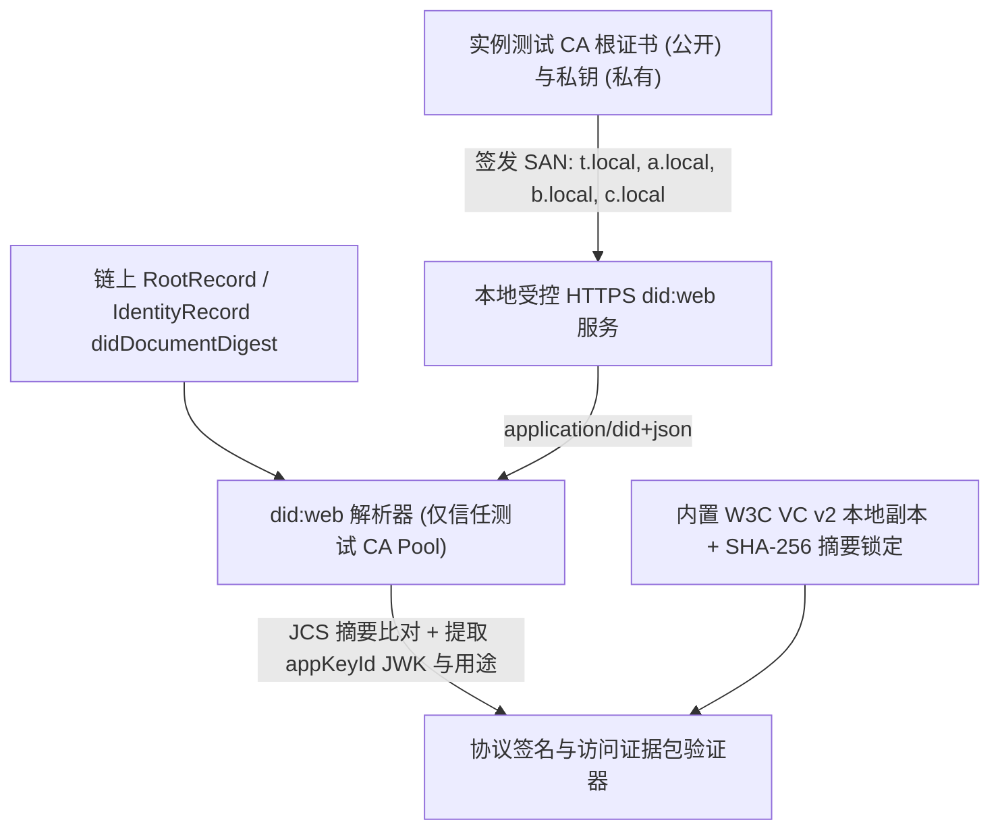

# D0 最小协议设计

## 背景

Fabric D0 最小网络已跑通单通道治理, Go 登记链码与固定高度视图, 但当前 `bootstrap` 与 `seed` 仍使用未保存私钥的临时公钥和合成字符串摘要. [提案](proposal.md) 在已锁定的 Fabric 部署和 T 根基础上, 按 [协议编码与测试向量](../../../docs/implementation/协议编码与测试向量.md) 实现规范编码, 本地 VC v2 上下文摘要固定, 测试 CA 的 `did:web` 解析, 以及真实 ES256/VC/SD-JWT/委托/KB-JWT 签名出示与链上锚点的逐字节绑定.

## 目标与范围

- 实现 `grad-auth-v1` 的 RFC 8785 JCS 规范化, 严格 JSON 输入解析, P-256 公钥/RFC 7638 JWK 指纹转换及 43 字符无填充 base64url 挑战 `nonce` 校验, 100% 复算已发布的全部静态测试向量.
- 固定 W3C VC v2 基础上下文 (`https://www.w3.org/ns/credentials/v2`) 本地副本摘要与内联 `@vocab` 上下文, 通过受控测试 CA 实现 `did:web` HTTPS 解析与 T 根预置文档核对, 杜绝运行时外部网络依赖.
- 将 `ledgerctl` 的引导与夹具升级为真实 P-256 应用密钥和真实签名协议材料, 私有密钥与公开证据严格分离, 在同一高度视图上完成访问证据包 (`AccessEvidencePackage` + `KB-JWT`) 核验与单字段篡改必败验收.
- 本变更以 D0 最小协议闭环为边界. OPA 策略求值, PostgreSQL 挑战消费行锁, 报价生成及订单幂等事务留在 M1/M2 阶段实施.

## 设计决策

### 1. 严格 JSON 解析, JCS 规范化与固定测试向量复算

- 使用 Go 标准库 `encoding/json` 的流式 Token 解析器结合自定义递归校验实现严格 I-JSON / `grad-auth-v1` 解码:
  - 拒绝超过 256 KiB 的原始输入, 拒绝任何层级的重复对象键, 未知业务字段, 尾随垃圾字节, `NaN`/`Infinity` 及绝对值超过 `2^53-1` 的整数.
  - 协议整数统一解析为精确整型并按无前导零十进制输出; 对象键按 UTF-16 代码单元顺序 (对 ASCII 键即字典序) 排序, 严格遵循 [RFC 8785 (JCS)](https://www.rfc-editor.org/rfc/rfc8785.html) 生成规范 UTF-8 字节后求 SHA-256 小写 hex.
- 公钥与 JWK 转换固定为单一路径:
  - `appPublicKey` 为 65 字节 P-256 非压缩点 (`0x04 || X || Y`) 的 130 位小写 hex, 解码时验证点在 P-256 曲线上且非无穷远点.
  - `publicKeyJwk` 仅允许 `{"crv":"P-256","kty":"EC","x":"...","y":"..."}` 四字段, 坐标为 32 字节大端无填充 base64url; 按 [RFC 7638](https://www.rfc-editor.org/rfc/rfc7638.html) 对该规范 JSON 求 SHA-256 无填充 base64url 指纹.
- 挑战 `nonce` 校验:
  - 仅接受恰为 43 个 base64url 字符 (`A-Z`, `a-z`, `0-9`, `-`, `_`) 的字符串, 使用 `base64.RawURLEncoding.Strict().DecodeString` 解码必须得到 32 字节, 且重编码结果与输入逐字节相等, 从而拦截 `=` 填充, 非法字符及末位非零填充位变形 (如末字符 `8` 改 `9`).

### 2. 本地 VC v2 上下文固定与受控测试 CA 的 did:web 解析

- **上下文固定**:
  - 在协议包内嵌入 W3C VC v2 基础上下文规范本地副本并固定其 SHA-256 摘要, 凭证 `@context` 数组必须严格等于 `["https://www.w3.org/ns/credentials/v2", {"@vocab": "https://grad-auth.example.test/vocab#"}]`.
  - 验证器启动和验签时核对本地副本摘要与数组字面量, 不相等立即返回 `INVALID_SCHEMA`, 从不发起外部 HTTP 请求下载上下文.
- **did:web 解析与测试 CA**:
  - 遵循 W3C `did:web` 规范映射 URL: `did:web:a.local` 映射为 `https://a.local/.well-known/did.json`, `did:web:a.local:u` 映射为 `https://a.local/u/did.json`.
  - 为保持 DID 标识符稳定 (不混入随机临时端口), 解析器通过绑定测试 CA `x509.CertPool` 的 `tls.Config` 与受控 `DialContext` 将 `t.local`, `a.local`, `b.local`, `c.local` 路由到本地受控 TLS 服务, 同时保持标准 TLS 主机名校验 (`ServerName` 与证书 SAN 严格匹配).
  - 解析器强制检查 HTTPS 协议, 服务端证书有效性, `Content-Type: application/did+json`, 文档 `id == subjectId`, `SHA256(JCS(doc)) == didDocumentDigest`, 并仅提取登记 `appKeyId` 对应的 `JsonWebKey`, 核对 `authentication` (用于 `KB-JWT`) 或 `assertionMethod` (用于域认证, VC, 委托) 授权关系.
  - T 根 (`did:web:t.local`) 既保存本地预置 DID 文档副本供离线核对 `RootRecord.didDocumentDigest`, 也支持通过同一 `did:web` 规则在线校验.

### 3. 三类签名材料与 SD-JWT / KB-JWT 构造规则

| 材料 | JOSE `typ` | 签发密钥与用途 | 链上锚定摘要 `digest` | 关键载荷与披露约束 |
| --- | --- | --- | --- | --- |
| `DomainAuthorityCredential` | `vc+jwt` | T `appKeyId` (`assertionMethod`) | `SHA256(ASCII(compactJws))` | 完整可见 VC, 绑定 `deploymentId`, `domainDid`, `administrator`, `registrar` 及升序去重的 `identityIssuers` 范围 |
| `EnterpriseIdentityCredential` | `vc+sd-jwt` | IA/IB/IC `appKeyId` (`assertionMethod`) | `SHA256(ASCII(issuerSignedJwt))` | 顶层含 `appKeyVersion`, `deploymentId`, `cnf.jwk`, `_sd_alg="sha-256"`; `credentialSubject` 内 `domain` 与 `role` 为独立带盐披露, `_sd` 按摘要字典序排序 |
| `Grant` (G0/G1) | `grad-delegation+jwt` | 签发者 `appKeyId` (`assertionMethod`) | `SHA256(ASCII(compactJws))` | 绑定 `deploymentId`, `parentId`, `parentDigest`, `rootId`, `taskId`, `authorizationMode`, 双方版本与凭证 ID, 资源/动作/供应商集合, `maxAmountMinor`, `nbf`/`exp`, `remainingDepth` |
| `KB-JWT` (含于 `leafPresentation`) | `kb+jwt` | 叶子 `appKeyId` (`authentication`) | 不上链 (绑定在本次出示) | 含 `aud`, 原样 `nonce`, `iat`, `sd_hash = base64url(SHA256(ASCII(leafPrefix)))`, 以及 `urn:grad:binding` 中的 `{challengeId, requestHash, chainHash, evidenceHash}` |

- **SD-JWT 锚定与披露边界**:
  - 链上 `Credential.Digest` 只对不含 `~` 披露段和 `KB-JWT` 的 `issuer-signed compact JWT` 求 SHA-256 hex, 避免每次選擇性披露或新会话出示要求重写链上记录.
  - `ancestorCredentials` 保存保留末尾 `~` 且不含 `KB-JWT` 的 SD-JWT 出示串; `leafPresentation` 为 `leafPrefix + kbJwt`, 其中 `leafPrefix` 保留紧邻 `KB-JWT` 前的最后一个 `~`.
  - 验证器检查所有披露项均被 `_sd` 引用且无重复披露, 从核验通过的披露中提取 `domain` 和 `role`.

### 4. 与 Fabric D0 引导, 夹具及验收的衔接

- **私钥与公开材料隔离**:
  - 在实例目录下建立非公开目录 `<instance>/private/`, 保存 T 根及 `domainA/B/C`, `IA/IB/IC`, `U`, `A1`, `alt`, `B1`, `C` 的 P-256 应用私钥及测试 CA/TLS 服务端私钥.
  - 公开目录 `<instance>/registry/` 保存公开 DID 文档集合, 测试 CA 根证书, VC v2 基础上下文摘要清单, 以及签发好的域认证 JWS, 身份凭证 SD-JWT, `taskSpec`, `G0`/`G1` 委托 JWS 和示例 `AccessEvidencePackage`.
  - `publicMaterials` 将上述公开协议材料纳入证据目录 `materials/`, 同时由现有的私钥扫描检查确保无任何 PEM 私钥标记或私钥文件泄露.
- **升级 `bootstrap` 与 `seed`**:
  - `bootstrap` 生成 T 根密钥对与 `did:web:t.local` 文档, 用真实的 `SHA256(JCS(rootDidDoc))` 写入 `RootRecord.DocumentDigest`.
  - `seed` 用真实角色私钥签发 A/B/C 域认证, 各主体身份凭证, 固定 `taskSpec` (`430541fe...`) 及 RP `G0`/`G1` 委托, 将真实摘要提交到 Fabric 链码并等待背书节点与 C 视图同步.
- **扩展 `ledgerctl verify`**:
  - 保留原有 17 项通道, 链码, 事务恢复与视图探针验收用例, 并新增协议层验收用例:
    1. 静态编码与测试向量复算 (`protocol-encoding-and-vectors`);
    2. 本地上下文摘要固定与测试 CA `did:web` 解析及 TLS/文档负例 (`did-web-and-context-pinning`);
    3. 绑定当前部署的域认证, SD-JWT, 委托与 `AccessEvidencePackage`/`KB-JWT` 全链路核验及单字段篡改拒绝 (`verifiable-evidence-and-tamper-rejection`).

## 风险与取舍

| 风险或代价 | 处理 |
| --- | --- |
| 测试环境中 `.local` 域名不在宿主 DNS 中 | 在 `did:web` 客户端的受控 `http.Transport` 中将已登记测试域名定向到本地 TLS 监听地址, 同时保留标准 `tls.Config.ServerName` 与测试 CA 证书链校验, 不修改宿主 `/etc/hosts`. |
| SD-JWT 披露盐随机生成导致每次签发字节变化 | 在静态测试中支持确定性盐以核对固定向量, 在实例夹具生成中使用 `crypto/rand` CSPRNG 生成至少 128 位独立随机盐并持久化已签发材料, 重跑时幂等复用同一实例材料. |
| 应用私钥新增后可能误入公开证据包 | 将全部应用私钥与测试 TLS 私钥统一存放在 `<instance>/private/`, 与 `<instance>/registry/` 物理隔离, 并在验收中对公开材料执行私钥标记与文件名扫描. |
