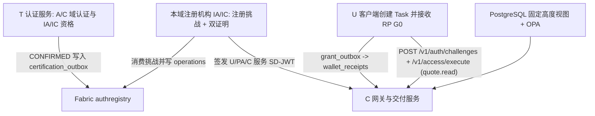

# M1 直接访问设计

## 背景

D0 最小网络与 D0 最小协议已跑通 Fabric `procurement` 通道, `authregistry` 链码, PostgreSQL 固定高度视图与原探针租约, 以及基于测试 CA 的 `did:web` 解析和 ES256/SD-JWT/Grant/KB-JWT 签名出示校验 ([提案](proposal.md)). 按照 [部署与链上登记](../../../docs/implementation/部署与链上登记.md), [证据交付与网关执行](../../../docs/implementation/证据交付与网关执行.md), [策略输入与数据约束](../../../docs/implementation/策略输入与数据约束.md) 和 [REST接口与响应码](../../../docs/implementation/REST接口与响应码.md), M1 直接访问阶段需要把链上登记, 一致视图装配, OPA 策略包求值和 C 网关锁后事务串成在线业务闭环.

## 目标与范围

- 实现 T 对 A/C 域认证及 IA/IC 资格核对, 普通身份注册挑战与双证明 (`ManagementDualProofBundle`) 校验受理, `U`/`PA`/`C` 服务 SD-JWT 凭证签发, `U` 任务创建及 `C -> U` RP 根授权 (`G0`) 交付闭环.
- 扩展 `internal/fabric` 在线读取器, 在单个 PostgreSQL `REPEATABLE READ` 只读事务中从已应用视图直接装配 `protocol.SnapshotView`, 强制执行本进程原探针单调期限 (`nowMono < probe.deadline`).
- 实现 `internal/policy` 策略包校验与 Rego v1 (`package procurement`) 确定性求值器, 固定 `trustRoots` 至部署 `RootRecord`.
- 实现 `internal/gateway` HTTP 服务与 PostgreSQL 业务主库事务, 支持 `U` 持 `C -> U` 的 `G0` 完成 `quote.read` 询价, 并在 `ledgerctl verify` 中验证询价成功, 同键幂等, 错误密钥拒绝, 探针到期 `STATE_STALE`, 锁后变为 `BLOCKED` 无报价行及到期当秒拒绝.
- 本变更以 M1 直接访问为边界. B 域 (`IB`/`B1`), 双域关联审批, `PA -> U` 的 BM 根, `G1`/`G2` 子委托, `order.create` 下单及接入 LLM 的智能体工具闭环留在 M2 阶段实施.

## 设计决策

### 1. 注册双证明, 资格核对与 C->U 材料交付闭环

- **注册双证明与操作跟踪**:
  - 在接入普通身份 (`U`, `PA`, `C` 服务) 登记前, 注册机构生成绑定 `deploymentId`, `domainId`, `subjectId`, `accountCommitment`, `managementIdentity`, `appKeyId`, `appKeyVersion`, `appPublicKey`, `didDocumentDigest`, 43 字符无填充 base64url `nonce` 及截止时间的注册挑战 (`grad-identity-registration-v1`).
  - 验证 `ManagementDualProofBundle` 中的 `applicationProof` (应用私钥 ES256 JWS) 与 `managementProof` (P-256 管理证书 DER 公钥对挑战 JCS SHA-256 签名), 在同一本地事务中消费挑战并持久化 `operations` 记录后才提交 Fabric 交易.
- **域认证与根授权交付边界**:
  - 建立 `certification_outbox`, `certification_receipts`, `grant_outbox` 与 `wallet_receipts` 持久化表.
  - 原链上登记交易确认 `VALID` 且当前实际时间满足资格与有效期时才开放材料交付 (`DomainAuthorityCredential` JWS, `C` 服务最小 SD-JWT 出示及 `C -> U` 的 RP `G0` JWS).
  - 接收端在固定高度一致视图上核对签名, 链上锚点摘要与收件人身份后原子写入材料与回执; 按 `(deploymentId, recipient, grantId)` 去重, 同包幂等确认, 同键异包返回 `409 DELIVERY_CONFLICT`, 当前认证已确认但正文暂缺时返回 `503 MATERIAL_NOT_SYNCED` 且不写回执.

### 2. PostgreSQL 固定高度一致视图逐次装配

- 扩展 `internal/fabric/view.go`, 为 `StateProvider` 提供面向在线访问验证的 `AssembleProtocolSnapshot(ctx, grantId)` 方法:
  - 在只读 `REPEATABLE READ` 事务中先读取 `fabric_head` 检查点与本进程原探针租约 (`online.lease`), 再读取 `Bootstrap` 与全部必要依赖 (`Grant` 到根路径, `Task`, 相关 `Credential`, `Identity`, `Domain`, `Certification`), 构造完整 `protocol.SnapshotView`, 输出 `point (block_no, hash)` 和 `probe.deadlineMono`.
  - 若 `fabric_head` 为空, 任一依赖缺失 (`MISSING_DEPENDENCY`) 或与引导清单不符, 整次装配失败并返回 `503 STATE_UNAVAILABLE`, 绝不回退查询 Peer 最新状态.
  - 检查 `nowMono < probe.deadlineMono`, 若已到达或超过原探针单调截止返回 `503 STATE_STALE`.
  - 本地材料库为快照内出现的每个域提供已核对 `SHA256(ASCII(jws)) == Certification.Digest` 的 `DomainAuthorityCredential` 正文和 `C` 服务最小出示, 正文缺失或不匹配时拒绝且不沿用旧块缓存.

### 3. OPA 策略包校验与确定性求值

- 新建 `internal/policy` 包, 加载并校验 `C` 策略包目录 (`manifest.json`, `procurement.rego`, 输入 schema 及角色/资源配置):
  - 按文件名排序计算内容文件 SHA-256 并记录在 `manifest.files`, 对 `JCS(manifest)` 计算 `policyDigest`, 检查与链上/配置策略版本和摘要严格一致, 禁止仅修改 `.rego` 而不升级版本.
  - 校验 `manifest.trustRoots` 仅包含与部署清单及 `RootRecord` 一致的 T 根 DID, `appKeyId`, `appKeyVersion`, `appPublicKey` 和 `didDocumentDigest`; 任何篡改或试图替换根/根密钥的包在预检和装配阶段即被拒绝.
  - 角色/资源配置固定 `acceptedAuthorizationModes` (M1 夹具含 `RESOURCE_PREAUTHORIZED`), `acceptedBuyerDomains` (`A`), `acceptedAuthorityRoles`, `allowedProductIds` (`urn:grad:product:P1`), `maxQuantity` (`1`) 及 `policyDeadline` (默认 `null` 或绝对 Unix 秒).
- 求值器使用 OPA Go SDK (`github.com/open-policy-agent/opa/v1/rego`):
  - 启用 `rego.StrictBuiltinErrors(true)`, 禁止注册或调用网络访问与 `time.now_ns()`.
  - 进入 Rego 前对构造好的输入结构体做完整必填与类型校验, 仅当唯一布尔结果 `allow == true` 时返回允许, `undefined`, 类型错误或异常一律 fail-closed 拒绝 (`500 POLICY_EVALUATION_ERROR` 或 `403 POLICY_DENIED`).
  - `supplierAcceptance` 由网关匹配已核验事实 (`principalDomain`, `authorizationMode`, `productId`, `quantity`, `supplierId` 与服务角色 `supplier-service`) 与当前策略配置生成, 绝不采信客户端提交值.

### 4. C 网关事务时序, 锁后求值与期限复核

| 表名 | 主键与唯一约束 | 用途与锁行为 |
| --- | --- | --- |
| `challenges` | PK `id`, UNIQUE `nonce` | 保存 43 字符规范 `nonce`, `actor`, `task_id`, `request_hash`, `audience`, `issued_at`, `expires_at` (`issuedAt+30s`), `consumed_at`; 事务中 `FOR UPDATE` |
| `trusted_contexts` | PK `task_id` | 每任务固定一行, 原地更新并递增 `context_version`, 保存 `source_id`, `observed_at`, `risk_level` (`NORMAL`/`ELEVATED`/`BLOCKED`), `access_deadline`; 事务中 `FOR SHARE` |
| `business_keys` | PK `(actor, task_id, action, idempotency_key)` | 保存 `business_hash`, `resource_id` (`quoteId`), 唯一协调同键并发与幂等重试; 拒绝时撤销未提交占位 |
| `quotes` | PK `quote_id` | 不可变报价记录 (`deployment_id`, `task_id`, `actor`, `supplier_id`, `product_id`, `quantity`, `currency`, `unit_price_minor`, `total_amount_minor`, `issued_at`, `valid_until`) |
| `decisions` | PK `decision_id`, UNIQUE partial on `challenge_id` | 记录 `code`, `block_no`, `block_hash`, `probe_tx_id`, `probe_deadline_mono`, `decision_at`, `context_version`, `risk_level`, `policy_digest`, `effective_deadline`, `failure_code`, `failed_object_id` |
| `catalog_prices` | PK `(deployment_id, product_id, currency)` | 基准单价 `80000` 分 (`800.00 CNY`), 未配置价格返回 `409 PRICE_UNAVAILABLE` |

`POST /v1/access/execute` 的执行流程严格按以下七步推进:

1. **Schema 与预检**: 限制请求体不超过 256 KiB 且 `Content-Type` 为 `application/json`, 执行 `grad-auth-v1` 严格解析; 校验 `quote.read` 的 `quoteId == null`, `amountMinor == 0`, `quantity > 0` 与 `idempotencyKey` 格式, 违例在验签前返回 `400 INVALID_SCHEMA`.
2. **初验 (使用一致视图 `h_1`)**: 通过 `StateProvider` 获取快照 `(h_1, hash_1, probe_1)` 与当前材料, 调用 `protocol.VerifyAccessEvidencePackage` 核验持有者签名, `nonce` 原值绑定, `taskSpecDigest`, T 根与域认证, U/C SD-JWT 凭证和 RP `G0`, 并核验 `request` 与 `taskSpec` 范围. 初验不写入业务库且不产生最终允许结论.
3. **加锁 (`READ COMMITTED`)**: 开启 PostgreSQL 事务, 按固定顺序取锁以避免死锁:
   - `SELECT ... FROM challenges WHERE id = $1 FOR UPDATE`: 不存在返回 `401 CHALLENGE_UNKNOWN`, `consumed_at IS NOT NULL` 返回 `409 CHALLENGE_REPLAY`, 绑定字段不符返回 `401 REQUEST_BINDING_MISMATCH`.
   - 协调 `business_keys`: 尝试插入占位行 `(actor, task_id, action, idempotency_key)` 或读取既有行 `FOR UPDATE`; 若已存在但 `business_hash` 不同返回 `409 IDEMPOTENCY_CONFLICT`; 若已存在同摘要且对应报价仍在有效期内, 准备在后续复核通过后幂等返回原 `quoteId`.
   - `SELECT ... FROM trusted_contexts WHERE task_id = $1 FOR SHARE`: 缺失环境行返回 `503 CONTEXT_STALE`.
   - `SELECT block_no, hash FROM fabric_head WHERE deployment = $1 FOR SHARE`: 若 `(block_no, hash) != (h_1, hash_1)`, 立即回滚当前事务并以最新一致视图重新执行步骤 2-3 (最多重试有界次数, 持续竞争返回 `409 STATE_CHANGED`).
4. **锁后最终时间与新鲜度复核**:
   - 查询数据库实时时钟 `SELECT clock_timestamp()` 作为 `decision_at` (严禁使用事务起始时间 `now()`/`CURRENT_TIMESTAMP`), 同时读取进程内单调时间 `nowMono`.
   - 强制按严格小于 `<` 检查全部有效截止:
     - `nowMono < probe.deadlineMono` (否则 `503 STATE_STALE`);
     - `decision_at >= cert.nbf && decision_at < cert.exp` (否则 `403 DOMAIN_CERTIFICATION_INVALID`);
     - `decision_at >= cred.nbf && decision_at < cred.exp` (否则 `403 CREDENTIAL_INACTIVE`);
     - `decision_at < task.validUntil` 与 `decision_at >= grant.nbf && decision_at < grant.exp` (否则 `403 TASK_INACTIVE` / `403 GRANT_EXPIRED`);
     - `decision_at < challenge.expiresAt` (否则 `401 CHALLENGE_EXPIRED`, 不消费挑战);
     - `decision_at < context.accessDeadline` (否则 `503 CONTEXT_STALE`);
     - 若 `policyDeadline != null`, `decision_at < policyDeadline` (否则 `403 POLICY_DENIED`).
   - 任一截止条件满足 `now >= deadline` (包含到期当秒 `now == deadline`) 立即拒绝.
5. **锁后最终 OPA 求值**: 使用步骤 3 共享锁锁住的 `trusted_contexts` 副本 (`riskLevel`, `contextVersion`) 与步骤 4 核验通过的布尔结果重新构造 OPA 输入并执行 Rego 求值, 绝不复用初验 `allow`. 若锁后风险变为 `ELEVATED` (询价允许) 或 `BLOCKED` (全部拒绝), 按最终求值结果定案.
6. **原子提交或回滚**:
   - 若锁后最终求值允许: 查目录单价与溢出检查, `validUntil = min(decision_at + 300s, task.validUntil)`, 写入 `quotes` (若同键同摘要复用原有效 `quoteId`, 若原报价已过期则返回 `409 QUOTE_EXPIRED`), 消费 `challenges.consumed_at = decision_at`, 写入 `decisions` (`ALLOW`) 并提交事务.
   - 若已通过持有者与挑战有效性校验但因业务/策略拒绝 (如锁后变为 `BLOCKED`): 回滚或删除新建的 `business_keys` 占位, 同一事务中消费挑战并写入拒绝 `decisions` (`code = POLICY_DENIED` 等), 不写 `quotes`.
   - 若因未证明持有者, 挑战无效/过期/重放, `STATE_STALE` 或临时存储异常拒绝: 回滚事务, 不消费挑战, `decisionId` 返回 `null`.
7. **响应返回**: 仅在 PostgreSQL `COMMIT` 成功返回后向客户端返回 `200 {decisionId, code:"ALLOW", quote}` 或对应错误响应与 `X-Request-Id`.

## 风险与取舍

| 风险或代价 | 处理 |
| --- | --- |
| 并发请求同时锁 `challenges`, `business_keys`, `trusted_contexts`, `fabric_head` 可能死锁 | 固定所有事务唯一加锁顺序: `challenges` -> `business_keys` -> `trusted_contexts` -> `fabric_head`; 视图写入事务 `view.apply` 仅写 `fabric_*` 表, 不反向锁业务表, 彻底消除跨模块环形等待. |
| 事务开始时间 `now()` 与实际等待锁后时间不一致导致误放行已到期请求 | 锁后显式执行 `SELECT clock_timestamp()` 作为 `decision_at` 与全部业务/挑战/认证截止比较输入, 探针新鲜度使用单调钟 `time.Now()` (`nowMono < probe.deadlineMono`) 避免系统时钟跳变影响租约. |
| 初验与加锁期间区块高度持续推进导致重验循环 | 限制检查点变化重验上限 (例如 3 次); 若期间探针过期则直接报 `503 STATE_STALE`, 持续高度竞争返回 `409 STATE_CHANGED`. |
| Go 引入 OPA SDK 后容器/离线构建依赖增大 | 在 `go.mod` 固定精确 OPA 版本并跑通离线 `go test ./...`, 确保策略包编译无外部网络调用且可在本地 arm64 环境直接构建. |
