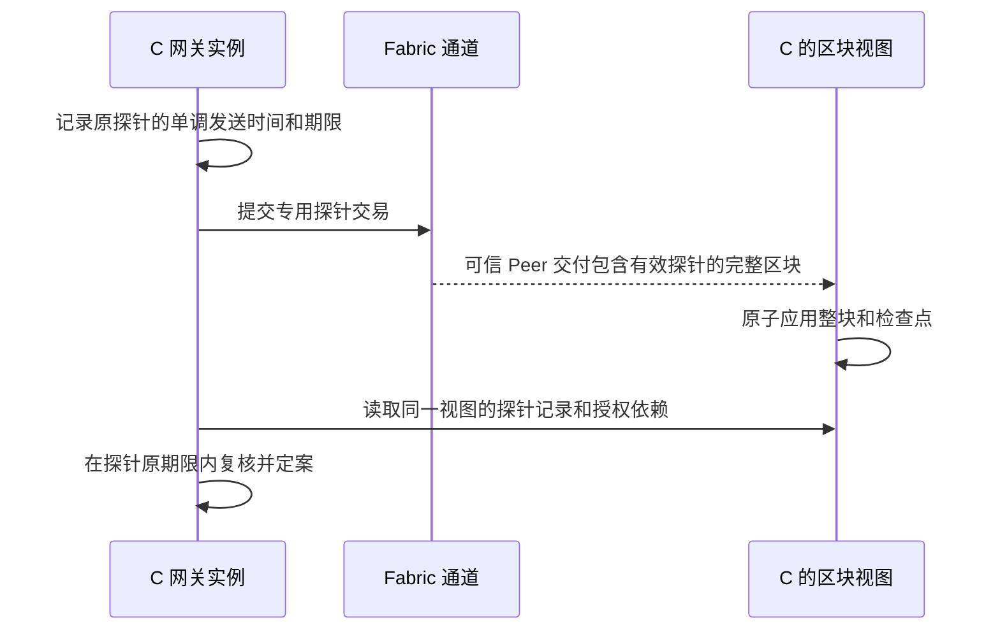

# Fabric 账本迁移设计

## 背景

现有 D0 的 `AuthRegistry.sol` 和 `ledgerctl` 已跑通 RP G0/G1 的合成登记夹具. 交易日志, 固定高度查询和故障测试分别依赖 EVM 回执, `eth_call` 及 QBFT 区块时间. [提案](proposal.md) 将这一切片迁移到 Fabric. 现有 [跨域身份](../../../docs/design/跨域身份与信任.md) 和 [委托规则](../../../docs/design/委托授权与策略.md) 定义后续采购网关需要验证的证据.

## 目标与范围

- 用同一 Fabric 通道完成跨域登记, 通过实际提交检验角色约束, 祖先依赖及版本竞争.
- 为 C 提供可追溯至区块的完整授权视图, 并给旧视图的在线使用设定可实测的期限. 历史复查区分登记状态与当时的准入决定.
- 实施验收以 D0 登记夹具和状态提供器为边界. 后续 M1/M2 的真实凭证和订单事务使用本文的消费契约, 正式 E1-E8 的结果在对应阶段取得.

## 设计决策

### 1. 通道治理与部署身份

使用 Fabric 3.1.x, 一个业务通道, A/B/C 各一个 Peer 和各自 MSP. A/B/C 及实验运维各控制一个 SmartBFT 排序节点. 四排序节点保留原设计的单拜占庭排序故障假设. Raft 的容错前提为崩溃故障. 在同一宿主运行时, 验收记录实际节点控制方, 结论限于容器级停机及恢复观测. [Fabric 排序服务](https://hyperledger-fabric.readthedocs.io/en/latest/orderer/ordering_service.html#bft) [SmartBFT 配置](https://hyperledger-fabric.readthedocs.io/en/latest/bft_configuration.html).

为 T 配置独立客户端 MSP, 授予提交域认证和查询结果所需的通道权限. 显式指定链码背书为 A/B/C 任意两个 `peer` 主体, 链码生命周期批准及关键应用通道策略由 A/B/C 三域治理. 将 T 纳入默认组织多数会改变阈值, 因此相关策略均显式列出业务组织. 节点身份, TLS, 客户端证书和 DID 应用密钥分别发放. [Fabric MSP](https://hyperledger-fabric.readthedocs.io/en/latest/msp.html) [链码背书策略](https://hyperledger-fabric.readthedocs.io/en/latest/endorsement-policies.html).

三域预先核对同一引导清单, 确定初始通道, T 根, 指定的初始化客户端, A 域/U, C 资源及实例参数. 在各 Peer 安装的链码包中固定批准的初始化参数摘要和调用者证书绑定. 初始化交易读取根键是否已存在, 核对调用者及参数摘要后一次写入. 即使另一个合法通道客户端先调用, 也无法抢占根键. 根和任务创建资格只读, 重复初始化由根键及读集校验拒绝.

`deploymentId` 取下列 JCS 对象 UTF-8 字节的 SHA-256 小写十六进制, 无前缀. `genesisHash` 使用 Fabric 区块头哈希算法, `instanceId` 为随机 32 字节的小写十六进制. `schemaVersion` 使用协议版本字符串.

```json
{
  "purpose": "grad-fabric-deployment-v1",
  "channelId": "procurement",
  "genesisHash": "<创世块头哈希>",
  "registryName": "authregistry",
  "instanceId": "<实例标识>",
  "schemaVersion": "<协议版本>"
}
```

启动时核对受信清单和已提交的通道配置, 链码定义及 sequence, 根记录, U 任务资格和实例参数. 受信清单还保存链码源码/构建摘要及各组织安装的 package ID. package ID 是组织安装标识, 通道上的已提交定义记录共同的版本, sequence 和策略. 链码定义及安全关键配置变更时暂停在线读取, 重新校验信任材料后才能采用. [链码生命周期](https://hyperledger-fabric.readthedocs.io/en/latest/chaincode_lifecycle.html).

### 2. 链码只接收可由通道成员共享的登记事实

- 用 Go 链码和确定性的键值访问实现 [登记规范](specs/authorization-registry/spec.md). 调用者取 Fabric 验证的客户端身份, 用 `(MSPID, SHA-256(证书 DER))` 匹配当前登记角色. 身份注册和恢复的实现契约用绑定部署及管理身份的同一挑战验证 X.509 管理密钥和 DID 应用密钥. 管理证书换发后须经既有授权流程更新登记, 旧指纹失效. 两域关联仍由两个域的注册机构分别审批同一提案, Peer 背书负责验证这些调用的执行结果.
- 用确定性的逐键读取覆盖调用者和角色绑定, 域及当前资格指针, 凭证锚, 任务, 目标授权及祖先. 建立 ID 或证书绑定前先读取对应的唯一键, 并发写入才能受到版本校验. `expectedRevision` 和预期摘要保留为业务版本条件. 替换时先检查旧对象与新授权的全部条件, 在同一写集中撤旧建新. 通过公共键值读取满足这些约束, 首版可使用 LevelDB.
- 链上保存必要结构字段及原文摘要, 版本和状态. 凭证, 披露盐, 完整授权正文, 策略和报价留在域内. 同样的披露边界适用于提案参数, 写集及事件. C 用同一视图核对材料摘要, 密钥和资格, 并验证应用签名及逐维权限包含. 持有者证明绑定当前部署及本次请求, 风险由锁后的环境副本判定.
- 对要求当前资格的管理操作, 三域 Peer 均启用 `TimeWindowCheck`. 设最大提案偏差为 `w`, 校时误差界为 `epsilon`. 链码读取提案时间 `t`, 对当前依赖要求 `t - (w + epsilon) >= nbf` 且 `t + (w + epsilon) < exp`. 凭证锚签发时还须检查 `cert.nbf <= credential.nbf` 且 `credential.exp <= cert.exp`. 已背书交易晚于期限入块时, 材料交付及业务执行仍按实际时间和当前资格复核. 有权撤销者可以清理已到期记录. 链码保持确定性, 环境风险和锁后的实际时钟检查由 C 执行. [Fabric 提案时间校验](https://github.com/hyperledger/fabric/blob/main/release_notes/v3.0.0.md) [链码时间戳接口](https://github.com/hyperledger/fabric-chaincode-go/blob/main/shim/interfaces.go#L347-L350).

### 3. 管理操作以 Peer 有效提交为准

操作键和输入摘要在受理时持久化, 同键同摘要查询原操作, 同键异摘要报告冲突. Fabric Gateway 客户端按提案随机 nonce 和调用者身份生成 `txID`. 提案和原 txID 在背书前落盘, 背书后在首次广播前保存完整已签交易. 按操作键协调并发执行. 首次广播后通过原 txID 查询可信 Peer, 必要时重投相同已签字节. HTTP 管理接口保持受理前冲突与受理后异步失败的区别.

首次部署续跑先恢复已受理的初始化操作. 原提案已被明确拒绝, 从未生成已签交易且可信 C Peer 确认根仍为空时, 操作者可显式发起新操作. 新操作键关联原 txID, 受理和部署清单写入由同一实例的部署锁协调. 原操作的键, 提案和结果保留, 已受理的新操作按同一恢复规则续跑.

原初始化已经有效提交时, 复用三域批准的包及构建, 在可信 C Peer 核对原签名交易的区块位置, 校验码和根记录, 随后写出部署清单. 重复初始化的拒绝由验收验证, 旧部署留下的验证操作只作为原始记录读取.

| 观测 | 操作结果与原始证据 |
| --- | --- |
| 原提案明确拒绝 | 记 `FAILED` 和背书阶段. 有确切原响应时映射业务原因, 其它确定性拒绝用通用背书失败码. |
| 广播已接收, 超时或原提交状态未查到 | 记 `PENDING`. 基础设施错误与确定性拒绝分别保存. |
| Peer 验证为 `VALID` | 核对原 txID, 调用者, 通道, 链码和提交区块. 用完整区块补足哈希及交易位置, 确认后才开放交付. |
| Peer 验证为无效 | 记录原块及校验码. `MVCC_READ_CONFLICT` 映射 `STATE_CHANGED`, 其它无法细分的提交无效使用 `COMMIT_INVALID`. |
| 重播出现 `DUPLICATE_TXID` | 查最初与原已签交易相符的记录, 按原校验结果归并. 无法确认原记录时保持待核实. |

先取得背书的交易仍可能因先排序的事务改写读集而无效. 用两份同版本的已背书交易再提交, 可以把背书期角色检查和提交期竞争独立验收. [Fabric Gateway](https://hyperledger-fabric.readthedocs.io/en/latest/gateway.html) [Fabric 读写集语义](https://hyperledger-fabric.readthedocs.io/en/latest/readwrite.html).

### 4. C 从完整提交区块生成读视图

用 C 自管的可信 Peer 作为区块来源. 从创世块建立检查点, 续读时先核对已保存块并从下一块开始. 验证通道, 区块号, 数据哈希, 父块哈希及交易校验元数据. 按交易位置处理登记链码命名空间的公开写集, 只应用 Peer 标记为 `VALID` 的交易. 区块数据哈希提供内容绑定, 交易有效性依赖可信 Peer 的校验结果. 非登记交易也推进块检查点. 对配置或链码定义变化检查受信策略.

PostgreSQL 用同一事务保存区块标识和交易来源, 当前键值, 历史版本以及最后完整应用的 `(height, hash)`. 历史记录按 `(deploymentId, key, blockNumber, txIndex)` 索引, 覆盖删除和同块多次更新. 崩溃后按持久化检查点重放, 同一已核对块幂等. 检查点冲突, 缺块及回退使在线视图未就绪, 重新核对后连续补块. 对历史请求取目标块末尾的各键版本, 由保留完整区块的 Peer 支撑独立重建.

在线装配用一个只读 `REPEATABLE READ` 事务取得检查点及所有依赖, 包括后续从记录发现的资格指针和祖先. 逐项 `Evaluate` 只能取得目标 Peer 的当前值, 无法指定这份快照的高度, 适合部署检查或对照测试. 状态读取器只输出登记事实和新鲜度. [Peer 区块事件](https://hyperledger-fabric.readthedocs.io/en/latest/peer_event_services.html) [Fabric 链下数据示例](https://github.com/hyperledger/fabric-samples/blob/main/off_chain_data/README.md).

### 5. 每个网关使用自己的提交探针



每个在线实例使用专用 Fabric 客户端身份. 探针在同一通道走常规背书, 排序和提交, 只写该身份的专用探针键, 按原 `txID` 匹配本地发送记录. 探针键与业务键分开, 业务写入没有探针键读依赖. 默认每实例间隔 1 秒发送, 期限 `deadline = sentMono + deltaState`, 初值 `deltaState = 5 s`. 发送计时从原交易首次广播之前开始, 同一交易重投沿用该时间. 先取得的提交状态用于观测, 整个包含探针的区块应用到本地后才可采用探针. 多个探针可用时选本进程期限最晚的一个.

在 `nowMono < deadline` 时才有新鲜度. 回放, 迟到确认和其它区块增长均不延长原期限. 两个 C 实例可共享同一 PostgreSQL 视图, 各自用自己的计时及探针判定新鲜度. 重启校验原检查点后发送新探针. 在途断流期间, 完整旧视图只可使用到原期限. 探针证明本地视图已应用本实例近期发出的交易, 所采用的区块仍可能落后于其它 Peer. Fabric 区块头只有块号, 父哈希及数据哈希, 因此区块接收时间及普通提案时间不参与续期. [Fabric 区块结构](https://github.com/hyperledger/fabric-protos/blob/main/common/common.proto).

后续订单网关先取得挑战, 业务键和环境行等锁, 再短时共享锁定视图检查点, 与前置装配的高度/哈希比对. 若已更新, 释放锁后从新视图重新装配和验权. 在所有可能等待之后用实际时间, 锁定的当前环境副本和报价重新求值 OPA. 最终检查探针原期限及全部业务期限, 记录 `decision_at`. 检查点和环境副本保持到定案事务结束. 响应在 PostgreSQL 提交后返回. 墙钟异常期间停止业务定案, 业务截止与风险时效始终由可信当前时间判断. [现有业务事务约束](../../../docs/implementation/证据交付与网关执行.md#3-c-如何提交订单).

若撤销在 `r` 块有效, 任何使用 `h >= r` 的决定都必须识别失效祖先. 当 `h < r` 时, 支撑该视图的探针处于 `h` 或更早, 其首次发送早于撤销排序和有效提交观测. 在同一计时基准下, 有效提交观测后的旧视图放行窗口至多为 `deltaState`. 跨机比较记录时钟误差, 撤销发送到有效提交的时延另行测量. E6 分开记录撤销发送, 有效提交观测, 共享视图应用 `r`, 各实例采用的高度及最后允许的时刻. 在途订单的提交响应另记. 探针增加的排序及区块同步开销计入 E8.

## 风险与取舍

| 风险或代价 | 处理 |
| --- | --- |
| 排序可用但 Peer 背书或 C 的交付滞后 | 分开注入故障并记录最后有效探针. 期限到达即返回 `STATE_STALE`. 区分排序确认延迟, Peer 交付延迟和视图应用延迟. |
| 探针密度提高后台开销, 频繁推进检查点可能增加锁后重验 | 记录空闲与负载下的交易数, Peer/排序节点资源, 视图应用延迟及锁后重验率. 用候选探针间隔和期限做配对实验. |
| 资格临近起止边界时管理提案可受理区间缩短 | 固定并记录 `w` 和 `epsilon`, 测试真实期限附近的正反例. 访问时单独检查可信业务时间. |
| 状态视图丢失或历史保留不足 | 保留可重放的完整区块和原始交易证据. 重建前关闭在线检查, 缺失的历史显式报告. |

## 迁移计划

1. 在 `infra/fabric/` 和 `chaincode/registry/` 建立独立的网络与链码入口, 按目标架构锁定镜像和构建依赖. 用隔离的数据目录和端口构建新通道及部署清单.
2. 在 `ledgerctl` 接入 Fabric 登记及读取, 复用既有命令和证据入口的职责. 在 Fabric 实例重新生成 RP 夹具, 旧部署签名材料按新部署标识重新签发. 移除旧账本的命令分支, 合约, 部署文件和专用依赖.
3. 在原 Fabric 实例和干净重建中运行 D0 验收, 并用 Fabric 作为唯一运行入口. 恢复时以相同通道和部署材料, 由可信 Peer 的完整区块恢复历史和在线检查点. 需要干净重建时采用新的部署标识. 工作树的运行证据仅包含 Fabric D0, 迁移前文件可按 Git 历史追溯.
4. 同步任务书, 设计, 实现和实验文档. E4/E5/E8 采用中心化一致快照, Fabric 视图逐次装配, Fabric 视图加静态验签缓存三组, 以相同凭证和策略判据测请求及后台开销. E6/E7 使用提交和视图采用时序更新实验判据. [实施任务](tasks.md).
