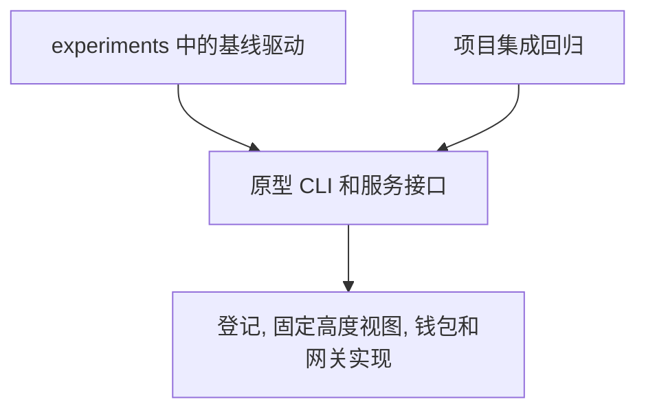

# 原型与实验的依赖边界

## 背景

见 [提案](proposal.md). 当前基线复用原型服务, 但通过 Fabric 实例的 `baseline` 字段向通用登记准备传递实验配置. 联合验收和基线还共享绑定验收上下文的装配方法. 迁移需要先拆开这些依赖, 再切换运行入口.

## 目标与边界

- 原型实现和项目测试可独立构建和运行. 实验可以调用仓库内已有的 CLI, HTTP, MCP 和 Go 接口. 原型侧提供这些接口所需的通用配置和装配.
- 迁移服务于现有基线和回归. 正式 E1-E8 的新增驱动, 统计方法和复算由 [正式实验工作流](../standardize-experiment-workflow/design.md) 及各实验负责.

## 决策

### 从目录和构建两处切断依赖

- 在 `experiments/baseline/` 放置独立入口, 基线计划, 固定种子, C0/B0/B1 配置映射, 运行隔离, 断言和证据导出. 基线测试随驱动迁移. 证据继续按原用途归入 Fabric 验收证据目录.
- 删除 Fabric 实例上的实验配置依赖. 由基线生成任务标识, 数量和其他场景输入, 再通过已有部署与登记能力应用. 补足实际需要的通用装配入口, 由调用方传入业务值和运行参数. 保留登记授权, 签名, 交易日志和业务事务的原执行路径. C0 一致快照, B0/B1 原探针和可选静态验签缓存仍由原型实现.
- 保持同一 Go 模块, 让迁移后的驱动继续复用已有的钱包, 状态提供器和网关 Go 接口. 用 `go list -deps -test` 核对原型包和测试的传递依赖, 也核对默认原型测试入口的包范围.

### 将联合验收改为独立的项目回归入口

逐项核对现有 `verify` 和实机定点测试的场景. 通道治理, 交易恢复, 固定高度, 探针时效, 双根采购, 幂等和核账等行为断言继续作为项目集成回归. 用独立实例运行, 保留按能力筛选, 失败退出和诊断留证. 实验预跑的采样循环, 窗口统计和专题导出归实验侧. 若撤销窗口预跑同时验证采用撤销块后拒绝或过期探针拒绝, 项目测试继续覆盖这些断言.

回归入口由测试编译范围承载. 仓库的 `mise run ledger:verify` 可以继续作为便捷入口, 指向独立回归. 基线使用独立的 `mise run experiment:baseline` 入口, 承接原目录, 数据库, 种子, 超时和输出参数.

### 按稳定能力命名

对活跃实现, 测试文件, 测试函数和运行选择器使用能力名, 例如钱包装配, 身份生命周期和订单幂等. 同步修改现行回归命令和过滤示例. 历史阶段记录由 Git 和归档承载.

区分代码标识与已有数据格式. 先核对链码响应的 `D0:` 前缀和夹具的 `m2TaskSpec` 字段的生产者及消费者. 代码使用能力名, 对仍需互通的旧链码或夹具保留协议兼容读写, 并有旧格式的回归样例. 历史记录保留原字节.

## 风险与迁移

- **基线等价性**. 切换前固定旧入口及参考运行, 用迁移后的固定构建和相同种子在两个干净实例核对 12 个订单, 逻辑夹具摘要, C0 和 Fabric 的独立登记回读及数据库副作用. 保留新轮次的实际部署, 检查点, 请求, 决定与失败阶段.
- **回归覆盖**. 先让新基线入口可跑, 再移除旧基线子命令和反向依赖. 跑通回归入口并核对原场景映射, 再移除旧 `ledgerctl verify`. 入口切换和说明更新放在对应改动中.
- **并行工作**. 新基线入口通过验证后, 协调更新正式实验工作流中对旧命令的承诺. 固定构建的历史复跑继续使用相应提交和当轮驱动.
