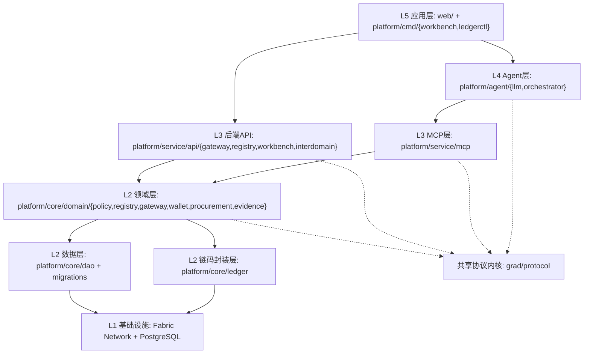

# Design

## Context

详见 `proposal.md`. 当前 `platform/` (约 2.3 万行 Go 源码) 存在 5 类分层失衡:
1. `platform/agent/` (3982 行) 将 L2 钱包持久化, L3 MCP Server 与 L4 LLM 推理揉在同一包中.
2. `platform/runtime/` (5500+ 行) 成为吞噬 L2/L3/L4 逻辑的上帝包, 并通过十余个回调钩子与 `platform/workbench/` 倒置耦合.
3. `platform/workbench/` 直接导入 `pgxpool`, `state/fabric`, `registrysvc` 与 `agent`.
4. `platform/gateway/` 与 `platform/registrysvc/` 混写 HTTP 路由, 领域逻辑与原生 SQL.
5. 目录树平铺, 无法直观反映用户的五层单向架构.

## Goals / Non-Goals

**Goals:**

- 保持 4 模块 Go 工作区 (`protocol`, `chaincode`, `platform`, `experiments`) 的简洁部署边界.
- 在 `platform/` 内建立一目了然的 L2 (`core/`) -> L3 (`service/`) -> L4 (`agent/`) -> 装配入口 (`bootstrap/`, `cmd/`) 分层目录.
- 彻底删除 `platform/runtime/` 上帝包与历史平铺目录, 零过渡适配层.
- 通过 `platform/arch_test.go` 在 `go test` 期自动验证全部单向依赖红线.
- 保持所有协议字节格式, 链码行为, `/api/v1` OpenAPI 契约, PostgreSQL 迁移及 `experiments/` 行为全量回归通过.

**Non-Goals:**

- 不改动 `grad/protocol` 协议字节编码与 `grad/chaincode` 链码语义.
- 不重写 `web/` 前端页面 (归属后续变更 `rebuild-workbench-web-ui`).
- 不将单域后端拆分为多容器微服务部署.

## Decisions

### 决策 1: 保留 4 个 Go 模块, 在 `platform/` 内按五层显式建包

- **选择**: 保留 `go.work` 的 4 模块划分 (`protocol`, `chaincode`, `platform`, `experiments`), 不为 L2/L3/L4 额外拆分多个 `go.mod`.
- **理由**: `go.mod` 是部署与第三方依赖隔离单元 (`chaincode` 需进 CCaaS 容器, `protocol` 需零第三方依赖给链码复用, `experiments` 需独立于生产镜像). 服务端 `platform/` 统一构建 `workbench` 与 `ledgerctl`, 拆成 7 个 `go.mod` 只会增加 `replace` 链, `go.sum` 漂移风险与 Dockerfile 复杂度; 在 `platform/` 内使用显式层级目录 + `arch_test.go` 静态断言即可获得同等编译/测试期强约束.

### 决策 2: 单域单二进制 + 真实 MCP 传输隔离 L4 与 L3

- **选择**: 每个域 (A/B/C) 仍运行单个后端二进制 (`cmd/workbench`), 进程内 L4 (`agent/orchestrator`) 与 L3 (`service/mcp`) 通过 `mcp.NewInMemoryTransports()` 走真实 MCP JSON-RPC 协议交互; `cmd/ledgerctl mcp` 复用同一份 L3 MCP Server 暴露 stdio 传输.
- **理由**: 三域加 Fabric 本机已运行 17 个容器, 域内再拆多进程容器会膨胀至 23+ 容器且无额外安全收益; 进程内走真实 MCP 传输既满足 L4 仅依赖 MCP 协议, 又保留未来零改动切换 HTTP/stdio 独立部署的弹性.

### 决策 3: 目标五层目录与包依赖红线

具体包映射与职责:
- **`platform/core/ledger/`** (原 `state/fabric/` + `state/` 契约): 链码封装, Fabric 实例与 CCaaS 构建, Deliver 完整块流, 固定高度视图, 单调时钟原探针与原交易日志.
- **`platform/core/dao/`** (原 `migrations/` + `state/central/` + 事务与钱包意图存储): 嵌入式 SQL 迁移 (`001_fabric.sql` 至 `012_bound_quotes.sql`), 显式事务与咨询锁封装 (`Tx` / `RunInTx`), 存储绑定 (`store_binding.go`), C0 集中快照 (`central/`), 以及钱包意图锁与回执存储 (`ActionStore`).
- **`platform/core/domain/`**: 深模块业务逻辑, 仅依赖 `core/dao`, `core/ledger` 与 `protocol`, 不含任何 `net/http` 路由代码; `gateway`, `registry`, `procurement` 与 `evidence` 通过 `core/dao` 的 `Tx` / `RunInTx` 与 `*pgxpool.Pool` 维持严格的行锁顺序与事务原子性:
  - `policy/`: OPA Rego v1 策略包校验与确定性求值.
  - `registry/`: 身份注册/恢复双证明, 异步管理操作受理/投影, 受控 outbox/receipt 交付.
  - `gateway/`: 挑战管理, 固定高度+锁后复核执行核, 未知订单核账与审计隔离.
  - `wallet/`: 隔离密钥与 SD-JWT 钱包, `client_actions` 意图锁, 强类型 `BoundOperations` 与纯 HTTP 网关客户端.
  - `procurement/`: 采购草稿版本管理, 确认与任务推进状态机 (原散落在 `workbench/` 与 `runtime/` 的核心逻辑).
  - `evidence/`: 五类证据视图投影与角色可见边界过滤.
- **`platform/service/api/`** (L3 HTTP 服务层): 统一使用 `internal/httpx` 与 `internal/mtls`, 仅做协议解码, 会话/CSRF/mTLS 认证与调用 `core/domain`, 拆分为 `gateway`, `registry`, `workbench`, `interdomain` 四个清晰处理器集.
- **`platform/service/mcp/`** (L3 MCP 服务层): 注册 6 个通用 MCP 工具及阶段受限工作台工具集, 仅调用 `core/domain/wallet`.
- **`platform/agent/`** (L4 Agent 层):
  - `llm/`: OpenAI 与 Anthropic 双官方 SDK 客户端.
  - `orchestrator/`: 采购草稿对话助手 (`Suggest`), A1 转委托编排与 B1/B2 询价/下单/核账编排; 所有工具执行严格通过 `mcp.ClientSession` 完成, 零 `core/` 导入.
- **`platform/bootstrap/`** (薄 DI 装配层): 仅做对象构造, 传输绑定 (将 L3 MCP 注入 L4 Orchestrator), 健康检查与测试/演示协议夹具 (`fixture`), 严禁包含业务判断.
- **`platform/cmd/{workbench,ledgerctl}/`**: 极薄进程入口与 Cobra CLI.

### 决策 4: 用 `platform/arch_test.go` 焊死五层红线

- **选择**: 在 `platform/arch_test.go` 使用标准库 `go/parser` 扫描 `platform/` 下所有 `.go` 文件的导入路径, 断言以下硬规则:
  1. `core/ledger` 与 `core/dao` 不得导入 `core/domain`, `service`, `agent`, `bootstrap`, `cmd`.
  2. `core/domain/...` 不得导入 `service`, `agent`, `bootstrap`, `cmd`, 且禁止注册 HTTP 路由 (`http.ServeMux` 等).
  3. `service/...` 不得导入 `agent`, `bootstrap`, `cmd`, 禁止导入 LLM SDK (`openai-go`, `anthropic-sdk-go`), 禁止直接导入 `fabric-gateway` 或在业务处理器中直连 `pgxpool` 执行原生 SQL.
  4. `agent/...` 仅允许导入 `protocol`, `service/mcp` (或官方 `mcp` 客户端协议) 与 LLM SDK, 严禁导入 `core/...`, `service/api/...`, `pgx`, `fabric-gateway`.
  5. `experiments/` 继续保持仅导入公开包且不反向污染生产模块.

## Risks / Trade-offs

- [一次性大重构范围广] -> 涉及 2.3 万行 Go 代码与 `experiments/` 调用方, 容易引入回归. 缓解措施: 严格按自底向上顺序分步迁移 (`core/dao` + `core/ledger` -> `core/domain` -> `service/api` + `service/mcp` -> `agent` -> `bootstrap` + `cmd` -> `experiments`), 每完成一层即跑对应单测与 PostgreSQL 集成测试, 最后运行全量 `test:unit`, `test:db`, `experiment:test`, `backend.Dockerfile` 构建与隔离 `ledger:verify` 实机验收.
- [L2 `core/domain/wallet` 到 C 网关的 HTTP 调用] -> 钱包作为跨企业客户端需要发起 HTTP 请求到 C 网关, 这属于出站客户端而非入站 HTTP 服务器. 缓解措施: 将出站网关 HTTP 客户端明确放在 `core/domain/wallet` (或 `core/gatewayclient`), 与 L3 入站 `service/api` 清晰区分并在 `arch_test.go` 中显式白名单说明.
- [事务边界与 DAO 拆分粒度] -> 网关 `execute` 与 `audit` 依赖同一 PostgreSQL 事务内的行锁顺序 (`challenges -> business_keys -> trusted_contexts -> fabric_head`). 缓解措施: `core/dao` 暴露显式事务上下文 (`Tx` / `RunInTx`), 确保锁顺序和原子性 100% 保持原契约, 不为了机械拆 DAO 而破坏事务一致性.
