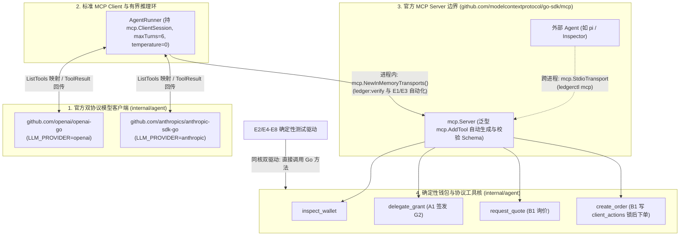

# M2 两种根与两级委托设计

## 背景

D0 最小网络, D0 最小协议与 M1 直接访问已建立 Fabric `procurement` 通道, `authregistry` 链码, PostgreSQL 固定高度视图与原探针租约, 以及 `C -> U` 单跳 RP `G0` 的 `quote.read` 在线询价闭环 ([提案](proposal.md)). 按照 [TODO](../../../TODO.md) 与 [技术栈](../../../docs/implementation/技术栈.md), M2 阶段需要将单跳询价扩展为覆盖 A/B/C 三域, RP/BM 双根权源, `G0 -> G1 -> G2` 两级委托, `order.create` 双实例唯一订单事务, 双域身份关联以及接入三大官方 Go SDK 的智能体工具闭环.

## 目标与范围

- **目标**:
  - 链码与协议层支持 `PA` 采购授权资格 (`purchasingAuthority`), `BUYER_MANDATE` (`BM`) 任务与 `PA` 签发的 `BM` 根 `G0`, 以及双域身份关联 (`IdentityLink`) 提案, 双域注册机构审批与撤销.
  - 完成 T 对 B 域及 `IB` 认证, 登记 `A1`, `B1`, `U-in-B` 并签发 SD-JWT 凭证, 实现 RP 与 BM 下的 `G0 -> G1 -> G2` 逐跳签发, 权限收缩 (`500000 -> 500000 -> 100000`, 深度 `2 -> 1 -> 0`) 及 `trustPaths` 去重投递.
  - 扩展 `internal/gateway` 与 PostgreSQL 业务主库支持 `order.create` (`orders` 与 `client_actions`), 实现报价校验, 委托链总额校验, 锁后 `ELEVATED`/`BLOCKED` 拒绝建单, `G1` 撤销块应用后拒绝 (`ANCESTOR_INACTIVE`), C 独立准入拒绝 (`SUPPLIER_POLICY_DENIED`), 以及双网关实例 (8103/8104) 同键并发唯一订单约束.
  - 引入官方 MCP Go SDK (`github.com/modelcontextprotocol/go-sdk`), 官方 OpenAI Go SDK (`github.com/openai/openai-go`) 与官方 Anthropic Go SDK (`github.com/anthropics/anthropic-sdk-go`), 构建 `internal/agent` 运行时与 `ledgerctl mcp` stdio 入口, 跑通 `A1`/`B1` 真实 LLM 工具调用闭环并纳入 `ledgerctl verify` 联合验收.
- **非目标**:
  - 跨请求静态验签缓存, 普通身份状态变更与管理账户恢复, 域认证续发/收缩, 密钥轮换, `B2` 改派与未知订单核账 (`reconcile_order`) 留在 M3 阶段.
  - C0/B0/B1 消融, E1-E8 大规模负载/撤销窗口测量与五个前端演示视图留在 M4 阶段.

## 设计决策

### 1. 链码扩展: PA 采购资格, BM 根授权与双域身份关联

- **PA 采购资格与 BM 根授权**:
  - 在 `internal/fabricapi` 的 `Domain` 结构增加 `PurchasingAuthority` 字段 (`string`, 指向本域有效 `SERVICE` DID), 并新增 `SetPurchasingAuthority` 交易: 链码强制校验调用者为该域登记管理员 (`d.Admin`), 目标身份属于该域且 `Kind == "SERVICE"` 与当前有效域认证一致, 更新 `Domain.PurchasingAuthority` 并递增 `Revision` (配合 `expectedRevision` 防止并发冲突).
  - 扩展 `RegisterTask` 允许 `Mode` 为 `api.RP` (`RESOURCE_PREAUTHORIZED`) 或 `api.BM` (`BUYER_MANDATE`), 保持任务创建者限受信清单固定的 A 域 `U`.
  - 扩展 `checkGrant` 的根授权分支 (`g.Parent == ""`): 当 `g.Mode == api.RP` 时保持由 `C` 资源所有者签发; 当 `g.Mode == api.BM` 时要求 `g.Issuer == domainA.PurchasingAuthority` (非空且身份/凭证均处于当前有效状态, 具备 `procurement-authority` 角色声明), `g.Grantee == t.Creator`, 且签发者管理证书与 `issuer.Management` 匹配. `IA`/`IB`/`IC` 或 `T` 均不可签发 `BM` 根.
- **双域身份关联 (`IdentityLink`) 状态机**:
  - 新增 `IdentityLink` 链上状态机: `PENDING -> ACTIVE -> REVOKED` (终态).
  - `ProposeIdentityLink`: 由首方所属域注册机构校验两端账户认证与应用密钥 PoP (`deploymentId` 绑定, 防重放 nonce) 后提交上链, 写入初始 `PENDING` 记录 (`effectiveActive = false`), 记录提案 JCS 摘要与发起方域 ID.
  - `ApproveIdentityLink`: 仅另一端所属域当前注册机构 (`TargetDomain` 的 `Registrar`) 可调用, 核对预期状态 `PENDING`, 提案摘要 (`ProposalDigest`) 以及两端当前身份/域资格有效性后置为 `ACTIVE` (`effectiveActive = true`, `Revision++`). 同域冒充另一域审批或审批变更后的提案摘要均被拒绝.
  - `RevokeIdentityLink`: 限任一端点主体登记管理身份或所属域当前注册机构调用, 置为终态 `REVOKED`.
  - 协议层与网关在核验访问路径时显式检查 `IdentityLink` 不参与授权路径继承: 尝试使用 `U-in-B` 替代 `G0` 的 `U` 或沿用其身份凭证时因主体/密钥连续性不匹配而被确定性拒绝.

### 2. 三域身份引导与 G0->G1->G2 逐跳交付装配

- **三域引导与多跳签发**:
  - 引导阶段补齐 `T` 对 `B` 域及 `IB` 的认证, 登记 `A1` (A 域 `AGENT`), `B1` (B 域 `AGENT`), `U-in-B` (B 域 `USER`) 与 `PA` (A 域 `SERVICE`) 并签发对应 SD-JWT 凭证.
  - 分别围绕独立的 RP 任务和 BM 任务签发三级委托链:
    - `G0`: `C -> U` (RP) 或 `PA -> U` (BM), 上限 `500000` 分 (`5000.00 CNY`), 剩余深度 `2`, 允许动作 `["quote.read", "order.create"]`.
    - `G1`: `U -> A1`, 上限 `500000` 分, 剩余深度 `1`, 引用 `G0` 标识与摘要.
    - `G2`: `A1 -> B1`, 上限 `100000` 分 (`1000.00 CNY`), 剩余深度 `0`, 引用 `G1` 标识与摘要 (由 `A1` 智能体工具在运行期签发并登记).
- **逐跳材料交付与去重装配**:
  - 扩展 `grant_outbox` 与 `wallet_receipts` 支持携带多跳祖先最小 SD-JWT 出示 (`ancestorCredentials`) 与按 `certificationId` 去重的 A/B/C 三域 `trustPaths` (`DomainAuthorityCredential` JWS + 对应域信息).
  - 协议核验器 (`internal/protocol`) 与 `StateProvider` (`internal/fabric/view.go`) 在同一 `REPEATABLE READ` 快照高度上递归装载并校验从叶子 `G2` 到 `G1` 到 `G0` 的每一跳状态 (`ACTIVE`), 区间包含, 深度严格递减, 集合非扩张, 父子凭证/密钥版本连续性以及根权源身份路径.

### 3. C 网关 order.create 事务与双实例并发幂等

- **数据表扩展 (`internal/gateway/schema.go`)**:
  - 新增 `orders` 表: 主键 `(deployment_id, order_id)`, 唯一约束 `UNIQUE (deployment_id, actor, task_id, idempotency_key)`, 记录 `quote_id`, `principal_domain`, `authorization_mode`, `currency`, `amount_minor`, `status` (`CREATED`), `creation_decision_id`, `created_at`.
  - 新增 `client_actions` 意图锁表: 按 `(deployment_id, actor, intent_id)` 与 `(deployment_id, actor, task_id, action, idempotency_key)` 记录客户端发送前的原请求, `request_hash`, `send_revision`, `status` (`OUTCOME_UNKNOWN` / `COMPLETED` / `FAILED`), `challenge_ids` 与 `order_id`.
- **锁后复核与策略分支 (`internal/gateway/execute.go` & `internal/policy`)**:
  - `validateAccessRequestSchema` 区分 `quote.read` (`quoteId == null`, `amountMinor == 0`) 与 `order.create` (`quoteId != ""`, `amountMinor > 0`, 资源为 `orders`).
  - `order.create` 在 `READ COMMITTED` 事务中按固定加锁顺序锁定: `challenges (FOR UPDATE)` -> `business_keys` -> `quotes (FOR SHARE)` -> `trusted_contexts (FOR SHARE)` -> `fabric_head (FOR SHARE)`.
  - 锁后依次核验: (1) `fabric_head` 一致性 (若检测到 `G1` 撤销块 `r` 已应用或高度推进则回滚并重验, 采用 `r` 后在路径状态核验返回 `403 ANCESTOR_INACTIVE`); (2) 报价归属 (`quote.actor == req.Actor && quote.task_id == req.TaskID && quote.product_id == req.ProductID`), 报价未过期 (`decision_at < quote.valid_until`, 否则 `409 QUOTE_EXPIRED`), 请求总额与报价严格相等 (`req.AmountMinor == quote.total_amount_minor`, 否则 `409 AMOUNT_MISMATCH`); (3) 整条路径最小单笔上限 (`req.AmountMinor <= path.maxAmountMinor`, 1200 元下单超 `G2` 1000 元上限时返回 `403 AMOUNT_LIMIT_EXCEEDED`); (4) C 独立准入策略与环境 (`SUPPLIER_POLICY_DENIED` 或锁后 `ELEVATED`/`BLOCKED` 返回 `403 POLICY_DENIED`).
  - 双实例唯一订单: 两个监听在不同端口 (如 8103 与 8104) 的 C 网关实例连接同一 PostgreSQL 主库, 并发提交同 `(actor, taskId, "order.create", idempotencyKey)` 请求时通过 `business_keys` 与 `orders` 唯一索引协调锁等待, 保证仅创建一笔 `orders` 记录, 双方同摘要返回同一 `orderId`, 异摘要返回 `409 IDEMPOTENCY_CONFLICT`.

### 4. 三大官方 SDK 智能体运行时与标准 MCP 架构

- **标准 MCP 工具边界 (`github.com/modelcontextprotocol/go-sdk/mcp`)**:
  - 使用 `mcp.NewServer` 与泛型 `mcp.AddTool[In, Out]` 注册 `inspect_wallet`, `delegate_grant`, `request_quote`, `create_order` 四个工具, 由官方 SDK 自动推导并校验输入 JSON Schema.
  - 确定性方法与密码学私钥 (`ecdsa.PrivateKey`), SD-JWT 披露盐值, `client_actions` 锁写库, 挑战 `nonce` 原样绑定及 `KB-JWT` 签发严格封装在 `WalletTools` 服务层内, 工具返回值只暴露脱敏业务视图和结构化网关错误码.
  - `AgentRunner` 通过 `mcp.NewInMemoryTransports()` 与 `mcp.Server` 建立真实进程内 `mcp.ClientSession`, 完整走完 `ListTools` / `CallTool` MCP 生命周期; 同时 `cmd/ledgerctl` 新增 `ledgerctl mcp` 子命令挂载 `mcp.StdioTransport`, 使 `pi` 等外部客户端无需改代码即可复用同一套工具服务.
- **官方双协议 LLM SDK 适配 (`openai-go` + `anthropic-sdk-go`)**:
  - 在 `internal/agent` 定义统一的 `ChatModel` 抽象, 分别由 `github.com/openai/openai-go` (支持 `option.WithBaseURL`, `option.WithAPIKey`, 覆盖 OpenAI/DeepSeek/Qwen/Ollama 等) 与 `github.com/anthropics/anthropic-sdk-go` (支持 `option.WithBaseURL`, `option.WithAPIKey`, 覆盖 Claude 及 Anthropic 兼容端点) 实现.
  - 单测与离线环境内置兼容 OpenAI `/v1/chat/completions` 与 Anthropic `/v1/messages` 的 `httptest.NewServer` 测试桩, 验证两套官方 SDK 的工具调用解码与闭环轨迹; `ledgerctl verify` 实机验收读取环境变量 (`LLM_PROVIDER`, `LLM_BASE_URL`, `LLM_API_KEY`, `LLM_MODEL`) 驱动真实模型完成 `A1` 签发 `G2` 与 `B1` 在 RP/BM 下的 800 元成功及 1200 元拒绝验收 (当环境未配置真实密钥时显式报告阻塞/跳过说明或要求配置真实 API, 确保 M2 退出证据真实可查).

## 风险与取舍

| 风险或代价 | 处理 |
| --- | --- |
| 引入三个官方 Go SDK (`modelcontextprotocol/go-sdk`, `openai-go`, `anthropic-sdk-go`) 增大 `go.mod` 与构建体积 | 使用 `go mod tidy` 精确锁定版本并运行离线 `go test -count=1 ./...` 与 `CGO_ENABLED=0` 交叉编译确认无构建回归; `chaincode/registry` 仍仅依赖 `fabric-chaincode-go` 与 `internal/fabricapi`, 不引入智能体依赖. |
| 真实 LLM 在 F07 (1200 元超额) 时可能自主识别超额而直接拒绝对工具的调用, 导致未触达网关拦截分支 | 在 F07 设计两条互补的真实 LLM 用例: (1) 正常任务由 `B1` 智能体自主决策识别超限拒绝下单; (2) 提示词诱导分支要求 `B1` 尝试提交 `Q1200` 订单以实测触发网关 `403 AMOUNT_LIMIT_EXCEEDED`, 两者均验证主库无新订单生成. |
| 双网关实例 (8103/8104) 并发访问共享 PostgreSQL 时可能出现死锁或重放竞争 | 保持两实例均严格遵循 `challenges -> business_keys -> quotes -> trusted_contexts -> fabric_head` 的固定加锁顺序, 并使用带独立 `probeOne`/`probeTwo` 身份的探针隔离状态新鲜度租约. |
| `authregistry` 链码新增 `SetPurchasingAuthority`, `ProposeIdentityLink`/`ApproveIdentityLink`/`RevokeIdentityLink` 及 `BM` 校验需要升级已部署通道链码 | M2 验收支持通过部署新 `instanceId` 的干净重建或链码序列升级 (`sequence++`) 同步至三域 Peer, 并在证据 `manifest.json` 中精确记录 `sequence` 与包摘要. |
