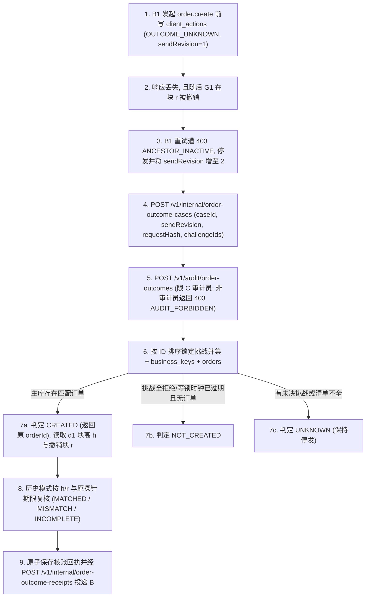

# M3 动态状态与恢复设计

## 背景

D0, M1 与 M2 已建立 Fabric `procurement` 通道, `authregistry` 链码, PostgreSQL 固定高度视图与探针租约, RP/BM 双根两级委托 (`G0 -> G1 -> G2`), `order.create` 双实例唯一订单事务, 以及基于 MCP Go SDK 与 OpenAI/Anthropic 官方 Go SDK 的 `A1`/`B1` 工具闭环 ([提案](proposal.md)). 按照 [阶段任务](../../../TODO.md), [部署与链上登记](../../../docs/implementation/部署与链上登记.md), [证据交付与网关执行](../../../docs/implementation/证据交付与网关执行.md) 与 [订单核账](../../../docs/implementation/订单核账.md), M3 阶段需要补齐动态生命周期, 静态验签缓存 (`B1`), 未知订单核账与历史高度复核, 以及 `B2` 改派和核账恢复的智能体轨迹与 E2/E3/E6/E7 预跑.

## 目标与范围

- **目标**:
  - 在 `chaincode/registry` 与 `internal/fabricapi` 补齐 T 域认证续发/收缩/撤销与引导身份恢复 (`CertifyDomain` 替换分支, `RevokeCertification`, `UpdateAuthorityIdentity`), 普通身份状态管理, 密钥轮换与 `grad-identity-recovery-v1` 双证明管理账户恢复 (`SetIdentityStatus`, `RotateIdentity`, `RecoverIdentity`), 以及凭证撤销, 任务取消与委托暂停/恢复 (`RevokeCredential`, `CancelTask`, `SuspendGrant`, `ResumeGrant`), 配合受理前版本预检与异步操作状态机完成 `S76-S103` 与 `F14-F15`.
  - 在 `internal/protocol` 与 `internal/gateway` 引入按 `(SHA256(rawBytes), alg, appKeyId, appKeyVersion)` 索引的 `B1` 静态验签缓存, 每次命中后仍在固定高度快照上强制校验 `Identity.Status`, `Identity.KeyVersion` (`KEY_VERSION_STALE`), 域认证指针与声明范围 (`department` 收缩边界 `S93`), 并支持 `T` 离线零调用本地核验 (`F14`/`S84`).
  - 在 `internal/gateway` 与 `internal/fabric` 实现两实例未知订单核账 (`client_actions` `OUTCOME_UNKNOWN` + `sendRevision`, `order_outcome_cases`, `order_outcome_receipts`, `POST /v1/internal/order-outcome-cases`, `POST /v1/audit/order-outcomes`, `POST /v1/internal/order-outcome-receipts`), 强制 `C` 审计员隔离 (`403 AUDIT_FORBIDDEN`) 与基于历史读取器对 `d1` 块高 `h`, 撤销块 `r` 和原探针期限的审计复核 (`MATCHED`/`MISMATCH`/`INCOMPLETE`/`NO_DECISION`).
  - 在 `internal/agent` 注册 `replace_grant` 与 `reconcile_order` MCP 工具, 跑通 `A1 -> B2` 改派与 `B1` 核账恢复的真实 LLM 工具轨迹 (`E3`), 并在 `internal/fabric` 完成 `E6` (撤销窗口) 与 `E7` (故障与并发) 预跑验收.
- **非目标**:
  - `C0`/`B0`/`B1` 大规模多轮重复消融测量 (`N=100..10000`, `10..500 ops/s`), `E4`/`E5`/`E8` 完整性能数据集产出与五个前端演示视图留在 M4 阶段.

## 设计决策

### 1. 链码与登记层: 域资格续发/收缩, 身份状态与管理账户恢复, 异步操作状态机

- **T 域认证原子续发, 收缩与机构引导恢复 (`chaincode/registry/identity.go`)**:
  - 扩展 `CertifyDomain`: 当目标域处于 `PENDING` 时保持首份激活逻辑; 当目标域处于 `ACTIVE` 或 `SUSPENDED` 且 `d.Certification != ""` 时, 要求输入 `ExpectedRevision == d.Revision` 与 `ExpectedCertification == d.Certification`, 先校验新 `Certification` 的 `Scopes` 与当前 `ISSUER` 身份密钥版本一致, 将新认证以 `ACTIVE` 写入新键, 并将 `d.Certification` 原子替换为新 ID 且递增 `d.Revision`. 同钥续发保留 `d.Status` (如 `ACTIVE`), 收缩 `claimNames` (如移除 `department`) 通过 `Scopes[i].Claims` 缩窄生效, 竞争冲突返回 `STATE_CHANGED`.
  - 新增 `RevokeCertification`: 限 `T` 管理身份调用, 校验 `ExpectedRevision`/`ExpectedDigest`, 将指定 `Certification` 置为终态 `REVOKED` 并递增其 `Revision`.
  - 新增 `UpdateAuthorityIdentity`: 限 `T` 管理身份更新或恢复非终态 `DOMAIN`/`ISSUER` 引导身份的管理证书绑定, `DIDDocumentDigest` 与应用公钥 (`KeyVersion++`, `Revision++`), 保留原 `Status`, 使 `IB` 换钥后须由 `T` 重新认证方可签发新凭证 (`F15`, `S81`).
  - **T 离线验证 (`F14`, `S84`)**: `DeliveryService.HasSyncedCertification` 校验网关本地主库是否存在当前高度所指 `certID` 且摘要匹配的原始 `DomainAuthorityCredential` JWS, 缺正文立即返回 `503 MATERIAL_NOT_SYNCED`, 有正文则直接用预置 `T` 根公钥本地验签, 运行期 `T` 在线调用数为 `0`.
- **普通身份状态转换, 密钥轮换与双证明管理账户恢复**:
  - 新增 `SetIdentityStatus`: 对普通身份 (`USER`/`AGENT`/`SERVICE`), 允许本人当前 `Management` 或本域当前 `Registrar` 将 `ACTIVE` 转为 `SUSPENDED` 或 `REVOKED` (或 `SUSPENDED -> REVOKED`), **仅本域当前 `Registrar`** 可将 `SUSPENDED` 恢复为 `ACTIVE` (且要求所属域及其当前认证有效); 对 `DOMAIN`/`ISSUER` 引导身份, 仅 `T` 可执行状态转换. 同状态转换或对 `REVOKED` 发起变更一律返回 `INVALID_STATE` (REST 层映射为 `409 IDENTITY_STATE_CONFLICT`).
  - 新增 `RotateIdentity`: 限普通身份本人当前 `Management` 在所属域有效且自身为 `ACTIVE` 时调用, 核对 `ExpectedRevision` 与 `ExpectedKeyVersion`, 校验新应用公钥与文档摘要, 将 `KeyVersion` 递增 `1` 并递增 `Revision`.
  - 新增 `RecoverIdentity`: 先由本域当前 `Registrar` 核验原 `AccountCommitment` 并签发 300 秒内 `grad-identity-recovery-v1` 挑战 (绑定 `deploymentId`, `domainId`, `subjectId`, `accountCommitment`, `oldManagementIdentity`, `newManagementIdentity`, `expectedRevision`, `expectedKeyVersion`, `newAppKeyId`, `newAppKeyVersion`, `newAppPublicKey`, `newDidDocumentDigest`, 43 字符规范 `nonce`); 核验新应用密钥 ES256 JWS 与新管理证书 P-256 ECDSA 双证明后消费挑战并提交链码. 链码校验调用者为本域有效 `Registrar`, 目标为非 `REVOKED` 普通身份且域资格有效, **原子删除旧 `binding/<oldMgmt>` 并占用 `binding/<newMgmt>`**, 更新 `Management`, `DocumentDigest`, `KeyID`, `PublicKey`, 递增 `Revision` 与 `KeyVersion`, **严格保留原 `Status`** (`SUSPENDED` 身份恢复账户后仍为 `SUSPENDED`, `S97`).
- **业务对象动态操作与异步操作状态机**:
  - 新增 `RevokeCredential` (限该凭证锚原 `Issuer` 管理身份), `CancelTask` (限任务 `Creator` 或资源方 `ResourceManagement`, `ACTIVE -> CANCELLED`), `SuspendGrant`/`ResumeGrant` (限该授权原 `Issuer`, `ACTIVE <-> SUSPENDED`, 不改变 `Interval.EXP`, `E3`).
  - 在 `internal/fabric/operation.go` 扩展管理服务端操作协调: 接受带 `expectedRevision` 的新写请求前预检当前账本/视图状态, 版本不匹配直接返回 `409 STATE_CHANGED` 且不写入 `operations` 或发起提案; 受理并写入 `operations` 后返回 `202` 与 `operationId`; `GET /v1/operations/{id}` 始终返回 `200`, 如实暴露 `PENDING`/`CONFIRMED`/`FAILED` 与 `ENDORSEMENT_REJECTED`/`STATE_CHANGED`/`COMMIT_INVALID`, `DUPLICATE_TXID` 仅核对原交易结果而不覆盖已确认记录 (`S100`/`S101`).

管理 REST 由 `NewFabricManagementOperationService` 装配真实 Fabric 后端, 受理事务保存调用者与规范输入, 后端复用 `journal` 持久化原提案和已签交易. 宿主运行 `RunRecovery` 恢复队列, 查询与重试始终关联原 txID, 不通过注入结果推进实机验收状态.

`RecoverIdentity` 的管理入口仅接受完整双证明包, 核对宿主已签发的一次性挑战, 由服务端派生链码参数. 挑战消费与原请求受理在同一事务提交, 队列恢复再次核对批准绑定, 无批准的旧原始恢复请求不得提交. 操作查询按已认证证书核对原发起身份; 本域审计者必须由宿主按 MSP 与指纹明确配置, 不以自报角色获得权限.

### 2. 协议与网关层: B1 静态验签缓存与 SD-JWT 披露范围收缩边界

- **静态验签缓存 (`SignatureCache`)**:
  - 在 `internal/protocol` 新增并发安全 (`sync.RWMutex` 或分片 map) 的 `SignatureCache`, 以结构化键 `{RawDigestSHA256, Alg, AppKeyID, AppKeyVersion}` 缓存静态 ES256 公钥验签与 JWK 指纹校验结论 (`B1` 配置启用, `B0` 配置传 `nil`).
  - `VerifyAccessEvidencePackage` 接受可选缓存: 命中时跳过重复的 ECDSA P-256 验签计算, **但绝不跳过**对当次固定高度 `SnapshotView` 中 `Identity.Status`, `Identity.KeyVersion`, `Identity.DocumentDigest`, `Domain.Status`, `Domain.Certification`, `Credential.Status` 与 `Grant.Status` 的逐项核对. 若缓存命中但快照中 `Identity.KeyVersion != tokenKeyVersion`, 确定性返回 `403 KEY_VERSION_STALE` (`S22`).
- **T 同钥收缩声明范围 (`S93`)**:
  - 在 `VerifyAccessEvidencePackage` 与 `internal/fabric/verify_protocol.go` 中支持包含可选合成声明 (如 `department`) 的 SD-JWT 凭证. 核对披露集合时: (1) 若未披露 `department`, 仅将其保留为待验证摘要哈希, 不把其声明名推断或写入策略输入; (2) 若披露了 `department`, 核对当前 `Certification.Scopes` 中对应 `Issuer` 的 `claimNames` 是否仍包含 `department`, 不包含则立即返回 `403 ISSUER_SCOPE_INVALID`; (3) 若缺少必需声明 `domain` 或 `role`, 返回 `400 INVALID_DISCLOSURE`.

### 3. 未知订单核账与历史高度 (`h < r`) 审计复核

- **数据表与意图停发 (`internal/gateway/schema.go`)**:
  - 扩展 `client_actions` 增加 `send_revision BIGINT NOT NULL DEFAULT 1`, `challenge_ids TEXT[] NOT NULL DEFAULT '{}'`, `case_id TEXT`, `outcome TEXT`, 将状态检查放宽支持 `'OUTCOME_UNKNOWN'` 与 `'RECONCILED'`; 停发时持有同一意图行锁递增 `send_revision` 并固定 `challenge_ids`, 拒绝迟到的旧 `send_revision` 工作进程继续发起 `execute`.
  - 新增 `order_outcome_cases` (主键 `(deployment_id, case_id)`, 保存 `send_revision`, `actor`, `task_id`, `idempotency_key`, `request_json`, `request_hash`, `challenge_ids`, `outcome`, `order_id`, `audit_status`, `created_at`) 与 `order_outcome_receipts` (保存 `(case_id, check_no, send_revision, outcome, order_id, history_status)`, 幂等防重开已完结意图).
- **核账审计锁序与历史高度复核 (`internal/gateway/execute.go`, `internal/fabric/view.go`)**:
  - `POST /v1/audit/order-outcomes` 校验 mTLS/身份为 `C` 审计员, 否则统一返回 `403 AUDIT_FORBIDDEN` (`S67`) 且不查询或泄露订单存在性.
  - 核账事务按 `(deployment_id, actor, task_id, request_hash)` 枚举 `challenges` 并与 `case.challengeIds` 取并集, 按字符串升序 `FOR UPDATE` 锁定全部挑战行后再锁 `business_keys` 与 `orders`, 用锁后 `clock_timestamp()` 判断未消费挑战是否已过期, 杜绝死锁并准确产出 `CREATED`/`NOT_CREATED`/`UNKNOWN`.
  - 当判定为 `CREATED` 时, 按 `order.decision_id` 查找首次允许决策 `d1`, 调用 `StateProvider` 的历史视图 (`mode="historical"`, `block=d1.block_number`) 加载当时的 `RootRecord`, `Certification` (使用 `d1.certification_id`/`certification_digest` 以固定 `T` 根验证, 不用当前新认证替代), `Identity`, `Credential`, `Grant` 链与策略摘要, 同时在可信 Peer 区块中定位目标撤销交易的 `VALID` 高度 `r`: 若 `h < r` 且 `d1.decision_at` 满足原探针期限 (`probe_deadline_mono_ns`/`probe_deadline`) 与业务期限则记 `MATCHED`, 若 `h >= r` 或超期放行则记 `MISMATCH`, 缺失创建决策或历史块则记 `INCOMPLETE`. 全程只读原表, 不修改 `orders` 或 `challenges`.

- **认证服务通道**: `serviceauth.Caller` 从已验证客户端证书的 DID URI 与角色 OU 取身份, 或读取宿主安装的进程内认证上下文; `X-Caller-*` 不能授予或覆盖身份. B 恢复, C 审计与 C 回执使用独立宿主配置的客户端, MCP 参数不能指定认证主体.
- **历史密码学材料**: 在创建 ALLOW 决策的同一事务向 `decision_evidence` 保存原始已验证出示, 当时 DID 文档与原探针单调核验时点. 历史复核用只读归档解析器重放全部密码学及 h 高度状态检查, 根据实际角色, 披露属性与路径上界装配策略. 缺材料记 `INCOMPLETE`, 矛盾记 `MISMATCH`.
- **停发与回执恢复**: 最终 execute 发送与停发持有同一意图行锁, `case_id` 非空时旧代次和当前代次均禁止新增发送. 审计事务同时保存 `order_outcome_outbox` 不可变回执; C 宿主交付或重启恢复沿用原 `checkNo`, 接收方对全部内容去重.

### 4. 智能体 MCP 扩展 (`replace_grant`/`reconcile_order`) 与 E6/E7 预跑架构

- **MCP 工具层扩展 (`internal/agent/mcp_server.go`, `internal/agent/wallet.go`)**:
  - 新增 `replace_grant` 工具: 封装 `A1` 替换叶子授权 `G2 -> G2'` 给 `B2`, 内部校验 `A1` 私钥签名与范围不扩张, 走真实 `ReplaceGrant` 交易与 `DeliveryService` 投递给 `B2`, 输出脱敏后的新 `grantId` 与修订信息.
  - 新增 `reconcile_order` 工具: 当 `create_order` 发生传输超时/响应丢失且重授权被拒时, 由 `B1` 智能体调用, 自动锁定 `client_actions` 递增 `sendRevision`, 提交核账单并触发核账回执同步, 返回 `outcome`, `orderId` 与 `historyStatus`.
  - 通过 `AgentRunner` (OpenAI & Anthropic 双官方 SDK) 跑通 `E3` 两条新增智能体轨迹 (`B2` 误用 `B1` 的 `Q800` 触发 `403 QUOTE_SCOPE_MISMATCH` 后自主重新询价建单; `B1` 响应截断 + `G1` 撤销后核账找回原订单).
- **E6 与 E7 预跑集成 (`internal/fabric/verify_m3.go`)**:
  - 延续"同核双驱动"原则: `E1`/`E3` 新轨迹由真实 LLM 智能体驱动, `E2` (`S76-S103`), `E6` (20 ms 间隔持续探测 `G1` 撤销窗口, 记录 `t_submit`, `t_valid`, `t_apply`, `t_adopt`, `t_last_allow`, `t_first_deny` 并验证 `t_adopt >= r` 后零允许及不超过 `deltaState`) 和 `E7` (停排序节点, Peer 断流补块, 等锁超时 `S66`, 锁后风险升级 `S91` 与核账恢复) 由确定性测试驱动高频执行并产出结构化证据.

## 风险与取舍

| 风险或代价 | 处理 |
| --- | --- |
| 静态验签缓存可能被误认为绕过动态吊销或换钥检查 | 强制要求缓存键包含 `appKeyVersion`, 并在命中缓存后无条件执行固定高度快照下的 `Status`, `KeyVersion`, `CurrentCertificationID` 与 `claimNames` 校验; 在 `S22`/`S81`/`S93` 显式写入对抗断言验证缓存命中下的拒绝行为. |
| `RecoverIdentity` 若未原子切换管理证书绑定, 可能留下旧管理私钥越权或双主体争用 | 在链码同一交易内校验 `newManagementIdentity` 未被占用后删除 `binding/<oldMgmt>` 并写入 `binding/<newMgmt>`, 同时保持 `Status` 不变与 `KeyVersion++`, 依靠 MVCC 读集避免并发换账冲突. |
| 核账事务同时锁定多条挑战与业务键, 在高并发下可能发生锁序反转死锁 | 严格强制对挑战 ID 并集按字典序排序后逐行 `FOR UPDATE`, 再锁定 `business_keys` 与 `orders`, 与在线 `execute` 事务锁序保持一致, 读库超时返回 `503` 保留 B 端未知状态. |
| E6/E7 预跑若混入真实 LLM 推理往返会掩盖 `20 ms` 探测精度和精密时序注入 | 遵循 [实验计划](../../../docs/experiments/实验计划.md) 的"同核双驱动": LLM 仅驱动 `E3` 改派与核账恢复语义决策轨迹; `E6` 撤销窗口与 `E7` 故障并发由确定性 Go 工具核直接驱动, 保证时间线精确可复现. |
