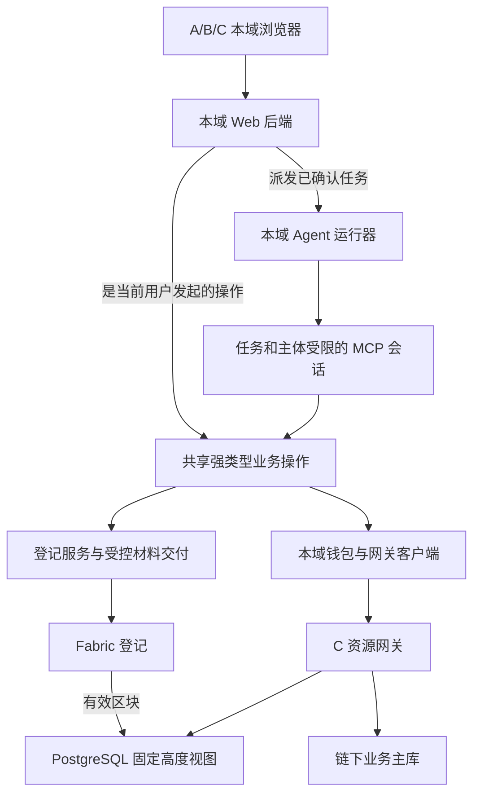

# M4 三域 Web 工作台设计

## Context

[提案](proposal.md)定义 M4 的交付范围. `registrysvc` 已有异步管理操作与原交易状态, `gateway` 负责固定高度验权和业务定案, `agent` 已有六个钱包操作, MCP 协议适配和双模型协议运行器. 现有运行时装配会读取固定夹具和多个主体的签名材料, 部分材料交付依赖夹具快照. 浏览器部署需要按域装配, 对真实任务从已确认登记与已核验交付记录读取材料.

## Goals / Non-Goals

- 目标为前后端独立构建, 同一套业务操作支撑人工和智能体入口, 网页可追溯正式状态及实际交易.
- 工作台的部署和验收范围为现有 A/B/C. Fabric 通道治理, 现有链码角色授权, T 的信任职责及 U 的任务创建资格沿用现有契约. 累计预算和真实支付属于原型范围以外.

## Decisions

### 1. 两个镜像, 一份按域部署的 Compose 模板

前端使用单一静态构建, 通过相对路径调用本域 `/api/v1` API. 前端服务按运行时配置转发该路径, 使浏览器同源访问, 同时保持 Go 后端可独立构建与替换. OpenAPI 定义会话, 本域管理, 任务草稿与确认, 运行状态和授权证据读接口, 细化返回类型和错误边界.

A/B/C 分别启动同一份模板, 将域 ID, 服务地址, 受信部署清单, 独立数据库连接及本域凭据绑定到各自后端. 后端启动时核对域与受信部署绑定. C 侧继续运行资源网关及其固定高度状态源. Compose 应用层复用已有 Fabric 网络, 各域的工作台会话及运行数据按数据库或独立凭据绑定的存储边界隔离. 浏览器入口和域间受控服务通信分开暴露. 逐域构建只在镜像内容有差异时有意义, 因此工作台将这些差异作为运行配置处理.

### 2. 使用已登记身份执行共同业务操作

首版演示使用预置账号和服务端会话. 账号绑定本域已登记 DID 及获准的管理证书, 后端使用安全 Cookie, 退出会撤销会话, 写操作复核 CSRF. 会话返回当前用户可用操作, 每条读写仍根据实际对象和现有角色独立校验. 本域管理员可通过 `SetPurchasingAuthority` 演示提交和确认, 在演示准备阶段为缺少合资格本域服务的域登记一个本域服务. 凭证签发, 注册机构及 C 审计功能继续按各自角色授予.

将现有签发, 状态变更, 钱包和网关调用整理为可共享的强类型业务操作. Web 与 MCP 分别适配 HTTP 和工具请求, 业务操作从可信会话或运行绑定取得调用主体, 保留管理操作键, 委托版本和网关业务键. `registrysvc`, `gateway` 和钱包仍分别负责其事务与校验. 公共层仅提取两个入口共用的行为, 保留现有 CLI 和进程内 MCP 调用契约.

B 域为 A 域工作台后端提供 mTLS 询价和下单入口. HTTP 入口和 B1 MCP 以原派单加载同一运行绑定. 演示探针保留独立业务键, 用于把失效祖先的拒绝留在 C 的实际网关证据中.

B1 钱包在返回成功报价前, 将报价 ID, 币种和总价按部署, B1 DID, 任务及原运行的询价键持久化. HTTP 和 MCP 下单从该绑定核对原报价, 即使首次下单前重启也可续用. C 网关继续核验报价有效期, 当前授权和原订单业务键.

### 3. 区分交互草稿与已确认执行

草稿对话向 A1 提供生成采购参数所需的上下文, 执行能力限于草稿阶段. 前端呈现结构化草稿和版本, U 确认后后端才以 U 的会话执行 `RegisterTask`. 按模式向 C 或 A 域 PA 请求 G0, 在材料确认并交付后以 U 的钱包签发 G1. 只有已确认任务与有效交付的 G1 可进入 A1 执行阶段.

后端持久化已确认草稿版本, 任务 ID, 运行 ID, 每个步骤的幂等键及收到的操作 ID 和回执, 并用持久化状态驱动分步执行. 浏览器轮询读取进度. 重试沿用原键及原操作结果, 重启继续检查待确认状态, 未知订单沿用现有意图锁和核账流程. 状态和待处理步骤在本地事务中保存, 跨域处理按关联 ID 对账.

A 和 B 在取得运行锁后持久化本次尝试, 将仍待处理的运行放到当前等待队列尾部. 轮询按下次处理时间和运行 ID 排序, 重启沿用该顺序.

A1 的 MCP 会话绑定本域钱包和 G1. A1 通过工具提交 G2, 经原交易确认后使用真实已提交视图发布材料. B 域在受控通信通道核验已确认的交付及任务关联, 以 B1 的钱包和 G2 建立自己的运行. 模型提供业务意图, 执行适配器逐次复核域, 主体, 任务, 模式和适用委托. A 侧获得可分享执行摘要, B1 的私钥与披露材料由 B 域保管.

### 4. 从权威记录构造五个视图

使用当前登记和材料核验结果填充信任关系, 实际披露与委托树. 用 `taskId`, `operationId`, `txId`, 运行 ID 及 `decisionId` 关联交易, 工具调用, 报价, 模拟订单与决策. C 域完整决定按现有已授权主体和审计者边界读取, A 域采购员读取其任务获得的脱敏摘要. 原始决策查询留在受控服务边界, 工作台的查询入口逐条验证对象权限.

委托树用当前链上锚点绑定实际签发材料或收件回执, 从中读取各跳额度. C 尚无决定时, 已登记委托仍可展示其签发额度. RP 的 G0 尚未送达 A 时, C 可为该工作台返回按任务和锚点查得的额度摘要.

演示使用有效材料的隔离实例. 对 1200 元超额和采纳暂停块后的拒绝, 用现有确定性业务操作补足可能被模型主动跳过的请求. 页面区分模型自行停止和实际网关拒绝, 以 C 的实际结果与主库对账. 默认动态演示选择由 U 暂停和恢复 G1, 并刷新受影响任务的时间线.

## Risks / Trade-offs

- 现有联调钱包可以在一个进程中操作多个夹具主体. 工作台安装和运行测试以实际挂载的本域材料, MCP 参数绑定和跨域交付为检查点.
- Fabric 异步确认和材料交付可能在不同时间完成. 状态区分已受理, 已确认, 已交付和业务已定案, 各阶段根据原证据推进.
- 复用网关查询时需要核对对象授权. 浏览器 API 使用按主体和任务过滤的投影, 完整查询经受控的服务身份和对象校验.

## Migration Plan

1. 在隔离 A/B/C Fabric 实例上准备公共信任材料, 本域账号及身份, 为每域配置独立的应用存储. PostgreSQL 新表由平台迁移统一管理.
2. 启动三套工作台, 核对镜像摘要, 域绑定, 就绪状态和代表性管理写操作, 再走两种根和动态授权演示.
3. 回退时停止工作台入口及新任务派发, 保留原交易和运行记录. 继续通过已有管理操作和网关接口查询已提交业务状态.
