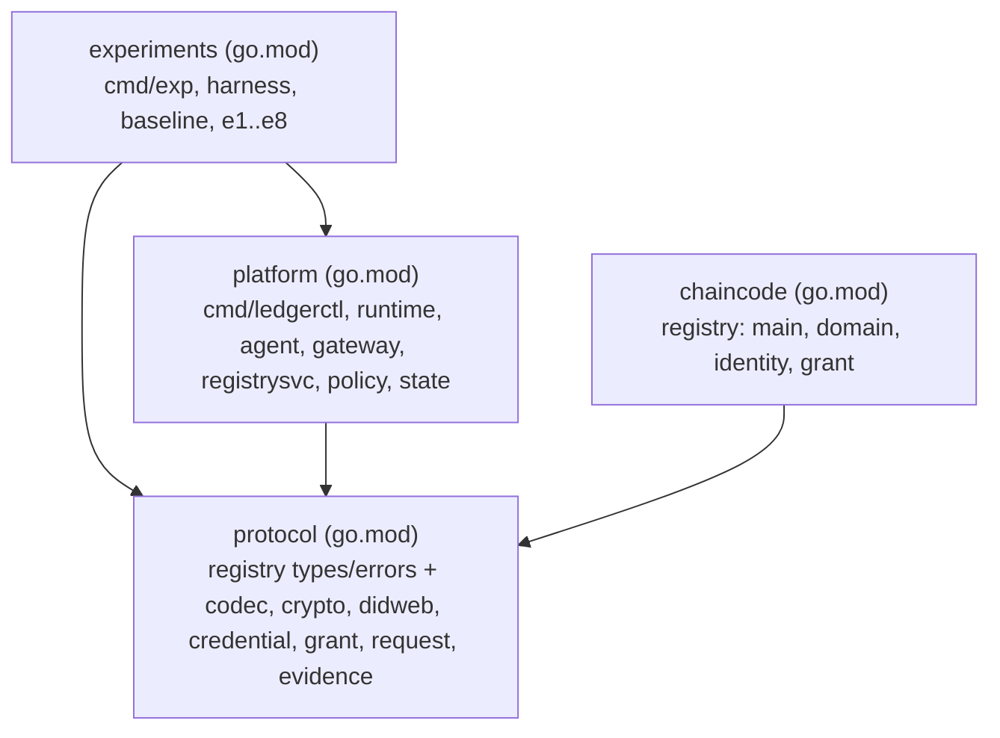
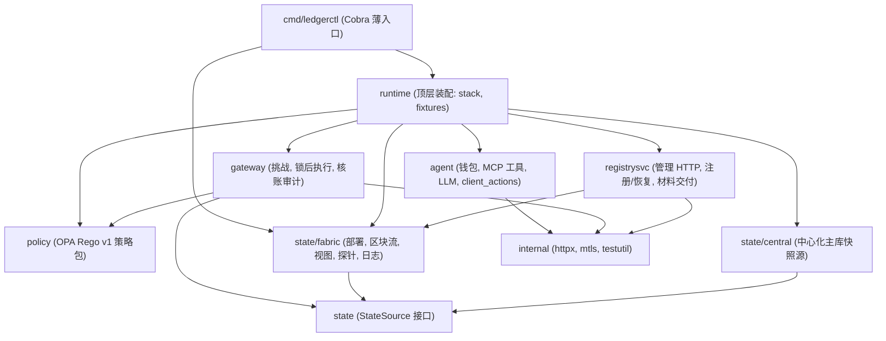

# 设计: Go Workspace Monorepo 与深模块重构方案

## Context

详见 [proposal.md](proposal.md). 仓库已回滚至 `ccfbb10` 干净基线, 且 [AGENTS.md](../../../AGENTS.md) 已确立 `v1.0.0` 之前允许彻底破坏性重构, 优先选择最优架构的原则.

当前系统存在三个根源性架构缺陷:
1. 单 Go 模块将链码, 协议, 平台服务与实验驱动捆绑在同一个 `go.mod`, 导致 `experiments/` 直接侵入 7 个 `internal/*` 包, 且任何 CLI/LLM/实验依赖变更都会污染链码构建指纹.
2. `internal/fabric` 承担了部署, 区块流, 视图, 探针, 管理 HTTP, 注册恢复, 材料交付, 1636 行夹具种子以及导入 `agent`/`gateway` 的 MCP 装配, 形成严重依赖倒挂.
3. 通用基础设施 (931 行手写 JSON/JCS, 手写 ES256 JWS/JWK, 散落 DDL 与手写 `row.Scan`, 标准库 `flag` CLI, 手工管理测试 Postgres) 造成大量样板代码与过碎文件.

## Goals / Non-Goals

**Goals:**
- 以 4-Module Go Workspace (`go.work`) 在编译期强制单向依赖与模块边界 (`protocol` <- `chaincode`, `protocol` <- `platform`, `protocol` + `platform` <- `experiments`).
- 构造高内聚, 低耦合的深模块 (Deep Modules): 消灭上帝包与依赖倒挂, 合并无意义的微包和浅包装, 保持单目录逻辑清晰且文件数量精简.
- 引入成熟包与 Go 1.27 标准库大幅缩减手写样板代码 (目标净减 30%~40%), 统一数据库迁移与三层隔离测试体系.
- 清理历史遗留协议前缀, 冗余字段与旧实验试跑产物, 使 `v1.0.0` 之前的代码库达到简洁, 可审计, 可直接开展全套正式实验的状态.

**Non-Goals:**
- 不改变论文核心安全与信任模型 (固定 T 根, 三域 Peer + 四节点 SmartBFT, 固定高度 `REPEATABLE READ` 视图, 单调钟原探针期限, RP/BM 双根模式, SD-JWT 选择性披露 + KB-JWT 绑定, 锁后复核与未知订单核账语义).
- 不保留对重构前旧部署实例, 旧数据库行, 旧 `D0:` 错误字符串或旧 `experiments/e*/runs/` 格式的向后兼容.
- 不拆分为超过 4 个细碎 Go 模块 (避免多 `go.mod` 维护税).

## Decisions

### 决策 1: 4-Module Go Workspace 拓扑与单向分层

采用根 `go.work` 纳管 4 个粗粒度模块 (`grad/protocol`, `grad/chaincode`, `grad/platform`, `grad/experiments`).

平台内部采用严格单向分层, 彻底反转原 `fabric -> agent/gateway` 倒挂:

- **理由**:
  - `protocol/registry` 保持零第三方依赖, 放在 `protocol` 模块中供 `chaincode` 与 `platform` 共享; `chaincode/go.mod` 仅依赖 `fabric-chaincode-go/v2` 与 `grad/protocol`, 彻底隔离 `pgx`, `opa`, `mcp`, `openai`, `anthropic`, `cobra` 等重依赖.
  - `experiments` 作为独立 Go module 后, Go 编译器原生禁止其导入 `platform/internal/*`, 也禁止 `platform` 反向导入 `experiments`.
  - `state.StateSource` / `state.HistoricalStateSource` 抽入 `platform/state`, 使 `state/fabric` 与 `state/central` 不再依赖 `gateway`.
  - `client_actions` 归位 `platform/agent`, 消除 `gateway/client_actions.go` 与 `agent/client_actions.go` 的双层包装, `agent` 仅通过 HTTP/`http.Handler` 与 `gateway` 通信.
- **替代方案**:
  - *单 Go 模块重构*: 无法通过编译器阻止 `experiments` 侵入 `internal/*`, 也无法隔离链码构建依赖. 否决.
  - *按每个领域包建独立 `go.mod` (8+ 模块)*: 依赖版本对齐与 `go.sum` 维护成本过高. 否决.

### 决策 2: 目录与深模块文件组织

- **`protocol/` (`grad/protocol`)**:
  - `registry/`: `types.go`, `errors.go`, `validate.go` (统一领域模型, 常量与错误码表; 合并 `Scope` 与 `IssuerScope`; 去掉 `"D0:"` 前缀).
  - 根包 `protocol`: `codec.go`, `crypto.go`, `didweb.go`, `credential.go`, `grant.go`, `request.go`, `evidence.go`, `contexts/vc-v2.json`.
- **`chaincode/` (`grad/chaincode`)**:
  - `registry/`: `main.go` (入口, 权限与时间检查, Initialize, Probe), `domain.go`, `identity.go`, `grant.go`.
- **`platform/` (`grad/platform`)**:
  - `cmd/ledgerctl/`: Cobra 薄入口, 保留 7 个核心子命令 (`deploy`, `seed`, `check`, `inspect`, `invoke`, `operation`, `mcp`).
  - `policy/`: `bundle.go`, `eval.go`.
  - `state/`: `state.go` (核心接口与快照/探针租约结构), `central/source.go`, `fabric/{instance,stream,view,probe,journal}.go`.
  - `registrysvc/`: `operations.go`, `identity.go`, `delivery.go`.
  - `gateway/`: `server.go`, `challenge.go`, `execute.go`, `audit.go`.
  - `agent/`: `wallet.go` (含本地 `client_actions` 存储), `tools.go`, `client.go`, `llm.go` (统一 OpenAI/Anthropic 双 SDK 运行器, 移除 15 行 `deterministic.go`).
  - `runtime/`: `stack.go` (MCP 与全栈装配), `fixtures.go` (模块化夹具构造与种子提交, 取代 1636 行 `seed.go`).
  - `migrations/`: 按领域编号的 `//go:embed` SQL 迁移文件 (`001_fabric.sql`, `002_central.sql`, `003_registrysvc.sql`, `004_gateway.sql`, `005_agent.sql`).
  - `internal/`: `httpx/` (统一 JSON 读写与错误信封), `mtls/` (吸收原 `serviceauth`), `testutil/` (Postgres testcontainer 隔离夹具与共享断言辅助).
- **`experiments/` (`grad/experiments`)**:
  - `cmd/exp/`: 统一 Cobra CLI (`baseline`, `run`, `analyze`).
  - `harness/`: 环境装配, 指标采集, 敏感信息扫描, 源码快照, 原子写入与 CSV 导出.
  - `baseline/`, `e1/`..`e8/`: 方法文档与简洁驱动.
- **精简 `AGENTS.md`**: 仅保留根 `AGENTS.md` 与顶层模块级指引 (`protocol/`, `chaincode/`, `platform/`, `experiments/`, `docs/`, `infra/`), 不为每个叶子目录维护碎片索引.

### 决策 3: 成熟库与 Go 1.27 标准库替代方案

| 能力 | 选型 | 替代对象与理由 |
| --- | --- | --- |
| 严格 JSON & RFC 8785 JCS | Go 1.27 `encoding/json/jsontext` (`Value.Canonicalize()`) | 替代 931 行手写 `jcs.go`; 仅保留 256 KiB 体积, 嵌套深度, 安全整数范围 (`[-(2^53-1), 2^53-1]`), 整数字面量与必填/可空语义校验 |
| ES256 JWS / JWK / 公钥校验 | `github.com/go-jose/v4` + Go 1.27 `crypto/ecdsa` (`ParseUncompressedPublicKey`, `Bytes`) | 替代手写 compact JWS 封装, JWK 序列化, RFC 7638 指纹与 P-256 坐标数学; 保留 `typ`, `kid`, 严格 base64url 与原始字节摘要校验 |
| SQL 访问与迁移 | `pgx.CollectRows` / `pgx.RowToStructByName` + `github.com/pressly/goose/v3` | 零代码生成步骤, 工具链极简; 消除散落 DDL 字符串与重复手工 `row.Scan` |
| HTTP 路由与信封 | Go 1.22+ `net/http` (`ServeMux` 方法与路径参数) + `platform/internal/httpx` | 零额外 Web 框架依赖; Gateway 与 RegistrySvc 共用统一 `{requestId, code, decisionId, message}` 错误信封 |
| CLI | `github.com/spf13/cobra` | 统一管理 `ledgerctl` 与实验 `exp` CLI |
| 测试与 Postgres 隔离 | `github.com/stretchr/testify` + `github.com/testcontainers/testcontainers-go/modules/postgres` | `platform/internal/testutil` 提供"单包共享临时 Postgres 容器 + 单测独立 schema/库"封装, 同时支持 `TEST_POSTGRES_DSN` 覆盖 |
| 原子写入与实验 CSV | `github.com/google/renameio/v2` + `github.com/jszwec/csvutil` | 消除手写临时文件原子替换与实验 CSV 手动列索引 |
| 有意保留自研 | SD-JWT 选择性披露, KB-JWT 绑定, 委托衰减校验, Fabric 完整区块流 (`stream.go`) | 属论文核心机制或 Fabric SDK `BlockEvents` 无法区分断流与 Peer 状态码 |

### 决策 4: 协议, 链码与 REST 破坏性简化

- **统一错误码**: 在 `protocol/registry/errors.go` 定义全部规范错误码常量, 链码直接返回该错误码 (去掉 `"D0:"` 前缀), `protocol`, `registrysvc`, `gateway` 共用同一错误码映射表.
- **规范资源 URI**: `quote.read` 仅接受 `urn:grad:resource:C:quotes`, `order.create` 仅接受 `urn:grad:resource:C:orders`, 移除 `"quotes"` 与 `"urn:grad:resource:quotes"` 历史别名, 同步更新协议测试向量文档.
- **清理遗留字段**: 夹具 JSON 移除 `synthetic` 标志与 `m2TaskSpec` 旧键名 (统一命名为 `procurementTaskSpec`).
- **三层测试分离**:
  1. 纯单元测试: `go test ./...` (毫秒至秒级, 零 Docker / 零 Postgres).
  2. 数据库集成测试: `//go:build db` (通过 `testcontainers-go` 自动起 `postgres:17-alpine` 并跑 `goose` 迁移, 或复用 `TEST_POSTGRES_DSN`).
  3. Fabric 实机集成测试: `//go:build fabriclive` (在 `mise run ledger:verify` 下独立运行, 不再与单测混杂).

### 决策 5: 链码独立构建与摘要计算

- `platform/state/fabric/instance.go` 构建链码时在 `chaincode/` 模块目录下执行 `go build -trimpath -buildvcs=false ... ./registry` (使用 workspace 解析本地 `grad/protocol`, 或构建时显式校验 `go.work` 指向的本地 `protocol/registry`).
- 链码源码摘要仅覆盖 `chaincode/go.mod`, `chaincode/go.sum`, `chaincode/registry/*.go` 与 `protocol/registry/*.go`. 上层平台或实验依赖变更不再触发链码重装.

## Risks / Trade-offs

- [一次性大跨度破坏性重构容易在迁移中途失去可编译基线] -> 按模块依赖自底向上分阶段实施 (`protocol` -> `chaincode` -> `platform` 核心与存储 -> `platform` 服务与 CLI -> `experiments` -> 文档与清理), 每阶段结束立即保证该模块编译与测试全绿.
- [`go-jose/v4` 与 `jsontext` 的宽松默认行为可能放过 `grad-auth-v1` 严格约束 (如重复键, 非法 base64url 末位填充, 超范围整数)] -> 在 `protocol/codec.go` 与 `protocol/crypto.go` 的入口边界显式前置严格校验, 并用覆盖全部负例的协议单元测试锁死行为.
- [`testcontainers-go` 依赖本地 Docker Daemon] -> 仅在 `//go:build db` 标签下启用, 普通 `go test ./...` 完全离线无 Docker 依赖, 且支持 `TEST_POSTGRES_DSN` 跳过容器拉起.
- [清理旧实验产物后 `experiments/e1/result.md` 与 `e6/result.md` 的历史链接会失效] -> 同步将旧运行目录清空, 在 `experiments/TODO.md` 与对应 `result.md` 标明待重构完成后重新执行正式实验并填充新运行 ID.

## Migration Plan

1. 保持当前已回滚的 `ccfbb10` + 已更新的 `AGENTS.md` 作为起点, 移除根目录残留 `./ledgerctl` 与重构前旧实验运行目录.
2. 自底向上创建 `go.work` 与 4 个模块 (`protocol` -> `chaincode` -> `platform` -> `experiments`), 逐层移植, 精简并验证单元测试.
3. 接通 `goose` 迁移与 `testcontainers-go` 数据库测试 (`//go:build db`), 全量通过网关, 注册恢复, 材料交付与智能体核账回归.
4. 通过隔离 Fabric 实例完成 `ledgerctl deploy`, `seed`, `check`, `inspect`, `mcp` 与 `//go:build fabriclive` 实机集成验收, 并验证实验 `exp` 基线与测试通过.
5. 清理旧目录 (`cmd/`, `internal/`, 根旧 `go.mod`/`go.sum`, 冗余 `AGENTS.md`), 同步更新 `mise.toml`, `README.md`, `docs/implementation/` 与 OpenSpec 主规范, 核对模块依赖图边界.
