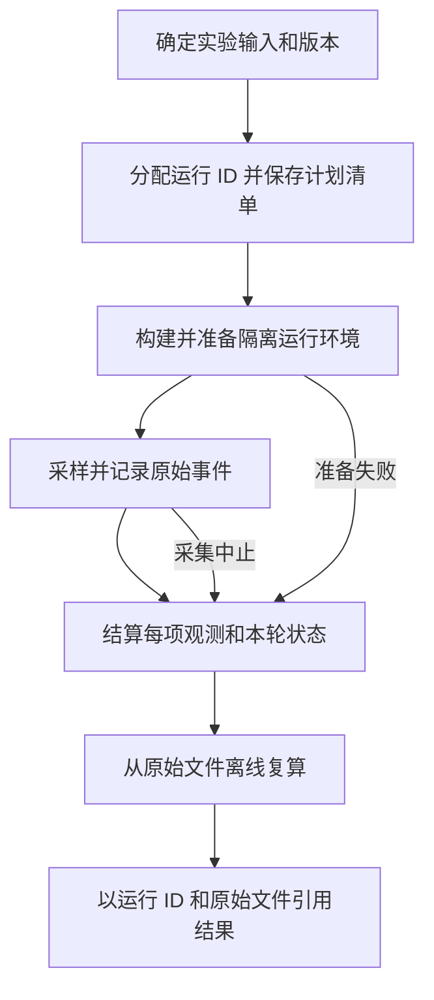

# 正式实验工作流设计

## 背景

[提案](proposal.md)以现有 E1 独立驱动和 M4 采购基线为起点. E1 的 `ledgerctl` 来自指定提交, 驱动源码来自运行时工作区并单独归档. 基线已具备隔离实例, 固定夹具和结构化导出. E6 目前有 M3 预跑记录和正式报告模板, 预跑的窗口计算采用客户端响应时点. 首批实现应复用现有准备, 工具调用和业务核对能力, 用 E1 和 E6 验证 [增量规范](specs/reproducible-procurement-experiments/spec.md)的运行和复算契约.

## 设计边界

工作流覆盖方法导航, 阶段任务, 正式运行和结果复算. E1/E3 保持真实 LLM 驱动, E2/E4-E8 保持确定性驱动, 共用钱包和协议工具. 业务准入, 缓存语义, 已有基线及 F/S 用例编号沿用现有契约. 正式实验的全面执行, 消融参数扫描, 五个演示视图和论文撰写在根 `TODO.md` 排入后续任务.

## 决策

### 方法按实验编号平铺

从 [原实验计划](../../../docs/experiments/实验计划.md)迁出各实验专属方法. 每份文档使用研究问题与范围, 对照与变量, 输入与准备, 执行与采样, 判据与缺测, 结果表和图六节. `实验计划.md` 保留共用的 C0/B0/B1 对照定义, 种子和复现约定, 并在原有被引用的标题下提供跳转. 指向 `验证用例.md` 的编号及旧锚点继续有效. 实验具体默认值和判据归对应方法文档, 真正共用的约定归共用计划.

| 方法文档 | 拆入的专属内容 |
| --- | --- |
| `E1-采购功能闭环.md` | RP/BM, F01-F16, 真实模型工具轨迹, 报价与订单副作用 |
| `E2-安全与状态机检查.md` | S01-S103 配对, 父子约束独立判据, 随机状态机与反例 |
| `E3-动态调整与恢复.md` | 从独立 Q800 出发的状态变化, 恢复路径, 重签与材料交付, 真实模型轨迹 |
| `E4-微基准.md` | 冷热条件, 分阶段耗时, 分配量和查询成本 |
| `E5-开放到达负载.md` | 预取报价, 开放到达, 排空与样本对账, 延迟和完成率 |
| `E6-撤销窗口.md` | 原探针, 多实例事件时间线, 确认后窗口, 无法判定时序及删失 |
| `E7-故障与并发.md` | 测试环境故障注入, 恢复时序, 事务副作用与核账 |
| `E8-账本与通信开销.md` | 资源成本, 账本操作各阶段, 探针及区块流, 客户端往返 |

`docs/experiments/AGENTS.md` 按验证问题链接方法文档. `experiments/README.md` 按编号连接方法, 运行说明和报告. 实测数据, 批次和结论继续归 `experiments/e*/`, 阶段进度归根 `TODO.md`. 拆分时对照原章节和条件表核对覆盖, 将活跃文档更新到新入口, 历史链接通过原锚点跳转.

### 待办按可独立验收的产出拆分

根 `TODO.md` 保留简短的已完成阶段与证据, 活动项按 E1-E8, 演示, 论文组织. 格式为 Markdown 复选项, 每项写一个动作及验收产出, 勾选时附可核查的文件, 运行 ID, 修复记录或核验结论. 任务粒度以可单独验收和写入周报为准. 发现问题, 保留失败样本和复现诊断可以各自验收, 正式采样是否通过仍按其判据勾选. 以 E1 的现有正式报告初始化有证据支持的完成项.

| 范围 | 建议拆分的交付 |
| --- | --- |
| E1 | 核对固定构建 F01-F16, 对账真实模型轨迹与主库, 重算 RP/BM 表, 汇总失败轮次 |
| E2 | 按用例主题交付配对结果, 验收万组父子约束, 执行随机状态机, 保存反例与缺测表 |
| E3 | 分别交付暂停和恢复, 改派和重新询价, 换钥和重签, 域资格和风险变化, 响应丢失后核账轨迹 |
| E4 | 分别测材料和验签, OPA 与路径校验, 挑战和事务, 一致视图与查询成本, 汇总冷热对照 |
| E5 | 验证开放到达与排空对账, 跑默认配对重复, 扫描到达率与路径深度, 发布延迟和完成率图 |
| E6 | 核对定案采集精度, 分开完成 RP 和 BM 短跑, 离线复算一轮, 完成主要场景重复, 完成参数扫描, 发布窗口和可用率图 |
| E7 | 分别对账排序节点和 Peer 故障, 视图变更与锁等待, 幂等并发, 响应丢失和恢复 |
| E8 | 分别导出管理交易各阶段, 探针和区块流, 节点资源, 端到端开销表 |
| 演示 | 身份与信任, 凭证披露, 委托树, 采购任务, 决策时间线各列验收场景, 最后串联一次端到端演示 |
| 论文 | 方法初稿, 结果表与图注, 结果论证, 局限与适用范围, 引用和文字复制比复核 |

例如 E6 的采样校验项可写为 `核对定案采集点及分辨率, 交付一轮能关联撤销原 txID, 决定 ID 和实际探针的时间线.`. 完成后补上运行 ID 和时间线链接, 周报可以直接引用实测覆盖及已知缺测. OpenSpec 的 `tasks.md` 追踪本次工作流变更实施, 根 `TODO.md` 追踪毕设实际推进.

### 共用入口编排运行与复算

用 `mise` 提供一致的运行与分析入口, 按实验编号调用各自的驱动或分析程序. 先接入 E1 和 E6. 入口统一参数, 版本和证据目录, 实验程序仍决定场景, 时钟, 采样和判定. 复用现有 Fabric 操作, E1 驱动和基线的证据字段约定, 把协议验证和业务事务留在原有实现. E6 和负载类驱动使用持续运行的状态提供器与实例探针, E1 现有按请求调用 `ledgerctl check` 的调度保留为该驱动的实际配置.

- 运行输入显式给出被测提交和驱动版本, 或可重建的驱动与入口快照. 工作区快照覆盖实际参与编排和构建的驱动文件. 解析计划后先创建运行目录并写初始 `manifest.json`, 后续补录构建摘要, 实际环境和部署信息. E1/E3 从 `experiments/llm.env` 加载模型配置, API 密钥继续由环境提供.
- 正式轮写入对应实验的 `runs/<run-id>/`, 前置采样及实现验收按现有证据目录留存. 运行 ID, 实例目录及适用的数据库和端口独立分配. `summary.json` 汇总完成, 失败及中止状态, 按计划识别未执行和缺测. 采样期间保留可恢复的原始事件, 使强制终止后仍可从初始清单与已有记录确认未正常结束. 复跑使用新运行 ID.
- 用例, 请求, 主库决定, 区块或快照按其原标识关联. 采样和统计文件按各自方法保留实际字段, 统一清单和缺测语义即可. 发布前沿用现有证据白名单和敏感材料排除规则.
- 分析程序接受运行目录和固定分析版本, 从原始记录产生派生汇总及图表数据, 将派生产物写到独立路径. 对既有 E1 格式提供只读解析, 用请求, 主库和模型轨迹复算 F01-F16 报告中的关键计数, 以已发布的汇总和交叉复算文件核对输出. 报告引用独立运行 ID, 分析版本及原始文件.

### 先验收 E6 时间口径

E6 使用正式方案定义的撤销原 txID, `t_valid`, `t_apply`, `t_adopt` 和最后允许的定案时点. 在网关现有锁后定案时钟读取点采集亚秒记录, 用同次请求的 `decisionId` 与已提交决定匹配, 并单独记录业务提交和客户端响应. 秒级业务期限表示继续供现有逻辑和历史记录使用. 用同一主机时基记录撤销观测和定案, 留存实际时间精度和漏探测. 若确认后允许与时间误差范围重叠, 标注无法判定先后. 用旧视图定案后延迟响应的样例核对复算口径.

短跑先使用现有 5 秒探针寿命, 验证 RP/BM 采集链路. 进入正式参数扫描前, 单独验收 1/5/15 秒各档的实际生效值, 将值和对应构建或配置写入清单. E6 的正式重复使用方法文档规定的轮数和时长.

## 风险与迁移

- 拆档可能遗漏判据或破坏历史引用. 按原章节及配置表逐项映射, 在原锚点保留链接, 核对 README, 设计, 实现, 实验报告及归档引用能到达方法内容.
- 历史 E1 的证据表头可能不同. 新分析入口通过读取原始格式验证可复算范围, 对缺列或缺记录给出可查原因. 历史清单和失败样本保留当轮原值.
- 启动新实例或增加采样记录会产生额外耗时. 将预热和准备操作分开记录, 以 E6 短跑确认实际发送间隔, 定案分辨率及缺测情况, 再决定是否进入正式采样.
- 依次完成方法导航, TODO 和运行清单, 再做离线复算及短跑验收. 通过保留 `ledgerctl experiment baseline` 和既有证据路径, 迁移期间仍可复跑基线并查阅历史结果.
