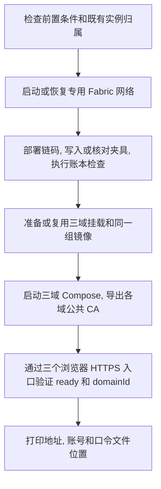

# 项目任务与演示部署设计

## Context

四个 Go 模块已在 `go.work` 注册. 七个前端脚本由 npm 维护, 实验参数由 `exp` 维护, 基线和 E1/E6 还会记录启动入口的文件摘要. Fabric 网络脚本能准备或恢复单个实例. 三域工作台已有 Compose 模板和 CLI, 其中 `prepare` 需要一个尚不存在的输出目录并生成新的口令和证书. 当前三域 Compose 的调用方式见[工作台手册](../../../infra/workbench/README.md).

## Goals / Non-Goals

根任务负责发现命令, 选择工作目录, 传参和组合前置步骤. 项目 CLI 继续负责协议材料, 业务操作及实验方法. 本地演示覆盖既有 arm64 部署形态, 以真实服务可登录为交付点. 采购员确认派单, 浏览器信任本地 CA 及论文实验采样各自沿用原入口和权限.

## Decisions

### 1. 根任务目录按现有用户操作组织

所有公开任务名和中文说明在根 `mise.toml` 注册. 根目录另设 `build` 和 `test` 两个聚合任务. 规范维护用 `spec` 转交本仓 OpenSpec CLI 的原生命令和选项, 例如 `mise run spec -- list --specs`. OpenSpec 仅在执行该入口时需要. 下表列出各命令族冒号后的任务名.

| 命令族 | 公开操作 | 执行约定 |
| --- | --- | --- |
| `test:*` | `unit`, `db`, `arch`, `vet`, `race`, `fabric:compile`, `demo` | 三模块单测和数据库测试保留现有范围. 架构检查覆盖平台和实验守卫, 模块导入方向及协议登记类型的标准库边界. 静态检查覆盖手册中的构建标签, 竞态检查可选 Go 包且仅该任务启用 CGO. 演示编排有离线回归入口. |
| `chaincode:*`, `ledger:*` | 链码 `build`. 账本 `build`, `deploy`, `seed`, `check`, `inspect`, `invoke`, `operation`, `mcp`, `verify` | 沿用 `grad/chaincode/registry` 和 `ledgerctl`. 保留 `FABRIC_INSTANCE`, 子命令选项和实机测试参数. MCP 连接使用原始标准输入输出. |
| `fabric:*` | `init`, `config`, `up`, `down`, `rebuild`, `ps`, `logs`, `start`, `stop`, `compose`, `peer`, `orderer` | 同名操作调用现有 `infra/fabric/network.sh`. 任务说明标明 `config` 首次会准备实例材料, `down` 保留卷, `rebuild` 需要新目录. |
| `workbench:*` | `build`, `prepare`, `serve`, `images`, `compose`, `certs`, `ready`, `probe` | 前三项调用 Go 构建和工作台 CLI. `compose -- <域> <动作> [参数...]` 覆盖单域运维. 其余入口复用镜像构建, 公共 CA 导出, HTTPS 检查及手册中已有的业务探针. 探针由操作者提供运行 ID 和重试键. |
| `web:*` | `install`, `dev`, `build`, `preview`, `typecheck`, `lint`, `test`, `test:browser`, `check` | 在 `web/` 运行 `npm ci` 和对应 npm 脚本. 调用者仍在仓库根. `check` 组合类型检查, lint 和单测. |
| `experiment:*` | `build`, `baseline`, `run`, `analyze`, `test` | 在仓库根调用 `grad/experiments/cmd/exp`. 基线, E1/E6 正式运行与复算复用各自子命令. 模块测试使用 `go test -p 1 grad/experiments/...`, 支持定向测试和数据库标签. |
| `demo:*` | `up`, `down`, `clean`, `status`, `logs` | 默认管理本仓库的一个专用本地演示. `logs` 支持查看指定域或服务, `status` 汇总运行状态, 入口及夹具有效期. |

`build` 生成 `build/authregistry`, `build/ledgerctl`, `build/workbench`, `build/exp` 和 `web/dist/`. 镜像构建属于 `workbench:images`. `test` 汇总 `test:unit`, `experiment:test`, `web:test` 和 `test:demo`. 数据库集成, 浏览器回归, Fabric 实机验收及正式实验均由各自的显式任务启动.

新公开 CLI 子命令或 npm 脚本和对应根入口在同一次修改中维护. 例如新增浏览器脚本时, 可直接将 `package.json` 的脚本名与 `mise tasks` 输出做覆盖检查. 项目内部的创世材料生成和实验驱动编排各自随 `fabric:init` 和 `experiment:run` 调用.

### 2. 前端和实验采用各自需要的工作目录

根工具链增加 Node 22, 与前端镜像的构建环境一致. 前端依赖安装跟随 `package.json`, `package-lock.json` 和本地安装状态. 开发, 检查及构建共用该前置步骤. `web:preview` 和 `web:test:browser` 依赖当前构建, Chrome 或 `CHROME_BIN` 只在执行浏览器回归时检查. 选项经 npm 的参数分隔符传给原脚本. [前端镜像](../../../web/Dockerfile)

将实验任务直接绑定到工作区包路径, 删除子目录的重复任务配置. 若根任务再调用 `mise -C experiments`, 复算器按工作目录解释的 `experiments/e1/runs/...` 会指向 `experiments/experiments/e1/runs/...`. 根工作目录同时满足复算路径和独立实例路径的语义. E1 的 `run.sh` 继续转交 `--experiment E1` 及原参数. 基线的文件锁定清单和 E1/E6 的驱动快照清单均改为记录实际根入口, E1 额外记录适用的启动脚本. [实验 CLI](../../../experiments/cmd/exp/main.go)

### 3. 演示状态由本地编排统一管理

在 `infra/workbench/` 放置一个使用已配置 Python 标准库的运维入口, 供工作台运维任务及 `demo:*` 共用. 它处理目录, Compose 参数, 进程调用和 HTTPS 检查, 以参数向量调用现有 Fabric 脚本, 工作台 CLI 和 Docker Compose. 一连串独立的 TOML 依赖适合构建, 但无法凭任务完成标志判断旧实例属于谁或中断时已创建了哪些资源.

| 位置或标识 | 用途 |
| --- | --- |
| `.local/demo-config/{a,b}/` | 在两域各放置一次 `llm.env` 与 `model-api-key`. A/B 的源配置在演示资源之外. 按需装入各自私有挂载, 密钥文件权限为 `0600`. C 域只装入本域配置. |
| `.local/demo/` | 编排专属目录. `fabric/` 保存隔离实例, `workbench/{a,b,c}/` 保存各域材料. 小型归属清单记录本实例的资源标识, 镜像标识及已确认阶段, 以原子替换落盘. |
| Compose 项目与端口 | 使用该实例 `network.env` 中的随机 Fabric 项目名, 三域项目名沿用其派生后缀. 默认 Fabric 连续端口为 18460-18469. 浏览器默认地址为 `https://a.localhost:18441`, `https://b.localhost:18442`, `https://c.localhost:18443`, 绑定环回地址. |

首次部署先检查宿主架构, Docker/Compose, 工具, A/B 输入和端口. 恢复时已归本实例使用的端口可继续使用. 为本地状态变更加进程锁, 锁在可删除的实例目录外, 进程退出时自动释放. 首次分配时先建立归属记录, 用 `network.sh init` 获得真实项目名, 在创建容器前写入该名称. 正常的 `fabric:*` 继续接受操作者指定的实例. `demo:*` 始终从自己的清单定位资源.

首次准备在同一文件系统中使用尚不存在的临时输出目录, 完成三域材料和配置校验后才发布为 `workbench/`. 恢复时比对原 `deploymentId`, 镜像和挂载材料, 核查账本实际提交及夹具有效期. 凭证签发后有效 24 小时, 过期时给出显式重建入口. 阶段中断后, 用已落盘的绑定和真实资源重新判断可续跑位置. 每域分别有界等待 Compose 及 HTTPS 就绪. 终端提供 CA 文件和首次本地信任指引, 信任库由操作者管理.

### 4. 清理以创建时的资源归属为界

`down` 先关闭三个工作台项目, 然后关闭提供外部网络的 Fabric 项目. `clean` 可直接执行, 按同样的顺序删除专用容器, 网络和命名卷, 核实资源已释放后再删除生成目录. 优先使用准备时记录的项目名和 Compose 资源标签, 清理也能处理模型文件缺失或某域尚未准备完毕的状态. 共享镜像和工具缓存属于主机, 实验数据和模型源文件分别归其所属目录.

清理前核对路径归属, 符号链接解析结果及 Compose 项目标识, 拒绝接管来源不明的目录或其他部署. 中途失败保留归属清单和剩余资源名称, 下次可接续. 已清理状态再次执行直接成功. 查询路径仅读取已有状态和可用日志, 不调用首次运行会初始化材料的 `fabric:config`.

## Risks / Trade-offs

| 条件 | 处理 |
| --- | --- |
| 浏览器尚未信任 CA, 或 A/B 模型配置有效但远端服务离线 | 部署用导出的公共 CA 实测每个 HTTPS 入口, 输出浏览器信任指引. 就绪检查覆盖工作台, 数据库和账本连接, 实际模型调用由采购流程验证. |
| 现场有旧手工实例或并行实验占用端口 | 首次执行指出冲突端口. 复用和清理只认演示的归属记录. |
| 源材料过期或中途只完成部分部署 | 明确报告到期时间或失败阶段. 可确认的自有资源支持续跑或定向清理, 其他实例可继续使用. |

## Migration Plan

先迁移根任务和实验摘要引用, 同步更新根及各模块手册的运行示例. 随后在新的专用目录验收演示, 以原手册目录中的既有部署作为独立实例对待. 如需退回手工入口, 可先停止或显式清理新演示, 再按对应版本的部署手册独立运行底层命令. 入口版本随新实验清单保存, 已归档的证据和源码快照保留原始内容. [工作台手册](../../../infra/workbench/README.md)
