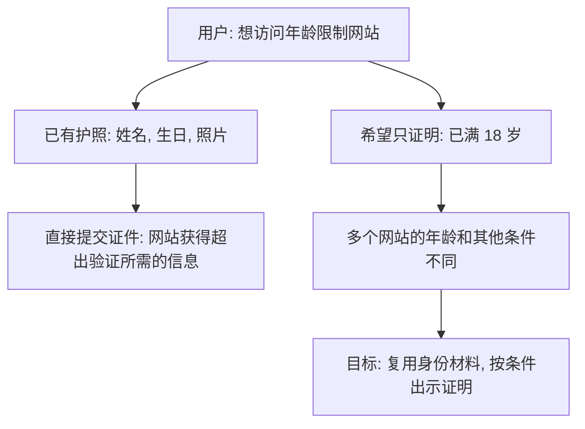
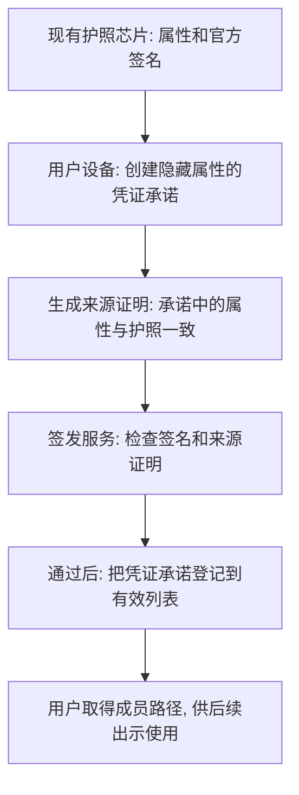
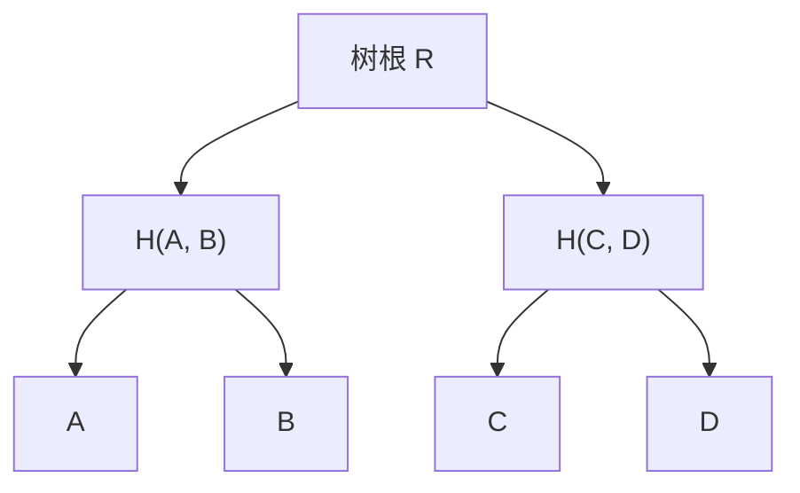
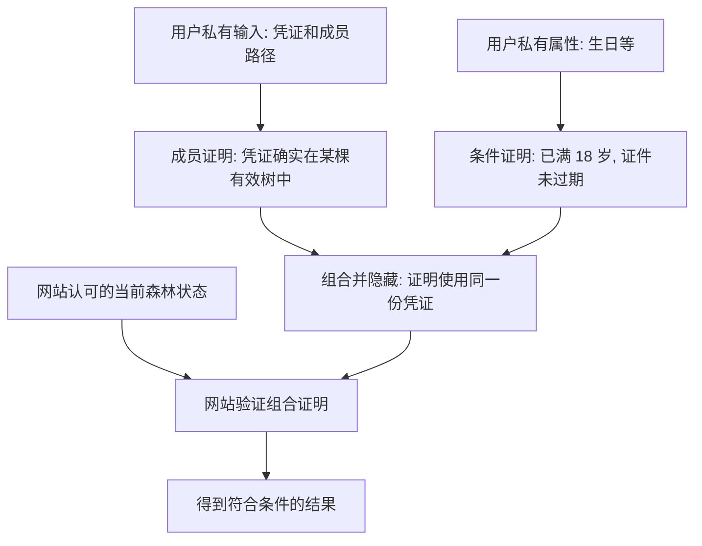
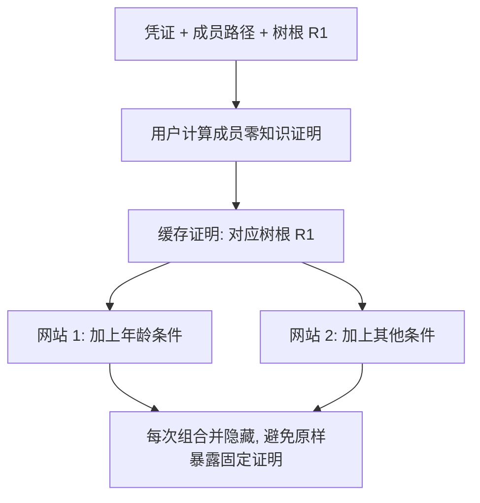
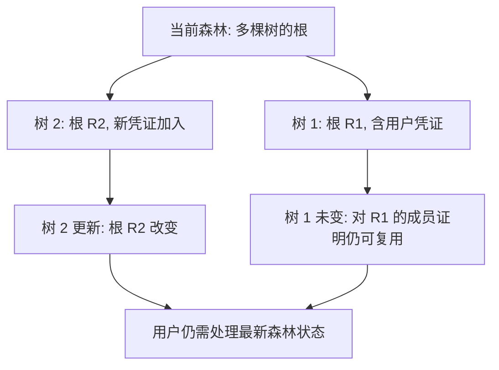
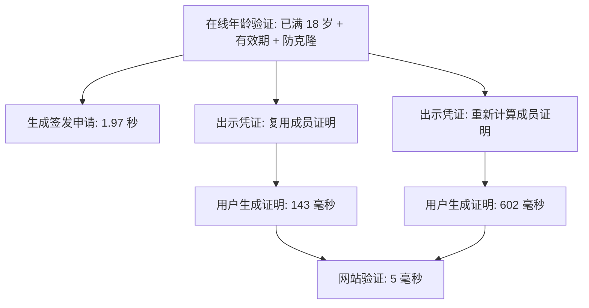
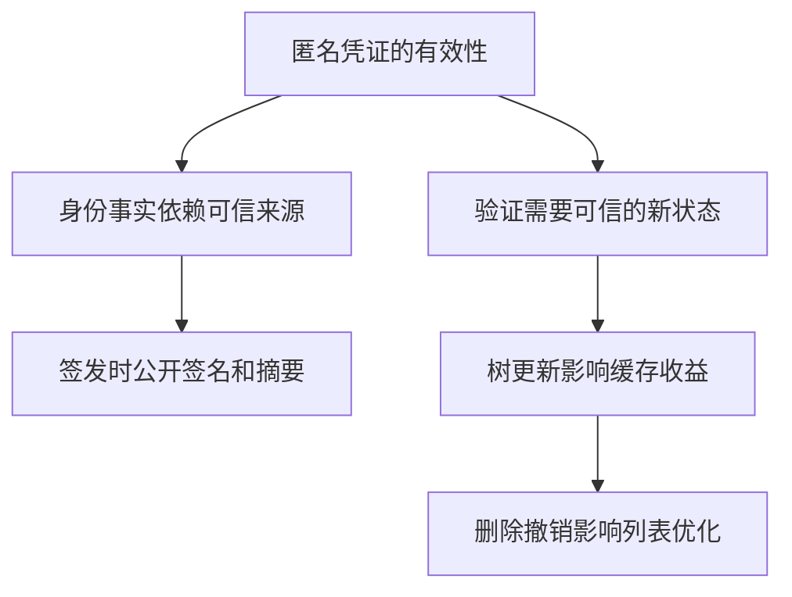

# zk-creds 论文阅读与组会汇报

Michael Rosenberg 等 | IEEE S&P 2023 | 论文 B1

以在线年龄验证为主线. 依据[论文作者完整版](SP46215.2023.10179430.pdf)第 1-10 节, 图 1-2, 表 1-3 及附录 B-C. 本报告为第一遍阅读, 未复现代码或核验完整安全证明.

## 1 问题: 用已有证件证明资格, 又不暴露身份

作者认为, 要求身份机构为每种需求运行新的凭证签发流程会增加部署负担; 现实中还存在不同机构和证件格式. 本文希望复用已有身份材料, 而不必要求原签发机构修改系统. (第 1.1-1.2 节)

## 2 方法: 一次取得凭证, 按需生成证明

### 2.1 从护照到可复用凭证

承诺可以理解为隐藏内容的防拆封装: 外部看到承诺值, 不直接看到生日等属性. 护照的原有签名用于核验来源; 新凭证可以加入公共列表, 无须新增一把凭证签发签名密钥. 图为第 7.1-7.3 节的护照实例.

### 2.2 在有效列表中, 但不公开是哪一项

图中例子有 4 个条目. 用户保存 A 的成员路径 B 和 H(C, D), 可据此计算到根 R; 用户不需要下载整个列表. 树根只是公开摘要, 单独知道树根并不能证明持有凭证. (第 3.2 节, 第 5.1 节)

成员证明向网站证明用户知道符合树关系的材料, 不必公开具体条目. 组合机制还要求成员证明与条件证明对应同一份隐藏凭证. 网站仍须信任列表的来源和签发规则. (第 4.2 节, 第 5.2 节)

### 2.3 本地缓存什么

缓存的是**已计算好的成员零知识证明**, 不只是成员路径, 也不是网站的最终放行结果. 成员证明与具体树根绑定; 用户每次还要处理当前森林状态和访问条件. (第 5.2 节)

如果用户所在树变化, 旧成员证明可能需要重算. 如果用户凭证被撤销, 验证者使用撤销后的可信状态时, 旧证明不能证明凭证仍在有效列表中. (图 4; 附录 C)

## 3 证据: 复用减少用户重复计算

表 3 的数据来自桌面电脑, 为 100 次运行的中位数. 143 和 602 毫秒的差别在于成员证明是否需要重算; 两种情况下验证均为 5 毫秒. 数值为本地计算耗时, 不包括完整网络和链上确认时间. (第 6.1 节, 第 7.3 节, 表 3)

作者还实现酒吧年龄和照片验证案例, 并给出安全定义与论证. 本次未独立复现测试, 也未逐步核验完整证明. (第 4.1, 5.7, 7.3 节)

## 4 边界与毕设启示

护照案例中的签名材料和摘要在签发时公开, 护照机构可能据此识别申请者; 后续出示则设计为与签发不可关联. 附录 C 明确指出, 简单删除会影响部分更新优化. (第 24 页脚注 11; 附录 C)

本项目的 B₁在询价和下单时分别签挑战. E4 分开测签名, 披露验证和缓存命中, E6 另测撤销传播. zk-creds 的隐藏属性证明可用于解释能力差异. 本项目的 1000 元单笔上限通过公开授权与可信报价比较, 论文的证明耗时不能代入这一步. [项目实验设计](../../docs/experiments/实验计划.md).

论文第 5.5 节的委托主要涉及**凭证签发权**, 不能直接替代采购场景中按资源, 动作和金额约束的动态访问委托. 后续可回读第 2 节图 1-2, 第 5.1-5.2 节及附录 B-C.
