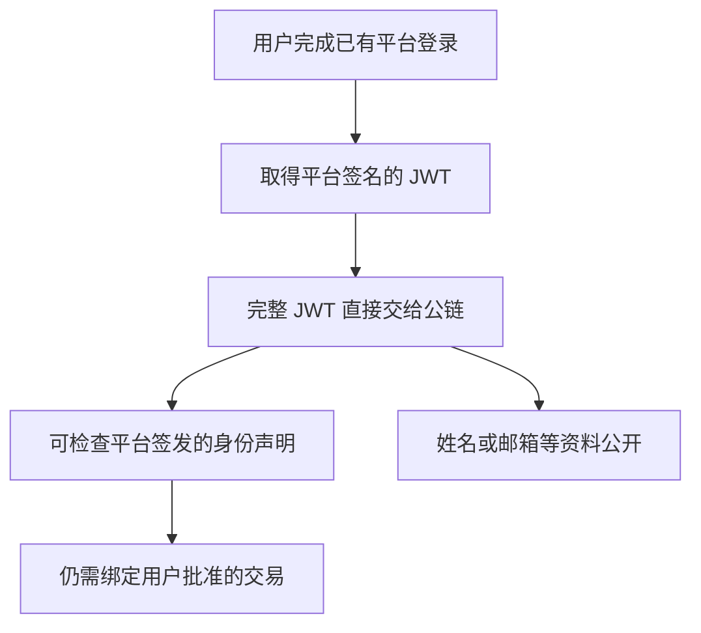
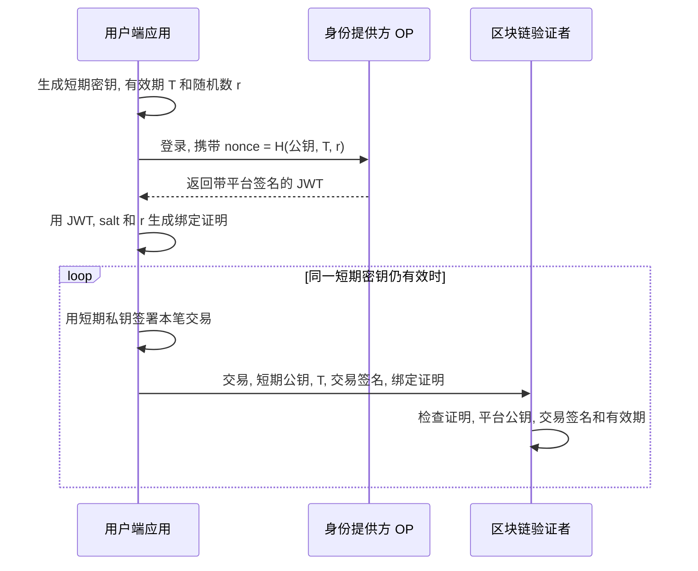
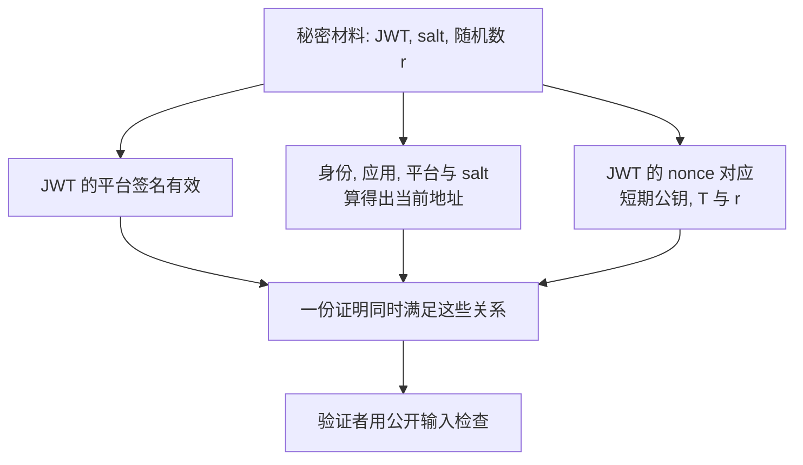

# 论文第一遍阅读 (Paper Snapshot)

**论文:** zkLogin: Privacy-Preserving Blockchain Authentication with Existing Credentials. 通俗理解: 用已有网络账号操作区块链钱包, 同时隐藏账号身份与链上地址的关联.

**作者与发表信息:** Foteini Baldimtsi, Konstantinos Kryptos Chalkias, Yan Ji, Jonas Lindstrøm, Deepak Maram, Ben Riva, Arnab Roy, Mahdi Sedaghat, Joy Wang. ACM CCS 2024. DOI: `10.1145/3658644.3690356`.

**论文类型:** 认证方法, 密码学安全模型, 系统实现与性能评估.

**来源与阅读范围:** [A2 本地 PDF](3658644.3690356.pdf), 共 20 页, 为 arXiv v2 作者完整版本, 首页标注 2024-09-27, 不是出版排版版. 已读摘要, 引言, 第 2-7 节; 附录 A-B 阅读相关定义, 定理及证明思路, 附录 D-E 阅读初始化与实现边界, 附录 C 仅浏览通用构造及其与第 4.5 节的关系. 已查看原文图 6-8 和表 1-3 所在页面. 未逐式核验完整证明, 未审计或运行实现, 未复现实验. 外部版本入口为 [固定版本记录](https://arxiv.org/abs/2401.11735v2), 本报告的内容判断依据本地 PDF.

**定位约定:** 下文页码均为从 1 开始的 PDF 页序. 本报告图号与论文图号分开标注. Mermaid 为阅读示意, 本次未预览其实际渲染; 若阅读器不支持 Mermaid, 可结合各图前后的短文阅读.

## 概览

这篇论文想让用户用已有的网络账号操作区块链钱包, 减少长期保管钱包密钥的负担, 同时避免公开账本直接暴露账号身份. 它让一次登录为一把短期交易密钥背书, 此后由用户用这把密钥批准交易; 再用一份可以验证的证明隐藏完整登录凭据. 作者已将它实现并部署在 Sui 上, 展示了这条路线的可行性. 首次生成证明需要额外等待, 向谁隐藏身份则取决于具体部署方式. (第 1, 4.2-4.4, 5 节, PDF 第 1-4, 7-14 页.)

## 问题

举个便于理解的假设例子: 小林已经有 Google 账号, 现在想用一款区块链应用收发资产. 她不想再保存一套钱包恢复词, 也不希望陌生人从公开账本发现自己的邮箱对应哪个地址. 这是教学场景, 对应作者在引言中讨论的使用门槛和隐私问题, 不是论文实验用例.

传统钱包靠一对密钥批准交易: 私钥由用户保密, 用于签署交易; 公钥可以交给别人, 用于检查签名. 丢失长期私钥可能失去资产, 交给托管平台又要依赖托管方保管和使用它. 作者希望借用用户已经拥有的登录账号, 减少新的长期密钥管理负担. (第 1 节, PDF 第 1-2 页.)

现成登录体系已经能提供一种材料: 用户完成认证后, 平台签发带有数字签名的身份声明, 称为 JWT. 签名让别人检查声明是否来自该平台, 内容是否被修改; JWT 的编码本身不会把姓名, 邮箱等内容加密. 允许应用使用这种平台登录结果的协议叫 OpenID Connect, 简称 OIDC, 提供认证的平台称为身份提供方 OP. (第 2 节, 图 1, PDF 第 2, 4-5 页.)

问题是, 把这份材料直接交给公链, 既会暴露资料, 也还没有完整说明用户批准了哪笔交易.

**图 1. 直接复用登录凭据, 留下了什么缺口?** 根据第 1 节的初步方案重绘, 来源为 PDF 第 2 页. 箭头表示做法与结果的逻辑关系, 不是时间顺序; 省略 JWT 内部字段.



读图时看最后两个出口: 公开身份凭据与批准具体交易是两件事. 作者要把已有登录接到交易签名上, 同时让验证者不必看到完整身份声明, 并继续使用平台原有接口. (第 1.1 节, PDF 第 2-3 页.)

## 方法

### 1. 先让一次登录为短期交易密钥背书

可以用一个教学类比理解: 已有机构在临时通行证上确认一把临时钥匙的归属和期限, 用户此后用钥匙批准办事. 机构对应 OP, 通行证对应签名后的 JWT, 临时钥匙对应短期密钥. 这只是帮助理解绑定关系; 实际没有新增发证机构, OP 也不必知道自己正被用于区块链钱包.

实际绑定利用登录请求里的一个字段 `nonce`. 它原本用于关联登录请求, 防止重复使用旧回复; 本文在里面放入短期公钥, 有效期和随机数的哈希. 哈希是由输入计算出的固定长度摘要, 在本文的安全条件下不能轻易用不同输入替换. 平台把这个 `nonce` 写进签名后的 JWT, 就间接保护了公钥和期限. (第 4.2 节, 图 7, PDF 第 8 页.)

**图 2. 一次登录怎样接上多笔交易?** 根据第 4.2 节和论文图 6-8 重绘, 来源为 PDF 第 8-9 页. 箭头表示消息传递或本地处理, 从上到下表示交互顺序. 图采用本地生成证明的模式, salt 已保存或取得; 省略初始化, 完整登录跳转和 OP 公钥同步.



关键变化在循环内外: 昂贵的证明负责把身份和地址接到短期公钥上, 每笔交易再用对应私钥单独批准. 证明本身不绑定某一笔交易, 所以绑定条件仍有效时可以重复使用. **复用的是证明, 每笔交易仍要签名, 验证者仍要检查.** (第 1.1, 4.2 节, PDF 第 3, 8-9 页.)

期限使用链能理解的时间, 例如区块号或 epoch, 后者是链划定的时间轮次. 验证者检查当前时间不晚于绑定期限, 并可限制期限不能设置得过远. 这不是直接照搬 JWT 自带的过期时间. 因而本文的到期检查也不能自动推出用户在 OP 退出登录后, 现有短期密钥会立即失效. (第 1.3, 4.2 节, PDF 第 3, 8-9 页; 最后一句为依据机制适用范围作出的判断.)

### 2. 用证明连接身份, 地址与公钥, 隐藏完整凭据

区块链不接收完整 JWT, 而是检查一份零知识证明. 这里的零知识证明, 是让别人检查某些关系成立, 同时不交出用于证明的秘密资料. 用户要证明的不是笼统的"我登录过", 而是下面几项关系由同一份材料同时满足. (第 4.2 节, 图 7, PDF 第 8-9 页.)

**图 3. 哪些关系必须一起成立?** 根据论文图 7 的证明电路 `Ckt` 重绘, 来源为 PDF 第 8 页. 箭头表示共同约束, 不表示先后顺序. 用中文替代形式化变量, 省略签发方标识一致这一项单独检查.



看三条路径的汇合处: 不能拿甲的有效登录, 乙的地址和丙的公钥, 拼成互不相关的证据后通过检查. 原文的公开输入包括 OP 公钥, 签发方标识, 链上地址, 短期公钥和期限; 秘密输入是 JWT, salt 和随机数 `r`. 短期私钥不需要交给这个证明电路, 它用于批准具体交易. (图 7, PDF 第 8 页.)

证明仍要以正确的平台公钥为依据. 系统需要从 OP 发布公钥的 JWK 端点同步链上认可的密钥, 并正确取得当前时间. **证明不能自行决定某个平台是否值得信任.** 作者还假设 OP 与用户端前端可信, 后端可以不可信; 因此后端不能独立盗签的结论, 不涵盖用户端应用遭篡改的情况. (第 4.1-4.2 节, PDF 第 6, 9 页.)

### 3. 地址保持稳定, 身份关联用 salt 隐藏

短期公钥会更换, 钱包地址却要能恢复. 作者因此从稳定的用户标识生成地址, 通常采用 JWT 的 `sub`. 但仅对邮箱等已知资料做哈希, 旁观者仍可能猜输入并比对地址. 本文加入一份持久随机量 salt, 让不知道它的人难以检查身份猜测. (第 4.2 节, 式 1, PDF 第 7-8 页.)

```text
zkaddr = H(stid, aud, iss, salt)
nonce  = H(vk_u, T_max, r)
```

`H` 表示哈希, `stid` 是稳定用户标识, `aud` 是平台分配给应用的标识, `iss` 是平台标识, `vk_u` 是短期公钥. **salt 用来跨会话恢复同一地址并隐藏身份关联, r 用来随机化 nonce, 避免平台从中识别短期公钥.** 两者作用不同. (第 4.2 节, PDF 第 7-8 页.)

`aud` 也有安全作用. 作者解释, 当同一平台向不同应用返回相同用户标识时, 若地址不区分应用, 恶意应用可能利用用户在自己这里的登录去操作其他应用的账户. 因此不同应用隔离不能简单删去. (附录 E, PDF 第 20 页.)

salt 可以由用户保存, 也可以交给服务管理, 但丢失后可能无法再使用原地址的资产. 普通 salt 服务若知道身份与 salt, 就能建立身份和地址的关联. 若仅凭 JWT 就能取得 salt, 恶意 OP 或被攻陷的 OP 账号还可能突破安全与隐私; 用户自行保存 salt 或另加认证因素会改变这一风险. (第 4.2-4.4 节, 表 1-2, PDF 第 8-11 页.)

因此, 本文隐私保护的重点是链下身份与链上地址的敏感关联. 同一地址的交易仍公开可见, 签发平台标识 `iss` 也不隐藏. (第 4.4 节, PDF 第 11 页.)

### 4. 计算可以交给服务器, 私钥留在用户端

普通证明服务可接收 JWT, salt 和 `r` 生成证明. 它没有短期私钥, 因而仅凭这些材料不能独立签署主方案中的交易; 但它可以算出用户地址, 所以知道身份与地址的关联. 这解释了为什么**外包计算可以减轻设备负担, 却不自动保护对该服务的隐私**. (第 4.3.2 节, PDF 第 10 页.)

作者还讨论使用受硬件保护的计算环境, 或让多台服务器共同计算, 减少单方接触秘密. 它们分别依赖硬件隔离和参与者不串通等条件. 第 5 节实际评测的是普通证明外包加 AWS Nitro 受保护环境管理 salt, 不能把所有增强隐私的模式都当成已经测过. (第 4.3, 5 节, PDF 第 9-12 页.)

这个解释针对 `nonce` 绑定的主方案. 对不返回 `nonce` 的平台, 第 4.5 节另提扩展, 但持有 JWT 的服务可能自行绑定密钥并签署交易; 作者因此要求该扩展本地生成证明. 可安全外包的结论不能原样套用. (PDF 第 11 页.)

## 贡献

### 1. 将已有登录接到可复用的交易认证上

根据作者在第 6 节的比较, 早先有方案把身份令牌直接交给验证者, 会暴露敏感资料; 最接近的 ZK Address Abstraction 则将每笔交易放进证明, 需要逐笔重建证明, 并对平台签名形式作了不同假设. zkLogin 的进展是让既有平台签署的登录结果绑定短期密钥, 同一证明支持多笔交易, 并允许将证明计算外包. 这是认证机制和系统组合上的贡献. 以上比较来自本文作者的相关工作分析, 本次未独立读取那些论文核实全部差异. (第 1.5, 6 节, PDF 第 4, 14-15 页.)

兼容已有平台仍有具体范围: 本文实现支持 RS256 签名的 JWT, 解析优化依赖平台按约定输出合法 JSON 等条件; 使用邮箱作稳定标识时还要检查 `email_verified` 为真. 它并不意味着任意 OIDC 令牌都能直接接入. (第 5.1 节, 附录 E, PDF 第 12-13, 20 页.)

### 2. 给出能讨论旧材料泄漏的安全模型与论证

传统签名围绕长期私钥是否泄漏讨论安全. 本文还需要描述登录凭据和短期密钥会过期, 旧材料泄漏后是否影响新的有效交易. 作者提出 Tagged Witness Signature, 用带有平台公钥, 地址, 期限等公开条件的秘密材料来刻画签名能力. 这是形式化模型上的贡献. (第 3, 4.1 节, PDF 第 5-7 页.)

第 4.4 节的定理 1-4 连接核心签名不可伪造, 秘密材料隐藏, 系统安全与身份不可关联. 通俗地说, 这些结论要求证明不能凭空作假, 平台签名和交易签名不能被伪造, 哈希不能被轻易找到冲突; 隐私还依赖证明不泄露秘密和地址计算能隐藏身份输入. 本次确认了定理陈述与附录 B 的证明思路, 没有独立验算完整证明. (第 4.4 节, 附录 B, PDF 第 10-11, 17-18 页.)

实现选择的 Groth16 证明系统还需要针对电路初始化公共参数. 作者组织多方参与的仪式, 以至少一个参与者正确生成并销毁秘密随机量来减轻单方信任风险. 这项准备仍是安全条件, 本次未核验仪式记录. (第 5 节, 附录 D, PDF 第 12, 19-20 页.)

### 3. 做成系统并测量成本, 展示可用性而非全面加速

作者用 Groth16 和 circom 实现证明关系, 电路约 110 万个约束. 可以把约束理解成证明系统要同时检查的小条件, 它们的数量影响生成成本. 通过只解析所需字段等优化, 作者将真实平台凭据的核查做进系统, 并报告已部署到 Sui 生产环境. 这是实现与部署贡献. (第 5-5.1 节, PDF 第 12-13 页.)

论文表 3 将 zkLogin 与传统 Ed25519 公私钥签名比较, 用来观察新增登录与证明机制的成本. 时间越短表示等待越少, 但各行测量的对象不同.

| 测量对象 | zkLogin | Ed25519 | 条件与样本 |
| --- | --- | --- | --- |
| 从 salt 服务取得 salt | 平均 0.2 s | 不需要 | AWS Nitro, 4 vCPU, 16 GB RAM |
| 证明服务处理一次请求 | 2.78 ± 0.25 s | 不需要 | Google Cloud, 16 vCPU, 64 GB RAM, 300 次, 无争用 |
| 验证一次签名 | 2.04 ms | 56.3 μs | Apple M1 Pro, 8 核, 16 GB RAM |
| 首次交易从取材料到测试网确认 | 3.52 ± 0.36 s | 120.74 ± 5.32 ms | 50 次, 不含操作登录弹窗的时间 |

来源: 第 5.2 节, 表 3, PDF 第 14 页. `s` 为秒, `ms` 为毫秒, `μs` 为微秒, 1 秒等于 1000 毫秒, 1 毫秒等于 1000 微秒. `±` 项按原文保留; 原文明示证明服务的统计采用均值和标准差.

看最后一行, 首次交易确实增加了数秒等待. 作者解释后续交易可复用证明, 使延迟接近传统签名交易, 也可提前生成证明减少可感知等待; 但表 3 没有单列后续交易的均值. 第一遍应当把结果理解为"首次支付证明成本, 后续分摊", 不能写成每次验证更快. 按表中数值计算, 单次验证约慢 36 倍. (第 5.2 节, PDF 第 14 页; 倍数为本报告计算.)

作者还使用 8 个验证节点, 每个 8 核, 128 GB RAM, 分布在纽约与洛杉矶, 输入每秒 1000 笔交易. 实际处理量从传统 EdDSA 签名交易的每秒 850 笔降到 zkLogin 的 750 笔, 原文概括为约 11% 的下降. 这说明该设置下整链吞吐没有按单次验签的变慢倍数下降, 作者推测是因为验签仅占节点工作的一部分; 它不能保证其他链和负载有相同比例. (第 5.2 节, PDF 第 14 页.)

上述性能测的是特定服务器与测试网. 证明服务每台机器同时处理一个请求, 依靠增加机器处理并发, 因此单请求结果不说明高负载下的排队时间, 也不能直接代表低端手机的速度. 同页报告完整 zkLogin 签名经 Base64 编码后约 1300 字节, 不是裸零知识证明的大小. (第 5.2 节, PDF 第 14 页.)

### 4. 对本毕设的价值集中在身份绑定和会话成本分摊

结合项目任务书 R2-R5, 我的判断是: A2 提供了可借鉴的身份到交易密钥的绑定方法, 以及首次与后续认证成本应分开评价的思路. 这是本报告对论文与项目的对照, 不是原论文已经完成本毕设任务的主张.

| 项目目标 | 本文提供的参考 | 仍需本项目设计或验证的部分 |
| --- | --- | --- |
| R2: 跨域身份信任链 | 平台身份, 应用, 地址和短期公钥的绑定 | 签发者准入, 多域信任传递, 智能体的身份来源 |
| R3: 轻量认证 | 在有效会话内复用证明, 用短期私钥逐笔签名 | 新鲜状态检查, 撤销后的处理, 实际端到端开销 |
| R4: 动态委托 | 第 1.3 节提出可在 nonce 中绑定策略信息 | 权限收缩, 再委托约束, 级联撤销的完整模型 |
| R5: 原型与评价 | 分开测材料获取, 证明, 验证和交易确认 | 本项目实现, 工作负载与组合安全性的验证 |

论文依据: 第 1.3, 4.2, 5.2 节, PDF 第 3, 8-9, 14 页; 项目目标依据本地[毕设要求](../../毕设要求.md). 首版中 B₁使用登记的 DID 密钥分别签署询价和下单挑战. 可复用的是静态验签结果, 两次访问均需验证新挑战和当前授权. 这给 E4 的冷/热验证对照提供了具体边界. [项目实验设计](../../docs/experiments/实验计划.md).
