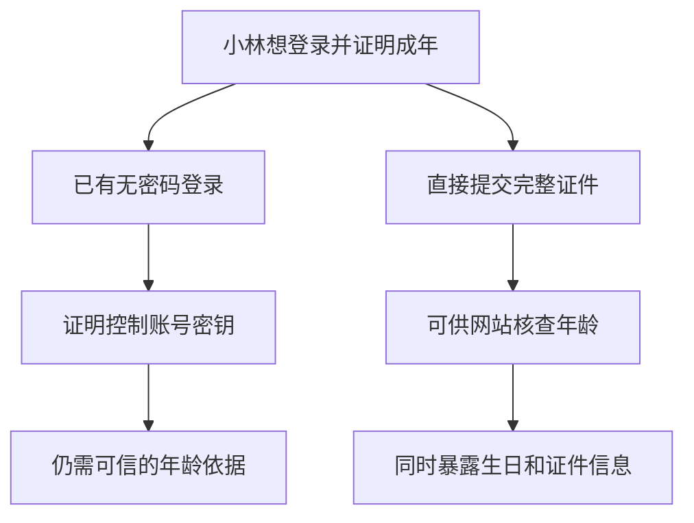
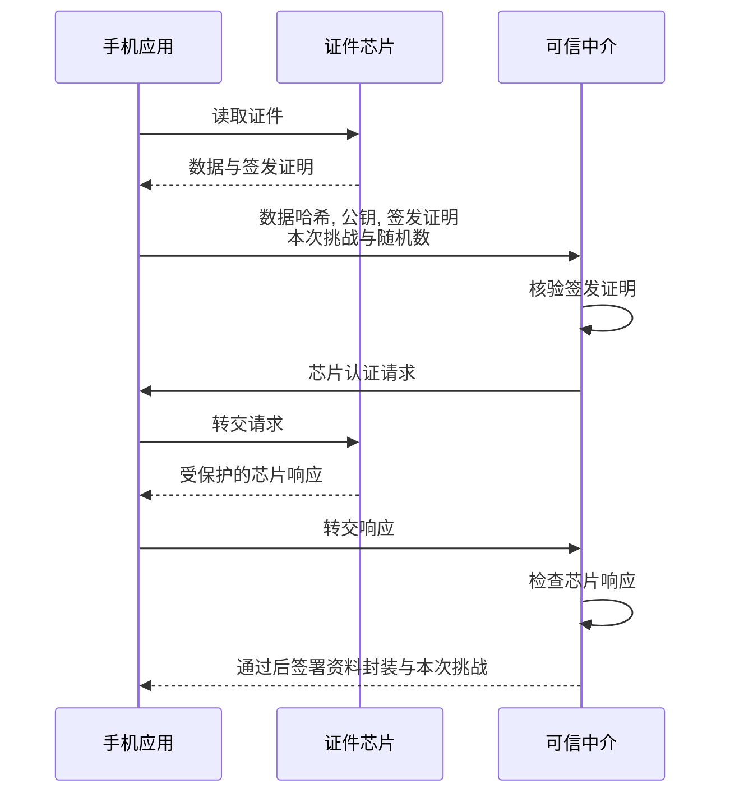
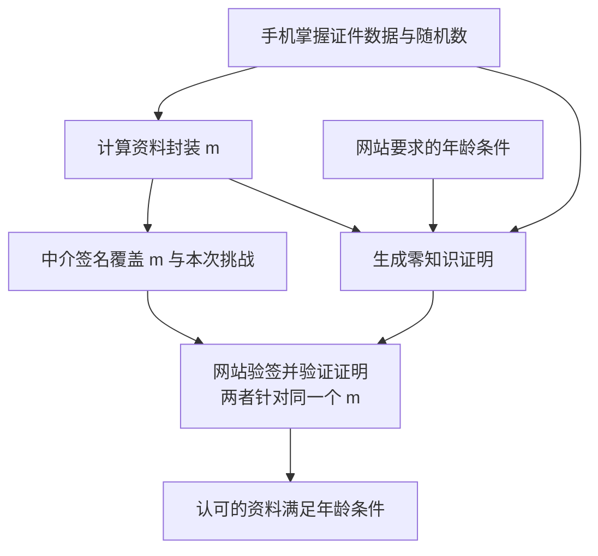
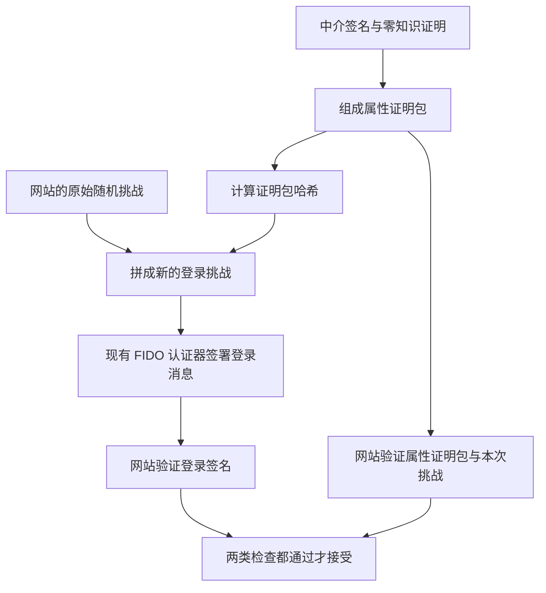

# 论文第一遍阅读 (Paper Snapshot)

**论文:** Fast IDentity Online with Anonymous Credentials (FIDO-AC). 通俗理解: 登录时证明自己具备某项资格, 同时少交出个人资料.

**作者与发表信息:** Wei-Zhu Yeoh, Michal Kepkowski, Gunnar Heide, Dali Kaafar, Lucjan Hanzlik. USENIX Security 2023, pp. 3029-3046.

**论文类型:** 认证协议框架, 安全模型, 系统原型与性能评估.

**来源与阅读范围:** [B2 正式版 PDF](usenixsecurity23-yeoh.pdf), 共 19 页, 含 1 页会议封面. 已读摘要, 引言, 第 2-9 节和附录 A-D; 第 4 节侧重安全目标, 未逐式审计安全实验. 已核对原文图 2-4 与表 3. 当前版本第 6 节只有证明草图; 未获取其提到的完整证明版本, 未运行源码或复现实验.

**定位约定:** 下文页码均指从 1 开始的 PDF 页序, 第 2 页对应印刷页 3029. 图号为本报告编号, 均标明身份与来源.

## 概览

网站能够确认你控制某个账号, 不等于知道你已经成年. FIDO-AC 把证件核查与现有无密码登录接起来: 手机检查电子证件, 生成一份只说明年龄达标的证明, 再让登录签名与这份证明绑定. 网站因此可以检查资格, 而不必接收完整生日和护照资料. 论文用原型展示了这种组合的可行性; 其低在线延迟依赖缓存和提前计算, 安全性依赖可信证件, 中介与终端环境. (摘要, 第 3, 5, 7.2 节, PDF 第 2, 5, 10-12, 14 页.)

## 问题

举个便于理解的假设例子: 小林登录网站购买需要成年资格的商品. 网站既要认出账号, 又要核实年龄, 还希望减少收集个人资料. 这个购买流程是教学例子; 年龄验证本身是论文引言给出的应用动机. (第 1 节, PDF 第 2 页.)

**图 1. 网站究竟缺哪种证明?** 教学假设图, 依据第 1, 2.1 节的问题动机整理, 不表示论文实验. 箭头表示各做法能够回答的问题或带来的信息暴露, 不表示时间顺序.



看左右两端留下的缺口: 账号控制权与年龄资格需要不同证据, 而完整证件又可能超出业务需要. 作者想补上的是一份与登录绑定的可信资格证明. 出生日期, 国籍等关于用户的资料, 在论文中统称为"属性". (第 1 节, PDF 第 2-3 页.)

再加一个关键区别: **资料真实, 不等于本次持有原证件.** 签发机构的签名可以说明资料未被篡改, 但资料及签名都可能被复制. 作者因此要求每次认证都检查证件芯片能够参与交互. 论文称其为 liveliness, 本报告称为"证件在场检查"; 它不是摄像头识别人脸或检查真人是否在场. (第 2.2-2.3 节, 第 3 节 R.2, PDF 第 4-5 页.)

## 方法

### 1. 谁核查证件, 怎样区分真数据与文件副本?

先认识两个角色. 手机上的 FIDO-AC 应用负责读取证件和生成属性证明; 新增的可信中介负责核查签发证明与芯片响应, 并为核查结果签名. 原型将中介放在同一个 Android 应用内, 依靠硬件支持的密钥及其认证机制建立信任. 证件通过手机贴近时使用的近距离无线通信 NFC 参与交互. (第 5.1-5.2, 7.1 节, 附录 B, PDF 第 10-11, 13, 17-18 页.)

**图 2. 中介凭什么为这次证件核查背书?** 根据表 1, 第 5.2 节和附录 A 重绘, 来源为 PDF 第 10-11, 17 页. 箭头表示消息传递, 从上到下表示本图的交互顺序. 为聚焦证件核查, 省略此前网站发出挑战的步骤和协议底层命令; 将同一应用内的中介作为独立逻辑角色画出.



两次核查回答不同问题. 核验签发证明叫被动认证 PA, 回答"数据是否由认可机构签发". 芯片认证 CA 回答"本次能否使用对应芯片内的秘密密钥". 后者依赖该密钥无法被导出的硬件假设; 仅有资料副本, 无法直接生成正确响应. 中介在此核查真实性和芯片参与, 年龄是否达标交给下一步证明. (第 2.2, 5.2 节, PDF 第 4, 10-11 页.)

网站还需要信任中介正确执行核查. 原型验证中介应用身份与硬件支持的密钥认证, 将认证挑战与本次 FIDO 请求绑定; 它依赖硬件和应用边界有效. 第 3 节同时假设终端与应用完整, 不讨论通过硬件运行痕迹窃取信息的侧信道攻击, 以及让中介无法正常服务的拒绝服务攻击. 芯片参与也不能直接扩大解释为人证同一, 阻止证件转借或所有转发攻击. (第 3 节, 附录 B, PDF 第 5, 17-18 页; 最后一句为保证范围的阅读判断.)

### 2. 网站看不到生日, 怎么知道年龄条件成立?

中介不把完整资料交给网站, 而是签署一个随机化的资料封装. 先把哈希理解成数据的固定长度摘要, 改变输入会改变摘要; 它本身不自动提供隐私. 本文用随机数让同一资料的封装可以随展示变化, 避免直接暴露一个固定资料摘要. 手机应用知道封装内的原始数据, 可以用它生成零知识证明: 让网站验证某个条件成立, 同时隐藏不必披露的资料. (第 5.2 节, 表 1, PDF 第 10-12 页.)

**图 3. 哪两份证据必须指向同一份隐藏资料?** 根据表 1 的 `attestac`, `proveac`, `checkac` 重绘, 来源为 PDF 第 10 页. 箭头表示验证依赖, 不表示执行先后. 图省略证明系统的参数与算法细节.



读图时看两条证据在 `m` 处相交: 中介签名说明它核查过对应资料和芯片, 零知识证明说明**封装中的那份资料**满足网站条件. 两份各自有效却互不相关的材料, 无法形成这个结论. (表 1, 第 5.2 节, PDF 第 10-12 页.)

可以把它类比成两份都写有同一封袋编号的核验结果: 一份确认来源和证件交互, 一份确认袋内资料符合年龄要求. 封袋编号对应 `m`, 两份结果对应中介签名与属性证明. 这只是教学类比; 实际连接依靠密码学关系, 网站并不打开封袋, 也没有新增一个替用户查看资料的人.

为便于回看原文, 核心关系可写成下面几行. `DG` 是证件数据组, `nonce` 是应用生成的随机数, `H` 是哈希, `||` 表示拼接. 零知识证明要说明自己知道 `DG` 和 `nonce`, 能算出这个 `m`, 且 `DG` 满足属性条件.

```text
m = H(H(DG) || nonce)
中介签名覆盖: m || 本次挑战
零知识证明检查: 隐藏数据对应 m, 且满足网站条件
```

中介接收的是数据哈希, 证件公钥和签发证明等信息, 不需要完整生日. **手机应用仍会读取个人数据, 中介仍可凭固定证件公钥识别重复证件.** 因此, 向网站少披露资料与向所有参与者隐藏一切, 是不同目标. (附录 A, PDF 第 17 页.)

本地中介有助于把观察留在用户设备内, 但不会让静态公钥消失. 第 6 节对此构造给出的是一次属性隐私; 中介与网站合作可能破坏不可关联性, 具体结果随执行环境变化. 不可关联性是指在模型范围内难以把不同展示认作同一来源, 不表示网站无法识别自己的同一账号. (第 4.1.2, 4.2.2, 6.1 节, 引理 5, 表 2, PDF 第 7-9, 12-13 页.)

### 3. 怎样防止把资格证明换到另一次登录?

先补上原有登录方式: 注册时, FIDO 认证器将公钥交给网站, 把对应私钥留在设备中. 登录时, 网站发出新随机挑战, 设备用私钥为相关消息签名, 网站用公钥验证. 挑战每次变化, 使旧回复不能直接用于新登录. 手机内置认证器或外接安全密钥都可以承担这个角色. (第 2.1 节, PDF 第 3 页.)

作者在这条签名保护中加入资格证明包的摘要, 将"控制账号"与"出示这些属性证据"连到同一请求.

**图 4. 资格证明怎样进入登录签名的保护范围?** 根据图 2, 第 5.3 节和附录 B 重绘, 来源为 PDF 第 11-12, 18 页. 箭头表示数据进入下一项计算或检查. 省略服务器身份等完整上下文与网页接口封装, 本图不是可直接实现的完整协议.



看新增摘要进入挑战的那一步. 替换属性证明包就会改变摘要, 网站重新计算挑战时应当发现不一致. 中介签名又覆盖了本次挑战, 因而不能随意搬用旧的证件核查结果. 这两层连接分别约束证明包与登录, 核查结果与会话. (图 2, 表 1, PDF 第 10-11 页.)

实际接入中, 网页加入 `fidoac.js`, 在调用浏览器的 WebAuthn 认证接口前取得证明并修改挑战, 调用后附上证明包; 网站也增加相应验证. 扩展包不直接传入认证器, 受到既有签名保护的是修改后的挑战. 因此可以继续使用原有浏览器与认证器, 但网站仍需改造验证逻辑. (第 5.3 节, 附录 B, PDF 第 12, 18 页.)

## 贡献

### 1. 将可信属性与现有登录组成一个框架

作者的主要进展是让网站在一次认证中同时检查账号控制权和可信属性, 并将证件在场检查纳入流程. 根据已读内容, 我的判断是, 其价值主要属于协议框架和系统整合: 使用已有密码学工具, 但明确了证件核查, 属性证明与登录签名之间的连接. (第 1, 5 节, 图 2, 表 1, PDF 第 3, 10-12 页.)

| 对照什么已有做法 | 本文改变了什么 | 这项进展的范围 |
| --- | --- | --- |
| 普通 FIDO 登录只证明账号控制权 | 将可信属性证明绑定到认证过程 | 扩展认证能力, 不等于提供完整业务授权 |
| 单凭可复制的证件数据及签名 | 每次认证加入证件芯片交互 | 在芯片硬件假设下约束仅复制资料的使用 |
| 依赖定制认证器的属性方案 | 设计可接入现有认证器的扩展方式 | 用户需安装应用, 网站仍需增加验证逻辑 |

来源: 第 1, 2.3, 5.1-5.3 节, PDF 第 2-4, 10-12 页. 最后一行来自作者对 FeIDo 等相关工作的比较; 本次没有另行审计这些方案, 不将作者的比较扩大为对全部已有工作的独立结论.

这一框架通过少交出原始资料来减少网站接触个人数据的机会. 论文提供的是构造与原型依据, 没有用真实部署前后的泄露事件来量化这种收益. (第 1, 7, 9 节, PDF 第 2-3, 13-15 页.)

### 2. 为组合后的系统明确安全目标

把几个各自安全的组件接起来, 还需要说明组合后要防住什么. 作者先定义带属性的无密码认证模型, 再将中介加入模型, 第 6 节给出五项性质与证明草图. 这是形式化建模和论证方面的贡献. 下表列出其分析目标及关键前提, 不表示本次已经核验完整证明. (第 4 节, 第 6 节引理 1-5, PDF 第 5-9, 12 页.)

| 作者分析的性质 | 需要哪些关键前提 |
| --- | --- |
| 无法冒充账号登录 | 底层 FIDO 无密码认证安全 |
| 新增属性证明不破坏模型内的不可关联性 | 底层认证的隐私性质成立, 将哈希理想化为随机映射, 证明满足零知识性质 |
| 不合格属性无法通过检查 | 中介签名不可伪造, 证件安全, 证明不能把假命题证明为真 |
| 中介不从协议请求辨别访问的网站 | 模型中诚实服务器随机生成挑战, 请求不透露网站身份 |
| 中介不从一次展示获知个人属性 | 将哈希理想化为随机映射, 并满足论文对证件数据组的不可关联假设 |

这使得"账号不能被冒充", "属性不能伪造"和"谁能关联用户"成为不同的检查目标. 但结论都依赖模型条件, 当前正式版明确说明这里只给证明草图. 因此, 已读材料支持介绍作者的目标与论证思路, 不支持声称本次已经完成独立安全验证. (第 4, 6 节, PDF 第 5-9, 12 页.)

### 3. 做出可接入原型, 测量运行成本

作者实现了 Android 应用与本地中介, 参数分发和验证服务, 以及网页脚本, 将框架落实为原型. 针对挑战扩展, 还在移动端 Chrome 测试了 Android 和 iOS 平台认证器及 Yubico 5 外接认证器, 结果支持这些对象能够容纳新增的 256 bit 摘要. 这提供了接入可行性的证据, 覆盖范围仍限于所测组合. (第 7.1 节, 图 4, 附录 C, PDF 第 13-14, 19 页.)

原型选择 Groth16 生成零知识证明. 这种选择在本文设置下验证快, 生成较慢, 并要求诚实生成的共用初始化参数; 原型信任参数服务提供正确材料. 因而, 接入已有登录机制的便利仍伴随新增的应用, 验证服务和信任条件. (第 7.1-7.2 节, 附录 B, PDF 第 13-14, 18 页.)

性能实验使用 Google Pixel 6 Pro 和 Azure Standard D4s v3 云实例, 云端配置为 4 vCPU, 16 GiB 内存, 证件为电子护照. 各项操作执行 100 次. 下表转录原文表 3, 看平均耗时列即可找到主要开销; `SD` 是标准差, 表示运行结果的离散程度, 不是最坏耗时. 1000 ms 等于 1 秒. (第 7.2 节, PDF 第 14 页.)

| 操作 | 平台 | 平均耗时 / ms | SD / ms |
| --- | --- | ---: | ---: |
| 读取证件数据 | 手机 | 1059.4; 已缓存时为 0.0 | 37.58 |
| 证件在场检查 | 手机 | 738.92 | 47.06 |
| 生成零知识证明 | 手机 | 3375.61 | 95.25 |
| 验证零知识证明 | 云端 | 8.19 | 0.29 |

来源: 第 7.2 节, 表 3, PDF 第 14 页. 正文将安全通道建立与本地中介检查计入在场检查部分.

证明生成约需 3.38 秒, 远长于验证. 作者说明, 示例证明依赖应用掌握的数据, 随机数和对应属性条件, 不依赖网站本次新选的随机挑战. 因而可以先生成证明, 在线时再由中介将对应资料封装与新挑战一起签署. 可能的查询较少或用户预先限定可接受查询, 是这种准备能够发挥作用的条件. (第 7.2 节, PDF 第 14 页.)

| 怎样准备 | 省去或移走什么 | 在线仍需要什么 |
| --- | --- | --- |
| 经用户允许缓存证件数据 | 省去重复读取资料 | 与证件芯片交互 |
| 为已知属性条件预先生成证明 | 将较重计算移到登录之前 | 与新挑战绑定的中介核查和网站验证 |

**作者报告: 同时缓存数据且完成离线预计算时, 相对普通 FIDO2 的额外延迟小于 1 秒.** 这不等于首次读取并现场生成证明时的总登录耗时. 缓存也意味着手机保存个人资料; 附录 B 将静态加密列为可进一步采用的保护措施, 不能据此写成所有缓存默认已经加密. (第 7.2 节, 附录 B, PDF 第 14, 17 页.)

根据已读证据, 我的判断是, 实验支持该原型在给定设备和准备条件下的可行性. 表 3 没有提供与其他匿名凭证方案在统一条件下的性能排名, 因而不能据此声称它全面更快, 或把 8.19 ms 证明验证时间当成整体认证成本.

结合[毕设任务要求](../../毕设要求.md), B2 最直接对应 R3 的请求绑定机制与 R5 的认证成本分解. 根据已读流程, 本文没有将区块链纳入认证路径, 也没有提供智能体委托链和动态级联撤销. 因而本报告判断, 它能为"可信属性如何随登录一同出示"提供依据, 业务权限是否仍有效及跨域授权状态怎样检查, 仍是本课题需要另行解决的问题. (第 5, 8 节, PDF 第 10-15 页.)

在本项目的采购流程中, 复制 B₁身份凭证对应 S07, 把询价证明换成下单请求对应 S08. 前者检查私钥持有, 后者检查签名覆盖的业务动作与报价. 这两个测试共同检验请求绑定, 800 元订单是否获准还须另查 G0-G2 和 C 的策略. [项目实验设计](../../docs/experiments/实验计划.md).
