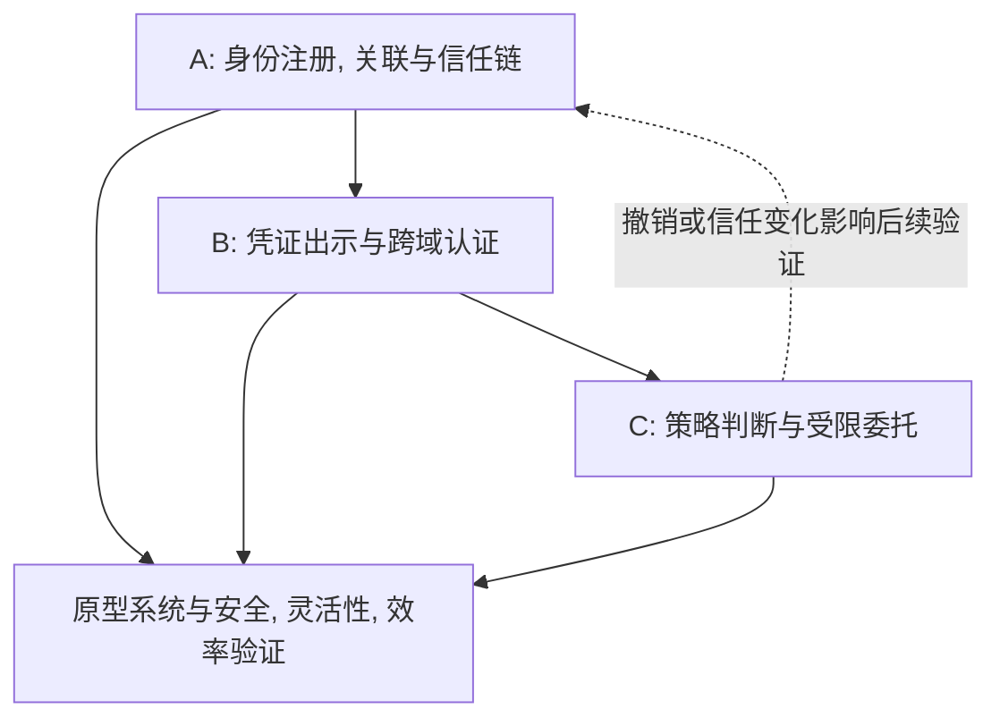

# 毕设论文阅读清单: 区块链跨域认证与委托授权

依据 [毕设要求](../毕设要求.md) 收录的最新要求及 R1-R5, 按前三项具体任务对应的三个研究板块组织, 共同支撑原型实现与方案验证两项交付.

## 筛选标准与使用方法

- **年份: 2023 年及以后正式发表.** 年份以会议届次或期刊卷期为准; 在线发表年份不同时单独说明. 公开作者版可能更早出现, 不能据此误判正式发表年份.
- **质量: 高水平会议和高质量期刊优先, 同时考察问题匹配程度.** 核心清单来自 CCS, IEEE S&P, USENIX Security, ASIACRYPT, OOPSLA/PACMPL, PETS/PoPETs. PoPETs 是与 PETS 研讨会关联的期刊; Cedar 发表在 PACMPL 的 OOPSLA1 卷期, 不把它们误写成普通会议论文集.
- **全文: 核心清单必须已有合法公开 PDF, 并已保存本地.** 正式发表的 DOI 与公开全文下载地址分别记录; 作者扩展版不是出版排版版. USENIX 官方条目未列 DOI 时使用官方会议标识, 不编造 DOI.
- **定位: 8 篇核心阅读+5 篇补充阅读+3 篇候选记录.** 补充阅读保留旧清单中有用的材料, 明确区分期刊研究, 立场论文与未确认正式发表的预印本. 候选记录不计入已下载清单, 也不是必读任务.
- **核查范围:** 核对发表记录, 公开摘要, 相关正文段落, PDF 题名和文件可解析性; 未独立验算全部证明, 也未运行或复现实验. 下文"可借鉴"是面向本课题的判断, 不表示原论文已经解决完整毕设问题.

全部本地 PDF 的文件名, 来源, 版本, 页数见[本地全文与阅读笔记索引](README.md). 保留 DOI 分层路径, 通过本清单的板块分类访问, 不重复保存跨板块论文.

## 三个板块与阅读顺序

| 板块 | 最新要求中的问题 | 核心论文 | 需要最终形成的设计 |
| --- | --- | --- | --- |
| A: 跨域身份信任链 | 区块链信任锚, 注册, 身份关联, 信任传递 | A1, A2, A3 | 参与方与信任假设, 身份绑定方式, 签发与传递规则, 链上状态 |
| B: 轻量化跨域认证 | 可验证凭证, 密码学承诺, 智能合约, 低开销认证 | B1, B2, B3 | 认证消息流程, 证明的命题, 会话绑定, 状态检查与性能指标 |
| C: 策略驱动的细粒度委托授权 | 任务, 属性, 信任与环境驱动的授权范围, 有效期和委托关系调整 | C1, C2; A3, B3 交叉支撑 | 策略规则, 再委托约束, 权限收缩, 到期与级联撤销机制 |

三部分共同通过原型系统验证. 身份声明上链不会自动使声明真实; 需要明确签发者准入及信任条件. 认证成功后仍要进行授权判断. 匿名性是可选的研究能力, 不因文献采用匿名凭证就自动成为任务书的强制目标.

**第一轮读 A1 → A2 → B1 → C1 → C2 → B3 的概览, 流程图和实验设计.** 随后按方案需要精读 A3, B2. 软件工程背景, 熟悉 Java/Go, 尚未系统学习密码学时, 先回答"谁信任谁, 谁证明什么, 在哪里检查", 再补承诺, 签名, 累加器和零知识证明. 不要求一次读完所有证明.

## 阅读产物与证据定位

已下载只代表文件可用, 下文的已读勾选保持实际学习进度. 每篇笔记使用 `.md`, 可保存在原始论文旁或 `docs/阅读/` 下, 不改写原始 PDF. 暂不创建空白笔记冒充已阅读.

| 笔记字段 | 记录要求 |
| --- | --- |
| 来源 | 论文 ID, 本地文件及论文版本 |
| 定位 | PDF 文件页码 (从 1 起), 原文节号/图表号; 印刷页码另列 |
| 内容 | 具体机制, 安全假设, 结论及不适用边界 |
| 项目连接 | 对应 R1-R5, 方案小节, 计划采用或排除的理由 |
| 复现 | 代码来源, 固定版本, 是否实际运行; 未运行明确标记 |
| 待确认 | 仍未理解的证明步骤, 缺失附录或不可比实验条件 |

正文中的文献 B1/C1 与实验中的配置 B1/C1 属于不同编号体系, 引用时加上"文献"或"配置". 设计采用方式见 [安全目标与文献依据](../docs/design/威胁模型与安全目标.md), 从机制到实验的对应关系见 [项目导读](../docs/design/AGENTS.md).

## A: 基于区块链的跨域身份信任链

### A1. SoK: Trusting Self-Sovereign Identity

- [ ] 已读
- **发表:** Evan Krul, Hye-young Paik, Sushmita Ruj, Salil S. Kanhere; PoPETs 2024(3):297-313, 2024. 系统化知识整理 (SoK).
- **定位: 首篇入门, 信任模型主参考.** 分析 SSI 参与方, 组件与威胁, 适合用来区分凭证的密码学有效性与签发机构的可信性.
- **重点与问题:** 身份持有者, 签发者, 验证者, 基础设施分别承担什么责任?注册表能保证什么?恶意签发者, 过期密钥与撤销状态怎样改变验证条件?
- **边界:** 是分析框架, 不是完整跨域协议; SSI 不必然使用区块链, 更不意味着所有参与者都不需要被信任.
- **证据与实验用途:** 用其威胁分类检查本课题模型是否遗漏攻击面; 不把 SoK 当作协议性能基线.
- **难度:** 中等, 先读框架和信任模型.
- **来源:** [官方发表页](https://petsymposium.org/popets/2024/popets-2024-0079.php); [DOI](https://doi.org/10.56553/popets-2024-0079); [官方 PDF](https://petsymposium.org/popets/2024/popets-2024-0079.pdf).
- **本地:** [PDF](10.56553/popets-2024-0079.pdf), 17 页, 正式版.

### A2. zkLogin: Privacy-Preserving Blockchain Authentication with Existing Credentials

- [ ] 已读
- **发表:** Foteini Baldimtsi 等; ACM CCS 2024:3182-3196.
- **定位: 身份关联与链上认证主参考, 同时支撑 B.** 使用已有 OpenID Connect 身份令牌认证区块链交易, 借助零知识证明隐藏链下身份与链上身份之间的敏感关联.
- **重点与问题:** 身份提供方, 公钥, 身份令牌, 临时密钥和链上账户如何绑定?证明绑定哪个会话或有效期?验证者认可哪个身份提供方?
- **边界:** 依赖原身份提供方的认证能力; 不能直接替代多管理域间的信任准入, 信任路径规则, 也不提供任务驱动委托授权.
- **证据与实验用途:** 有安全定义, 分析与系统实现, 已在 Sui 部署. 可借鉴证明生成, 验证和链上执行的分项评估; 部署事实不等于本课题的组合安全性已被证明.
- **难度:** 中等偏难, 先读系统模型和认证流程.
- **来源:** [DOI](https://doi.org/10.1145/3658644.3690356); [作者完整版本记录](https://arxiv.org/abs/2401.11735); [PDF, v2](https://arxiv.org/pdf/2401.11735v2).
- **本地:** [PDF](10.1145/3658644.3690356.pdf), 20 页, 作者完整版本, arXiv v2 (2024-09-27).

### A3. Delegatable Anonymous Credentials from Mercurial Signatures with Stronger Privacy

- [ ] 已读
- **发表:** Scott Griffy, Anna Lysyanskaya, Omid Mir, Octavio Perez Kempner, Daniel Slamanig; ASIACRYPT 2024, LNCS 15485:296-325.
- **定位: 层级签发与可验证委托链的进阶参考, 同时支撑 C.** 根签发者可委托签发权, 研究委托链中的恶意签发者可能破坏匿名性的问题, 并提出撤销令牌机制.
- **重点与问题:** 验证一条签发链时, 哪些信息必须公开?攻击者控制链中节点时还能获得什么保证?公共参数初始化带来哪些信任假设?
- **边界:** 签发权委托不等同于资源访问权委托; 不能把它直接当作属性, 环境和任务驱动的策略模型. 引入匿名链还需考虑本课题是否要求审计和责任追溯.
- **证据与实验用途:** 公开版本包含构造, 安全论证及复杂度讨论; 可参考安全定义与链深度相关开销, 不将未经复现的效率主张作为本系统结果.
- **难度:** 较难, 先读引言, 技术概览, 委托与撤销接口.
- **来源:** [作者机构发表记录](https://publications.ait.ac.at/en/publications/delegatable-anonymous-credentials-from-mercurial-signatures-with-/); [DOI](https://doi.org/10.1007/978-981-96-0888-1_10); [ePrint 记录](https://eprint.iacr.org/2024/1216); [作者 PDF](https://scottgriffy.com/papers/spdac.pdf).
- **本地:** [PDF](10.1007/978-981-96-0888-1_10.pdf), 42 页, 作者扩展版本; 不是 30 页的出版排版版.

## B: 结合凭证, 承诺与智能合约的轻量化跨域认证

### B1. zk-creds: Flexible Anonymous Credentials from zkSNARKs and Existing Identity Infrastructure

- [ ] 已读
- **发表:** Michael Rosenberg, Jacob White, Christina Garman, Ian Miers; IEEE Symposium on Security and Privacy (S&P), 2023.
- **定位: 承诺, 匿名凭证和证明组合的主参考.** 从已有身份材料构造匿名凭证, 支持对多个凭证形成复杂的身份声明, 公告板可采用透明日志, 拜占庭系统或区块链.
- **重点与问题:** 承诺绑定哪些数据?证明的公开输入与秘密输入是什么?如何证明持有有效凭证且满足属性条件?怎样将证明绑定到2026-10-25 整理时请求?
- **边界:** 匿名凭证构造与 W3C VC 数据格式不能直接画等号; 区块链是可选实例化, 文章不直接解决完整的动态多级委托. 采用 zkSNARK 不自动意味着端到端开销更低.
- **证据与实验用途:** 有安全定义, 证明材料, 实现和评估. 应分别测证明生成, 验证, 证明大小, 凭证集合规模及链上操作, 而不是只比较验证时间.
- **难度:** 较难; 先看概览与凭证生命周期, 再补承诺, Merkle 树, 零知识证明.
- **来源:** [IEEE 发表页](https://ieeexplore.ieee.org/abstract/document/10179430/); [DOI](https://doi.org/10.1109/SP46215.2023.10179430); [作者完整 PDF](https://www.cs.umd.edu/~imiers/pdf/zkcreds.pdf); [实现](https://github.com/rozbb/zkcreds-rs).
- **本地:** [PDF](10.1109/SP46215.2023.10179430.pdf), 56 页, 作者完整版本, 沿用已有文件.

### B2. Fast IDentity Online with Anonymous Credentials (FIDO-AC)

- [ ] 已读
- **发表:** Wei-Zhu Yeoh, Michal Kepkowski, Gunnar Heide, Dali Kaafar, Lucjan Hanzlik; USENIX Security 2023:3029-3046.
- **定位: 认证与可信属性结合的系统参考, 第二轮选读.** 将 FIDO2 认证与匿名属性证明结合, 提供基于电子身份材料的原型.
- **重点与问题:** 已有认证如何与属性证明绑定?中介承担什么职责?验证者怎样检验请求的属性条件?协议改动对客户端和服务端部署有什么影响?
- **边界:** 主要场景是人的电子身份与 Web 登录; 不是区块链跨域信任系统. 迁移到智能体时必须替换身份证明来源, 不能照搬电子护照假设.
- **证据与实验用途:** 有形式化定义, 安全分析与原型评估; 可参考认证集成方法, 消息往返和端到端延迟的评估方式.
- **难度:** 中等偏难, 优先看系统架构和实现.
- **来源:** [官方发表页](https://www.usenix.org/conference/usenixsecurity23/presentation/yeoh); [官方 PDF](https://www.usenix.org/system/files/usenixsecurity23-yeoh.pdf); [实现](https://github.com/FIDO-AC/fidoac). 官方 BibTeX 未列 DOI, 使用会议标识.
- **本地:** [PDF](usenix/usenixsecurity23-yeoh.pdf), 19 页, 官方正式版 (含会议封面).

### B3. EVOKE: Efficient Revocation of Verifiable Credentials in IoT Networks

- [ ] 已读
- **发表:** Carlo Mazzocca, Abbas Acar, Selcuk Uluagac, Rebecca Montanari; USENIX Security 2024:1279-1295.
- **定位: 轻量凭证状态检查与撤销的主参考, 同时支撑 A, C.** 使用基于椭圆曲线密码的累加器, 关注低计算, 低存储条件下的凭证撤销与离线节点更新.
- **重点与问题:** 累加器, 见证和链上记录各存什么?状态更新后谁更新见证?离线节点恢复后如何拒绝旧凭证?
- **边界:** 解决凭证撤销不等于解决委托链级联撤销; 离线更新也不等于所有节点立即获知撤销. IoT 设备实验不能直接作为智能体工作负载结果.
- **证据与实验用途:** 有系统与威胁模型, 安全分析, 原型及规模实验. 可借鉴状态存储量, 更新通信量, 验证延迟和撤销传播时间; 需区分设备本体与外接控制器上的执行.
- **难度:** 中等偏难, 先理解累加器的集合成员证明和状态同步.
- **来源:** [官方发表页](https://www.usenix.org/conference/usenixsecurity24/presentation/mazzocca); [官方 PDF](https://www.usenix.org/system/files/usenixsecurity24-mazzocca.pdf); [实现与实验](https://github.com/evokevc/EVOKE). 官方 BibTeX 未列 DOI, 使用会议标识.
- **本地:** [PDF](usenix/usenixsecurity24-mazzocca.pdf), 18 页, 官方正式版 (含会议封面).

## C: 策略驱动的细粒度委托授权

### C1. Cedar: A New Language for Expressive, Fast, Safe, and Analyzable Authorization

- [ ] 已读
- **发表:** Joseph W. Cutler 等; PACMPL 8(OOPSLA1), Article 118:670-697, 2024; OOPSLA 2024 论文.
- **定位: 策略表达与可分析授权的主参考.** 将授权逻辑独立为策略, 结合角色, 属性和关系, 研究快速求值, 类型检查及策略分析.
- **重点与问题:** 主体, 操作, 资源, 上下文如何进入决策?允许规则与禁止规则如何组合?策略变化如何检查是否意外扩大权限?任务和环境信息由谁提供, 如何保证可信?
- **边界:** Cedar 自身不是跨域身份协议, 也不是完整的委托凭证系统. 动态上下文可作为输入, 但信任状态获取, 委托链验证和级联撤销仍须另行设计.
- **证据与实验用途:** 有 Lean 建模与性质证明, Rust 实现, 策略语言性能比较. 适合参考策略层正确性和求值效率; 这些保证不能自动扩展到链上状态与凭证的整个组合系统.
- **难度:** 中等, 适合先从示例策略入手, 再看形式语义.
- **来源:** [作者机构发表页](https://www.amazon.science/publications/cedar-a-new-language-for-expressive-fast-safe-and-analyzable-authorization); [DOI](https://doi.org/10.1145/3649835); [扩展版 PDF, v2](https://arxiv.org/pdf/2403.04651v2); [实现](https://github.com/cedar-policy/cedar).
- **本地:** [PDF](10.1145/3649835.pdf), 39 页, 作者扩展版本, arXiv v2 (2024-03-08).

### C2. Practical Delegatable Anonymous Credentials From Equivalence Class Signatures

- [ ] 已读
- **发表:** Omid Mir, Daniel Slamanig, Balthazar Bauer, René Mayrhofer; PoPETs 2023(3):488-513, 2023.
- **定位: 受限再委托与属性凭证的主参考, 同时支撑承诺机制.** 支持含属性的可委托匿名凭证, 以及对后续委托能力的限制, 采用集合承诺与等价类签名构造.
- **重点与问题:** 委托者如何限制下一跳?凭证与被委托者公钥怎样绑定?公开属性与隐藏属性如何处理?链深度和属性数量分别影响哪些开销?
- **边界:** 不提供任务与环境驱动的完整策略引擎; 文中将撤销置于研究范围之外, 不能声称它已经解决级联撤销. 属性委托怎样映射到资源与操作权限仍需明确设计.
- **证据与实验用途:** 有形式化安全模型, 通用群模型下的证明及实现基准. 可参考委托, 出示, 验证耗时与凭证大小; 避免将"凭证大小固定"误写成"全部协议成本固定".
- **难度:** 较难, 先读应用场景, 接口和性能表, 再读构造.
- **来源:** [官方发表页](https://petsymposium.org/popets/2023/popets-2023-0093.php); [DOI](https://doi.org/10.56553/popets-2023-0093); [官方 PDF](https://petsymposium.org/popets/2023/popets-2023-0093.pdf); [原文给出的实现](https://github.com/mir-omid/DAC-from-EQS).
- **本地:** [PDF](10.56553/popets-2023-0093.pdf), 26 页, 正式版. 虽有 2022 年预印本, 正式发表年份为 2023, 符合本清单标准.

## 补充阅读: 保留旧清单中有用的材料

以下 5 篇已有本地 PDF; 按需要阅读, 不与核心清单混同. 代码链接仅供定位, 尚未验证当前依赖和可复现性.

### S1. Efficient Blockchain-Based Mutual Authentication and Session Key Agreement for Cross-Domain IIoT

- [ ] 已读
- **发表:** Jie Cui 等; IEEE Internet of Things Journal 11(9):16325-16338, 2024.
- **对应 A, B:** 直接研究区块链跨域认证, 适合补充设备, 边缘服务器, 注册机构的协议流程及链上存储设计; 可作场景接近的候选对照.
- **边界与证据:** 面向 IIoT, 不是完整的 W3C VC 委托体系. 包含安全分析与 ProVerif 符号验证, 不能把符号验证等同于计算模型下的归约证明. 先读流程和评估, 难度中等偏难.
- **来源:** [IEEE 发表页](https://ieeexplore.ieee.org/abstract/document/10384713/); [DOI](https://doi.org/10.1109/JIOT.2024.3351892); [作者 PDF](https://qyzhang.com/papers/cui2024BC-crossAKA.pdf).
- **本地:** [PDF](10.1109/JIOT.2024.3351892.pdf), 14 页, 作者托管的正式版, 沿用已有文件.

### S2. DACP: Enforcing a dynamic access control policy in cross-domain environments

- [ ] 已读
- **发表:** Ahmad Salehi S., Runchao Han, Carsten Rudolph, Marthie Grobler; Computer Networks 237:110049, 2023.
- **对应 C:** 动态跨域策略, ABAC, 属性管理与撤销; 可参考域内策略与外域属性验证的分工, 包含 Java 实现与评估.
- **边界与证据:** 不是区块链多跳委托方案; 主要按安全需求展开分析, 不能当作完整归约证明模板. 先读场景和策略流程, 难度中等偏难.
- **来源:** [作者机构发表页](https://research.monash.edu/en/publications/dacp-enforcing-a-dynamic-access-control-policy-in-cross-domain-en/); [DOI](https://doi.org/10.1016/j.comnet.2023.110049); [仓储 PDF](https://researchmgt.monash.edu/ws/files/567346039/556683261_oa.pdf).
- **本地:** [PDF](10.1016/j.comnet.2023.110049.pdf), 11 页, 正式版.

### S3. A Novel Model for Authority and Access Delegation Utilizing Self-Sovereign Identity and Verifiable Credentials

- [ ] 已读
- **发表:** Špela Čučko, Muhamed Turkanović; IEEE Access 13:115102-115134, 2025.
- **对应 C:** 直接描述委托参与方, 数据对象, 生命周期与凭证状态. 可帮助将抽象密码学接口翻译成系统流程.
- **边界与证据:** 保留原因是模型匹配, 并非将 IEEE Access 与安全顶会等同. 技术独立的模型及案例验证不构成完整的区块链协议或密码学归约证明. 先看模型和案例, 难度中等.
- **来源:** [DOI](https://doi.org/10.1109/ACCESS.2025.3582312); [大学仓储全文入口](https://dk.um.si/IzpisGradiva.php?id=93898&lang=eng).
- **本地:** [PDF](10.1109/ACCESS.2025.3582312.pdf), 33 页, 仓储正式版.

### S4. Position: AI Agents Need Authenticated Delegation

- [ ] 已读
- **发表:** Tobin South 等; ICML 2025, PMLR 267:82211-82231, **Position Paper (立场论文)**.
- **应用背景:** 帮助说明智能体自己的身份与用户授予它的权限为何需要分开表达, 可用于场景, 问题动机与责任追溯讨论.
- **边界:** 不作为完成密码学构造, 证明和区块链系统评估的证据; 不因 ICML 品牌而将立场论文视作安全协议研究论文. 难度较低.
- **来源:** [正式发表页](https://proceedings.mlr.press/v267/south25a.html); [官方 PDF](https://raw.githubusercontent.com/mlresearch/v267/main/assets/south25a/south25a.pdf). 官方页面未列 DOI, 使用 PMLR 标识.
- **本地:** [PDF](pmlr/v267/south25a.pdf), 21 页, PMLR 正式版.

### S5. CRSet: Private Non-Interactive Verifiable Credential Revocation

- [ ] 已读
- **状态:** Felix Hoops, Jonas Gebele, Florian Matthes; 2025 年 arXiv 预印本.2026-10-25 核查记录中的页面标注 Preprint, 未列正式会议或期刊出处.
- **对应 B, C:** 可选的撤销隐私研究线索, 关注通过定期发布状态, 由验证方本地检查来减少签发活动信息泄露.
- **边界与证据:** 不计入正式发表的核心清单; 论文给出证明草图和实验, 不能据此声称完整安全证明已独立验证, 也不能将周期性发布视作即时撤销. 难度中等偏难.
- **来源:** [论文记录](https://arxiv.org/abs/2501.17089); [预印本 DOI](https://doi.org/10.48550/arXiv.2501.17089); [PDF, v3](https://arxiv.org/pdf/2501.17089v3).
- **本地:** [PDF](10.48550/arXiv.2501.17089.pdf), 17 页, arXiv v3 (2025-09-17), 沿用已有文件.

## 候选记录: 未取得合适全文, 不计入核心阅读

### P1. FDAAC-CR: Practical Delegatable Attribute-Based Anonymous Credentials With Fine-Grained Delegation Management and Chainable Revocation

- **发表:** Min Xie, Peichen Ju, Yanqi Zhao, Zoe L. Jiang, Man Ho Au, Junbin Fang, Yong Yu, Xuan Wang; IEEE TIFS 20:7572-7587, 2025.
- **相关性:** 与 C 高度匹配: 部分属性委托, 再委托深度与属性集限制, 链式撤销. 正式全文取得后值得优先补读, 用于补足 C2 的撤销缺口; 暂不据摘要选定其作为实现方案.
- **全文限制:** 尚未取得可验证的最终版 PDF. 作者在 ePrint 2024/610 页面明确说明早期预印本存在错误, 已撤回, 应以 IEEE TIFS 最终版及其支持材料为准.**不下载该旧稿充当正式版, 不将其用于实现或证明依据.**
- **来源:** [正式 DOI](https://doi.org/10.1109/TIFS.2025.3587182); [作者机构发表记录](https://research.polyu.edu.hk/en/publications/fdaac-cr-practical-delegatable-attribute-based-anonymous-credenti/); [作者的版本警示](https://eprint.iacr.org/2024/610).
- **本地:** 无. 后续取得最终版时, 核对题名, 8 位作者, DOI, 并同时检查证明附录/支持材料是否齐全.

### P2. Blockchain-based access control architecture for multi-domain environments

- **旧清单条目:** Zhiqiang Du 等; Pervasive and Mobile Computing 98:101878, 2024.
- **相关性与调整:** 多域, 区块链, DID, 凭证与访问控制的架构组合贴题, 但现有公开入口未取得完整 PDF, 2026-10-25 整理时不再作为核心阅读. 不能把仅核对摘要的条目写成已审读完整安全证明.
- **来源:** [DOI](https://doi.org/10.1016/j.pmcj.2024.101878); [出版页面](https://www.sciencedirect.com/science/article/pii/S157411922400004X).2026-10-25 整理时出版页面访问返回 403; 此前作者上传入口也受限.
- **本地:** 无, 保留检索记录.

### P3. A zk-SNARK-Enhanced Blockchain-Based Lightweight Scheme for Cross-Domain Authentication

- **旧清单条目:** Yinong Li, Yi Li; Blockchain: Research and Applications, Article 100550. 上一轮记录为 2026-08-17 在线发表, Journal Pre-proof; 2026-10-25 书目核查时出版页返回 403, 未重新确认其最终卷期状态.
- **相关性与调整:** 原清单记录其组件组合贴题, 但完整 PDF 仍未取得, 且缺少足够的全文核查, 2026-10-25 整理时移至候选记录; 不因题名包含全部关键词就列入核心.
- **来源:** [DOI](https://doi.org/10.1016/j.bcra.2026.100550); [出版页面](https://www.sciencedirect.com/science/article/pii/S2096720926001119).
- **本地:** 无, 保留检索记录.

## 如何转化为毕设方案和实验

每篇核心论文先留下半页到一页笔记, 记录: 

1. 解决的具体问题, 以及与本课题的差异.
2. 参与方, 攻击者能力, 可信前提; 区块链具体提供什么保证.
3. 身份, 凭证, 承诺, 权限, 委托关系和状态如何表示.
4. 链上与链下分工; 一次访问的交互轮数, 读链和写链次数.
5. 安全依据属于威胁分析, 符号验证, 形式化性质证明还是密码学归约, 其模型与假设是什么.
6. 开源实现, 实验条件和待复现指标; 哪些结果只测某个局部环节.

| 要验证的能力 | 可参考的文献 | 本课题建议测量/检查 |
| --- | --- | --- |
| 身份与信任链 | A1, A2, A3 | 注册与关联流程, 非法签发者拒绝, 信任路径合法性, 密钥与状态更新 |
| 轻量认证 | B1, B2, S1 | 消息轮数与字节数, 生成/验证耗时, 链上开销, 端到端延迟; 明确基线与安全等级 |
| 动态撤销 | B3; 取得最终版后的 P1 | 撤销传播时间, 旧状态接受窗口, 离线恢复, 上游撤销后下游失效 |
| 策略与委托 | C1, C2, S2, S3 | 属性/环境/任务变化后的决策, 权限不扩张, 有效期继承, 再委托深度限制 |
| 系统组合 | 全部 | 将身份, 凭证, 策略版本和状态绑定到同一请求; 并发变更, 缓存与链最终性带来的影响 |

论文写作围绕同一笔采购取证. B₁的身份来源对应 A 类文献和 F04, 持有者证明对应 B 类和 S07/S08, A₁能交给 B₁的额度对应 C 类和 S11-S14/S58. 采购方根仍被 C 拒绝的证据来自 F10/F11, 撤销后旧报价无法再下单的证据来自 E1 的撤销步骤和 E6. 这些编号指向待运行的本项目用例. 论文中将文献依据, 项目规则和实测结果分别标注. [方案](../docs/design/采购场景与总体设计.md), [实验](../docs/experiments/实验计划.md).

## 资料整理记录与旧编号对照

新增 6 篇公开全文: zkLogin, ASIACRYPT 2024 可委托凭证, FIDO-AC, EVOKE, Cedar, PoPETs 2023 可委托凭证. 保留原有 7 个 PDF, 不改动其字节内容. FDAAC-CR 作为有版本风险提示的候选, 不用撤回稿补足数量.

| 旧编号 | 新编号 | 调整 |
| --- | --- | --- |
| 01 | A1 | 保留为信任模型核心 |
| 02 | P2 | 全文受限, 转候选 |
| 03 | S3 | 模型贴题, 保留补充 |
| 04 | S1 | 保留跨域协议补充 |
| 05 | B1 | 保留为凭证与承诺核心 |
| 06 | P3 | 全文受限, 转候选 |
| 07 | S2 | 保留动态策略补充 |
| 08 | S5 | 保留预印本研究线索 |
| 09 | S4 | 保留智能体应用背景 |
