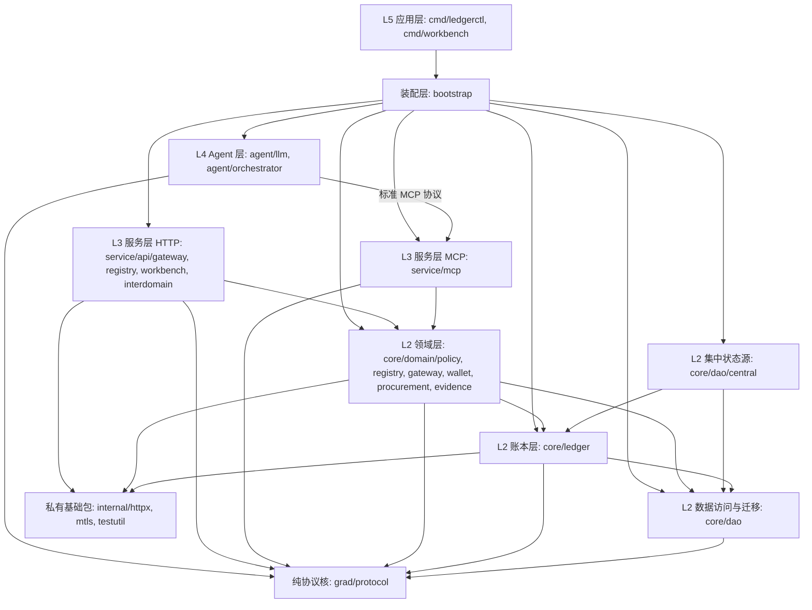

# platform/AGENTS.md

## 模块职责与目录结构

`platform/` 是 Go 模块 `grad/platform` 的根目录, 按严格五层单向依赖架构实现可信状态源, PostgreSQL 持久化与迁移, OPA 策略评估, 管理与交付领域逻辑, 供应商资源网关, 隔离智能体钱包, 采购编排与证据投影, 入站 REST/mTLS 与 MCP 服务, LLM 智能体编排, 顶层运行时装配以及命令行/工作台进程入口. 本模块仅单向依赖 `grad/protocol`, 不依赖 `experiments/` 或 `chaincode/`.

| 路径 | 层级与职责 |
| --- | --- |
| `go.mod`, `go.sum` | `grad/platform` 模块依赖锁定, 通过 `replace` 引用本地 `../protocol`. |
| `arch_test.go` | 五层单向依赖架构守卫 (`TestFiveLayerArchitecture`, `TestArchRulesEngine`), 基于 Go AST 静态校验所有包导入与 L2 无入站 HTTP 约束. |
| `internal/httpx/` | 模块私有: 统一 REST JSON 编码, 有界严格解码, `X-Request-Id` 透传和 `ErrorEnvelope` 响应. |
| `internal/mtls/` | 模块私有: 内部服务 mTLS 身份解析与本地测试信道, 忽略调用方自报头. |
| `internal/testutil/` | 模块私有: 基于 `testcontainers-go` PostgreSQL 的隔离测试库工具, 支持 `TEST_POSTGRES_DSN` 覆盖. |
| `core/dao/` | L2 数据访问与迁移: 嵌入式 PostgreSQL 迁移 (`001_fabric.sql` 至 `012_bound_quotes.sql`, `dao.Up`), 事务辅助 (`Tx`), 意图锁与回执存储 (`ActionStore`) 以及持久化存储绑定. |
| `core/dao/central/` | L2 集中式状态源: 业务主库集中登记状态源 (`centralized_registry`), 实现 `ledger.StateSource`, 提供固定版本 `REPEATABLE READ` 快照与 `FOR SHARE` 锁重检. |
| `core/ledger/` | L2 账本封装: 统一状态源契约 (`StateSource`, `HistoricalStateSource`, `StateSnapshot`, `ProbeLease`), Fabric 实例管理, 链码构建与 CCaaS 打包, 完整块 Deliver 连续重放, PostgreSQL 固定高度视图, 单调时钟原探针租约与原交易日志 (`ledger.Journal`, `fabric_operation`). |
| `core/domain/policy/` | L2 策略领域: 确定性 OPA Rego v1 策略包构建, 清单与文件 SHA-256 校验, 固定 T 根检查, 禁用非确定性内置函数扫描与求值. |
| `core/domain/registry/` | L2 登记管理领域: 管理操作受理与状态投影, 注册与恢复双证明挑战协调, 受控 outbox/receipt 同步交付 (`DeliveryService`), 复用 `ledger.Journal` (`NewFabricService`, `NewFabricServiceWithDB`). |
| `core/domain/gateway/` | L2 供应商网关领域: 挑战签发, 风险上下文管理, 锁后重检与订单执行, `h < r` 历史复核, 核账单与 `order_outcome_outbox` 回执投递, 不含入站 HTTP 路由. |
| `core/domain/wallet/` | L2 隔离钱包领域: 隔离密钥与 SD-JWT 钱包 (`WalletContext`), 持久化意图锁 (`client_actions`, `order_outcome_receipts`), 出站纯 HTTP 网关客户端以及强类型任务绑定操作 (`BoundOperations`). |
| `core/domain/procurement/` | L2 采购编排领域: 本域会话与权限, 采购草稿与运行状态机, 委托发放调度及域间派单状态维护. |
| `core/domain/evidence/` | L2 证据投影领域: 面向工作台的运行证据, 委托树与脱敏轨迹投影服务. |
| `service/api/gateway/` | L3 入站网关 HTTP API: 供应商 C 资源网关端点 (`challenges`, `contexts`, `execute`, `decisions`, `health/ready`, `order-outcome-cases`, `audit/order-outcomes`). |
| `service/api/registry/` | L3 入站管理 HTTP API: 管理操作受理与状态查询 (`POST /v1/management/{method}`, `GET /v1/operations/{operationId}`). |
| `service/api/workbench/` | L3 入站浏览器工作台 API: 同源 `/api/v1` 会话, 管理, 采购运行与证据接口, 嵌入 `openapi.json`. |
| `service/api/interdomain/` | L3 域间 mTLS API 与传输: 受控域间委托/派单/核账回执入站服务与客户端传输封装. |
| `service/mcp/` | L3 标准 MCP 工具服务: 基于 `modelcontextprotocol/go-sdk` 暴露确定性协议工具 (`inspect_wallet`, `delegate_grant`, `replace_grant`, `request_quote`, `create_order`, `reconcile_order`), 桥接 `core/domain/wallet` 隔离执行. |
| `agent/llm/` | L4 LLM 客户端: 适配 OpenAI/Anthropic 兼容 API 以及工具轨迹脱敏 (`redact.go`), 不接触私钥与基础设施. |
| `agent/orchestrator/` | L4 智能体编排: 基于 LLM 与标准 MCP 客户端驱动采购任务流 (`flows.go`, `orchestrator.go`), 仅通过 MCP 协议调用 L3 工具. |
| `bootstrap/` | 顶层装配层: 负责 Fabric/Central 网关栈 (`StartFabricGatewayStack`), 钱包, 本地 mTLS 客户端 (`NewLocalMTLSClient`), 工作台, MCP stdio 及协议夹具装配与种子登记. |
| `cmd/ledgerctl/` | L5 CLI 入口: 基于 Cobra 的运维与调试命令行 (`deploy`, `seed`, `check`, `inspect`, `invoke`, `operation`, `mcp`). |
| `cmd/workbench/` | L5 工作台进程入口: 按域启动浏览器 API 与受控域间 mTLS 服务. |

## 五层单向依赖约束



所有分层规则均由 `arch_test.go` 在 `go test` 时强制校验:

- **L4 Agent 严格隔离**: `agent/` (`agent/llm`, `agent/orchestrator`) 严禁导入 `core/...`, `service/api/...`, `bootstrap/`, `cmd/`, `internal/testutil`, 以及 `pgx`, `goose`, Fabric SDK 或 OPA; 只能通过标准 MCP 协议 (`modelcontextprotocol/go-sdk`) 调用 L3 `service/mcp`.
- **L3 服务层无基础设施直连**: `service/api/` 与 `service/mcp/` 严禁反向导入 `agent/`, `bootstrap/`, `cmd/`, LLM SDK 或 Fabric SDK, 且生产代码禁止直接导入 `core/dao`, `core/ledger`, `pgx` 或 `goose`, 统一经 `core/domain/...` 调用领域逻辑; `service/mcp` 亦禁止导入 `service/api`, 其生产代码仅允许调用 `core/domain/wallet`.
- **L2 领域层无入站 HTTP 与上层耦合**: `core/domain/...` 严禁导入 `service/`, `agent/`, `bootstrap/`, `cmd/`, LLM/MCP/Fabric SDK, 生产代码严禁使用入站 HTTP 服务端构造 (`http.ServeMux`, `http.ResponseWriter`, `http.Server` 等; `core/domain/wallet` 的出站 `http.Client` 例外). `core/domain/gateway` 与 `core/domain/wallet` 互相零直接导入, 跨边界通信全部经 HTTP/`http.Handler` 与独立 DTO 完成.
- **L2 数据与账本顺序**: `core/dao` 根包位于 `core/ledger` 之下, 不得导入 `core/ledger` 及以上各层或 Fabric/LLM/MCP/OPA SDK; 仅 `core/dao/central` 为实现 `ledger.StateSource` 契约允许导入 `core/ledger`. `core/ledger` 不得导入 `core/domain` 及以上各层或 LLM/MCP/OPA SDK.
- **装配, 入口与私有包边界**: `bootstrap/` 不得导入 `cmd/`. `cmd/` 入口包必须经 `bootstrap/` 装配, 严禁直接导入 `core/dao`, `core/domain`, `pgx`, `goose`, Fabric SDK, OPA 或 LLM SDK. `internal/httpx`, `internal/mtls` 和 `internal/testutil` 为模块私有包, 不得导入 `core/domain` 及以上各层; `experiments/` 等外部模块仅可导入 `grad/platform` 公开包 (如 `bootstrap.NewLocalMTLSClient`), `grad/platform` 严禁反向依赖 `grad/experiments`.
- **业务与协议约定**: 浏览器经 `service/api/workbench` 与 `core/domain/procurement`/`core/domain/registry` 使用管理操作与原交易查询. 工作台 MCP 与确定性业务调用经 `core/domain/wallet` 的 `BoundOperations` 复用任务绑定, 钱包和网关幂等语义. 公开协议与夹具不包含历史兼容字段 (无 `synthetic`, 无 `m2TaskSpec`, 统一为 `procurementTaskSpec`, C 服务凭证键统一为 `"C"`, 资源 URI 严格使用 `urn:grad:resource:C:quotes` 与 `urn:grad:resource:C:orders`).

## 数据库迁移

- 所有表结构由 `core/dao/001_fabric.sql` 至 `core/dao/012_bound_quotes.sql` 统一维护, 禁止在业务包中维护内联 DDL.
- `dao.Up(ctx, pool)` 通过固定咨询锁编号串行化并发迁移, 可在进程启动和测试初始化时幂等调用.

## 三层测试与验证

在 `platform/` 目录下执行:

1. 纯单元测试与五层架构守卫 (无 Docker 与外部依赖, 包含 `arch_test.go`):
   ```sh
   go test -race -count=1 ./...
   ```
2. PostgreSQL 集成测试 (`//go:build db`, 自动通过 `testcontainers-go` 启动 `postgres:17-alpine`, 或设置 `TEST_POSTGRES_DSN`):
   ```sh
   go test -tags=db -race -count=1 ./...
   ```
3. 真实 Fabric 联调验收 (`//go:build fabriclive`, 需设置 `FABRIC_INSTANCE` 指向已启动网络目录; 未设置时自动跳过):
   ```sh
   go test -tags=fabriclive -v -count=1 ./core/ledger/... ./bootstrap/...
   ```
   仅验证编译:
   ```sh
   go vet ./... && go vet -tags=db ./... && go vet -tags=fabriclive ./...
   go test -tags=fabriclive -c -o /dev/null ./bootstrap
   ```

## ledgerctl 构建与运行

```sh
cd platform && go build -o ../build/ledgerctl ./cmd/ledgerctl
../build/ledgerctl --help
```

全局参数为 `--dir` (默认 `$FABRIC_INSTANCE` 或 `.local/fabric-d0`) 与 `--timeout` (默认 `2m`), 子命令共 7 个: `deploy`, `seed`, `check`, `inspect`, `invoke`, `operation`, `mcp`.
