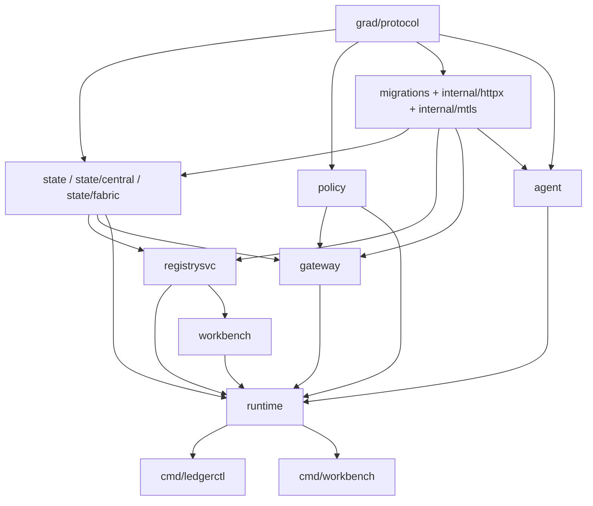

# platform/AGENTS.md

## 模块职责与目录结构

`platform/` 是 Go 模块 `grad/platform` 的根目录, 实现可信状态源, OPA 策略评估, 管理与交付服务, 供应商资源网关, 隔离智能体钱包, 顶层运行时装配和命令行入口. 本模块仅单向依赖 `grad/protocol`, 不依赖 `experiments/` 或 `chaincode/`.

| 路径 | 职责 |
| --- | --- |
| `go.mod`, `go.sum` | `grad/platform` 模块依赖锁定, 通过 `replace` 引用本地 `../protocol`. |
| `migrations/` | 嵌入式 PostgreSQL 迁移, 由 `goose/v3` 按会话咨询锁幂等执行. |
| `internal/httpx/` | 统一 REST JSON 编码, 有界严格解码, `X-Request-Id` 透传和 `ErrorEnvelope` 响应. |
| `internal/mtls/` | 内部服务 mTLS 身份解析与本地测试信道, 忽略调用方自报头. |
| `internal/testutil/` | 基于 `testcontainers-go` PostgreSQL 的隔离测试库工具, 支持 `TEST_POSTGRES_DSN` 覆盖. |
| `state/` | 统一状态源契约 (`StateSource`, `HistoricalStateSource`, `StateSnapshot`, `ProbeLease`). |
| `state/central/` | 业务主库集中登记状态源 (`centralized_registry`), 提供固定版本 `REPEATABLE READ` 快照与 `FOR SHARE` 锁重检. |
| `state/fabric/` | Fabric 实例管理, 链码构建与 CCaaS 打包, 完整块 Deliver 连续重放, PostgreSQL 固定高度视图, 单调时钟原探针租约与原交易日志 (`fabric_operation`). |
| `policy/` | 确定性 OPA Rego v1 策略包构建, 清单与文件 SHA-256 校验, 固定 T 根检查, 禁用非确定性内置函数扫描与求值. |
| `registrysvc/` | 管理操作 HTTP 受理与状态投影 (`POST /v1/management/{method}`, `GET /v1/operations/{operationId}`), 注册与恢复双证明挑战协调, 受控 outbox/receipt 同步交付 (`DeliveryService`). |
| `gateway/` | 供应商 C 资源网关 (`challenges`, `contexts`, `execute`, `decisions`, `health/ready`, `order-outcome-cases`, `audit/order-outcomes`), 锁后重检, `h < r` 历史复核与 `order_outcome_outbox` 回执投递. |
| `agent/` | 隔离密钥与 SD-JWT 钱包 (`WalletContext`), 持久化意图锁 (`client_actions`, `order_outcome_receipts`), 纯 HTTP 网关客户端, MCP 工具及 LLM 适配层. `BoundOperations` 为工作台直接调用与阶段受限 MCP 提供同一套强类型钱包操作. |
| `workbench/` | 浏览器 API, 本域会话与权限, 采购草稿与运行查询. |
| `runtime/` | 顶层装配层, 负责 Fabric/Central 网关, 钱包, mTLS 客户端, 工作台及 MCP stdio 装配. 工作台签发和交付读取真实已确认交易与固定检查点. 联调装配可加载协议夹具. |
| `cmd/ledgerctl/` | 基于 Cobra 的运维与调试命令行 (`deploy`, `seed`, `check`, `inspect`, `invoke`, `operation`, `mcp`). |
| `cmd/workbench/` | 按域运行浏览器 API 和受控域间服务. |

## 单向分层约束



- `gateway` 与 `agent` 互相零直接导入, 跨边界通信全部经 HTTP/`http.Handler` 与独立 DTO 完成.
- 浏览器经 `workbench` 使用 `registrysvc` 的管理操作与原交易查询. 工作台 MCP 与确定性业务调用经 `agent.BoundOperations` 复用任务绑定, 钱包和网关幂等语义. 夹具 MCP 与 CLI 沿用既有入口.
- `internal/httpx`, `internal/mtls` 和 `internal/testutil` 为模块私有包; `experiments/` 等外部模块仅可导入 `grad/platform` 公开包 (如 `runtime.NewLocalMTLSClient`).
- 公开协议与夹具不包含历史兼容字段 (无 `synthetic`, 无 `m2TaskSpec`, 统一为 `procurementTaskSpec`, C 服务凭证键统一为 `"C"`, 资源 URI 严格使用 `urn:grad:resource:C:quotes` 与 `urn:grad:resource:C:orders`).

## 数据库迁移

- 所有表结构由 `migrations/*.sql` 统一维护, 禁止在业务包中维护内联 DDL.
- `migrations.Up(ctx, pool)` 通过固定咨询锁编号串行化并发迁移, 可在进程启动和测试初始化时幂等调用.

## 三层测试与验证

在 `platform/` 目录下执行:

1. 纯单元测试 (无 Docker 与外部依赖):
   ```sh
   go test -race -count=1 ./...
   ```
2. PostgreSQL 集成测试 (`//go:build db`, 自动通过 `testcontainers-go` 启动 `postgres:17-alpine`, 或设置 `TEST_POSTGRES_DSN`):
   ```sh
   go test -tags=db -race -count=1 ./...
   ```
3. 真实 Fabric 联调验收 (`//go:build fabriclive`, 需设置 `FABRIC_INSTANCE` 指向已启动网络目录; 未设置时自动跳过):
   ```sh
   go test -tags=fabriclive -v -count=1 ./state/fabric/... ./runtime/...
   ```
   仅验证编译:
   ```sh
   go vet ./... && go vet -tags=db ./... && go vet -tags=fabriclive ./...
   go test -tags=fabriclive -c -o /dev/null ./runtime
   ```

## ledgerctl 构建与运行

```sh
cd platform && go build -o ../build/ledgerctl ./cmd/ledgerctl
../build/ledgerctl --help
```

全局参数为 `--dir` (默认 `$FABRIC_INSTANCE` 或 `.local/fabric-d0`) 与 `--timeout` (默认 `2m`), 子命令共 7 个: `deploy`, `seed`, `check`, `inspect`, `invoke`, `operation`, `mcp`.
